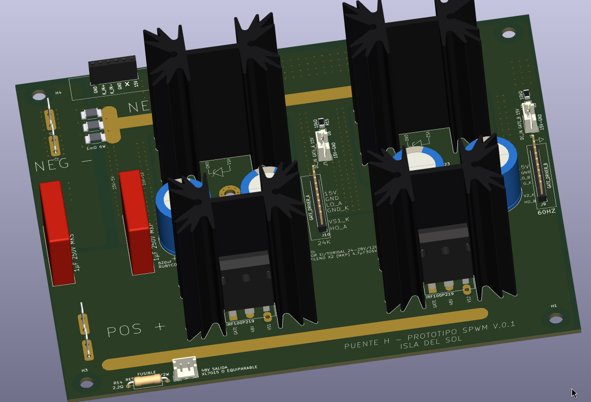
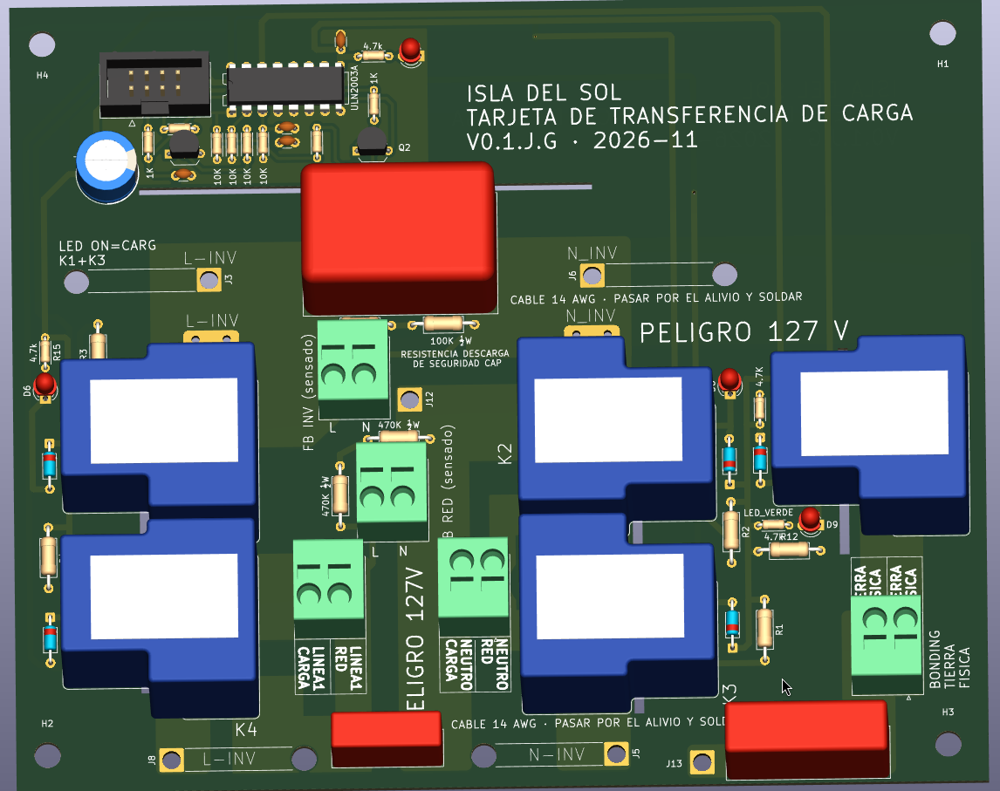

# Isla del Sol — Puente H SPWM 48 V → 127 V / 60 Hz

Inversor / cargador de **puente H con modulación SPWM** para sistemas solares aislados: **48 V de batería → 127 V / 60 Hz, 1000 W**, con modo cargador de **1 kVA**.

El proyecto se publica como **referencia de estudio**: cada decisión de diseño está justificada y documentada (cálculos, hojas de datos, errores encontrados y cómo se corrigieron).

> ⚠️ **Advertencia de seguridad:** este equipo maneja corrientes altas en el lado de 48 V y **127 V AC en la salida, que pueden ser mortales**. Es un prototipo en desarrollo, no un producto certificado. Úsalo bajo tu propio riesgo y solo si tienes experiencia con electrónica de potencia.

---



*Tarjeta de potencia del puente H, prototipo de trinchera V0.1 (render 3D de KiCad). Detalles en [`hardware/puente_h/`](hardware/puente_h/README.md).*



*Tarjeta de transferencia de carga V0.1 (render 3D de KiCad): red / inversor / cargador con 5 relés y unión N–PE automática. Detalles en [`hardware/transferencia_reles/`](hardware/transferencia_reles/README.md).*

## Características principales

| Parámetro | Valor |
| --- | --- |
| Entrada | Batería de 48 V |
| Salida | 127 V / 60 Hz, 1000 W (transformador compatible 24–28 V / 120 V) |
| Modo inversor | Modulación híbrida: rama A a 24 kHz, rama B a 60 Hz |
| Modo cargador | Unipolar, ambas ramas a 24 kHz, 1 kVA |
| MOSFET | Infineon IRF100P219 (100 V), disipador Fischer SK 129 |
| Capacitores de bus | 4 × Rubycon 100ZLH820MEFC18X40 |
| Filtro de salida | ~2 mH (dispersión + inductor de ferrita E65 N87) + 4.7 µF MKP X2 |

---

## Gate drivers universales

Los módulos de gate driver son **intercambiables**: usan los mismos conectores (J1 hacia la tarjeta de control, J5 hacia el puente H) y **el mismo firmware**.

| Módulo | Tecnología | Tiempo muerto | Para qué | Estado |
| --- | --- | --- | --- | --- |
| IRS2186 | Driver de bootstrap | 500 ns | Producción, bajo costo | **Diseñado** (P9 en J1) |
| UCC21520ADWR | Driver aislado | 500 ns | Mejor desempeño | Diseñado |
| **TLP250 + tótem TIP41C/TIP42C** | Optoacoplador DIP + transistores TO-220 | **1 µs** | **Modo trinchera:** zonas sin acceso a componentes modernos; reparable con partes de tienda local | **V.0.1 diseñado** |
| **IR2110 + tótem TIP41C/TIP42C** | Driver de bootstrap legacy (DIP-14) + transistores TO-220 | **1 µs** | **Modo trinchera:** el driver de medio puente más fácil de conseguir o rescatar; reparable con partes de tienda local; de 1 a 5 MOSFET por posición | **V.0.1 diseñado** |

### Identificación automática del tiempo muerto (P9)

Cada módulo **declara** qué tiempo muerto necesita por la terminal **P9** de J1:

| P9 | Tiempo muerto |
| --- | --- |
| A GND | 500 ns (IRS2186, UCC21520) |
| Abierto o en falla | **1 µs** (TLP250, o cualquier duda) |

El modo seguro es el valor por defecto: un módulo legacy, un cable suelto o una soldadura fría nunca llevan a un tiempo muerto insuficiente.

### Diseño poka-yoke

El sistema está pensado para que **el error humano no pueda causar el daño**:

- Llave mecánica en la posición 8 de J5: el módulo solo entra en una posición.
- P9 abierto = 1 µs: falla segura.
- Serigrafía que dice qué hace cada módulo ("OPERACION DT TLP250=1US").
- Un solo firmware para los tres módulos: no hay versión equivocada que cargar.

---

## Contenido del repositorio

```
ISLA_DEL_SOL_PUENTE_H-/
├── README.md                                   ← este archivo
├── LICENSE.md                                  ← licencias (hardware, documentación, firmware)
├── .gitignore
├── docs/
│   ├── vision_isla_del_sol.md
│   ├── identificacion_dt_pin9.md
│   ├── modulacion_spwm.md
│   ├── decisiones_criticas.md                  ← bitácora de decisiones del arquitecto
│   ├── corte_por_hardware.md                   ← corte del PWM: SENSOR_OK, EN_HW, 74HC08
│   ├── referencia_outback_fx.md                ← estudio de referencia: OutBack FX (neutro común, unión N–PE)
│   ├── img/                                    ← diagramas (PNG, PDF y su script)
│   │   ├── README.md                           ← índice de diagramas
│   │   └── outback_fx/                         ← fotos de banco del OutBack FX
│   ├── compensacion_adaptativa_tiempo_muerto.md
│   └── sensado_corriente.md
└── hardware/
    ├── gate-drivers/
    │   ├── irs2186/
    │   │   ├── README.md
    │   │   └── GATE_DRIVER_IRS2186.kicad_pro / .kicad_sch / .kicad_pcb
    │   ├── ir2110-trinchera/
    │   │   ├── README.md
    │   │   └── GATE_DRIVER_IR2110_TOTEM.kicad_pro / .kicad_sch / .kicad_pcb
    │   ├── tlp250-trinchera/
    │   │   ├── README.md
    │   │   └── GATE_TLP_250_TOTEM_TIP.kicad_pro / .kicad_sch / .kicad_pcb
    │   └── ucc21520/
    │       ├── README.md                           ← borrador (faltan los archivos de KiCad)
    │       └── img/
    ├── puente_h/
    │   ├── README.md                               ← tarjeta de potencia
    │   ├── PUENTE_H_INV48V_REV_C_2026-10_GATE_CENTRO.kicad_pro / .kicad_sch / .kicad_pcb
    │   ├── CAPASITORES.kicad_sch                   ← hoja: banco de capacitores
    │   ├── untitled.kicad_sch                      ← hoja: disipadores
    │   ├── Heatsink_Fischer_SK129-STS_50.8mm.step  ← modelo 3D del disipador
    │   ├── Disipador_V8511Y_equiv.step             ← modelo 3D aproximado (versión anterior)
    │   ├── SSA2512_Littelfuse_Kelvin.kicad_mod     ← huella del shunt
    │   ├── SSA2512_Littelfuse.step                 ← modelo 3D del shunt
    │   ├── img/                                    ← vistas del PCB y 3D
    │   └── auditoria/
    │       ├── README.md                           ← auditoría de corriente y temperatura
    │       ├── auditoria_cobre.py · termica_componentes.py · sensibilidad.py
    │       └── resultados/                         ← figuras (.png) y resúmenes (.json)
    ├── control/
    │   ├── README.md                               ← tarjeta de control V0.1: glosario de módulos
    │   ├── ATMEGA328P_SPWM_TARJETA.kicad_pro / .kicad_sch / .kicad_pcb
    │   └── img/                                    ← esquemático, capas y vistas 3D
    ├── transferencia_reles/
    │   ├── README.md                               ← tarjeta de transferencia de carga V0.1
    │   ├── RELAY_TRANSFER_INV_RED.kicad_pro / .kicad_sch / .kicad_pcb
    │   ├── RELAY_TRANSFER_INV_RED.kicad_dru        ← reglas de separación (5 mm / 3 mm) para el DRC
    │   ├── 3d/                                     ← modelo 3D aproximado del relé (STEP) y su script
    │   ├── img/                                    ← esquemático, capas y vistas 3D
    │   └── auditoria/                              ← auditoría térmica a 10 A (script, mapas, informe)
    └── sensores/
        └── sensor-dc-ina-comparador/
            ├── README.md
            ├── SENSOR_DC_INA_COMPARADOR_V2.kicad_pro / .kicad_sch / .kicad_pcb   ← V0.2
            ├── SSA2512_Littelfuse_Kelvin.kicad_mod ← huella del shunt
            ├── SSA2512_Littelfuse.step             ← modelo 3D del shunt
            └── img/                                ← esquemático, PCB y evidencia del proceso
```

Próximamente: `hardware/sensores/` (sensor AC del primario) y `firmware/`.

### Documentos de sistema (`docs/`)

| Documento | Qué explica | Útil para |
| --- | --- | --- |
| [Visión: la Isla del Sol](docs/vision_isla_del_sol.md) | Por qué existe el proyecto: convertir la luz del sol en energía útil contra la cadena diaria del diésel (exploración, extracción, refinación, transporte); acceso a la electricidad como bien común; **la soberanía se construye en las trincheras** (soberanía energética: poder entender, reparar y sustituir cada pieza); hardware abierto y modo trinchera; lo que la solar también cuesta; ideas para trabajar más adelante (borrador) | Entender el propósito antes que los circuitos |
| [Identificación del tiempo muerto por P9](docs/identificacion_dt_pin9.md) | Cómo cada módulo declara su tiempo muerto (P9 a GND = 500 ns, abierto = 1 µs); soporte legacy para trincheras; costo contra beneficio; filosofía poka-yoke; llave mecánica en la posición 8; análisis de fallas; código de referencia para ATmega328 y ESP32; validación en banco | Entender la interfaz universal y escribir el firmware |
| [Modulación SPWM: bipolar, unipolar e híbrida](docs/modulacion_spwm.md) | Por qué el inversor usa modulación **híbrida** (pierna A a 24 kHz, pierna B a 60 Hz) y el cargador **unipolar**; comparación de rizo (4 : 2 : 1), consumo en vacío, pérdidas de conmutación, distorsión por tiempo muerto con módulos de 500 ns y 1 µs, modo común; ciclos de trabajo para el firmware; validación | Entender la estrategia de modulación y escribir el firmware |
| [Decisiones críticas de diseño](docs/decisiones_criticas.md) | Bitácora de decisiones del arquitecto (ADR): **por qué** se eligió cada solución, qué alternativas se descartaron y qué críticas se esperan. Entradas **DC-001 a DC-019**: cascada de alimentación 48 → 15 → 8 → 5 V ("pagamos complejidad para comprar pureza en el ADC"), XL7015 en socket mixto, protección de la entrada de 48 V, MP1584, 7805, sensado AC y de la batería, tablero de diagnóstico, holgura para capacidad médica (DC-009), reparto de tareas entre los dos ATmega con I2C y CAN (DC-010), lectura de P9 (DC-011), alimentación de los Arduino Nano (DC-012), pinza SCT-013 (DC-013), **corte del PWM por hardware** (DC-014), corriente de fuga para la V2 (DC-015), **corto circuito en AC, arranque de motores y arco** (DC-016), presupuesto de CPU/memoria y Nano Every (DC-017), **cargador híbrido y socket 328P/4809** (DC-018) y **transferencia red / inversor / cargador con 5 relés, modos INVERSOR CASA (con unión N–PE) e INVERSOR CARGA (UPS, sin unión)** (DC-019) | Entender lo que no se ve en el cobre antes de "mejorar" algo |
| [Corte del PWM por hardware](docs/corte_por_hardware.md) | Cómo el inversor se apaga en ~2–4 µs sin pedir permiso al firmware: barrera **74HC08 (AND, nunca 74HC00)**, EN_HW (D12 + switch ON/OFF + pull-down), lógica fail-safe **SENSOR_OK** (sensor ausente o cable roto = corte), jumper **J_RIESGO**, doble candado AUX/CRÍTICO; cada componente con su porqué, cálculos, firmware mínimo, serigrafía, prueba en banco y diagnóstico | Antes de soldar, probar o "mejorar" la protección del puente H |
| [Referencia industrial: OutBack FX](docs/referencia_outback_fx.md) | Estudio en banco de la etapa AC de un OutBack FX 120 V: **neutro común**, tierra de chasis pasante, **sin unión N–PE interna** (la decide el instalador, NOM 250-24 / 250-30); filtro C1 5 µF + toroide en el neutro; relé Deltrol 3PDT con clasificación HP; guía de los 4 casos de instalación; comparación con la V1 de 5 relés y sus modos **INVERSOR CASA / INVERSOR CARGA** configurados por menú y selector SW_TN | Entender la unión N–PE de la V1 y preparar la versión de bajo costo |
| [Compensación adaptativa de tiempo muerto](docs/compensacion_adaptativa_tiempo_muerto.md) | Por qué el tiempo muerto genera armónicos impares; compensación con el signo de la corriente; medición del 3er armónico con Goertzel; ajuste automático; hoja de ruta en 5 etapas | Etapa posterior: mejorar la calidad de la onda |
| [Sensado de corriente DC y AC](docs/sensado_corriente.md) | Por qué hacen falta dos sensores (bus DC y primario AC); protección por hardware; INA240 en el primario; protección del transformador contra saturación; muestreo sincronizado; calibración | Etapa posterior: base para el control avanzado |

### Módulos gate driver (`hardware/gate-drivers/`)

Todos son **gate drivers de medio puente H** (una rama: MOSFET alto + MOSFET bajo). El puente completo usa dos módulos iguales, uno por rama.

| Módulo | Documento | Archivos KiCad | Qué incluye |
| --- | --- | --- | --- |
| **IRS2186** | [README](hardware/gate-drivers/irs2186/README.md) | ✓ Esquemático, PCB y proyecto | Interfaz con P9 a GND; tierras compartidas (lógica = potencia), unión única GND_K–GND con *net tie* y cómo controlar el lazo de tierra; bootstrap con R antes del diodo y referencias; cálculo de los 500 ns; **alcance por cantidad de MOSFET** (1 IRF100P219 o hasta 2 IRF540N); opciones con tótem; lista de materiales; validación |
| **TLP250 + tótem TIP41C/TIP42C** (trinchera) | [README](hardware/gate-drivers/tlp250-trinchera/README.md) | ✓ Esquemático, PCB y proyecto | Propósito educativo y de supervivencia; entrada aislada; por qué 1 µs; tótem y regla de 250 nC; **evaluación de 9 transistores** (por qué TIP41/42 y no BD, Darlington, IRF540 o BC); layout; BOM; ensamble con RTV neutro; validación en 10 pasos; **registro de errores corregidos durante el diseño** |
| **UCC21520ADWR** | [README](hardware/gate-drivers/ucc21520/README.md) (borrador) | Pendiente de subir | Driver aislado de dos canales (4 A / 6 A), tiempo muerto programable por hardware, protección contra entradas encimadas, bootstrap; P9 a GND (500 ns). **Pendiente: R3 a 50 kΩ** para garantizar 500 ns en hardware |
| **IR2110 + tótem TIP41C/TIP42C** (trinchera) | [README](hardware/gate-drivers/ir2110-trinchera/README.md) | ✓ Esquemático, PCB y proyecto | VSS y COM separados con J5-6 a GND lógico; VDD de 5 V con 78L05; SD a VSS; tótem por canal con su desacoplo; zener en VB–VS1 y en VCC; P9 abierto (1 µs); **alcance de 1 a 5 MOSFET** y refuerzo del bootstrap; **registro de 8 errores corregidos**; BOM; validación |


### Tarjeta de potencia (`hardware/puente_h/`)

| Tarjeta | Documento | Archivos KiCad | Qué incluye |
| --- | --- | --- | --- |
| **Puente H SPWM 48 V** (REV C) | [README](hardware/puente_h/README.md) · [Auditoría](hardware/puente_h/auditoria/README.md) | ✓ Esquemático (3 hojas) y PCB | 4 × IRF100P219 con disipador SK 129; pierna A a 24 kHz y B a 60 Hz; sockets universales J10/J9 con llave; banco Rubycon + cerámicos con plano partido y lazo doblado (~4 nH); shunts con Kelvin; transformador compatible 24–28 V / 120 V; salida protegida al buck (R14 + T1A, buck ≥ 80 V); **cobre de 1 oz como condición de trinchera**, con **auditoría de corriente y temperatura** (MOSFET, Rubycon y cobre) y refuerzo opcional con alambre 12 AWG; ensamble, validación, BOM y pendientes |

### Tarjeta de control (`hardware/control/`)

| Tarjeta | Documento | Archivos KiCad | Qué incluye |
| --- | --- | --- | --- |
| **[Tarjeta de control SPWM V0.1](hardware/control/README.md)** | [Proyecto de la tarjeta (README)](hardware/control/README.md) | ✓ Esquemático (A2, por bloques) y PCB (esquemático = PCB verificado pin por pin, DRC sin errores) | Dos ATmega328P (Arduino Nano) en zócalo: **CRÍTICO** (SPWM, sensado AC/DC, corriente con SCT-013, batería, temperatura, P9, I_LIM, relés) y **AUX** (CAN/BMS, LCD 16×2 con 4 botones, ventilador, buzzer, monitor del riel de 15 V); cascada 48 → 15 → 8 → 5 V con tablero de LEDs y test points; **corte del PWM por hardware** (74HC08, SENSOR_OK, AUX_KILL); **caída automática a la red**; **glosario de los 22 módulos con la justificación de cada componente**, ensamble y pendientes |

### Tarjeta de transferencia de carga (`hardware/transferencia_reles/`)

| Tarjeta | Documento | Archivos KiCad | Qué incluye |
| --- | --- | --- | --- |
| **[Transferencia de carga V0.1](hardware/transferencia_reles/README.md)** | [Proyecto de la tarjeta (README)](hardware/transferencia_reles/README.md) · [Auditoría térmica](hardware/transferencia_reles/auditoria/README.md) | ✓ Esquemático y PCB (esquemático = PCB verificado pin por pin) | 5 relés SPDT de 30 A (fase y neutro): **red / inversor / cargador** sin que una falla de un relé ponga las dos fuentes en paralelo; **falla segura a la red**; candados por hardware Q1 (inversor bloquea cargador) y Q2 (unión N–PE solo con inversor); **unión N–PE automática según el modo del SETUP** (CASA / UPS); filtro C_F, CX/CY de la red y resistencias de descarga; **separaciones de 5 mm / 3 mm verificadas** y ranuras de aislamiento; **auditoría térmica a 10 A** (cobre de 1 oz suficiente; relés de 15 V sin resistencia en serie); ensamble, pruebas con multímetro y BOM |

### Módulos de sensado (`hardware/sensores/`)

| Módulo | Documento | Archivos KiCad | Qué incluye |
| --- | --- | --- | --- |
| **SENSOR_DC_INA_COMPARADOR** **V0.2** | [README](hardware/sensores/sensor-dc-ina-comparador/README.md) | ✓ Esquemático y PCB V0.2 (ERC/DRC sin errores), THT para la trinchera | Medición bidireccional del bus DC con INA240A1 (I_OUT 0–3.3 V, compatible con ATmega, STM32 y ESP32). **Dos ventanas por hardware** con LM393: **disparo duro** (U3, ±105 A) y **límite de corriente** (U4, ±75 A, salida **I_LIM**). Salida **SENSOR_OK fail-safe** (Q1 BC547: 0 V = sensor bien; sin módulo, sin 15 V o con el cable roto = corte). 3 shunts Littelfuse SSA2512 de 1 mΩ (0.333 mΩ) con sensado Kelvin. Incluye cómo se llegó a la V0.2, tabla de seguridad con las fallas de una sola pieza, evidencia del proceso, BOM y validación en banco |


### Por dónde empezar a estudiar

1. **Este README:** visión general del inversor y de la interfaz universal.
2. **[Identificación por P9](docs/identificacion_dt_pin9.md):** el "contrato" que cumplen todos los módulos.
3. **[Modulación SPWM](docs/modulacion_spwm.md):** por qué híbrida en el inversor y unipolar en el cargador, y por qué eso hace viables los módulos de 1 µs.
4. **[Módulo IRS2186](hardware/gate-drivers/irs2186/README.md):** el driver de bootstrap clásico, la base para entender los demás.
5. **[Módulo TLP250](hardware/gate-drivers/tlp250-trinchera/README.md):** cómo resolver lo mismo con partes de tienda local, y los errores típicos al diseñar un tótem.
6. **[Módulo IR2110](hardware/gate-drivers/ir2110-trinchera/README.md):** el driver legacy clásico con tierras separadas y tótem para muchos MOSFET.
7. **[Tarjeta del puente H](hardware/puente_h/README.md)** y su **[auditoría](hardware/puente_h/auditoria/README.md):** cómo se juntan los módulos, el banco de capacitores, el layout de potencia y cómo comprobar antes de fabricar que el cobre y los componentes aguantan.
8. **[Tarjeta de control](hardware/control/README.md) (V0.1):** qué hace cada módulo y cada resistencia de la tarjeta que decide; el mejor punto de entrada para quien la arma o la repara.
9. **[Tarjeta de transferencia de carga](hardware/transferencia_reles/README.md) (V0.1):** cómo la casa pasa entre la red y el inversor sin que nunca tenga las dos fuentes, cómo se conecta el cargador y cuándo se une el neutro a tierra.
10. **[Sensor DC con comparador](hardware/sensores/sensor-dc-ina-comparador/README.md) (V0.2):** cómo medir la corriente del bus, limitarla para que arranquen los motores y cortar las compuertas por hardware antes que el fusible, con la salida fail-safe SENSOR_OK.
11. **[Sensado de corriente](docs/sensado_corriente.md)** y **[compensación de tiempo muerto](docs/compensacion_adaptativa_tiempo_muerto.md):** los siguientes pasos, cuando el hardware ya esté validado.

## Herramientas

- **KiCad** (esquemáticos y PCB).
- Firmware: **ATmega328P a 5 V** (ecosistema Arduino) para la misión actual; la interfaz J1 de los gate drivers es **lógica de 5 V**. STM32 o ESP32 (3.3 V) en etapas posteriores, cambiando la compuerta de corte por 74HCT08.

## Estado

| Etapa | Estado |
| --- | --- |
| Tarjeta del puente H (REV C) | **Lista para fabricar** (cobre 1 oz, auditada); pendiente validar en banco |
| Módulo UCC21520 | Diseñado, con P9 a GND en J4; pendiente cambiar R3 a 50 kΩ y subir los archivos de KiCad |
| Módulo TLP250 de trinchera | V.0.1 diseñado; pendiente fabricar y validar |
| Módulo IRS2186 | Diseñado con P9 en J1; pendiente fabricar y validar |
| Módulo IR2110 + tótem TIP41C/TIP42C (trinchera) | V.0.1 diseñado (DRC sin errores); pendiente fabricar y validar |
| Módulo SENSOR_DC_INA_COMPARADOR | **V0.2** (2026-11-08): SENSOR_OK fail-safe, límite ±75 A (U4) e I_LIM; ERC/DRC sin errores. Pendiente: fabricar y validar en banco |
| [Tarjeta de transferencia de carga](hardware/transferencia_reles/README.md) (5 relés, DC-019) | **V0.1** (2026-11-11): esquemático y PCB terminados, separaciones de 5 mm / 3 mm verificadas, auditoría térmica a 10 A. Pendiente: comparar los pines del relé de 15 V con la huella, fabricar y validar en banco |
| [Tarjeta de control SPWM](hardware/control/README.md) | **V0.1** (2026-11-11): esquemático y PCB terminados, DRC sin errores, glosario de módulos. Pendiente: prueba de banco de la caída automática, firmware y validación |
| Firmware | Pendiente |
| Validación en banco | Pendiente |

## Misión actual: SPWM con cargador básico de trinchera

Primero gatear, después caminar. La etapa actual busca un equipo **básico pero completo y seguro**:

| Dentro del alcance | Fuera del alcance (integración avanzada, después) |
| --- | --- |
| Inversor SPWM híbrido a 24 kHz, tiempo muerto fijo según P9 | Sensor AC con INA240 en el primario |
| Regulación lenta del voltaje RMS con el feedback 120 → 12 V | Compensación de tiempo muerto |
| Cargador básico sincronizado con la red, CC/CV con límite de corriente (boost: el pico del primario, ~43 V, está por debajo del voltaje de carga) | Lazo resonante de voltaje y corriente |
| **Protección de sobrecorriente por hardware** (shunt DC + comparador), batería baja/alta, sobretemperatura, arranque suave | Formación de red con AC coupling y control por frecuencia |
| Gate drivers IRS2186, TLP250 e IR2110 | Migración a STM32G4 o ESP32 (la misión básica se hace con ATmega328P a 5 V) |

## Licencia

- **Hardware** (archivos de KiCad, Gerbers): CERN-OHL-S v2
- **Documentación**: CC BY-SA 4.0
- **Firmware**: MIT

Ver [`LICENSE.md`](LICENSE.md).

Las hojas de datos de los fabricantes no se incluyen en el repositorio por derechos de autor; los documentos citan la fuente de cada dato.
