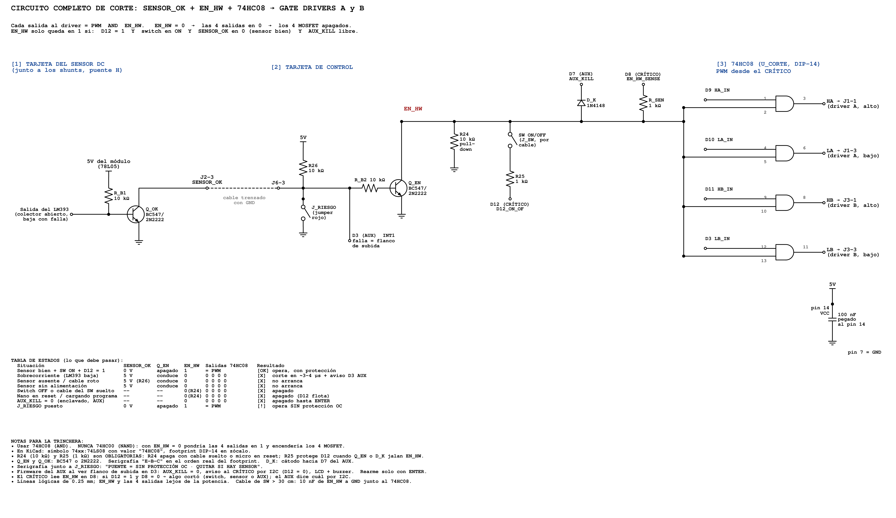

# Corte del PWM por hardware: SENSOR_OK, EN_HW y 74HC08

**Proyecto:** Isla del Sol — Puente H SPWM (inversor 48 V → 127 V / 60 Hz, 1000 W; modo cargador 1 kVA)
**Tarjeta:** control (dos ATmega328P en Arduino Nano: CRÍTICO y AUX) + tarjeta del sensor DC (junto a los shunts del puente H)
**Bloque del esquemático:** `COMPUERTAS LOGICAS AND`
**Estado:** esquemático validado (2026-11-08). **Tiempos y corrientes calculados, todavía no medidos en banco.**
**Decisión asociada:** [DC-014](decisiones_criticas.md#dc-014-corte-del-pwm-por-hardware-con-lógica-fail-safe-sensor_ok-y-doble-candado)

> **En resumen: el inversor solo puede conmutar si cuatro condiciones dicen "sí" al mismo tiempo, y cualquiera de ellas lo apaga sin pedirle permiso al firmware. Si algo falta, se suelta o se muere, el resultado es "apagado".**



*Diagrama completo (PNG de alta resolución y PDF vectorial en `docs/img/`). El script que lo genera está en `docs/img/completo_tw.py`.*

---

## Índice

1. [Qué protege y de qué](#1-qué-protege-y-de-qué)
2. [La regla en una línea](#2-la-regla-en-una-línea)
3. [Diagrama en texto](#3-diagrama-en-texto)
4. [Lista de componentes: qué hace cada uno y por qué ese valor](#4-lista-de-componentes-qué-hace-cada-uno-y-por-qué-ese-valor)
5. [Tabla de estados](#5-tabla-de-estados)
6. [Cálculos: niveles, corrientes y tiempos](#6-cálculos-niveles-corrientes-y-tiempos)
7. [Por qué así: decisiones y alternativas descartadas](#7-por-qué-así-decisiones-y-alternativas-descartadas)
8. [El candado: por qué el corte rápido no basta](#8-el-candado-por-qué-el-corte-rápido-no-basta)
9. [Firmware mínimo obligatorio](#9-firmware-mínimo-obligatorio)
10. [Tierra compartida entre tarjetas](#10-tierra-compartida-entre-tarjetas)
11. [Reglas de PCB y serigrafía](#11-reglas-de-pcb-y-serigrafía)
12. [Partes de KiCad](#12-partes-de-kicad)
13. [Prueba en banco, paso a paso](#13-prueba-en-banco-paso-a-paso)
14. [Diagnóstico de fallas](#14-diagnóstico-de-fallas)
15. [Límites conocidos y preguntas abiertas](#15-límites-conocidos-y-preguntas-abiertas)
16. [Referencias](#16-referencias)

---

## 1. Qué protege y de qué

El puente H tiene cuatro MOSFET que conmutan 48 V con corrientes de decenas de amperes. Una sobrecorriente (corto en la salida, falla del transformador, conducción cruzada) destruye un MOSFET en **microsegundos**. El firmware no es lo bastante rápido ni lo bastante confiable para ser la única defensa:

| Amenaza | Por qué el firmware solo no alcanza |
| --- | --- |
| Sobrecorriente | Una lectura por ADC + decisión tarda de decenas a cientos de µs. El MOSFET ya se dañó. |
| Micro en reset o cargando programa | Los pines quedan flotando: los drivers podrían recibir cualquier nivel. |
| Micro colgado (bucle infinito, I2C trabado) | El PWM por timer **sigue corriendo** aunque el programa esté muerto. |
| Sensor ausente o cable roto | Si la protección espera una señal de "falla", **un sensor que no está nunca la envía**. |
| Error humano (alguien quita el sensor "para probar") | Sin una barrera física, el equipo opera sin protección y nadie lo sabe. |

Este bloque resuelve las cinco con piezas de menos de un dólar que se consiguen en cualquier tienda de electrónica.

---

## 2. La regla en una línea

```
SALIDA_AL_DRIVER  =  PWM   AND   EN_HW

EN_HW = 1  solo si:   D12 = 1          (el CRÍTICO autoriza)
                 Y    SW ON/OFF = ON   (el operador autoriza, cable conectado)
                 Y    SENSOR_OK = 0    (el sensor está presente, alimentado y sin falla)
                 Y    AUX_KILL = 1     (el AUX no tiene un apagado enclavado)
```

**Cualquiera** de las cuatro condiciones que falle pone EN_HW en 0, y entonces **las cuatro salidas del 74HC08 quedan en 0 aunque el PWM siga corriendo**. Ningún MOSFET puede encender.

La palabra clave es **AND**: el chip es una compuerta "Y". Es una barrera, no un interruptor que alguien tenga que acordarse de abrir.

---

## 3. Diagrama en texto

Para quien lo lea en terminal o lo imprima sin la imagen:

```
 [1] TARJETA DEL SENSOR DC (junto a los shunts)

      5V (78L05 del módulo)
       │
      R_B1 10k
       │                 colector
 LM393 ┴──── base  Q_OK ──────────────► J2-3  SENSOR_OK ═══ cable trenzado con GND ═══►  J6-3
 (colector         BC547   emisor ── GND
  abierto)

 [2] TARJETA DE CONTROL

                 5V
                  │
                 R26 10k
                  │
 J6-3 ────────────●──────────────●──── R16 10k ──── base  Q1 (Q_EN) BC547
 SENSOR_OK        │              │                         colector ──► EN_HW
                J_RIESGO         └──► D3 del AUX (INT1)    emisor ───► GND
                (jumper rojo)          AUX_D3_SENSOR_OK
                  │
                 GND

 Red EN_HW (todo conectado al mismo nodo):

   colector de Q1 ────────┐
   D12 CRÍTICO ── R25 1k ── SW on/off ──┤
   GND ── R24 10k ────────┤
   D7 AUX (AUX_KILL) ──|◄── D9 1N4148 ──┤      (cátodo hacia D7: el AUX solo puede apagar)
   D8 CRÍTICO ── R38 1k ──┤      (EN_HW_SENSE: el CRÍTICO ve si le quitaron el permiso)
                          │
                          └──► EN_HW ──► pines 2, 5, 10 y 13 del 74HC08

 [3] 74HC08 (U4, DIP-14 en zócalo)

   D9  HA_IN → pin 1  ─┐
   EN_HW     → pin 2  ─┴ AND ─ pin 3  → HA → J1-1 (driver A, lado alto)
   D10 LA_IN → pin 4  ─┐
   EN_HW     → pin 5  ─┴ AND ─ pin 6  → LA → J1-3 (driver A, lado bajo)
   D11 HB_IN → pin 9  ─┐
   EN_HW     → pin 10 ─┴ AND ─ pin 8  → HB → J3-1 (driver B, lado alto)
   D3  LB_IN → pin 12 ─┐
   EN_HW     → pin 13 ─┴ AND ─ pin 11 → LB → J3-3 (driver B, lado bajo)

   pin 14 = 5V con C12 100 nF pegado · pin 7 = GND
```

> **Ojo: hay dos "D3".** El **D3 del CRÍTICO** es la entrada PWM **LB_IN**. El **D3 del AUX** es **SENSOR_OK** (INT1). Son pines de chips diferentes. Por eso las redes llevan prefijo: `AUX_D3_SENSOR_OK`, `CRIT_D8_EN_SENSE`.

---

## 4. Lista de componentes: qué hace cada uno y por qué ese valor

Las referencias corresponden al esquemático de KiCad de la tarjeta de control (bloque `COMPUERTAS LOGICAS AND`). Las de la tarjeta del sensor (Q_OK, R_B1) se asignan cuando se dibuje esa tarjeta.

### Tarjeta del sensor DC

| Ref. | Valor | Función | Por qué ese valor | Si falta o falla |
| --- | --- | --- | --- | --- |
| LM393 | comparador, colector abierto | Compara la corriente del shunt contra el umbral. Salida **suelta** = sin falla; **a 0 V** = sobrecorriente | Respuesta de ~1.3 µs; salida de colector abierto, fácil de combinar | Sin LM393: Q_OK sin base → SENSOR_OK alto → **corte** (falla segura) |
| R_B1 | 10 kΩ, ¼ W | Pull-up de la salida del LM393 y corriente de base de Q_OK | (5 − 0.7) V / 10 kΩ ≈ **0.43 mA** de base: satura a Q_OK de sobra | Abierta: Q_OK no conduce → **corte** (falla segura) |
| Q_OK | BC547 o 2N2222 | **Dice "estoy bien"** jalando la línea SENSOR_OK a 0 V | Solo hunde los 0.5 mA de R26; cualquier NPN de señal sirve | Quemado abierto: **corte** (falla segura). En corto C-E: ver sección 15 |
| 78L05 | 5 V, 100 mA | Alimenta R_B1 desde el 15 V del módulo del sensor | Si el sensor pierde su 15 V, R_B1 se queda sin voltaje → Q_OK se apaga → **corte** | — |

### Tarjeta de control

| Ref. | Valor | Función | Por qué ese valor | Si falta o falla |
| --- | --- | --- | --- | --- |
| J6 | Phoenix 5 pines | Entrada desde el sensor: 1 I_OUT, 2 GND, **3 SENSOR_OK**, 4 GND, 5 NC | GND a ambos lados de las señales: cada señal viaja con su retorno | Suelto: R26 sube la línea → **corte** |
| R26 | 10 kΩ a 5V | Pull-up de SENSOR_OK. **Siempre empuja a Q1 a encender**; solo Q_OK se lo impide | 0.5 mA: suficiente para dar base a Q1 y fácil de hundir por Q_OK | Abierta: Q1 sin base, no corta por sensor ausente. **Es la pieza más crítica del bloque**: revisarla en banco (prueba 1) |
| J_RIESGO | jumper 2 pines, **rojo** | Riesgo autorizado: pone SENSOR_OK a GND a la fuerza → **opera sin protección de sobrecorriente** | Físico, visible, no depende del firmware | Puesto por error: el equipo opera **sin protección**. Por eso es rojo y lleva serigrafía |
| R16 | 10 kΩ | Resistencia de base de Q1 (Q_EN) | Con R26: (5 − 0.7) / 20 kΩ ≈ **0.21 mA** de base → Q1 hunde 5 mA con ganancia forzada de ~24 | Abierta: Q1 no corta por sensor |
| Q1 (Q_EN) | BC547 (TO-92, 1 = C, 2 = B, 3 = E) | **Ejecuta el corte**: cuando SENSOR_OK sube, jala EN_HW a ~0.1 V | hFE mínimo de 110 contra ~24 necesario: satura con margen de 4× | Abierto: no corta por sensor. Por eso existe la prueba 4 en banco |
| R24 | 10 kΩ a GND | **Pull-down de EN_HW.** Con el Nano en reset, el switch abierto o su cable suelto, EN_HW = 0 | Débil frente a D12 (cae solo ~0.45 V por R25); fuerte frente a fugas y ruido | **Obligatoria.** Sin ella, EN_HW flota en reset y con el cable del switch suelto |
| SW on/off | interruptor de panel, por cable | El operador autoriza. **En serie** con D12 | En serie (no a GND): si el cable se suelta, EN_HW cae por R24 → apagado. "Si se suelta, ya no prende" | — |
| R25 | 1 kΩ | Limita la corriente de D12 cuando Q1 o D9 jalan EN_HW a 0 | 5 V / 1 kΩ = 5 mA: muy por debajo de los 40 mA máximos del pin | **Obligatoria.** Sin ella, D12 en 1 contra Q1 saturado sería un corto del pin |
| D9 (D_K) | 1N4148, **cátodo hacia AUX_KILL** | Candado del AUX: si D7 del AUX = 0, jala EN_HW a ~0.8 V | Diodo: el AUX puede **apagar**, pero nunca **encender** (D7 en 1 no conduce) | Al revés: el AUX nunca podría enclavar el apagado |
| R38 (R_SEN) | 1 kΩ | Lleva EN_HW a D8 del CRÍTICO para que sepa si alguien le quitó el permiso | Protege D8 si por error del firmware queda como salida | — |
| U4 | **74HC08** (cuatro AND, DIP-14 en zócalo) | La barrera: cada salida = PWM AND EN_HW | Familia HC a 5 V: niveles CMOS, salida fuerte en alto y en bajo, ~10 ns | **Si se pone un 74HC00 (NAND) se encienden los 4 MOSFET.** Ver sección 7 |
| C12 | 100 nF cerámico | Desacople del 74HC08 | Pegado al pin 14: los flancos del PWM piden corriente en ns | Sin él: rebotes en las salidas, flancos falsos en los drivers |

---

## 5. Tabla de estados

Lo que **debe** pasar. Si en banco algo no coincide, hay una falla (ver sección 14).

| Situación | SENSOR_OK | Q1 (Q_EN) | EN_HW | Salidas del 74HC08 | Resultado |
| --- | --- | --- | --- | --- | --- |
| Sensor bien + SW en ON + D12 = 1 | 0 V | apagado | ~4.55 V | = PWM | **Opera, con protección** |
| Sobrecorriente (LM393 a 0 V) | 5 V | conduce | ~0.1 V | 0 0 0 0 | **Corte en ~2–4 µs** + aviso a D3 del AUX |
| Sensor ausente o cable roto | 5 V (por R26) | conduce | ~0.1 V | 0 0 0 0 | **No arranca** |
| Sensor sin alimentación (sin 15 V) | 5 V | conduce | ~0.1 V | 0 0 0 0 | **No arranca** |
| SW en OFF o su cable suelto | — | — | 0 V (R24) | 0 0 0 0 | Apagado |
| Nano CRÍTICO en reset o programándose | — | — | 0 V (R24) | 0 0 0 0 | Apagado (D12 flota) |
| AUX_KILL = 0 (apagado enclavado) | — | — | ~0.8 V | 0 0 0 0 | Apagado hasta ENTER |
| **J_RIESGO puesto** (con o sin sensor) | 0 V | apagado | ~4.55 V | = PWM | **Opera SIN protección de sobrecorriente** |

---

## 6. Cálculos: niveles, corrientes y tiempos

### 6.1 Niveles lógicos en EN_HW

El 74HC08 a 4.5 V lee **1** con 3.15 V o más (V<sub>IH</sub>) y **0** con 1.35 V o menos (V<sub>IL</sub>) [1].

| Caso | Cálculo | EN_HW | ¿Cumple? |
| --- | --- | --- | --- |
| D12 = 1, nadie jala | 5 V × R24 / (R25 + R24) = 5 × 10k / 11k | **4.55 V** | Sí: 1.4 V sobre V<sub>IH</sub> |
| Q1 saturado | V<sub>CE(sat)</sub> del BC547 | **~0.1–0.2 V** | Sí: 1.2 V bajo V<sub>IL</sub> |
| D9 conduciendo (AUX_KILL = 0) | V<sub>F</sub> 1N4148 a ~4 mA + V<sub>OL</sub> del pin D7 | **~0.7 + 0.1 ≈ 0.8 V** | Sí: 0.5 V bajo V<sub>IL</sub> (el margen más angosto del bloque) |
| D12 flotando (reset) | R24 a GND | **0 V** | Sí |

### 6.2 Corrientes

| Punto | Cálculo | Valor | Límite |
| --- | --- | --- | --- |
| Base de Q_OK | (5 − 0.7) V / R_B1 10 kΩ | 0.43 mA | — |
| Colector de Q_OK | 5 V / R26 10 kΩ | 0.5 mA | Ganancia forzada ≈ 1.2: saturación profunda |
| Base de Q1 (Q_EN) | (5 − 0.7) V / (R26 + R16) = 4.3 / 20 kΩ | 0.21 mA | — |
| Colector de Q1 | (5 − 0.1) V / R25 1 kΩ (+ R38 si D8 fuera salida) | ~5 mA | Ganancia forzada ≈ 24 contra hFE mín. 110 [3] |
| Pin D12 del CRÍTICO con Q1 o D9 jalando | 5 V / R25 | ~5 mA | 40 mA máximo absoluto por pin [5] |
| Pin D7 del AUX hundiendo por D9 | (5 − 0.7) V / R25 | ~4.3 mA | 40 mA máximo absoluto por pin [5] |
| Entradas del 74HC08 | fuga | < 1 µA | No cargan a nadie |

### 6.3 Tiempo de corte (estimado, **por medir**)

| Paso | Qué pasa | Tiempo típico | Fuente |
| --- | --- | --- | --- |
| 1 | El LM393 detecta la sobrecorriente y baja su salida | ~1.3 µs | [2] |
| 2 | Q_OK sale de saturación (tiempo de almacenamiento) | ~0.2–1 µs | [3] (depende de la sobresaturación) |
| 3 | R26 sube la línea (con la capacitancia del cable) y Q1 entra | ~0.2–0.5 µs | Cálculo: τ = 10 kΩ × ~50 pF ≈ 0.5 µs |
| 4 | EN_HW cae; el 74HC08 pone sus salidas en 0 | ~0.01–0.02 µs | [1] |
| 5 | El TLP250 apaga la compuerta del MOSFET | ≤ 0.5 µs | [6] |
| | **Total estimado** | **~2–4 µs** | Objetivo del proyecto: < 2–3 µs desde el comparador ([sensado de corriente](sensado_corriente.md)) |

Para comparar: un firmware que lee el ADC y decide tarda de **10 a 100 µs o más**.

---

## 7. Por qué así: decisiones y alternativas descartadas

### 7.1 74HC08 (AND) y no 74HC00 (NAND)

| Chip | Con EN_HW = 0 | Veredicto |
| --- | --- | --- |
| **74HC08 (AND)** | Las 4 salidas en **0** → MOSFET apagados | **Elegido** |
| 74HC00 (NAND) | Las 4 salidas en **1** → **los 4 MOSFET encendidos: corto directo de la batería de 48 V** | **Prohibido** |
| 74LS08 | Salida en alto débil (TTL) para el LED del optoacoplador del TLP250 | Descartado |
| CD4081 (CMOS 4000) | Salida débil a 5 V y lenta (~100 ns) | Descartado |
| 74HCT08 | Funciona, pero solo es necesario si el micro fuera de 3.3 V | Alternativa válida |
| 74LVC2G08 (SSOP-8) | Dos AND por chip; útil si falta espacio (dos chips, uno por pierna) | Alternativa válida |

**Nota de KiCad:** la librería no trae el símbolo `74HC08`. Se usa `74xx:74LS08` **con el valor cambiado a "74HC08"**. El pinout es idéntico; lo que importa es el chip que se suelda.

### 7.2 Lógica invertida (fail-safe) y no una señal de "FAULT"

La primera versión usaba una línea **FAULT activa en 0**: el sensor la bajaba cuando había sobrecorriente, y un diodo jalaba EN_HW. El problema:

| Situación | Con FAULT activo en 0 | Con SENSOR_OK (lógica invertida) |
| --- | --- | --- |
| Sobrecorriente | Corta | Corta |
| **Sensor ausente** | El pull-up deja la línea en alto = "sin falla" → **opera sin protección** | La línea sube = **corte** |
| **Cable roto** | Igual: **opera sin protección** | **Corte** |
| **Sensor sin alimentación** | Igual: **opera sin protección** | **Corte** |

Con una señal de "falla", **el silencio significa "todo bien"**, y un sensor que no está siempre guarda silencio. Con lógica invertida, **el sensor tiene que estar diciendo "estoy bien" todo el tiempo** para que el inversor opere. Es el mismo principio del "hombre muerto" de los trenes: si el operador suelta la palanca, el tren frena.

**Por eso Q_OK y Q1:** Q_OK convierte la salida del LM393 (suelta = bien) en "jalo la línea a 0 = estoy aquí y estoy bien", y Q1 convierte "nadie jala la línea" en "corto EN_HW".

### 7.3 Hardware y no firmware para la presencia del sensor

Se pidió expresamente: **"no quiero usar firmware, quiero que sea físico"**. Razones:
- Un firmware que revisa si el sensor existe puede tener un error, puede desactivarse "para probar" y olvidarse, o puede no correr si el micro está colgado.
- El hardware no se olvida: Q1 conduce mientras nadie le robe la corriente de base.

El firmware **sí** participa, pero solo para **avisar y enclavar** (secciones 8 y 9), nunca para **permitir** la operación sin sensor.

### 7.4 J_RIESGO: riesgo autorizado, físico y visible

En una trinchera puede pasar que el módulo del sensor (INA, LM393) no llegue o se dañe, y que el equipo se necesite de todos modos. Se decidió:
- **Arrancar siempre con sensor** por defecto.
- Permitir operar sin él **solo si el usuario pone un jumper físico**: J_RIESGO.
- El jumper es **rojo** y la serigrafía dice lo que hace. **Quien lo pone acepta el riesgo, sabiendo cuál es.**

Advertencia: con el puente puesto **también se ignora la sobrecorriente**, aunque el sensor esté conectado. Es una decisión de todo o nada a propósito: un modo "medio protegido" daría una falsa sensación de seguridad.

### 7.5 Switch ON/OFF en serie con D12, no a tierra

| Opción | Cable del switch suelto |
| --- | --- |
| Switch que pone EN_HW a GND (apagar = cerrar) | Cable suelto = switch abierto = **enciende**. Peligroso |
| **Switch en serie entre R25 y EN_HW (encender = cerrar)** | Cable suelto = R24 baja EN_HW = **apagado** |

Regla de trinchera: **"que necesite el cable siempre para encender; si se suelta, ya no prende."**

**El switch NO desconecta la batería.** Solo bloquea el PWM. Para trabajar en la potencia hay que abrir el interruptor de la batería.

### 7.6 Sin pull-downs en las entradas PWM

No hacen falta: con el Nano en reset, R24 deja EN_HW en 0 y las 4 salidas quedan en 0 sin importar lo que haya en las entradas PWM. Además, los módulos de gate driver traen su propio pull-down de entrada. **Nunca se unen las entradas PWM entre sí:** sería conducción cruzada en el puente H.

### 7.7 Por qué el 74HC08 va en zócalo

Es la pieza que protege a los MOSFET y la que primero se sospecha cuando algo falla. En zócalo se cambia sin soldar y se puede probar fuera de la tarjeta.

---

## 8. El candado: por qué el corte rápido no basta

**El corte de Q1 NO es enclavado.** Si la corriente baja, el LM393 suelta, Q_OK vuelve a conducir, Q1 se apaga y **el PWM regresa solo**. Sobre una falla que persiste (un corto en la salida), eso es un ciclo de apagar y encender a la velocidad del comparador, y termina quemando el puente.

Por eso hay **tres capas**:

| Capa | Quién | Qué hace | Tiempo |
| --- | --- | --- | --- |
| 1. Corte rápido | Q1 (hardware) | Baja EN_HW en cuanto SENSOR_OK sube | ~2–4 µs |
| 2. Candado del AUX | AUX: D3 (INT1) → D7 = 0 → D9 | Mantiene EN_HW en 0 aunque el sensor ya esté bien | ~µs después del flanco |
| 3. Candado del CRÍTICO | CRÍTICO: D8 (PCINT0) → D12 = 0 | Baja su propio permiso. Cubre el caso de que el AUX se cuelgue o se reinicie | ~µs después de que cae EN_HW |

**Doble candado:** si el AUX se reinicia, D7 flota, D9 deja de conducir y el candado 2 se suelta. Pero el CRÍTICO ya bajó D12 (candado 3) y además ve que se perdió el latido I2C del AUX. No vuelve a arrancar solo.

**Rearme:** solo con **ENTER** en el LCD, o con un reintento temporizado y **límite de intentos**, y solo si D3 del AUX lee 0 (sensor bien) **antes** de soltar el candado.

---

## 9. Firmware mínimo obligatorio

### 9.1 AUX: vigilancia permanente de SENSOR_OK

D3 del AUX va en **INT1 por flanco de subida**: el ATmega328P lo vigila por hardware aunque el programa esté ocupado con el LCD, el CAN o el I2C.

```cpp
volatile bool falla_oc = false;

void ISR_falla() {                  // INT1, flanco de subida en D3 (AUX_D3_SENSOR_OK)
  PORTD &= ~_BV(PD7);               // AUX_KILL = 0, directo al registro
  falla_oc = true;                  // I2C, LCD y buzzer se atienden en loop()
}

void setup() {
  PORTD |= _BV(PD7);  DDRD |= _BV(PD7);          // D7 en alto: candado libre
  pinMode(3, INPUT);                              // R26 ya es el pull-up: NO usar INPUT_PULLUP
  attachInterrupt(digitalPinToInterrupt(3), ISR_falla, RISING);
  if (digitalRead(3) == HIGH) {                   // ya había falla o no hay sensor al arrancar
    PORTD &= ~_BV(PD7);  falla_oc = true;
  }
  wdt_enable(WDTO_250MS);                         // si el AUX se cuelga, se reinicia
}
```

Reglas:
1. **El flanco no ve un nivel que ya existía.** Por eso se lee el nivel de D3 en `setup()` y antes de cada rearme.
2. **La ISR es corta:** solo D7 y la bandera. Nada de `Serial`, LCD ni I2C dentro.
3. **No bloquear interrupciones** (`cli()`, `noInterrupts()`) en secciones largas.
4. **Al rearmar:** solo si `digitalRead(3) == LOW`; entonces `PORTD |= _BV(PD7)` y avisar al CRÍTICO por I2C.
5. En `loop()`, con `falla_oc`: avisar al CRÍTICO por I2C, LCD "SOBRECORRIENTE" o "SENSOR AUSENTE", buzzer.

### 9.2 CRÍTICO: permiso y segundo candado

D8 del CRÍTICO es **PB0 / PCINT0**: también puede vigilar con interrupción.

```cpp
volatile bool corte_externo = false;

ISR(PCINT0_vect) {
  if (!(PINB & _BV(PB0)) && (PORTB & _BV(PB4))) {   // EN_HW = 0 con D12 = 1
    PORTB &= ~_BV(PB4);                             // D12 = 0: el CRÍTICO también enclava
    corte_externo = true;                           // en loop(): parar timers, preguntar causa al AUX
  }
}

void setup() {
  PORTB &= ~_BV(PB4);  DDRB |= _BV(PB4);            // D12 = 0 desde el primer instante
  DDRB &= ~_BV(PB0);                                // D8 entrada (EN_HW_SENSE)
  PCICR |= _BV(PCIE0);  PCMSK0 |= _BV(PCINT0);
}
```

**Secuencia de arranque:**
1. D12 = 0.
2. Configurar timers, tiempo muerto (leer P9 en A7), salidas PWM en 0.
3. Verificar: latido I2C del AUX, voltaje de batería, el AUX confirma D3 = 0 y candado libre.
4. **D12 = 1.**
5. Leer D8: si sigue en 0, alguien está cortando (switch, sensor o AUX). No arrancar; preguntar al AUX.
6. Arranque suave del SPWM.

**Secuencia de apagado:** primero **D12 = 0** (corta en nanosegundos), después detener los timers.

**Diagnóstico:** si D12 = 1 y D8 = 0, algo de afuera cortó. El AUX dice cuál por I2C (SENSOR_OK en alto → sensor; candado del AUX → AUX; ninguno de los dos → switch en OFF o cable suelto).

---

## 10. Tierra compartida entre tarjetas

Q_OK jala la línea a la tierra **de la tarjeta del sensor**; Q1 la compara contra la tierra **de la tarjeta de control**. Si entre las dos tierras hay más de ~0.4 V (por corriente de potencia que circula por el cable), Q1 puede encender solo y **cortar en falso**, o en el peor caso Q_OK no logra bajar la línea lo suficiente.

Reglas:
- **SENSOR_OK viaja trenzado con su propio GND** (J6-4 o J6-2). Ese GND es **solo de señal**: no carga corriente de potencia.
- La tierra del sensor y la de control se unen **en un solo punto**: el negativo de la batería, junto a los shunts.
- Cable corto (< 50 cm), lejos de los cables de potencia y del transformador.
- Prueba: con el inversor a plena carga, medir entre el GND de J6 y el GND del emisor de Q_OK: debe ser **< 0.1 V**.

---

## 11. Reglas de PCB y serigrafía

### PCB

- Pistas lógicas (PWM, EN_HW, SENSOR_OK, salidas al driver): **0.25 mm** (corriente < 10 mA).
- EN_HW y las 4 salidas del 74HC08: **cortas y lejos de la potencia**.
- **C12 (100 nF) pegado al pin 14** del 74HC08, con su vía a GND lo más cerca posible.
- 74HC08 en **zócalo DIP-14**.
- Si el cable del switch mide más de 30 cm: **10 nF de EN_HW a GND junto al 74HC08** (filtra ruido inducido; retrasa el encendido ~10 µs, no el apagado por Q1).
- Q1 cerca del 74HC08; R26 y J_RIESGO cerca de J6.

### Serigrafía obligatoria

| Lugar | Texto |
| --- | --- |
| Junto a U4 | `74HC08 (AND) — NUNCA 74HC00` |
| Junto a J_RIESGO | `J_RIESGO: PUENTE = SIN PROTECCIÓN OC · QUITAR SI HAY SENSOR` |
| J6, terminal 3 | `SENSOR_OK` (no "FAULT": la lógica cambió) |
| Junto al switch | `ON/OFF PWM — NO DESCONECTA LA BATERÍA` |
| Q1, Q_OK | Orden real de las patas del footprint: `C-B-E` (BC547) o `E-B-C` (2N2222 TO-18) |
| D9 | Marca del cátodo hacia AUX_KILL |

### Nombres de redes (para que nadie cruce los dos D3)

| Red | Va de → a |
| --- | --- |
| `AUX_D3_SENSOR_OK` | J6-3 / R26 / R16 / J_RIESGO → D3 del AUX |
| `CRIT_D8_EN_SENSE` | R38 → D8 del CRÍTICO |
| `D12_ON_OF` | D12 del CRÍTICO → R25 |
| `AUX_KILL` | D7 del AUX → cátodo de D9 |
| `HA_IN`, `LA_IN`, `HB_IN`, `LB_IN` | D9, D10, D11, D3 del CRÍTICO → entradas del 74HC08 |
| `HA`, `LA`, `HB`, `LB` | salidas del 74HC08 → J1-1, J1-3, J3-1, J3-3 |

**Pendiente en el esquemático:** la etiqueta de J6-3 todavía dice `FAULT` y comparte cable con `AUX_D3_SENSOR_OK`. Dejar un solo nombre (el ERC marca dos nombres en una red). Poner marca de no conexión en los pines libres de los dos Nano.

---

## 12. Partes de KiCad

| Pieza | Símbolo | Footprint |
| --- | --- | --- |
| 74HC08 | `74xx:74LS08` con valor `74HC08` (unidades A–D + E de alimentación) | `Package_DIP:DIP-14_W7.62mm_Socket` |
| BC547 (Q1, Q_OK) | `Transistor_BJT:BC547` (1 = C, 2 = B, 3 = E) | `Package_TO_SOT_THT:TO-92_Inline` |
| 2N2222A TO-18 (alternativa) | `Transistor_BJT:2N2219` | `Package_TO_SOT_THT:TO-18-3` (E-B-C) |
| 1N4148 (D9) | `Diode:1N4148` | `Diode_THT:D_DO-35_SOD27_P7.62mm_Horizontal` |
| J_RIESGO | `Connector:Conn_01x02_Pin` o `Jumper:Jumper_2_Open` | `Connector_PinHeader_2.54mm:PinHeader_1x02_P2.54mm_Vertical` |
| Resistencias | `Device:R` | `Resistor_THT:R_Axial_DIN0207_L6.3mm_D2.5mm_P10.16mm_Horizontal` |
| C12 | `Device:C` | `Capacitor_THT:C_Disc_D5.0mm_W2.5mm_P5.00mm` |

---

## 13. Prueba en banco, paso a paso

**Sin la etapa de potencia conectada** (sin batería de 48 V en el puente H). Alimentar la tarjeta de control con su fuente de banco. Instrumentos: multímetro y, para la prueba 9, osciloscopio de dos canales.

| # | Condición | Medir | Valor esperado |
| --- | --- | --- | --- |
| 1 | J6 desconectado, SW en ON, D12 = 1 (firmware de prueba) | EN_HW (colector de Q1) | **< 0.3 V** (corta por sensor ausente). Si da ~4.5 V: R26, R16 o Q1 están mal |
| 2 | Igual que 1 + J_RIESGO puesto | EN_HW | **~4.55 V** |
| 3 | Quitar J_RIESGO; sensor conectado y sin falla | SENSOR_OK (J6-3) / EN_HW | **< 0.3 V** / **~4.55 V** |
| 4 | Simular sobrecorriente: puentear la salida del LM393 a GND | EN_HW / LCD | **< 0.3 V** / aviso en el LCD, buzzer |
| 5 | Quitar el puente de la prueba 4 | EN_HW | **Sigue en ~0.8 V o menos** (candado del AUX). Si regresa a 4.5 V: falla el candado |
| 6 | Rearmar con ENTER | EN_HW | ~4.55 V |
| 7 | SW en OFF; después, desconectar el cable del switch | EN_HW | **0 V** en ambos casos |
| 8 | Presionar el reset del CRÍTICO | Salidas 3, 6, 8, 11 del 74HC08 | **0 V** durante todo el reset |
| 9 | PWM corriendo; repetir la prueba 4 con osciloscopio | Canal 1: base de Q_OK (o salida del LM393). Canal 2: pin 3 del 74HC08 | Del flanco del canal 1 al corte del canal 2: **< 3 µs** |
| 10 | Reiniciar solo el AUX con la tarjeta operando | D12 del CRÍTICO / LCD | El CRÍTICO detecta la pérdida del latido → **D12 = 0** |
| 11 | Desconectar el 15 V del módulo del sensor | EN_HW | **< 0.3 V** |

**Anotar los valores medidos** (sobre todo el tiempo de la prueba 9) y abrir una entrada en la [bitácora de decisiones](decisiones_criticas.md) si algo difiere de lo esperado.

---

## 14. Diagnóstico de fallas

| Síntoma | Causa probable | Cómo confirmarlo |
| --- | --- | --- |
| El inversor no arranca nunca; LCD sin aviso | SW en OFF o su cable suelto; D12 no sube | Medir EN_HW (~0 V) y D12 (debe ser ~5 V) |
| No arranca; LCD "SENSOR AUSENTE" | Cable de J6 suelto, sensor sin 15 V, LM393 o Q_OK dañados | Medir J6-3: si ~5 V, el sensor no está jalando. Medir el 5 V del 78L05 del sensor |
| No arranca; EN_HW ~0.8 V | Candado del AUX activo (D7 = 0) | Medir D7 del AUX. Rearmar con ENTER. Si sigue: revisar el firmware del AUX |
| Corta solo bajo carga, sin sobrecorriente real | Diferencia de tierras entre tarjetas (sección 10) o ruido en SENSOR_OK | Osciloscopio en J6-3 contra GND de control a plena carga |
| Con J_RIESGO puesto tampoco arranca | No es el sensor: switch, D12 o AUX_KILL | Seguir las tres primeras filas |
| Con el sensor desconectado **sí arranca** | **R26 abierta, R16 abierta o Q1 dañado. PELIGRO: no hay protección** | Prueba 1 de la sección 13. **No operar hasta corregir** |
| Los 4 MOSFET encienden juntos / corto al arrancar | **Se soldó un 74HC00 (NAND)** o salidas cruzadas | Leer el chip. Debe decir **HC08** |
| Salidas con rebotes o flancos falsos | Falta C12 o está lejos del pin 14 | Osciloscopio en el pin 14: rizo en los flancos del PWM |

---

## 15. Límites conocidos y preguntas abiertas

Lo que se sabe que se puede discutir. Se deja escrito a propósito:

1. **El candado depende de los micros.** El corte rápido es 100 % hardware, pero el enclavamiento (que el PWM no regrese solo) depende del firmware del AUX y del CRÍTICO. Una alternativa 100 % hardware sería un flip-flop (74HC74) o un latch con dos transistores que solo se libera con un botón. Se descartó por ahora para mantener el bloque simple; con el doble candado y el watchdog, los dos micros tendrían que fallar a la vez.
2. **Q_OK en corto C-E** dejaría la línea siempre en 0 (= "estoy bien") aunque haya sobrecorriente. Es la única falla de una sola pieza que anula la protección sin que se note. Se detecta con la prueba 4 de la sección 13, que debe repetirse en el mantenimiento.
3. **Tiempo de almacenamiento de Q_OK.** Q_OK trabaja en saturación profunda (ganancia forzada ≈ 1.2), lo que alarga su apagado. Si la medición de la prueba 9 sale por encima de 3 µs, se puede acelerar subiendo R_B1 a 22–47 kΩ o poniendo un diodo Schottky (BAT85) de base a colector (clamp de Baker).
4. **Margen de D9:** EN_HW queda en ~0.8 V con el candado del AUX, contra 1.35 V de V<sub>IL</sub>. Funciona, pero es el margen más angosto del bloque. Si se cambia el 1N4148 por un Schottky (BAT85, ~0.4 V), el margen mejora.
5. **El umbral de sobrecorriente del LM393** todavía no está definido; depende de los MOSFET y de la red de compuerta ([sensado de corriente](sensado_corriente.md)).
6. **Todos los tiempos de la sección 6.3 son estimados de hoja de datos.** Se reemplazan por mediciones cuando se haga la prueba 9.

---

## 16. Referencias

1. Texas Instruments, *SN74HC08 Quadruple 2-Input Positive-AND Gates*, hoja de datos: a V<sub>CC</sub> = 4.5 V, V<sub>IH</sub> mín. = 3.15 V, V<sub>IL</sub> máx. = 1.35 V, t<sub>pd</sub> típ. 10 ns / máx. 20 ns (25 °C); salida ±4 mA a 5 V. <https://www.ti.com/lit/ds/symlink/sn74hc08.pdf> (copia consultada: <https://www.digikey.sg/htmldatasheets/production/3797880/0/0/1/sn74hc08nsr.html>). Equivalente: Nexperia, *74HC08; 74HCT08*, <https://assets.nexperia.com/documents/data-sheet/74HC_HCT08.pdf>
2. Texas Instruments, *LM393 Dual Differential Comparator*: salida de colector abierto, tiempo de respuesta típico de 1.3 µs. <https://www.ti.com/lit/ds/symlink/lm393.pdf> (ficha consultada: <https://au.rs-online.com/web/p/comparators/0810239P>)
3. onsemi, *BC546B, BC547A/B/C, BC548B/C — Amplifier Transistors NPN*, hoja de datos: hFE mín. a I<sub>C</sub> = 2 mA: BC547/BC547A = 110, BC547B = 200, BC547C = 420; V<sub>CE(sat)</sub> típ. 0.09 V / máx. 0.25 V a I<sub>C</sub> = 10 mA, I<sub>B</sub> = 0.5 mA; TO-92: 1 = colector, 2 = base, 3 = emisor. <https://www.onsemi.com/pdf/datasheet/bc546-d.pdf>
4. Vishay, *1N4148 Small Signal Fast Switching Diode*, hoja de datos: voltaje directo contra corriente (V<sub>F</sub> máx. 1 V a 10 mA). <https://www.vishay.com/docs/81857/1n4148.pdf>
5. Microchip, *ATmega328P*, hoja de datos: interrupciones externas INT0/INT1, interrupciones por cambio de pin (PCINT0 en PB0), corriente máxima por pin de E/S (40 mA absoluto), watchdog.
6. Toshiba, *TLP250 Photocoupler for gate drive*, hoja de datos: t<sub>pLH</sub> y t<sub>pHL</sub> típ. 0.15 µs / máx. 0.5 µs (I<sub>F</sub> = 8 mA). <https://toshiba.semicon-storage.com/info/docget.jsp?did=16821> (copia consultada: <https://akizukidenshi.com/goodsaffix/TLP250.pdf>)
7. IPC-2221, *Generic Standard on Printed Board Design*: ancho de pistas y separación entre conductores.
8. [Decisiones críticas de diseño](decisiones_criticas.md): DC-010 (reparto entre los dos ATmega), DC-012 (alimentación de los Nano por +5V), DC-014 (esta decisión).
9. [Sensado de corriente DC y AC](sensado_corriente.md): protección por hardware y objetivo de tiempo de corte.

---

*Documentación bajo licencia CC BY-SA 4.0 (ver `LICENSE.md` en la raíz).*
