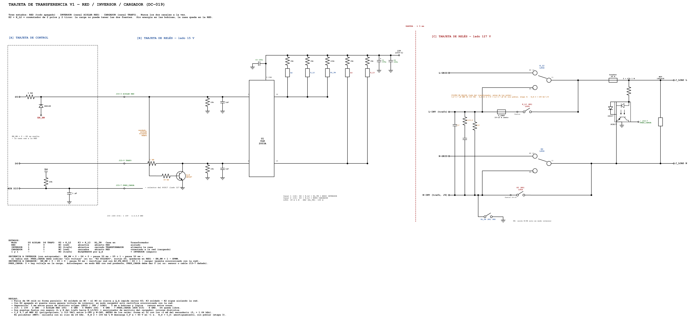

# Decisiones críticas de diseño

**Proyecto:** Isla del Sol — Puente H SPWM (inversor 48 V → 127 V / 60 Hz, 1000 W; modo cargador 1 kVA)
**Documento:** bitácora de decisiones del arquitecto (*Architecture Decision Record*, ADR)
**Estado:** vivo. Crece con el proyecto; las decisiones no se borran, se reemplazan por otras nuevas que las citan.
**Inicio:** 2026-11-06

> **Entre más información se transfiere, más se estabiliza el sistema.**

---

## Para qué existe este documento

El cobre muestra **qué** se hizo, pero no **por qué**. Un técnico de trinchera sabe medir, soldar y sustituir; lo que no puede adivinar es lo que el arquitecto consideró: la falla que evita un valor, el margen que protege una pieza, la opción que se descartó y por qué. Esa información es la primera que se pierde, y sin ella una "mejora" bien intencionada puede romper algo que estaba bien pensado.

Cada entrada tiene el mismo formato:
- **Contexto:** el problema y sus restricciones.
- **Alternativas consideradas:** con la razón para aceptarlas o descartarlas.
- **Decisión.**
- **Consecuencias:** lo que se gana, lo que se paga y lo que queda pendiente.

Las decisiones de este documento **pueden criticarse**, y deben hacerlo: si alguien encuentra un error o una opción mejor, se abre una entrada nueva que la reemplace, citando a la anterior. Vamos gateando; con la crítica, vamos a caminar.

---

## Índice

| ID | Decisión | Tarjeta | Fecha | Estado |
| --- | --- | --- | --- | --- |
| [DC-001](#dc-001-cascada-de-alimentación-de-baja-tensión-48--15--8--5-v) | Cascada de alimentación de baja tensión: 48 → 15 → 8 → 5 V | Control | 2026-11-06 | Vigente |
| [DC-002](#dc-002-buck-de-48-a-15-v-módulo-xl7015-en-socket-mixto) | Buck de 48 a 15 V: módulo XL7015 en socket mixto | Control | 2026-11-06 | Vigente |
| [DC-003](#dc-003-protección-de-la-entrada-de-48-v) | Protección de la entrada de 48 V | Control | 2026-11-06 | Vigente |
| [DC-004](#dc-004-pre-regulador-de-15-a-8-v-mp1584-en-socket-con-puente) | Pre-regulador de 15 a 8 V: MP1584 en socket con puente | Control | 2026-11-06 | Vigente |
| [DC-005](#dc-005-regulador-lineal-7805-para-el-riel-de-5-v) | Regulador lineal 7805 para el riel de 5 V | Control | 2026-11-06 | Vigente |
| [DC-006](#dc-006-sensado-ac-con-dos-transformadores-de-12-v-directos-al-adc) | Sensado AC con dos transformadores de 12 V directos al ADC | Control | 2026-11-06 | Vigente |
| [DC-007](#dc-007-sensado-del-voltaje-de-la-batería) | Sensado del voltaje de la batería | Control | 2026-11-06 | Vigente |
| [DC-008](#dc-008-tablero-de-diagnóstico-de-la-alimentación-led-test-points-y-valores-de-referencia) | Tablero de diagnóstico de la alimentación: LED, test points y valores de referencia | Control | 2026-11-06 | Vigente |
| [DC-009](#dc-009-objetivo-a-futuro-holgura-de-diseño-para-capacidad-médica) | Objetivo a futuro: holgura de diseño para capacidad médica | Todo el sistema | 2026-11-06 | Objetivo (no vigente) |
| [DC-010](#dc-010-reparto-de-tareas-entre-los-dos-atmega-enlace-i2c-con-latido-y-can-para-el-bms) | Reparto de tareas entre los dos ATmega, enlace I2C con latido y CAN para el BMS | Control | 2026-11-07 | Vigente |
| [DC-011](#dc-011-lectura-de-p9-las-dos-ramas-en-un-solo-pin-analógico-nunca-en-paralelo-directo) | Lectura de P9: las dos ramas en un solo pin analógico, nunca en paralelo directo | Control | 2026-11-07 | Vigente |
| [DC-012](#dc-012-los-nano-se-alimentan-por-5v-pin-27-nunca-por-vin) | Los Nano se alimentan por +5V (pin 27), nunca por VIN | Control | 2026-11-07 | Vigente |
| [DC-013](#dc-013-corriente-ac-con-pinza-sct-013-015-en-el-crítico-a2) | Corriente AC con pinza SCT-013-015 en el CRÍTICO (A2) | Control | 2026-11-07 | Vigente |
| [DC-014](#dc-014-corte-del-pwm-por-hardware-con-lógica-fail-safe-sensor_ok-y-doble-candado) | Corte del PWM por hardware con lógica fail-safe (SENSOR_OK) y doble candado | Control + sensor DC | 2026-11-08 | Vigente |
| [DC-015](#dc-015-corriente-de-fuga-y-aislamiento-se-diseñan-en-la-versión-2-después-de-validar-la-versión-1-en-campo) | Corriente de fuga y aislamiento: se diseñan en la versión 2, después de validar la versión 1 en campo | Sistema | 2026-11-08 | Diferida (V2) |
| [DC-016](#dc-016-corto-circuito-en-ac-niveles-de-protección-arranque-de-motores-arco-transferencia-y-reintentos) | Corto circuito en AC: niveles de protección, arranque de motores, arco, transferencia y reintentos | Control + potencia | 2026-11-08 | Vigente (V1) |
| [DC-017](#dc-017-presupuesto-de-cpu-y-memoria-de-los-atmega328p-y-alternativa-en-el-mismo-socket-nano-every-atmega4809) | Presupuesto de CPU y memoria de los ATmega328P, y alternativa en el mismo socket: Nano Every (ATmega4809) | Control | 2026-11-08 | Vigente (V1) / alternativa abierta |
| [DC-018](#dc-018-modulación-híbrida-a-24-khz-también-en-el-cargador-y-socket-multimodelo-atmega328p--atmega4809) | Modulación híbrida a 24 kHz también en el cargador, y socket multimodelo ATmega328P / ATmega4809 | Control | 2026-11-08 | Vigente (V1, por validar en banco) |
| [DC-019](#dc-019-transferencia-red--inversor--cargador-tres-estados-y-ninguna-falla-de-un-relé-forma-paralelo) | Transferencia red / inversor / cargador: tres estados y ninguna falla de un relé forma paralelo | Tarjeta de relés | 2026-11-08 | Vigente (V1, por validar en banco) |
| [Críticas esperadas](#críticas-esperadas-y-preguntas-abiertas) | Lo que sabemos que se puede discutir | — | 2026-11-06 | Abierto |

---

## DC-001. Cascada de alimentación de baja tensión: 48 → 15 → 8 → 5 V

> **En resumen: pagamos complejidad para comprar pureza en las lecturas del ADC.** El ADC es los ojos del inversor: si ve con ruido, el lazo de control y la sincronía con la red deciden mal.

**Contexto**

La tarjeta de control necesita dos rieles:
- **15 V** para los gate drivers (y su bootstrap), los relés y un ventilador;
- **5 V** para los dos Arduino Nano (ATmega328P), el LCD I2C y los sensores.

El riel de 5 V **no es solo alimentación: es la referencia del ADC** (AVCC). De él sale también el bias de 2.5 V del sensado AC, y de su limpieza depende la sincronía con la red.

**Consumo estimado**

| Riel | Carga | Corriente aprox. |
| --- | --- | --- |
| 15 V | Drivers (2 MOSFET a 24 kHz + 2 a 60 Hz) | 20–40 mA |
| 15 V | Relés (2–3) | 60–150 mA |
| 15 V | Ventilador de 12 V (si lo hay) | 100–200 mA |
| 5 V | 2 Nano + LCD con luz de fondo + sensores | 100–170 mA |
| **48 V** | **Entrada total** | **~0.1–0.2 A** (5–8 W) |

**Alternativas consideradas**

| Alternativa | Por qué no |
| --- | --- |
| 7805 directo de 15 a 5 V | Cae 10 V en el regulador: a 150 mA son **1.5 W**. Sin disipador, Tj ≈ 115 °C a 40 °C de ambiente; a 200 mA, cerca del corte térmico |
| Buck directo de 15 a 5 V | Frío, pero su rizo de **20–50 mV** cae en el AVCC: son **4–10 cuentas** de ruido del ADC (1 cuenta ≈ 4.9 mV), justo en las lecturas AC de las que depende la sincronía |
| Buck directo de 48 a 5 V | El mismo problema de rizo, y un segundo módulo de alto voltaje |

**Decisión**

Una cascada de tres etapas, cada una haciendo lo que mejor sabe hacer:

```
48 V ──[XL7015, buck]──► 15 V ──[MP1584, buck]──► 8 V ──[7805, lineal]──► 5 V
 batería          drivers, relés,          cae solo 3 V:            Nano, LCD,
                  ventilador               ~0.45 W a 150 mA         sensores, AVCC
```

- **Los bucks hacen el trabajo pesado** (eficiencia de ~85–90 %).
- **El 7805 trabaja frío y limpia el rizo** del MP1584: rechaza ~60 dB a baja frecuencia.
- **El 7805 necesita al menos ~7 V de entrada** (su caída es de ~2 V); por eso el MP1584 se ajusta a **7–8 V**.

**Consecuencias**

- ✅ El 5 V queda limpio para el ADC y los reguladores van fríos.
- ✅ Cada etapa es reemplazable por separado (sockets).
- ⚠️ Son tres etapas en serie: si una falla, se cae todo lo que está después. Cada riel tiene su test point para encontrar la falla con el multímetro.
- ⚠️ **Los relés no van en 5 V:** una bobina de 5 V consume 70–90 mA, y con dos el 7805 se sale de su presupuesto térmico. Van en 12 o 15 V.

---

## DC-002. Buck de 48 a 15 V: módulo XL7015 en socket mixto

**Contexto**

La batería de 48 V llega hasta **58.4 V** (LiFePO4 16S cargada) o **62–64 V** (plomo-ácido en ecualización), más los picos de conexión. El buck tiene que aguantar eso y conseguirse en cualquier rincón.

**Alternativas consideradas**

| Alternativa | Entrada máxima | Por qué sí o por qué no |
| --- | --- | --- |
| LM2596 | 40 V | ❌ Descartado: no aguanta ni la batería nominal |
| LM2596HV | 60 V | ❌ Descartado: queda debajo de la batería de plomo-ácido en ecualización |
| **XL7015 (módulo)** | **80 V**, 0.8 A [1] | ✅ **Elegido:** se encuentra en todo el mundo y cuesta menos que una botella de agua |
| LM5164 (diseño propio) | 100 V, 1 A, síncrono, UVLO programable [2] | Mejor margen, pero se consigue con distribuidor: queda como opción "de producción" |

**Decisión**

- **Módulo XL7015 en un socket mixto:** el área y los pines admiten el **módulo amplio o el reducido**. Solo se instala uno.
- **El módulo de trinchera define el estándar.** El área, la posición de los pines y la altura se toman del XL7015. Quien diseñe un buck más robusto (con el LM5164, por ejemplo) debe caber en esa misma huella, con sus pines en el mismo lugar.
- **Contrato de interfaz del área:**
  - entrada de 40–64 V en operación, y el diseño debe aguantar ≥80 V;
  - salida de **15 V ±5 %**, ≥0.8 A continuos, con rizo ≤100 mV pico a pico.

**Consecuencias**

- ✅ Se usa el módulo que haya en el cajón ese día.
- ⚠️ **El margen de 80 V es justo:** sobre 64 V queda un ~25 %. La protección de la entrada (DC-003) es parte de esta decisión, no un extra.
- ⚠️ **Muchos clones traen el electrolítico de entrada de 63 V.** Con plomo-ácido en ecualización queda al límite. **Revisión obligatoria:** si es de 63 V, se cambia por uno de 100 V.
- ⚠️ **El XL7015 no tiene UVLO ajustable:** sigue consumiendo con la batería casi vacía. El firmware, con la lectura de la batería (DC-007), debe apagar el inversor por bajo voltaje. Más adelante, el BMS o un relé de corte desconecta todo.
- **Advertencias en la serigrafía** (el poka-yoke):
  - **"AJUSTAR A 15V ANTES DE INSERTAR"**, dentro del contorno del módulo: se ve justo cuando el socket está vacío. El potenciómetro puede venir de fábrica en 20 V o más.
  - **"⚠ NUNCA PUENTEAR IN → OUT"**. En el MP1584 (DC-004) sí se puentea; aquí meterías **48 V al riel de 15 V** y quemarías los drivers, el 7805 y los Nano de un golpe.
  - **"SOLO UNO"** (amplio o reducido).

---

## DC-003. Protección de la entrada de 48 V

**Contexto**

Los picos vienen de conectar la batería (la inductancia del cable cargando los capacitores), de relés y ventiladores que conmutan cerca, y de un fusible o un cable que se abren con carga.

**Decisión**

| Componente | Función | Prioridad |
| --- | --- | --- |
| **R14 de 2.2 Ω (½ W THT) + fusible T1A**, en J8 del puente H | Fusible de bajo costo y limitador de la corriente de arranque | Obligatorio |
| **D1, TVS SMBJ58A** (LiFePO4) o **SMBJ64A** (plomo-ácido) | Última línea contra los picos rápidos | Obligatorio |
| **C17, 1 µF / 100 V X7R (1210)** | Picos de alta frecuencia, pegado a la entrada del módulo | Obligatorio |
| El electrolítico del propio módulo, **revisado que sea de 100 V** | Energía local del buck | Obligatorio |
| **C18, 47–100 µF / 100 V** | Junto con R14 forma un filtro RC (τ ≈ 220 µs) que aplana los picos de conexión | Opcional, recomendado |

**Por qué el SMBJ58A y no otro** [3]

| Parámetro | SMBJ58A | Qué significa |
| --- | --- | --- |
| VRWM | 58 V | Hasta aquí no conduce (fuga de µA) |
| VBR | 64.4–71.2 V | Aquí empieza a conducir |
| VC | 93.6 V a ~6.4 A | El peor caso con un pico grande |

- Es el TVS **más bajo que no estorba a la batería LiFePO4 cargada** (58.4 V). Uno más bajo se calentaría con la batería llena.
- **Con plomo-ácido en ecualización (62–64 V)** quedaría pegado a la ruptura: se usa el **SMBJ64A**.
- **Para ser honestos:** con un pico grande, el TVS recorta en ~94 V, **arriba de los 80 V del XL7015**. Con los picos chicos conduce cerca de su VBR (~65–70 V) y sí protege. Contra los picos grandes, **la defensa real es el filtro R14 + C18**; por eso C18 se recomienda aunque no sea obligatorio.
- **Polaridad:** el cátodo (la banda) va a 48 V. Si se pone al revés, es un corto a GND al conectar la batería.

**Consecuencias**

- ✅ Protección en capas: filtro, TVS y fusible.
- ⚠️ C18 es opcional porque el módulo ya trae su propio electrolítico. Sin C18, la entrada depende más del TVS.
- **Separación del cobre de 48 V:** 0.6 mm en pistas y 1 mm en los terminales (IPC-2221, tabla B2: conductores externos sin recubrimiento, 31–100 V).

---

## DC-004. Pre-regulador de 15 a 8 V: MP1584 en socket con puente

**Contexto**

El 7805 necesita bajar su caída de voltaje para ir frío (DC-001), pero no se le puede meter un buck directo a 5 V.

**Decisión**

- **Módulo MP1584EN en socket,** ajustado a **7–8 V**.
- **"SIN MÓDULO: PUENTE IN_POS → OUT_POS".** Sin el MP1584, el 7805 recibe los 15 V directo: funciona igual, solo que necesita disipador. La tarjeta nunca se queda parada por falta de un módulo.

**Consecuencias**

- ✅ El 7805 cae solo ~3 V: ~0.45 W a 150 mA, sin disipador.
- ✅ Puentear aquí es seguro: el 7805 aguanta hasta 35 V en la entrada.
- ⚠️ **Esta regla es la contraria a la del XL7015** (DC-002). Por eso las dos advertencias están escritas en la serigrafía, una junto a la otra.

---

## DC-005. Regulador lineal 7805 para el riel de 5 V

**Decisión**

- **Huella doble: TO-220 (U1) o D2PAK (U2), solo uno.** Se usa el que haya.
- **Salida:** 100 µF + 10 µF + 1 µF. El 7805 es estable con eso.
- **Entrada:** 1 µF pegado al pin IN. La hoja de datos pide ≥0.33 µF cuando el regulador queda lejos del capacitor de la fuente.

**Consecuencias**

- ✅ Un 5 V limpio para el AVCC y el bias del sensado AC.
- ⚠️ **El D2PAK depende del cobre** para disipar. Con el MP1584 en su lugar no hay problema; sin él (con 15 V en la entrada), el TO-220 con disipador es la opción segura.

---

## DC-006. Sensado AC con dos transformadores de 12 V directos al ADC

**Contexto**

Se necesitan dos lecturas AC: la salida del inversor (para el lazo de amplitud) y la red (para sincronizarse antes de transferir). Las dos van al ATmega 2, junto con los relés de transferencia.

**Alternativas consideradas**

| Alternativa | Por qué sí o por qué no |
| --- | --- |
| ZMPT101B | Bueno, pero no se encuentra en todas partes: queda como mejora opcional |
| Transformador con la señal rectificada | ❌ Pierde la polaridad y el cruce por cero: no sirve para la sincronía |
| Un solo transformador conmutado | ❌ Agrega un relé en la ruta de la señal, más tiempo de conmutación y más puntos de falla |
| **Dos transformadores de 120 a 12 V, sin rectificar, con bias de 2.5 V** | ✅ **Elegido:** pieza de trinchera y el ADC ve la onda completa |

**Decisión y valores**

- **Divisor:** 100 kΩ + (8.2 kΩ + **trimmer Bourns 3296W de 2 kΩ**). Rango de ajuste de ±10 %, sin saturar nunca el ADC: con 16 VAC en vacío, como máximo ±2.1 V sobre el bias.
- **El trimmer se conecta como reóstato** (el cursor unido a un extremo): si el cursor pierde contacto, la resistencia se va a 2 kΩ y el canal no queda flotando.
- **Bias de 2.5 V con 10k/10k + 10 µF + 100 nF,** uno por canal, para que una señal no se cuele en la otra.
- **10 nF pegados al pin del Nano** (A0 y A6): filtran la conmutación de 24 kHz. Desfase de ~2° a 60 Hz, **igual en los dos canales**, así que se cancela en la sincronía.
- **A6 solo existe en el ATmega328P TQFP** (el del Nano). En el DIP-28 no hay A6: hay que usar A1–A3.
- **Serigrafía "12VAC / RET",** no "L1 / N": nadie debe pensar que ahí entra la red de 120 V.

**Consecuencias**

- ⚠️ **Firmware:** el ADC lee un canal a la vez (~104 µs por conversión). Eso equivale a **~2.25° de desfase** entre las dos lecturas, casi la mitad de la ventana de sincronía de 5°. El firmware debe restarlo o alternar el orden de las lecturas.
- **Calibración en trinchera:** se mide la salida con el multímetro y se gira el trimmer hasta que el ATmega reporte el mismo valor. La corrección fina va por software, en la EEPROM.

---

## DC-007. Sensado del voltaje de la batería

**Decisión**

- **Divisor 68k + 68k + 10k** (ganancia de 0.0685): 48 V → 3.29 V; 58.4 V → 4.00 V; el ADC llega a 5 V con **~73 V**. Cubre cualquier química de 48 V.
- **Dos de 68k en serie:** si una se pone en corto, la otra sigue limitando, y cada una solo ve ~27 V.
- **R3 de 1k + C1 de 1 µF en el pin A3:** fuente de baja impedancia para el ADC, y R3 limita la corriente hacia los diodos de protección.
- **Falla segura:** si R4 se abre, la lectura sube, el firmware ve un "sobrevoltaje" y apaga.

**Consecuencias**

- ⚠️ **El filtro es lento a propósito** (τ ≈ 10 ms, corte en ~15 Hz): sirve para la caída lenta de la batería y para la protección por bajo voltaje. **No sirve** para compensar el rizo de 120 Hz del bus en la SPWM; eso lo corrige el lazo PI de amplitud con la lectura AC. Si algún día se quiere compensar el rizo de 120 Hz por feedforward, C1 baja a 100 nF.
- ⚠️ Si el 48 V del sensado comparte cable con la alimentación del buck, la lectura queda después de R14: con ~0.2 A caen ~0.4 V. Para una lectura más exacta, el sensado lleva su propio cable.
- **Separación:** 1 mm en el terminal y 0.6 mm en el divisor.

---

## DC-008. Tablero de diagnóstico de la alimentación: LED, test points y valores de referencia

> **Los datos cuantitativos de diagnóstico son oro.** El LED dice *dónde* está la falla; el test point, con su valor de referencia, dice *qué tan mal* está.

**Contexto**

La cascada de DC-001 tiene tres etapas en serie: cuando algo falla, se apaga todo lo que está después. El usuario necesita saber **en qué etapa** está la falla sin abrir el README, y el técnico necesita **números** contra los cuales comparar su multímetro.

**Decisión 1: un LED por riel, en fila y en el orden de la cascada**

LED rojos o verdes, **los cuatro del mismo tipo y color** (Vf ≈ 2 V), a **~1.3 mA** para que todos brillen parejo. Todas las resistencias son de **¼ W** y de valores E12.

| LED | Confirma | Resistencia | Corriente | Potencia en R |
| --- | --- | --- | --- | --- |
| **48 V** | Hay batería; el fusible y R14 están bien | **47 kΩ ¼ W** | 0.98 mA (1.3 mA a 64 V) | 80 mW a 64 V |
| **15 V** | El XL7015 funciona | 10 kΩ | 1.3 mA | 17 mW |
| **8 V** | El MP1584 funciona (o está el puente) | 4.7 kΩ | 1.3 mA | 8 mW |
| **5 V** | El 7805 funciona | 2.2 kΩ | 1.4 mA | 4 mW |

*Historial:* la primera versión usaba 22 kΩ de ½ W en el LED de 48 V y ~3 mA en los demás. Se cambió a 47 kΩ (propuesta del arquitecto): basta una resistencia de ¼ W, se calienta menos junto al cobre de 48 V y gasta menos batería; los demás LED se bajaron a ~1.3 mA para que brillen igual. Un LED blanco o azul (Vf ≈ 3 V) brillaría menos con estos valores.

**El LED de 48 V es obligatorio:** es el único que se alimenta directo de la batería, no de la cascada. Sin él, "todo apagado" no distingue una falla de batería de una falla del XL7015.

**Cómo se lee el tablero**

| 48V | 15V | 8V | 5V | Diagnóstico |
| --- | --- | --- | --- | --- |
| ⚫ | ⚫ | ⚫ | ⚫ | No llega batería: fusible, R14 o cable |
| 🟢 | ⚫ | ⚫ | ⚫ | El XL7015 falta, falla, o no está bien insertado |
| 🟢 | 🟢 | ⚫ | ⚫ | Falla el MP1584, o falta el puente sin módulo |
| 🟢 | 🟢 | 🟢 | ⚫ | Falla el 7805 (abierto), o hay un corto en el riel de 5 V |
| 🟢 | 🟢 | 🟢 | 🟢 | Hay voltaje en todos los rieles. **Confirmar los valores con los test points** |

Para distinguir el 7805 de un corto en el riel de 5 V: se desconectan las cargas de 5 V (los Nano, el LCD). Si el LED prende, el corto está en una carga; si sigue apagado, es el 7805.

Serigrafía junto a los LED: **"TODOS ENCENDIDOS = HAY VOLTAJE · EL PRIMERO APAGADO = ETAPA EN FALLA"**.

**Decisión 2: valores de referencia para cada test point**

| Test point | Nominal | Rango aceptable | Debajo del rango | Arriba del rango |
| --- | --- | --- | --- | --- |
| **48 V** (BAT) | 51.2 V (LiFePO4) / 48 V (plomo) | 40–58.4 V (LiFePO4) · 42–64 V (plomo) | Batería descargada: el firmware apaga el inversor | Cargador mal ajustado; revisar el TVS (DC-003) |
| **15 V** | 15.0 V | **14.25–15.75 V** (±5 %) | < 12 V: los drivers pierden margen sobre su UVLO | > 16.5 V: XL7015 mal ajustado; el zener de 18 V del bootstrap empieza a trabajar |
| **8 V** | 7.5–8 V | **7.0–9.0 V** | < 7 V: el 7805 sale de regulación (su caída es de ~2 V) | > 10 V: el 7805 se calienta (> 0.75 W a 150 mA) |
| **5 V** | 5.00 V | **4.80–5.20 V** (L7805C: ±4 %) | Sobrecarga o 7805 dañado | **> 5.5 V: sospechar que el 7805 falló en corto.** El ATmega328P aguanta como máximo 6.0 V |
| **Bias AC** (2.5 V) | 2.50 V | 2.45–2.55 V (resistencias al 1 %) | — | Una resistencia del bias equivocada o abierta |

**Consumo de referencia en la entrada de 48 V, con el inversor apagado:** ~0.1–0.2 A. **Más de 0.3 A sin inversor** indica un corto o una carga que no debería estar en los rieles de baja tensión.

**Decisión 3: protección contra el 7805 en corto**

**Un 7805 puede fallar en corto,** con la entrada unida a la salida. Entonces los 8 V pasan al riel de 5 V, el LED de 5 V **sigue prendido** (un poco más brillante) y el tablero **no lo detecta**. A 8 V se queman los Nano y el LCD.

| Componente | Función |
| --- | --- |
| **TVS SMAJ5.0A**, del riel de 5 V a GND | Conduce si el riel sube de ~6.4 V |
| **Fusible reseteable (PTC) de ~500 mA**, en la entrada de 8 V del 7805 | Cuando el TVS conduce, la corriente sube y el PTC se abre: protege a los Nano |

**Decisión 4: autodiagnóstico por firmware (costo cero de hardware)**

- **El 5 V se mide a sí mismo:** el ATmega328P puede leer su **referencia interna de 1.1 V** usando AVCC como referencia. Entonces **VCC = 1.1 V × 1023 / lectura**. La referencia interna varía entre 1.0 y 1.2 V según la hoja de datos, así que se calibra una vez contra el multímetro y la constante se guarda en la EEPROM.
- **El 48 V ya se mide** con el sensado de la batería (DC-007).
- **Opcional:** el riel de 15 V en un pin analógico libre del **AUX** (en el CRÍTICO, A2 se usa para la corriente AC, DC-013, y A7 para P9, DC-011), con un divisor de **47 kΩ / 10 kΩ** (15 V → 2.63 V; llega a 5 V con 28.5 V).
- **El LCD muestra los valores reales:** el usuario lee "BAT 51.2V · 15V OK · 5V 4.98V" en lugar de adivinar.

**Consecuencias**

- ✅ El usuario sabe **dónde** está la falla (los LED), y el técnico sabe **qué tan mal** está (los test points con su valor de referencia).
- ⚠️ **El LED dice "hay voltaje", no "el voltaje es correcto".** Un XL7015 ajustado a 20 V prende el LED de 15 V igual. El valor lo confirman el test point o el LCD.
- ✅ Los cuatro LED suman ~5 mA repartidos en los cuatro rieles: **~0.1 W** vistos desde la batería. Es el precio de poder ver el estado de la cascada.

---

## DC-009. Objetivo a futuro: holgura de diseño para capacidad médica

> **Lo más grande que puede lograr la Isla del Sol es ayudar a salvar una vida.** Cerca de mil millones de personas se atienden en centros de salud sin electricidad o con electricidad poco confiable [7]. Para llegar ahí, hay que esforzarse más en los requerimientos de diseño.

**Estado:** objetivo, no vigente. **El prototipo actual (versión 1) NO es apto para cargas de soporte vital ni para el entorno del paciente** (ver DC-015). Esta entrada deja registrado lo que el diseño tendría que cumplir para acercarse a esa capacidad, para que cada decisión nueva lo tome en cuenta desde ahora.

**Por escalones (de menor a mayor exigencia)**

| Escalón | Cargas | Qué exige |
| --- | --- | --- |
| 1. Salud comunitaria | Iluminación de partos, refrigerador de vacunas e insulina, carga de oxímetros y de radios | Validación en banco completa, horas de operación, prueba de arranque de compresores |
| 2. Clínica | Concentradores de oxígeno pequeños, equipos de diagnóstico | Lo anterior, más certificación de seguridad como convertidor o UPS, y transferencia sin interrupción |
| 3. Quirófano | Soporte vital | Instalación hospitalaria certificada, redundancia y normas de lugares médicos. Fuera del alcance de un solo equipo: es el sistema completo |

**Holguras de diseño a considerar desde ahora**

| Tema | Hoy (prototipo) | Para capacidad médica |
| --- | --- | --- |
| **Reducción de esfuerzo de los componentes** (*derating*) | Rizo por Rubycon al **95–97 %** de su capacidad (auditoría) | Componentes al **≤ 50–70 %** de su capacidad: más capacitores en el bus, MOSFET y cobre con margen |
| **Margen térmico** | Tj ≈ 62 °C a 40 °C de ambiente, con sensibilidad de −33/+70 % | Validado con termopar, más margen por gabinete cerrado, polvo y alta temperatura ambiente |
| **Arranque de cargas** | Por validar ("la prueba de la margarita") | Arrancar compresores y motores de forma repetida sin disparar la protección |
| **Calidad de la onda** | Por medir | Distorsión armónica baja (orden de < 5 %), regulación de voltaje y frecuencia medida bajo carga |
| **Continuidad** | Transferencia por relés | Tiempo de transferencia medido y documentado; sin un punto único de falla |
| **Aislamiento y fuga** | Transformador de salida (aislamiento galvánico). **No se consideró la fuga en la tarjeta de control ni en el puente H: ver DC-015** | Diseño de la versión 2 con datos de campo de la V1 (DC-015): fuga ≤ 100 µA de contacto, aislamiento 2 MOOP/2 MOPP, monitor de aislamiento |
| **Diagnóstico** | Tablero de LED y test points (DC-008) | Alarmas audibles, registro de eventos, autodiagnóstico continuo |
| **Fiabilidad** | Sin datos | Horas de quemado (*burn-in*), pruebas de falla inducida, registro de fallas en campo |
| **Fabricación** | Tarjetas de trinchera | Recubrimiento conformado contra humedad, trazabilidad de componentes |

**Normas de referencia (verificar la versión vigente antes de usarlas)**
- **IEC 62109-1:** seguridad de convertidores de potencia para sistemas fotovoltaicos.
- **IEC 62040-1 y 62040-3:** seguridad y desempeño de sistemas de alimentación ininterrumpida (UPS).
- **IEC 60601-1:** seguridad de equipo electromédico. Aplica a los equipos que se alimentan, no al inversor, pero define lo que esos equipos esperan de su alimentación.
- **IEC 60364-7-710:** instalaciones eléctricas en lugares médicos.
- **México:** NOM-001-SEDE, artículo 517 (instalaciones en lugares de atención de la salud).

**Consecuencias**

- ✅ Cada decisión nueva puede preguntarse: *¿esto acerca o aleja a la Isla del Sol del escalón 1?*
- ⚠️ **La primera holgura que hay que atender es el rizo de los Rubycon** (95–97 %): para uso médico es un margen demasiado corto.
- ⚠️ **Ningún documento sustituye la validación:** solo un equipo con historial medido se gana el derecho de estar cerca de un paciente.

---

## DC-010. Reparto de tareas entre los dos ATmega, enlace I2C con latido y CAN para el BMS

> **Lo que decide la onda y la protegen vive en un solo micro. Lo que informa y conversa vive en el otro.**

**Contexto**

La tarjeta de control usa dos Arduino Nano (ATmega328P TQFP). Hay que repartir:
- la SPWM;
- los sensados AC y la sincronía con la red;
- los relés de transferencia;
- el BMS por CAN, el LCD, el ventilador y el buzzer.

**Esta entrada reemplaza** lo que decía el borrador de la arquitectura de control: los sensados AC y los relés iban al ATmega 2.

**Decisión**

| ATmega 1 — **CRÍTICO** | ATmega 2 — **AUX** |
| --- | --- |
| SPWM: HA/LA en D9/D10 (Timer1), HB/LB en D11/D3 | CAN con el BMS: MCP2515 por SPI (CS en D9, INT en D2) |
| Sensado AC del inversor (A0) y de la red (A6) | LCD por I2C **en un bus aparte** (D4/D5, I2C por software) |
| Batería (A3) y temperatura (A1) | ~~Sensor de corriente AC ZMCT103C (A1)~~ → reemplazado por el SCT-013-015 en el CRÍTICO (DC-013); el AUX recibe el monitor del riel de 15 V |
| Relés de transferencia (D4, D5, D6) y encendido (D12) | Ventilador (D6), buzzer, LED y botón (D8) |
| **Esclavo o maestro del enlace I2C (A4/A5)** | **El otro extremo del enlace I2C (A4/A5)** |

**Por qué los sensados AC y los relés van en el CRÍTICO:** para sincronizarse con la red hay que **ajustar la fase de la tabla de senos**, y eso solo lo puede hacer el micro que genera la SPWM. Si la sincronía pasara por el enlace I2C, el retraso del enlace se comería parte de la ventana de 5°. La transferencia de los relés tiene que ocurrir en el instante que decide la sincronía, en el mismo micro.

**Por qué el LCD va en un bus aparte:** si el LCD se cuelga, se desconecta o tiene un falso contacto, **no tumba el enlace entre los dos ATmega**.

**El enlace I2C**
- **Pull-ups de 4.7 kΩ a 5 V en A4/A5,** un solo par para todo el bus (R10 y R11). El Nano no los trae, y los internos del ATmega (20–50 kΩ) son demasiado débiles. Con ~100 pF, el flanco sube en ≈ 0.4 µs, contra 1 µs como máximo a 100 kHz. El mínimo permitido es ≈ 1.5 kΩ (3 mA por pin) [8].
- **Latido (*heartbeat*):** el AUX manda un mensaje cada ~100 ms con los permisos de carga y descarga del BMS. **Si el CRÍTICO no recibe nada en ~500 ms, deja de cargar** y sigue protegiendo la batería con su propia lectura de A3.
- **El CRÍTICO nunca depende del enlace para protegerse:** la sobrecorriente, el bajo voltaje y la temperatura se deciden con sus propias lecturas.
- **El bus no se debe colgar:** se usa `Wire.setWireTimeout()` (núcleo AVR de Arduino).
- **Mensajes cortos:** cada mensaje dispara una interrupción en el CRÍTICO, y mientras corre, la interrupción de la SPWM espera. El Timer1 actualiza con doble búfer y tolera retrasos de unos µs.

**El CAN con el BMS**
- **Módulo MCP2515 + TJA1050 (HW-184)** en un socket de 7 pines, en el mismo orden que el módulo: VCC, GND, CS, SO, SI, SCK, INT.
- **RJ45 tipo Pylontech:** pin 4 = CAN_H, pin 5 = CAN_L, pin 6 = GND [9]. Los pines 4 y 5 forman un par trenzado en un cable de red. Antes de conectar una batería de otra marca, se revisa el manual de su puerto CAN.
- **El header J13 (H/L) va en paralelo** al RJ45, para conectar con cable suelto.
- **El cristal del módulo es de 8 MHz:** en el firmware se declara `MCP_8MHZ` a **500 kbps**. Muchas bibliotecas asumen 16 MHz, y con eso el bus queda a la mitad de velocidad y no se comunica con nada.
- **D10 (SS) del AUX queda como salida** en el firmware. Si se queda como entrada y recibe un nivel bajo, el SPI del AVR se pasa a modo esclavo y el CAN se cae.
- **Terminación de 120 Ω:** jumper J1 del módulo puesto, porque el inversor es un extremo del bus. El bus lleva exactamente dos terminaciones.

**Consecuencias**

- ✅ La sincronía y la transferencia no dependen de ningún enlace.
- ✅ Una falla del LCD o del CAN no afecta la generación de la onda.
- ⚠️ **El CRÍTICO carga con más trabajo:** la SPWM a 24 kHz deja ~666 ciclos de reloj por periodo, y además están los tres canales de ADC y los relés. Hay que medir en el banco cuánto tiempo ocupa la interrupción de la SPWM (con un pin que cambie de estado al entrar y salir, y el osciloscopio).
- **Pines libres para crecer:**
  - en el CRÍTICO: D2 (reservado para el FAULT), D8 y D13 (A2 se usa para la corriente AC, DC-013; A7 para P9, DC-011);
  - en el AUX: D3, D7, A0, A1, A2, A3, A6 y A7 (uno de ellos, para el monitor del riel de 15 V, DC-013).

---

## DC-011. Lectura de P9: las dos ramas en un solo pin analógico, nunca en paralelo directo

> **El poka-yoke se diseña para lo que puede pasar, no para lo que debería pasar.**

**Contexto**

Cada módulo de gate driver declara su tiempo muerto por P9: **GND = 500 ns** (IRS2186, UCC21520) y **abierto = 1 µs** (TLP250). Los módulos son intercambiables por diseño, así que en la trinchera **puede haber módulos mezclados**: por ejemplo, se quema un UCC21520 y en el cajón solo hay un TLP250.

**Alternativas consideradas**

| Alternativa | Por qué sí o por qué no |
| --- | --- |
| P9A y P9B en paralelo, en un solo pin digital | ❌ **Descartada.** En paralelo **gana el GND**: con un UCC en una rama y un TLP250 en la otra, el ATmega lee 500 ns y **el TLP250 conduce cruzado**. Rompe la falla segura |
| Paralelo + la regla escrita "NO MEZCLAR MÓDULOS" | ❌ Es una regla, no un poka-yoke: en la trinchera las reglas se rompen por necesidad |
| Un pin digital por rama (D8 y A2) | Seguro, pero usa dos pines libres del CRÍTICO |
| **Un pin analógico con tres resistencias de distinto valor** | ✅ **Elegida:** un solo pin, segura con módulos mezclados, y dice cuál rama es distinta |

**Decisión (bloque "SPWM DT CONFIG")**

```
5V ──[R12 10k]──┬──► A7 (solo analógico)
                ├──[R13 10k]── P9_A (J1-5)
                └──[R14 20k]── P9_B (J3-5)
```

| Rama A | Rama B | Voltaje en A7 | Cuentas del ADC (10 bits, 5 V) | Firmware |
| --- | --- | --- | --- | --- |
| Abierto | Abierto | **5.00 V** | ~1023 | 1 µs |
| Abierto | GND | **3.33 V** | ~682 | 1 µs, con aviso "DT MIXTO (A)" (la rama A tiene el módulo de 1 µs) |
| GND | Abierto | **2.50 V** | ~512 | 1 µs, con aviso "DT MIXTO (B)" |
| GND | GND | **2.00 V** | ~409 | **500 ns** |
| — | — | **< 1.8 V** | < ~368 | 1 µs, con aviso "FALLA P9" (corto a GND en el nodo) |

- **Solo se permiten 500 ns si la lectura cae entre 1.8 y 2.2 V** (~368 a ~450 cuentas). Cualquier otro valor da 1 µs.
- **Margen:** entre el caso de 500 ns (2.00 V) y el más cercano (2.50 V) hay ~100 cuentas. Con resistencias al 1 % sobra.
- **R13 y R14 también protegen el pin:** limitan la corriente si llega un voltaje indebido por el cable de P9.
- **100 nF de A7 a GND,** junto al Nano, para filtrar el ruido de la conmutación de 24 kHz.
- **A7 es el uso ideal:** es solo analógico, y aquí solo se necesita una lectura analógica. **El monitor del riel de 15 V (DC-008) pasa al AUX** (DC-013).
- **D2 (INT0) queda reservado** para el FAULT de sobrecorriente del sensor DC.

**Reglas del firmware**
1. Leer A7 **al arrancar, antes de habilitar la SPWM**, varias veces seguidas, y promediar.
2. **Si las ramas no coinciden, se usa 1 µs en las dos** y se avisa en el LCD con la rama que tiene el módulo distinto.
3. **Nunca invertir la lógica** (abierto = 500 ns): es la regla de la sección 2.1 de `identificacion_dt_pin9.md`.
4. **Si se cambia una resistencia del bloque, se recalcula la tabla.** R13 y R14 deben ser distintas: si son iguales, los dos casos mixtos dan el mismo voltaje y ya no se sabe cuál rama es distinta (aunque la falla segura se mantiene).

Serigrafía junto al bloque: **"P9: GND=500ns · ABIERTO=1µs · R13≠R14"**.

**Consecuencias**

- ✅ Un cable roto, un módulo ausente, una mezcla de módulos o un corto en el nodo llevan siempre a 1 µs: la falla segura se mantiene.
- ✅ Usa un solo pin, y el LCD dice cuál rama tiene el módulo distinto.
- ⚠️ La lectura depende del ADC y de la referencia de 5 V. Las ventanas son anchas a propósito para tolerar el ±4 % del 7805.

---

## DC-012. Los Nano se alimentan por +5V (pin 27), nunca por VIN

> **Una etiqueta que dice "5V" no garantiza que el micro reciba 5 V: importa a qué pin llega.**

**Contexto (la lección)**

En la primera versión del esquemático, el 5V de la tarjeta llegaba al **pin 30 (VIN)** de los dos Nano. VIN es la **entrada del regulador interno** del Nano (tipo AMS1117-5.0), que necesita ~1 V o más de diferencia para regular. Con 5 V en VIN:
- el ATmega quedaba en **~3.8–4 V**, al límite de lo que pide su hoja de datos a 16 MHz;
- **la referencia del ADC (AVCC) quedaba en ~3.9 V,** mientras que el bias de los sensores AC, el divisor de la batería, los pull-ups de I2C y el bloque de P9 salían del 5 V de la tarjeta. Las lecturas se desfasaban, y el caso "P9 abierto" (5 V) saturaba el ADC;
- los pull-ups de I2C a 5 V quedaban arriba del VCC del micro, metiendo corriente por sus diodos de protección.

La red se llamaba "5V" en el esquemático y en el PCB, así que el error **no se veía**. Se detectó leyendo la etiqueta del pad 27: `unconnected-(A1-+5V-Pad27)`.

**Decisión**

- **El 5V de la tarjeta (del 7805, DC-005) va al pin 27 (+5V) de los dos Nano.**
- **El pin 30 (VIN) queda sin conectar**, con su marca de no conexión en el esquemático.
- **1 µF X7R** de +5V a GND junto a cada Nano (C15 y C19).

**Consecuencias**

- ✅ El ATmega, el ADC, el bias, los pull-ups y P9 comparten **la misma referencia de 5 V**. Todas las tablas de este documento (DC-008, DC-011) son válidas.
- ✅ Con el USB conectado para programar no hay conflicto: el Nano tiene un diodo entre el USB y su riel de 5 V.
- **Prueba en banco:** con la tarjeta alimentada, entre el **pin 27 y GND** debe haber **4.80–5.20 V**. Si se mide ~3.9 V, el 5V está entrando por VIN.

---

## DC-013. Corriente AC con pinza SCT-013-015 en el CRÍTICO (A2)

> **Un solo sensor, en el lugar correcto, sirve para los dos modos y para la compensación del tiempo muerto.**

**Contexto**

Se necesita medir la corriente AC para:
1. el **modo inversor** (DC → AC): corriente, watts reales, factor de potencia y apagado por sobrecarga sostenida;
2. el **modo cargador** (AC → DC): la corriente que viene de la red;
3. la **compensación adaptativa del tiempo muerto**, que usa `d_comando = d_ideal + signo(i) · DT · f_sw` (`docs/compensacion_adaptativa_tiempo_muerto.md`).

**Alternativas consideradas**

| Alternativa | Por qué sí o por qué no |
| --- | --- |
| Módulo ZMCT103C | Rango de 0–10 A (lineal hasta 6 A); el cable de 127 V tiene que **pasar por el agujero**, así que hay que cortarlo o pasarlo, y meterlo cerca de la tarjeta [10] |
| **Pinza SCT-013-015** | ✅ **Elegida:** núcleo abierto, se abraza el cable sin cortarlo; **los 127 V nunca entran a la tarjeta de control**; 15 A → 1 V RMS con la resistencia de carga integrada; plug de 3.5 mm; se cambia sin herramientas [11] |
| En el AUX | ❌ El signo de la corriente se necesita en cada periodo de la portadora, dentro de la interrupción de la SPWM: por I2C llegaría tarde. Tampoco se podrían medir watts reales con el voltaje en un micro y la corriente en otro |

**Decisión**

- **SCT-013-015 en el CRÍTICO, pin A2.** El monitor del riel de 15 V (DC-008) pasa al **AUX**.
- **La pinza abraza el cable del devanado de 127 V del transformador,** entre el transformador y los relés de transferencia. Ahí pasa la corriente de los dos modos:
  - **inversor:** del transformador hacia la carga, signo **positivo**;
  - **cargador:** de la red hacia el transformador, signo **negativo**. El signo también dice hacia dónde va la energía.
- **La flecha "K→L" del SCT apunta del transformador hacia la carga.** Un signo invertido hace que la compensación **empeore** el 3er armónico.
- **Abraza un solo conductor** (la fase). Si abraza fase y neutro juntos, las corrientes se cancelan.

**Circuito en la tarjeta de control**

```
Jack 3.5 mm (PJ-320A)
 Punta (tip) ──[1 kΩ]──┬──► A2 del CRÍTICO
                       ║ 10 nF a GND (junto al Nano)
 Cuerpo (sleeve) ──────┴── BIAS 2.5 V (10k/10k + 10 µF + 100 nF)
 Anillo (ring) ──── sin conexión
```

| Corriente | Pico del SCT | En el ADC |
| --- | --- | --- |
| 7.9 A RMS (1000 W a 127 V) | ±0.75 V | 1.75–3.25 V |
| 15 A RMS | ±1.41 V | 1.09–3.91 V |
| Saturación del ADC | ±2.5 V | ~18.7 A RMS (~26.5 A de pico) |

- **Resolución:** ~52 mA por cuenta.
- **Sin divisor y sin resistencia de carga extra:** el SCT-013-015 ya entrega volts.
- **Poka-yoke:** el **SCT-013-000** (100 A, salida de corriente) usa el mismo plug y **no** trae resistencia de carga. Serigrafía junto al jack: **"SOLO SCT-013-015 (15A/1V)"**. La resistencia de 1 kΩ limita la corriente hacia el pin si se conecta el equivocado. Opcional: una huella de resistencia de carga marcada **"NO INSTALAR (solo SCT-013-000)"**.

**El ADC del CRÍTICO**

Con 4 canales (A0, A6, A3 y A2) a ~104 µs por conversión, cada canal se lee cada ~416 µs (~9° de la onda): demasiado grueso para el signo cerca del cruce por cero.
- **Leer la corriente intercalada** (corriente, voltaje, corriente, red, corriente, batería…): se actualiza cada ~208 µs (~4.5°).
- **O subir el reloj del ADC a 500 kHz** (prescaler de 32): ~26 µs por conversión. Arriba de 200 kHz se pierde algo de resolución, pero alcanza para el signo y el RMS [6].
- **El desfase entre canales** por el multiplexor se resta por firmware, igual que en DC-006.

**Límites (para no pedirle al SCT lo que no puede dar)**

| Límite | Consecuencia | Qué hacer |
| --- | --- | --- |
| No ve la corriente de magnetización (solo circula por el primario) | Con poca carga, el signo cerca del cruce por cero puede salir mal | La zona lineal `I_TH` de la compensación ya lo suaviza; la compensación rinde más con carga media y alta |
| Error de fase de la pinza (unos grados, mayor con poca corriente) | El cambio de signo se corre unos grados, y los watts y el factor de potencia salen con error | Calibrar el desfase en el banco con una carga resistiva conocida |
| **No ve corriente DC** | **No detecta la componente DC del primario** (la que satura el núcleo) | **El shunt + INA240 del primario sigue en el plan** (`docs/sensado_corriente.md`). El SCT no lo reemplaza |
| Se satura en arranques muy grandes | No sirve como protección rápida | La protección por sobrecorriente sigue siendo el sensor DC con su FAULT por hardware (D2) |

**Consecuencias**

- ✅ Un solo sensor da la corriente de los dos modos, los watts reales y el factor de potencia, y el signo para el tiempo muerto adaptativo.
- ✅ Los 127 V se quedan fuera de la tarjeta de control.
- ⚠️ El CRÍTICO suma un cuarto canal de ADC: hay que medir en el banco el tiempo de las interrupciones (DC-010).
- **Pines del CRÍTICO después de este cambio:** D2 reservado para el FAULT, D8 y D13 libres; ya no quedan entradas analógicas libres.

---

## DC-014. Corte del PWM por hardware con lógica fail-safe (SENSOR_OK) y doble candado

> **El inversor solo conmuta si cuatro condiciones dicen "sí" a la vez. Si algo falta, se suelta o se muere, el resultado es "apagado".**

Documento completo, con cálculos, prueba en banco y diagnóstico: **[Corte del PWM por hardware](corte_por_hardware.md)**.

**Contexto**

Una sobrecorriente destruye un MOSFET en microsegundos; el firmware tarda de 10 a 100 µs o más en reaccionar, y con el micro en reset o colgado el PWM puede seguir corriendo. La primera versión usaba una señal **FAULT activa en 0** desde el comparador del sensor DC: funcionaba contra la sobrecorriente, pero **con el sensor ausente, el cable roto o el sensor sin alimentación, la línea quedaba en "sin falla"** y el inversor operaba sin protección.

**Alternativas consideradas**

| Alternativa | Por qué no |
| --- | --- |
| Solo firmware (ADC + decisión) | Demasiado lento; no protege con el micro en reset o colgado |
| FAULT activo en 0 con diodo a EN_HW | Un sensor ausente "no reporta falla": opera sin protección |
| Revisar la presencia del sensor por firmware | Puede desactivarse "para probar" y olvidarse. Se pidió expresamente que fuera físico |
| 74HC00 (NAND) como compuerta | Con EN_HW = 0 pone las 4 salidas en 1: **enciende los 4 MOSFET** |
| Latch 100 % hardware (74HC74) | Más piezas; se deja como mejora futura (ver límites) |

**Decisión**

- **Barrera:** 74HC08 (AND) en zócalo: cada salida al driver = PWM AND EN_HW.
- **EN_HW** = D12 del CRÍTICO (por R25 1 kΩ) en serie con el **switch ON/OFF**, con **R24 10 kΩ** de pull-down: reset, switch en OFF o cable suelto = apagado.
- **Lógica invertida (SENSOR_OK):** en la tarjeta del sensor, **Q_OK** jala la línea a 0 V mientras todo está bien. En la tarjeta de control, **R26** (pull-up) empuja a **Q1 (Q_EN)** a cortar EN_HW, y solo Q_OK se lo impide. Sin sensor, sin cable, sin alimentación o con sobrecorriente: **corte en ~2–4 µs** (estimado, por medir).
- **J_RIESGO:** jumper rojo físico para operar sin sensor. Anula también la protección de sobrecorriente; quien lo pone acepta el riesgo.
- **Doble candado**, porque el corte de Q1 no es enclavado: el AUX vigila SENSOR_OK en **D3 (INT1)** y enclava con **AUX_KILL (D7 → D9 1N4148)**; el CRÍTICO vigila EN_HW en **D8 (PCINT0)** y baja D12. Rearme solo con ENTER y con el sensor en 0.

**Consecuencias**

- ✅ Protección contra sobrecorriente, sensor ausente, cable roto, sensor sin alimentación, micro en reset y cable del switch suelto, con piezas de menos de un dólar.
- ✅ El estado de cada condición es medible con multímetro en un solo punto (EN_HW).
- ⚠️ El enclavamiento depende de los dos micros (con watchdog y latido I2C).
- ⚠️ **Q_OK en corto C-E** anula la protección sin que se note: la prueba de sobrecorriente simulada debe repetirse en cada mantenimiento.
- ⚠️ La tierra del sensor y la de control deben unirse en un solo punto; SENSOR_OK viaja trenzado con su GND.
- **Prueba en banco mínima:** con J6 desconectado, SW en ON y D12 = 1, EN_HW debe medir **< 0.3 V**. Si mide ~4.5 V, el bloque no protege.

---

## DC-015. Corriente de fuga y aislamiento: se diseñan en la versión 2, después de validar la versión 1 en campo

> **No se puede presumir lo que no se ha medido. Primero la versión 1 demuestra que funciona en campo; con sus datos se diseña la versión 2 para estar cerca de un paciente.**

**Contexto (la omisión)**

DC-009 dejó el objetivo médico, pero la fuga quedó en una sola fila ("corriente de fuga medida"). **Nunca se consideró en la tarjeta de control ni en el puente H.** En una aplicación médica es de lo primero que se revisa (IEC 60601-1, 3.ª edición; verificar la versión vigente):

| Corriente | Condición normal | Primera falla |
| --- | --- | --- |
| De contacto (gabinete, partes que se tocan) | 100 µA | 500 µA |
| De paciente, tipo B y BF | 100 µA | 500 µA |
| De paciente, tipo CF | 10 µA | 50 µA |

El inversor no es equipo electromédico, pero si alimenta uno dentro del entorno del paciente forma parte de un **sistema electromédico**, y esos límites aplican al conjunto.

**Dónde nace la fuga en la Isla del Sol**

1. **Transformador de salida (la fuente principal):** la pierna A conmuta 48 V a 24 kHz y la capacitancia entre devanados (cientos de pF a nF) inyecta modo común en la salida. Estimación sin ponderar: del orden de 1–2 mA con ~1 nF. **Por medir.**
2. **Capacitores Y del filtro EMI** a tierra: ~50 µA por nF a 127 V / 60 Hz.
3. **Tarjeta de control como barrera:** sensado AC, SCT-013, relés K1–K3 (si van en ella) y el USB del Nano. En primera falla, 127 V podrían llegar al LCD, los botones o el cable del switch.
4. **Unión neutro–tierra y chasis:** sin una política definida.

**Decisión**

- **La versión 1 no se modifica por fuga.** Se valida en campo como está.
- **La versión 1 queda declarada NO apta para el entorno del paciente** ni para cargas médicas.
- **La versión 2 se diseña con los datos de campo de la versión 1** y cubre cuatro pilares: **medir, diseñar baja, vigilar y probar**.

**Lo que sí se hace en la versión 1 (sin rediseño, para alimentar la versión 2)**

| Acción | Por qué |
| --- | --- |
| Medir la fuga de la V1 si hay instrumento (o con la red MD de la norma armada a mano), en condición normal, polaridad invertida, neutro abierto y tierra abierta | Es la línea base: dice cuánto hay que bajar y dónde |
| Medir la capacitancia entre devanados del transformador de salida | Define si la V2 necesita pantalla electrostática |
| Registrar si la salida opera flotante o con neutro a tierra en cada instalación | Base para elegir la arquitectura de la V2 |
| El USB del Nano solo para programar, con el inversor apagado | Una laptop conectada a la red cierra un camino de fuga y de ruido |
| Anotar en DC-009 y en el README que la V1 no es apta para uso médico | Que nadie lo suponga |

**Alcance de la versión 2 (para no olvidarlo)**

| Pilar | Contenido |
| --- | --- |
| Medir | Analizador de seguridad eléctrica o red MD casera, multímetro *true RMS* con ancho de banda suficiente para 24 kHz, *hipot* y megóhmetro |
| Diseñar baja | Pantalla electrostática entre devanados; filtro EMI sin capacitores Y a tierra (o Y1 pequeños); 127 V fuera de la tarjeta de control o con ranura y 5–8 mm de distancia de fuga (2 MOOP / 2 MOPP); transformador de sensado de seguridad; recubrimiento conformado; borne de medición en el gabinete |
| Vigilar | **Decisión pendiente:** (A) salida flotante tipo **sistema IT médico** con monitor de aislamiento IEC 61557-8 (alarma a 50 kΩ; la Isla ya tiene el transformador aislador y está en el rango de 0.5–10 kVA), o (B) neutro a tierra con monitor de corriente diferencial (detecta mA, no µA). Pines libres del AUX: A1, A2, A3, A6 |
| Probar | Rigidez dieléctrica, resistencia de aislamiento y fuga en condición normal y primera falla, repetidas en cada mantenimiento |

**Consecuencias**

- ✅ La versión 1 no se retrasa y se valida con lo que ya tiene.
- ✅ La versión 2 se diseña con datos medidos, no con suposiciones.
- ⚠️ Hasta la versión 2, **la Isla del Sol no alimenta equipo médico conectado a un paciente.** El escalón 1 de DC-009 (refrigerador de vacunas, iluminación, carga de equipos) no implica contacto con el paciente y sigue siendo el objetivo alcanzable.
- **Pendiente:** dónde van los relés K1–K3 (si en la tarjeta de control, la V2 necesita zona aislada).

**Referencias:** [12] a [15].

---

## DC-016. Corto circuito en AC: niveles de protección, arranque de motores, arco, transferencia y reintentos

> **Un motor que arranca y un corto se parecen en los primeros milisegundos: los dos jalan corriente y los dos hunden el voltaje. Los separan tres cosas: qué tan hondo cae el voltaje, hacia dónde va la corriente ciclo a ciclo, y el desfase entre los dos.**

**Contexto (la omisión)**

DC-014 protege a los MOSFET de una sobrecorriente con el shunt DC, pero nunca se evaluó **el corto en la salida de 127 V** como escenario completo. En campo pasa: un cable aplastado, una clavija dañada, un aparato en corto. Además:

- **El shunt DC está ciego en los estados cero:** con la modulación híbrida, la corriente del primario circula dentro del puente sin pasar por el shunt. La ve en el siguiente pulso activo, pero cerca del cruce por cero los pulsos son más cortos que el *blanking* de 1 µs.
- **La corriente de corto la limita solo la inductancia de dispersión del transformador** (no medida). Con 10 µH referidos al primario sube 48 V / 10 µH = 4.8 A/µs: en los ~4 µs del corte, ~19 A **por encima** del umbral. Con 5 µH, el doble.
- **Un solo umbral con candado** dispara en cada arranque de compresor: el refrigerador de vacunas de DC-009 no podría arrancar.
- **El inversor no dispara los interruptores de la instalación:** entrega ~8 A en la salida; un breaker de 15 A no se entera. **El que protege es el inversor.** La protección de personas no puede depender del breaker (ver DC-015).

**Cómo se distingue un arranque de motor, un corto y un arco**

Los tres hunden el voltaje. El voltaje solo no basta; hay que verlo **junto con la corriente** (impedancia aparente Z = V/I) y **en el tiempo**. Referencia: carga nominal a 127 V / 1000 W → Z ≈ **16 Ω**, I ≈ **7.9 A**.

| Rasgo (por medio ciclo) | Arranque de motor | Corto franco | Arco paralelo (fase–neutro por aislamiento carbonizado) | Arco serie (conexión floja) |
| --- | --- | --- | --- | --- |
| Caída de voltaje en la salida | **Parcial** (el voltaje se sostiene al 40–70 %) | **Colapso** (< 10–30 %) | Variable, a saltos | Casi ninguna |
| Z = V/I | Baja (~1/3 a 1/6 de la nominal) **y sube** ciclo a ciclo | Muy baja (< ~1.6 Ω) **y no sube** | Errática | Mayor que la nominal (la corriente **baja**) |
| Corriente ciclo a ciclo | **Pico decreciente**: el rotor acelera | Constante o creciente | **Caótica**, medios ciclos sueltos | Ligeramente menor, irregular |
| Desfase V–I | **Inductivo**: factor de potencia bajo (~0.3–0.6) | Lo fija el cable y la dispersión | Variable | — |
| Duración | 0.1–3 s y termina solo | No termina | Intermitente | Intermitente |
| Ruido de alta frecuencia (~100 kHz–1 MHz) | Al conmutar (motores de escobillas) | No | **Sí, de banda ancha** | **Sí, de banda ancha** |

Los detectores de arco comerciales usan estas mismas firmas: inhiben la detección durante ~0.3 s después de varios medios ciclos con factor de potencia no unitario (arranque de motor) o con pico decreciente (arranque de cargas), y declaran falla por la **variación caótica** entre medios ciclos y el ruido de alta frecuencia [16]. **El arco serie no aumenta la corriente**: ninguna protección de sobrecorriente lo ve.

**Decisión: cuatro niveles**

| Nivel | Qué | Dónde | Tiempo | Candado |
| --- | --- | --- | --- | --- |
| 0. Disparo duro | Shunt DC + LM393 canal 1 + 74HC08 (DC-014). Umbral fijado por el pico seguro del MOSFET, **con el sobretiro medido** | Hardware | ~2–4 µs | Sí (AUX_KILL + D12) |
| 1. Límite de corriente | LM393 **canal 2** (ya está en el chip) con umbral más bajo (~2.5–3 × nominal) → **D2 del CRÍTICO (INT0, libre)** → el firmware baja el índice de modulación ese ciclo y los siguientes | Hardware + firmware | 1 ciclo de portadora | **No**: el voltaje se dobla, la carga sigue alimentada |
| 2. Clasificación | Mientras el nivel 1 está activo, el CRÍTICO calcula por medio ciclo V<sub>rms</sub> (A0), I<sub>rms</sub> (A2, SCT-013), Z, factor de potencia y la tendencia del pico | Firmware | 2–3 ciclos (~50 ms) | Según el resultado |
| 3. Sobrecarga térmica | Curva I²t con I<sub>rms</sub>: permite 150 % unos segundos, 110 % minutos | Firmware | s–min | Sí |

**Clasificación del nivel 2: tres huellas, y por defecto se corta**

La lógica es la misma de SENSOR_OK (DC-014): **la tolerancia se gana, no se supone.** Ante una sobrecorriente, el inversor corta a los 2–3 ciclos **salvo que la huella del motor se confirme desde el primer ciclo y se siga confirmando en cada medio ciclo.** Las huellas de corto y de arco adelantan el corte; la del motor es la única que lo pospone.

Medición común por medio ciclo (el CRÍTICO, sincronizado con el cruce por cero de A0):

| Variable | De dónde | Para qué |
| --- | --- | --- |
| V<sub>rms</sub> | A0 (AC_FB_A0, voltaje de salida) | Profundidad de la caída |
| I<sub>rms</sub>, I<sub>pico</sub> | A2 (I_AC, SCT-013) | Magnitud y tendencia |
| Z = V<sub>rms</sub> / I<sub>rms</sub> | Calculado | Corto contra motor |
| FP = P / (V<sub>rms</sub> · I<sub>rms</sub>), con P = promedio de v·i | Calculado (muestras alternadas de A0 y A2, corrigiendo el desfase de muestreo) | Inductivo (motor) o no |
| Variación de I<sub>pico</sub> entre medios ciclos de la misma polaridad | Calculado | Caos (arco) |

Con el ADC a ~9.6 kHz alternando A0 y A2: ~4.8 kHz por canal, **~40 muestras por medio ciclo**. Suficiente para RMS, pico y factor de potencia; no para el ruido de alta frecuencia del arco serie.

| Función | Devuelve verdadero si… (valores iniciales, se calibran con datos de campo de la V1) | Acción |
| --- | --- | --- |
| `huella_corto()` | Z < ~1.6 Ω **o** V<sub>rms</sub> < ~30 % de 127 V, durante 2 medios ciclos seguidos | **Cortar** (D12 = 0), candado, reintentos |
| `huella_arco()` | Variación de I<sub>pico</sub> > ~20 % entre medios ciclos de la misma polaridad, o medios ciclos de corriente alta sueltos, o saltos de V<sub>rms</sub> | **Cortar**, candado, "REVISAR CABLEADO" |
| `huella_motor()` | **Todo a la vez:** Z entre ~1.6 y ~8 Ω, V<sub>rms</sub> > ~40 %, FP < ~0.6, I<sub>pico</sub> **bajando** y Z **subiendo** medio ciclo a medio ciclo | **Sostener** el límite, máximo 3 s y presupuesto I²t |
| Ninguna (sobrecorriente sin huella) | — | **Cortar a los 2–3 ciclos** |
| `huella_motor()` deja de cumplirse antes de 3 s, o llega a 3 s | **Rotor bloqueado** o algo que se disfrazó de motor | **Cortar**, candado |

```c
// CRÍTICO: se llama al final de cada medio ciclo mientras el nivel 1 (límite) está activo
void clasificar(const MedioCiclo *m) {
  if (huella_corto(m))  { cortar(F_CORTO); return; }       // D12 = 0 → EN_HW → 74HC08
  if (huella_arco(m))   { cortar(F_ARCO);  return; }
  if (huella_motor(m))  {
    if (++mc_motor > MAX_MC_MOTOR /* 3 s = 360 medios ciclos */ || i2t_agotado()) cortar(F_ROTOR);
    return;                                               // se sostiene: la huella se gana cada medio ciclo
  }
  if (++mc_sin_huella >= 5) cortar(F_SOBRECORRIENTE);      // por defecto: cortar (~40 ms)
}
```

**Energía en un arco paralelo con este esquema** (límite ~24 A, arco de ~40 V ≈ 960 W): corte a ~50 ms ≈ **~48 J**. El criterio con que IEC 62606 fijó los tiempos de los detectores de arco es del orden de **100 J con 40 V**, y les permite hasta **0.12 s a 32 A** [17]. Con la regla anterior (3 s para todo lo que "pareciera motor") eran ~2.9 kJ: 30 veces el criterio. **Un arco que se disfrace de motor pierde la tolerancia en cuanto deja de evolucionar como motor.**

**Arco serie (terminal floja): no detectable en la V1.** La corriente no sube, así que ninguna huella lo ve. Límite declarado; la V2 necesita un detector de arco con banda de alta frecuencia. Mitigación en la V1: **NTC pegado a las terminales de salida** hacia el AUX (A1, A3 o A6 libres; apagar y avisar "TERMINAL CALIENTE" arriba de ~70 °C), punteras en los cables y revisión de apriete en cada mantenimiento.

**Chispa e incendio: lo que la electrónica no evita**

- **La chispa inicial no se puede evitar:** nace al tocarse los conductores, en µs, y la primera energía sale del capacitor del filtro de salida (½·C·V²; con 10 µF a 180 V pico, ~160 mJ). Eso es **mil veces** la energía mínima de ignición del hidrógeno (0.016 mJ) y unas 600 veces la de vapores de solventes o propano (~0.2–0.25 mJ) [18]. **Con vapores inflamables, ninguna protección evita la ignición: se controla con el lugar de instalación.**
- **Lo que sí controla la protección** es cuánto dura el arco y cuánta energía recibe.
- **El lado de 48 V DC es el más peligroso:** un arco en DC no se apaga solo (no hay cruce por cero) y una batería de litio entrega miles de amperes. Ahí no protege el inversor: solo el **fusible DC clase T pegado al borne de la batería**.
- **Instalación de trinchera:** gabinete metálico cerrado; nada inflamable cerca (combustible, solventes, tela, paja); ventilación si la batería es de plomo-ácido (hidrógeno); cables de calibre correcto, en tubo, sin empalmes al aire; extintor clase C a la mano.

**Inconsistencia de umbrales detectada (resolver con la medición de la V1)**

El umbral duro del shunt DC (60–80 A en el bus, [sensado de corriente](sensado_corriente.md)) es **menor** que el pico de un arranque de motor en el primario (90–140 A, misma tabla). Tal como está, **el nivel 0 dispararía con cada arranque de compresor antes de que el nivel 2 pueda clasificar.** Opciones: subir el umbral duro arriba de ~140 A (los MOSFET deben aguantar ese pico más el sobretiro medido) o limitar el arranque a ~1.5 × nominal. Lo decide la inductancia de dispersión medida.

**Resolución (2026-11-08):** con los **3 shunts de diseño** (0.333 mΩ) y la escalera de 5 resistencias del módulo V0.2, el **límite queda en ±75 A** (1.6 × el pico nominal de 46 A) y el **disparo duro en ±105 A** (2.3 ×). El arranque se sostiene en el límite (hasta ~12.8 A<sub>rms</sub> en la salida) y no llega al disparo. Queda por medir el sobretiro sobre los 105 A con la inductancia de dispersión.

**Nota sobre la pinza:** el SCT-013-015 entrega 1 V a 15 A. Con el límite de ~24 A son ~1.6 V<sub>rms</sub> (2.26 V pico) sobre el bias de 2.5 V: cabe en 0–5 V, pero **justo**. Un corto franco antes del límite recorta la lectura; la clasificación debe hacerse con el límite ya activo.

**Reintentos después de un corto:** 3 intentos separados 5–10 s, con arranque suave. Después, bloqueo con "CORTO EN SALIDA" en el LCD y rearme solo con ENTER. Un motor que arranca no llega al tercer intento; un corto real sí.

**Transferencia red/inversor (corto por paralelo fuera de fase):** antes de cerrar un relé hacia la red, EN_HW = 0, esperar ~20 ms, abrir el relé que estaba cerrado, cerrar el nuevo, verificar con AC_FB y AC_FB_GRID, y solo entonces rearmar. Nunca dos relés cerrados a la vez.

**Modo cargador:** si un MOSFET falla en corto con la red conectada, la corriente la limita **la red**. Solo protegen el **breaker o fusible de entrada AC** y el **fusible DC de la batería**, con capacidad de interrupción en DC para la corriente de corto de la batería (en litio, miles de A; por ejemplo clase T).

**Lo que se mide en la V1 (antes de fijar umbrales)**

1. **Inductancia de dispersión:** secundario en corto, medir el primario con un medidor LCR. Da el sobretiro real en los MOSFET y fija el umbral del nivel 0.
2. **Corto real en banco:** bus reducido (12–24 V), fuente con límite de corriente, salida en corto. Osciloscopio: pico de corriente y tiempo de corte.
3. **Arranques reales** ("la prueba de la margarita"): refrigerador, bomba, herramienta. Registrar V<sub>rms</sub>, I<sub>rms</sub>, Z y factor de potencia por medio ciclo durante el arranque. **Con esos datos se ajustan las reglas del nivel 2.**

**Consecuencias**

- ✅ Los arranques de motor dejan de disparar la protección; los cortos y los arcos paralelos se apagan en ~50 ms (~48 J en el arco) con candado; el MOSFET sigue protegido en µs.
- ✅ Por defecto se corta: la tolerancia del motor se gana medio ciclo a medio ciclo.
- ✅ Todo con piezas que ya están: el segundo canal del LM393, D2 del CRÍTICO, A0 y A2.
- ⚠️ El nivel 2 depende del firmware del CRÍTICO: si se cuelga, quedan el nivel 0 (hardware) y el watchdog.
- ⚠️ El shunt DC no ve los estados cero: el sensor AC del primario ([sensado de corriente](sensado_corriente.md), sección 4) cierra ese hueco en una revisión posterior.
- ⚠️ **El arco serie no se detecta en la V1.** Una conexión floja puede calentarse sin que el inversor lo note: apriete y revisión de terminales en cada mantenimiento.
- **Resuelto (2026-11-08, módulo del sensor V0.2):** el canal B del LM393 original ya cuidaba el sentido de carga, así que el límite se hizo con **un segundo LM393 (U4)** en el módulo, con salida **I_LIM por J2-5 / J6-5** hacia D2 del CRÍTICO (pull-up 10 kΩ, 1 kΩ en serie y 1 nF). Ver el [README del módulo](../hardware/sensores/sensor-dc-ina-comparador/README.md).

**Referencias:** [16], [17], [18].

---

## DC-017. Presupuesto de CPU y memoria de los ATmega328P, y alternativa en el mismo socket: Nano Every (ATmega4809)

> **El CRÍTICO carga con lo más pesado: SPWM inversor-cargador, protecciones en tiempo real, huellas de corto, arco y motor (DC-016) y el enlace con el AUX. Con 2 KB de RAM, alcanza solo con disciplina, y hay que medirlo, no suponerlo.**

**Contexto (la preocupación)**

El ATmega328P trabaja a 16 MHz con **2 KB de RAM**, 32 KB de flash y 1 KB de EEPROM. Cada decisión de esta bitácora le ha ido sumando trabajo al CRÍTICO. Si se programa con las funciones normales de Arduino (`analogRead()`, `digitalWrite()`, `float`, `Serial`, `Wire` como maestro), **no alcanza**: `analogRead()` bloquea ~112 µs y `Wire.endTransmission()` bloquea hasta que el bus responde.

**Presupuesto estimado del CRÍTICO (por medir)**

Inversor y cargador **nunca corren al mismo tiempo**: el presupuesto es el del modo más pesado, no la suma.

| Tarea | Frecuencia | Ciclos por llamada | Carga del CPU |
| --- | --- | --- | --- |
| Actualizar el SPWM (tabla seno × índice) | 24 kHz | ~80–120 | 12–18 % |
| ADC: acumular v, i, v², i², v·i (sin guardar muestras) | 9.6 kHz | ~100 | ~6 % |
| Lazo de corriente del cargador (PI) | ~4.8 kHz | ~200 | ~6 % (solo cargador) |
| Huellas, RMS y regulación (enteros) | 120 Hz | ~3,000–5,000 | 2–4 % |
| PCINT de D8, INT0 de D2 | Solo con eventos | Pocos | ~0 % |
| I2C con el AUX | 10–20 mensajes/s | Interrupción corta | < 1 % |
| **Total** | | | **~25–35 %** |

| Recurso | Uso estimado | Disponible |
| --- | --- | --- |
| RAM | Acumuladores ~100 B + buffers de Wire ~160 B + variables ~200 B + pila ~300 B ≈ **800 B** | 2,048 B |
| Flash | ≈ **10–16 KB** (tabla seno de un cuarto de onda: 100–200 B) | ~30 KB con Optiboot |
| EEPROM | Calibraciones | 1 KB |

El riesgo no es el promedio sino **la latencia**: el AVR no tiene prioridades entre interrupciones. Una interrupción larga retrasa la del SPWM y **deforma la onda**, pero no quita protección: el corte duro es hardware (DC-014).

**Decisión (V1): reglas de programación obligatorias en el CRÍTICO**

1. **El CRÍTICO es esclavo I2C; el AUX es el maestro.** El CRÍTICO nunca espera al bus.
2. **ADC por interrupción con disparo automático por timer.** Nunca `analogRead()`.
3. **Registros directos** (`PORTB`, `PINB`) en las interrupciones. Nunca `digitalWrite()`.
4. **Enteros y punto fijo, sin `float`.** El RMS se compara al cuadrado, sin raíz.
5. **Sin `Serial`.** La depuración sale por I2C al AUX y de ahí al LCD.
6. **Acumuladores, no buffers:** las huellas suman por medio ciclo y se reinician en el cruce por cero.
7. **Al AUX va todo lo que no es tiempo real:** LCD, buzzer, registro de eventos, curva térmica I²t (con los RMS que manda el CRÍTICO), CAN con el BMS, ventiladores, reintentos y mensajes.

**Cómo se mide en la V1 (con la placa real)**

- **CPU:** el **D7 del CRÍTICO** (libre) se pone en 1 al entrar a cada interrupción y en 0 al salir. En el osciloscopio, el porcentaje del tiempo en alto es la carga del CPU, y el pulso más ancho es la peor latencia.
- **Flash:** el reporte de `avr-size` al compilar.
- **RAM:** una función de RAM libre que el AUX muestra en el LCD.
- **Criterio de aceptación:** CPU < 50 % en el peor modo y RAM libre > 30 %. Si no se cumple: primero bajar la actualización del SPWM a 12 kHz (una de cada dos portadoras, con más distorsión). **Nunca se quita una protección para ganar espacio.**

**Alternativa en el mismo socket: Nano Every (ATmega4809)**

Mismo tamaño y misma distribución de pines que el Nano (D0–D13, A0–A7, +5V, GND): **entra en el mismo socket** [19][20].

| Punto | Nano (328P) | Nano Every (4809) | Impacto |
| --- | --- | --- | --- |
| Socket, posiciones, lógica de 5 V | — | Iguales | ✅ |
| RAM / flash | 2 KB / 32 KB | **6 KB / 48 KB** | ✅ 3 veces la RAM |
| PWM por hardware | D3, D5, D6, D9, D10, D11 | D3 (TCB1), D5, D9, D10 (TCA0), D6 (TCB0). **D11 sin PWM** | ⚠️ |
| Timers y registros | Timer1 y Timer2 (OC1A/B, OC2A/B) | Otra arquitectura (TCA0, TCB) | ❌ El código del SPWM a nivel registro se reescribe |
| Interrupciones externas | Solo D2 (INT0) y D3 (INT1) | En todos los pines | ✅ El código cambia |
| A6 / A7 | Solo analógicos | También digitales | ✅ |
| I2C (A4/A5), SPI (D11–D13) | — | Mismos pines | ✅ |
| EEPROM | 1 KB | **256 B** | ⚠️ Contarla |
| Programación | Bootloader por USB | UPDI por el mismo USB (puente SAMD11) | Solo cambia la herramienta |

**Dónde sí y dónde no:**

- **AUX: cambio directo, sin tocar la tarjeta.** LCD, CAN por SPI, I2C, ventilador por PWM en D6 (TCB0), buzzer, SENSOR_OK en D3 y BOTON_LCD en A7 no dependen de registros del 328P. Se adapta el firmware y el AUX gana 3 veces la RAM, justo donde más se ocupa: LCD, CAN, registro de eventos e I²t.
- **CRÍTICO: no es directo.** El modo inversor (híbrida) cabe: la pierna A a 24 kHz en el TCA0 (D9/D10) y la pierna B a 60 Hz por software. Pero **el modo cargador (unipolar) necesita las dos piernas a 24 kHz, 4 canales PWM rápidos**, y en el Every D11 no tiene PWM y D3 está en un TCB más limitado. **Requiere reasignar HB/LB en la PCB.**

**Ruta**

1. **V1:** los dos Nano con 328P (pines validados). Medir CPU y RAM con el método de arriba.
2. **Si el AUX se queda corto:** cambiar a Nano Every en el mismo socket.
3. **Si el CRÍTICO se queda corto:** decisión de V2 con reasignación de pines del SPWM (Nano Every, o un STM32 con entrada de falla del PWM por hardware, ver [sensado de corriente](sensado_corriente.md)).

**Consecuencias**

- ✅ El presupuesto queda escrito y se puede verificar con un osciloscopio en la trinchera.
- ✅ Hay una salida de emergencia para el AUX sin rediseñar la tarjeta.
- ⚠️ El firmware del CRÍTICO no puede escribirse "estilo Arduino": las siete reglas son obligatorias, y quien lo modifique debe conocerlas.
- ⚠️ El presupuesto es estimado. La medición de la V1 manda.
- **Idea para la V2 del CRÍTICO:** el diseño de la PCB podría dejar HB/LB en pines con PWM rápido en **ambos** micros, para que el cambio al Every también sea directo en el CRÍTICO.

**Referencias:** [19], [20].

---

## DC-018. Modulación híbrida a 24 kHz también en el cargador, y socket multimodelo ATmega328P / ATmega4809

> **Una sola tarjeta, el mismo socket y la misma función, con dos firmwares. Si un Nano clásico no se consigue o se queda corto, se pone un Nano Every y se carga su firmware, sin soldar nada.**

**Contexto (el hallazgo)**

[Modulación SPWM](modulacion_spwm.md) define el inversor como **híbrido** (pierna A a 24 kHz, pierna B a 60 Hz) y el cargador como **unipolar** (las dos piernas a 24 kHz, sincronizadas). Al revisar la compatibilidad con el ATmega4809 (DC-017) apareció que **el cargador unipolar no cabe bien ni en el 328P**:

- La pierna A (HA D9 / LA D10) está en **Timer1**, de 16 bits, y es la única documentada en [identificación por P9](identificacion_dt_pin9.md): TOP = 333, OCR1B = OCR1A + DT.
- La pierna B (HB D11 / LB D3) está en **Timer2**, de 8 bits. Con las dos salidas activas, Timer2 no puede fijar 24 kHz exactos (con TOP fijo da ~31.4 kHz) y es un timer distinto del de la pierna A.
- En el 4809, **D11 no tiene PWM** y D3 está en un TCB de 8 bits no sincronizado [19].

**Alternativas consideradas**

| Alternativa | Por qué sí o por qué no |
| --- | --- |
| Cargador unipolar a 24 kHz en el 328P | Timer2 no da 24 kHz con las dos salidas. **Descartada** |
| **Cargador unipolar a ~31.4 kHz en el 328P:** Timer1 y Timer2 en *phase-correct* de 8 bits (TOP = 255, sin preescalador: 16 MHz / 510 = 31.37 kHz), sincronizados con `GTCCR` (`TSM`, `PSRSYNC`, `PSRASY`, contadores a cero y liberación conjunta) | Funciona, pero con ~30 % más pérdidas de conmutación, el tiempo muerto pesa más (1 µs = 3.1 % del periodo), la resolución baja a 255 pasos y **solo funciona en el 328P**. **Respaldo** si el rizo del híbrido resulta excesivo |
| Reasignar la pierna B a pines con PWM en los dos chips (D5/D6) | En el 328P cae en Timer0 (se pierde `millis()`, 8 bits); en el 4809, D6 está en un TCB no sincronizado. **Descartada** |
| **Cargador híbrido: pierna A a 24 kHz, pierna B a 60 Hz** (topología *totem-pole*: una pierna rápida y una lenta a la frecuencia de la red) | La pierna B no necesita PWM: D11 y D3 son salidas digitales en los dos chips. Usa el mismo par rápido del inversor. **Elegida** |

**Decisión**

1. **Inversor y cargador usan modulación híbrida a 24 kHz.** La pierna A (D9/D10) conmuta a 24 kHz con el tiempo muerto de P9; la pierna B (D11/D3) cambia de estado en cada cruce por cero.
2. **El socket del CRÍTICO y del AUX es multimodelo:** Nano (ATmega328P) o Nano Every (ATmega4809), sin cambios en la PCB. Los dos se alimentan por **+5V (pin 27)**, que está en la misma posición; VIN sin conectar (DC-012).
3. **Dos firmwares con lógica común:** la lógica (SPWM, tiempo muerto, huellas de DC-016, protecciones, I2C) se escribe una vez; la capa que toca timers, ADC e interrupciones se escribe **una por chip**, en archivos separados.
4. **El 4809 trabaja a 20 MHz** (con MegaCoreX; el *core* oficial corre a 16 MHz).

**Equivalencias en el CRÍTICO**

| Parte | 328P a 16 MHz | 4809 a 20 MHz |
| --- | --- | --- |
| Pierna A, 24 kHz (D9/D10) | Timer1, 16 bits, *phase-correct*, TOP = 333 (24.02 kHz) | TCA0, 16 bits, *dual-slope*, PER = 416 (24.04 kHz) |
| Tiempo muerto | OC1B invertido, OCR1B = OCR1A + DT | Salida invertida en el pin (INVEN), CMP1 = CMP0 + DT |
| Paso del tiempo muerto | 62.5 ns | **50 ns** |
| Tiempo muerto de 500 ns / 1 µs (P9) | 8 / 16 cuentas | 10 / 20 cuentas |
| Resolución del ciclo de trabajo | 333 pasos | 416 pasos (+25 %) |
| Pierna B, 60 Hz (D11/D3) | Salidas digitales | Salidas digitales |
| D2 (límite de corriente), D8 (EN_HW_SENSE) | INT0 y PCINT0 | Interrupción en cualquier pin |
| A0, A2, A7 | ADC de 10 bits | ADC de 10 bits, referencia VDD |
| I2C (A4/A5) | ✅ | ✅ |
| CPU disponible (presupuesto de DC-017) | ~25–35 % de uso | ~20–28 % de uso |
| EEPROM | 1 KB | **256 B** |
| Reloj | Resonador externo | **Oscilador interno**, ±1.5 % a 25 °C, ±2–3 % en todo el rango [21] |

**Reglas para el 4809 a 20 MHz**

- **Voltaje:** a 20 MHz el chip necesita 4.5–5.5 V. El 7805 entrega 5.0 V ±4 %: cumple. **Detector de bajo voltaje (BOD) a ~4.3 V**: si el 5 V cae, el chip se reinicia; mientras tanto R24 deja EN_HW en 0 y el inversor queda apagado (DC-014).
- **Precisión de los 60 Hz:** con el oscilador interno, la salida en modo inversor quedaría en 60 Hz ±1–2 Hz. Corrección sin hardware: cuando hay red (modo cargador), el CRÍTICO mide el periodo real de 60 Hz con su timer, calcula el error de su reloj y lo guarda en EEPROM; en modo inversor ajusta el paso del SPWM con ese factor. En modo cargador no importa, porque se sincroniza con la red.
- **Constantes a partir de `F_CPU`:** PER, cuentas del tiempo muerto, preescalador del ADC y velocidad del I2C se calculan, no se escriben fijas.
- **TCA0 en modo de 16 bits** deja sin `analogWrite()` a D5, D9 y D10. No afecta al CRÍTICO: el SPWM usa registros directos (DC-017).

**Lo que se valida en banco (V1)**

1. **Rizo del cargador híbrido:** el doble que el unipolar (relación 2:1 de [modulación SPWM](modulacion_spwm.md)). Medir la corriente de carga y su rizo; si es excesivo, pasar al respaldo unipolar a 31.4 kHz (solo 328P).
2. **Transición de la pierna B en el cruce por cero,** en modo cargador: corriente y voltaje con el osciloscopio.
3. **Mismo comportamiento con los dos chips:** las pruebas de [corte por hardware](corte_por_hardware.md) y las huellas de DC-016 con el 328P y con el 4809.
4. **Frecuencia de salida del 4809 en modo inversor,** antes y después de la calibración contra la red.

**Consecuencias**

- ✅ El cargador funciona en el 328P actual sin cambiar la tarjeta.
- ✅ La trinchera tiene dos opciones de micro en el mismo socket: el 328P de lo que haya en la tienda y el 4809 de más capacidad.
- ✅ Las protecciones por hardware (74HC08, SENSOR_OK, EN_HW, AUX_KILL) no dependen del micro.
- ⚠️ Dos firmwares que mantener. Cada cambio en la lógica común se prueba en los dos.
- ⚠️ El cargador híbrido tiene más rizo y está sin validar.
- ⚠️ El 4809 depende de la calibración contra la red para tener 60 Hz precisos en modo inversor.
- **Reemplaza** la elección del cargador unipolar de [modulación SPWM](modulacion_spwm.md), que debe actualizarse con esta decisión.

**Referencias:** [19], [21].

---

## DC-019. Transferencia red / inversor / cargador: tres estados y ninguna falla de un relé forma paralelo

> **La casa nunca puede tener dos fuentes a la vez, ni siquiera si un relé se suelda. Sin energía en las bobinas, la casa queda en la red.**



*Script: [`img/esquematico_transferencia_v1_dc019.py`](img/esquematico_transferencia_v1_dc019.py).*

**Contexto**

Los relés de transferencia van en **su propia tarjeta**: los 127 V quedan fuera de la tarjeta de control (DC-015). El CRÍTICO los manda por J15 a través de un ULN2003. Hacía falta decidir la topología, el relé y qué pasa cuando algo falla. Como referencia se revisó un inversor comercial de inyección a red: usa **4 relés NO** (dos en serie en L y dos en N) porque IEC 62109-2 y VDE 0126-1-1 piden **dos interruptores en serie** para que un contacto soldado no deje energizada la red [22]. La Isla del Sol no inyecta a la red; su objetivo es el respaldo con transferencia. Lo que sí aplica es el principio: **una sola falla no puede poner las dos fuentes en paralelo.**

**Alternativas consideradas**

| Alternativa | Por qué no / por qué sí |
| --- | --- |
| Relés de PCB pequeños (SRD, 10 A) cargando al motor | 1 HP a 115 V = 16 A a plena carga y del orden de 6 veces al arrancar: un SRD se suelda. **Descartada para potencia** |
| Contactores con enclavamiento mecánico, manejados por relés SRD | La opción más robusta para muchos arranques al día. Queda como **alternativa** (diagrama de contactores) |
| 4 relés NO en serie (estilo inversor de inyección) | Con el Nano apagado la casa se queda sin energía; pensado para otro objetivo. **Descartada** |
| **K2 + K_L2 conmutados (SPDT) + K3 + K_L3 (NO), Rayex L90S** | Conmutador de 2 polos y 2 tiros (DPDT), el interruptor de transferencia básico [23]: la carga no puede tener las dos fuentes. Fail-safe a la red. **Elegida** |

**Decisión**

1. **Topología (la misma en L y en N):**

| Relé | COM (11) | NC (12) | NO (14) |
| --- | --- | --- | --- |
| K2 (N) / K_L2 (L): transferencia | LOAD | GRID | INV (transformador) |
| K3 (N) / K_L3 (L): conexión del cargador | INV (transformador, por puente faston con seguro) | sin conectar | LOAD |

2. **Un canal por modo, no por relé:**

| Canal (ULN2003) | Pin del CRÍTICO | Bobinas |
| --- | --- | --- |
| AISLAR RED (salida 16) | D5 → J15-3 | K2 + K_L2 + RL_TN |
| TRAFO (salida 15) | D6 → J15-5 | K3 + K_L3 |

3. **Tres estados; K2 + K3 a la vez no se usa:**

| Modo | AISLAR | TRAFO | Casa en | Transformador |
| --- | --- | --- | --- | --- |
| **Red** (Nano apagado, en reset, cable suelto) | 0 | 0 | Red | Aislado |
| **Inversor** | 1 | 0 | Transformador (N unido a PE por RL_TN) | Alimenta la casa |
| **Cargador** | 0 | 1 | Red | Conectado a la red (a través del nodo de la carga) |

4. **Candado por hardware (un BC547, Q_A):** la orden AISLAR jala a 0 V la entrada del canal TRAFO (base con 10 kΩ desde la orden cruda; 1 kΩ en serie en el canal TRAFO). Si llegan las dos órdenes, solo queda AISLAR = inversor.
5. **Caída automática a la red:** en la tarjeta de control, D5 → 1 kΩ → J15-3, con un **1N4148 hacia EN_HW** (cátodo a EN_HW). Si el inversor se detiene por cualquier causa (SENSOR_OK, AUX_KILL, switch, reset), K2 se suelta solo y la casa cae a la red, sin esperar al firmware.
6. **Autoprueba contra relé soldado:** un **PC817** con 2 × 47 kΩ / 1 W y 1N4007 antiparalelo detecta voltaje en la carga → J15-7 **PRES_CARGA** → AUX D10 (10 kΩ a 5 V y 1 µF). Al pasar a inversor con red presente, la carga debe quedar sin voltaje antes de arrancar el SPWM; si no, "K2 SOLDADO" y se queda en la red.
7. **Relés:** **Rayex L90S** para K2, K_L2, K3 y K_L3 (NO 30 A / NC 20 A a 240 VAC, 2500 VAC bobina–contacto, bobina de 12 V con 160 Ω / 0.9 W) [24], con **39 Ω ½ W** en serie desde 15 V. RL_TN: SRD de 12 V con 100 Ω. ULN2003 con **COM (pin 9) a 15 V**: sus diodos internos son el flyback de las bobinas.
8. **Protecciones de potencia:** fusible lento de **10–12 A** entre K_L3 y el transformador (solo el camino del cargador); **breaker de 20 A** hacia la carga; **MOV 14D241K** en J_LOAD. Sin capacitores en paralelo con los contactos.
8b. **Capacitor del filtro de salida en la entrada del transformador:** **C_F 4.7 µF MKP X2, ≥ 310 VAC**, entre L-INV y N-INV, **antes de los relés** (siempre del lado del transformador). Con los ~2 mH del secundario (dispersión + inductor E65 N87) forma el filtro LC de f₀ ≈ 1.64 kHz que quita la portadora de 24 kHz ([compensación adaptativa del tiempo muerto](compensacion_adaptativa_tiempo_muerto.md)).
   - **Polipropileno (MKP) clase X2, no poliéster (MKT):** el poliéster tiene más pérdidas y se calienta con el rizo de 24 kHz; la clase X2 está hecha para ir entre fase y neutro de la red.
   - **R_B 2 × 100 kΩ ½ W en paralelo:** descarga C_F a menos de 60 V en ~1 s (τ = 200 kΩ × 4.7 µF ≈ 0.94 s) después de apagar; disipa ~0.08 W.
   - **R_D 22 Ω 5 W + C_D 4.7 µF X2, sin poblar:** red de amortiguamiento para la etapa 3 (pico de los armónicos 27° y 29°).
   - En modo cargador, C_F queda conectado a la red por K3/K_L3: ~0.22 A reactivos a 127 V / 60 Hz, sin problema para los relés.
9. **J15:** 1 15V · 2 GND · 3 AISLAR RED (D5) · 4 GND · 5 TRAFO (D6) · 6 GND · 7 PRES_CARGA (AUX D10) · 8 GND. **D4 queda libre.** C1 100 µF + C2 100 nF en la entrada de 15 V; C3 100 nF en COM; 10 kΩ y 1 nF en cada entrada del ULN2003.

**Análisis de falla de un solo relé**

| Falla | Consecuencia |
| --- | --- |
| K2 soldado en NC | Al pedir inversor el NO no puede cerrar; Q_A impide cerrar K3 → la casa sigue en la red, el transformador aislado. La autoprueba lo detecta |
| K2 soldado en NO | La casa queda en el transformador; la red no entra. Sin paralelo |
| K3 soldado cerrado | En inversor, K2 sigue aislando la red. En modo red, el transformador queda en la red con el puente apagado: el pico del secundario (~180 V / 4.16 ≈ 43 V) es menor que la batería, los diodos del puente no conducen |
| Bobinas sin energía (Nano, cable, 15 V) | Todo a la red |

**Reglas de firmware (obligatorias)**

- **A inversor:** EN_HW = 0 → TRAFO = 0 → pausa 50 ms → AISLAR = 1 → pausa 50 ms → autoprueba con PRES_CARGA → EN_HW = 1 → SPWM.
- **A cargador:** EN_HW = 0 → AISLAR = 0 → pausa 50 ms → verificar red con AC_FB_GRID → TRAFO = 1 → el puente solo rectifica, sincronizado con la red.
- **Con AISLAR = 0, el puente nunca genera voltaje de inversor.**
- **Si el inversor se detiene, se sueltan los dos canales** (además del diodo de EN_HW).
- **Autochequeo del sensor:** en modo red con red presente, PRES_CARGA debe indicar voltaje; si no, sensor o cable J15-7 dañado.

**Reglas de PCB**

- Los relés **atraviesan la ranura**: bobina del lado de 15 V, contactos del lado de 127 V.
- **3 mm** entre pours de distinto origen (GRID, INV, LOAD), **5 mm** a bobinas y lógica.
- Corriente de la carga (16 A con 1 oz): pour de ~9 mm en una capa o ~5 mm en cada capa con vías; estañar o soldar cable de 2.5 mm². Conectores Phoenix SPT 2,5 (22 A, 2.5 mm²) con puntera.
- Dos puentes faston con seguro (L y N del transformador hacia K_L3 y K3), de colores distintos: seccionador de servicio del cargador.

**Consecuencias**

- ✅ Ninguna falla de un solo relé pone la red en paralelo con el inversor.
- ✅ Fail-safe: sin bobinas energizadas, la casa está en la red.
- ✅ Desde cargador, la transferencia a inversor solo suelta la red.
- ⚠️ La sincronización del cargador con la red y la autoprueba dependen del firmware.
- ⚠️ El L90S no publica clasificación en HP; el NC (red) pasa 16 A continuos con 1 HP. Validar con la caída de voltaje en el contacto (< 80 mV a plena carga) y la temperatura (< 70 °C después de 1 h).
- ⚠️ No es un inversor de inyección: no aplica IEC 62109-2 / VDE 0126 tal cual. La instalación en una casa debe cumplir la **NOM-001-SEDE** y la revisa un electricista o una unidad de verificación.
- **Reemplaza** la asignación anterior de J15 (K1_D4_L1, K2_D5_N, K3_D6_TN).

**Referencias:** [22], [23], [24].

---

## Críticas esperadas y preguntas abiertas

Lo que sabemos que se puede discutir. Se deja escrito a propósito:

1. **¿Tres etapas no es demasiado?** Un solo LM5164 a 15 V más un LDO de bajo ruido sería más elegante. Se eligió la cascada porque cada pieza se consigue en cualquier tienda y se cambia sin soldar. Si cambia la disponibilidad, cambia la decisión.
2. **El margen del XL7015 (80 V) es justo** para una batería de plomo-ácido en ecualización. Es la decisión más expuesta de este documento.
3. **No hay UVLO por hardware** en el buck de 48 V: la batería depende del firmware para no descargarse de más.
4. **Los clones de los módulos varían** en tamaño, posición de los pines y calidad de los capacitores. El socket mixto ayuda, pero no elimina el problema: hay que medir cada módulo nuevo.
5. **La disipación del D2PAK** depende del cobre de la tarjeta, y todavía no se ha medido.

Quien tenga datos (mediciones, una alternativa probada, una falla documentada) puede abrir una entrada nueva que reemplace a cualquiera de las anteriores.

---

## Referencias

1. XLSEMI, *XL7015 — 80V 0.8A 150KHz Buck DC to DC Converter*, hoja de datos. <https://wmsc.lcsc.com/wmsc/upload/file/pdf/v2/lcsc/XLSEMI-XL7015E1_C73013.pdf>
2. Texas Instruments, *LM5164 100-V input, 1-A synchronous buck DC/DC converter*. <https://www.ti.com/product/lm5164>
3. Littelfuse, *SMBJ series 600 W TVS diode*, hoja de datos del SMBJ58A. <https://datasheets.globalspec.com/ds/littelfuse/smbj58a/9783f4db-c0de-4b72-8214-b60a21d5bafc>
4. STMicroelectronics, *L78 — positive voltage regulator ICs*, hoja de datos: capacitores de entrada y salida, caída de voltaje.
5. IPC-2221, *Generic Standard on Printed Board Design*, tabla 6-1: separación entre conductores según el voltaje.
6. Microchip, *ATmega328P*, hoja de datos: ADC, tiempo de conversión, AVCC y canales ADC6/ADC7 (solo en TQFP/QFN).
7. Organización Mundial de la Salud, *Close to one billion people globally are served by health-care facilities with no electricity access or with unreliable electricity*, 14 de enero de 2023. <https://www.who.int/news/item/14-01-2023-close-to-one-billion-people-globally-are-served-by-health-care-facilities-with-no-electricity-access-or-with-unreliable-electricity>
8. NXP Semiconductors, *UM10204 — I2C-bus specification and user manual*: tiempos de subida, fórmula t ≈ 0.8473 × R × C y corriente máxima de 3 mA.
9. OpenDTU-OnBattery, *Pylontech battery*: conexión del puerto CAN (RJ45 pin 4 = CAN-H, pin 5 = CAN-L, pin 6 = GND). <https://github.com/helgeerbe/OpenDTU-OnBattery/wiki/Pylontech-battery>
10. Qingxian Zeming Langxi Electronic, *ZMCT103C*, hoja de datos: relación 1000:1, rango de 0–10 A con 50 Ω, linealidad ≤0.2 % entre el 5 % y el 120 %. <https://datasheetspdf.com/datasheet/ZMCT103C.html>
11. YHDC, *SCT-013-015 split core current transformer, 15 A / 1 V*, hoja de datos: salida de voltaje con resistencia de carga integrada, abertura de 13 × 13 mm, plug de 3.5 mm. <https://zbotic.in/wp-content/uploads/2020/06/SCT013-015-0-15A-0-1V.pdf>
12. IEC 60601-1, *Medical electrical equipment — Part 1: General requirements for basic safety and essential performance*: corrientes de fuga, MOOP/MOPP y sistemas electromédicos (cláusula 16). Resúmenes consultados: Delta, *Leakage Current Considerations for Medical Power Supplies*, <https://psu.deltaww.com/en/industry-know-how/leakage-current-considerations-for-medical-power-supplies>; Mouser/TechNote, *IEC 60601-1 3rd Edition*, <https://www.mouser.lt/pdfdocs/TechNote_IEC60601-1_3rd_Edition-2.pdf>
13. Avnet Abacus, *MOPP vs. MOOP: how to specify medical power supplies*: voltajes de prueba y distancias de fuga. <https://my.avnet.com/abacus/resources/article/mopp-vs-moop-how-to-specify-medical-power-supplies/>
14. MDDI, *Leakage Current Standards Simplified*: condiciones de medición (polaridad invertida, neutro y tierra abiertos, 110 % del voltaje). <https://www.mddionline.com/components/leakage-current-standards-simplified>
15. NICEIC, *Medical IT systems* (BS 7671 sección 710, IEC 61557-8, EN 61558-2-15): transformador aislador, monitor de aislamiento con alarma a 50 kΩ, fuga del devanado a tierra ≤ 0.5 mA. <https://niceic.com/newsletter/medical-it-systems/>
16. Eaton Corp. (X. Zhou, J. J. Shea, J. C. Engel, K. L. Parker, T. J. Miller), *Arc fault circuit interrupter and method of parallel and series arc fault detection*, patente US 7,558,033 B2, 7 de julio de 2009: firmas del arco (ruido de banda ancha, variación caótica entre medios ciclos), el arco serie no aumenta la corriente, inhibición durante el arranque de motores (factor de potencia no unitario) y de cargas con pico decreciente. <https://patents.google.com/patent/US7558033>
17. BEAMA, *Arc Fault Detection Devices (AFDD) — FAQ fact sheet*: tiempos máximos de corte de IEC 62606 (2.5 A → 1 s … 32–63 A → 0.12 s), criterio de ~100 J con 40 V para la ignición del aislamiento de un cable. <https://www.beama.org.uk/static/84330bcd-90bc-4fe3-87df9d092ec14b89/BEAMA-ARC-FAULT-DETECTION-AFDD-FAQ-Fact-Sheet.pdf>
18. Dow, *Ignition energy* (tabla de energías mínimas de ignición en aire): hidrógeno 0.016 mJ; metano 0.21 mJ; propano, hexano, heptano e isooctano 0.24–0.25 mJ; acetona 0.19 mJ. <https://nl.dow.com/content/dam/corp/documents/ehs/779-07309-06-l3g-06-05-c-10-industrieel-reinigen-bijlage-8-ignition-energy.pdf>
19. ESP32.co.uk, *Arduino Nano Every pinout (ATmega4809): GPIO, ADC, PWM, UPDI*: PWM en D3 (TCB1), D5, D9, D10 (TCA0) y D6 (TCB0); D11 sin PWM; interrupciones en todos los pines; 48 KB de flash, 6 KB de RAM, 256 B de EEPROM; distribución de pines compatible con el Nano. <https://esp32.co.uk/arduino-nano-every-pinout-atmega4809-gpio-adc-pwm-updi/>
20. Zbotic, *Arduino Nano Every vs classic Nano: full comparison*: mismo tamaño y pines, otra arquitectura de timers (el código a nivel registro del 328P no es compatible), programación por UPDI. <https://zbotic.in/arduino-nano-every-vs-classic-nano-full-comparison/>
21. Microchip, *Oscillators and Clocks* (hoja de datos de la familia AVR con OSC20M): precisión del oscilador interno de 16/20 MHz, ±1.5 % calibrado de fábrica a 25 °C, ±2 % de 0 a 70 °C, ±3 % en todo el rango; paso de calibración del usuario. <https://onlinedocs.microchip.com/oxy/GUID-C541EA24-5EC3-41E5-9648-79068F9853C0-en-US-3/GUID-E7FE8424-FF3A-4E84-8E9A-83C19635B6BF.html> *(La página no indica el número de parte: confirmar contra la hoja de datos del ATmega4809.)*
22. eeNews Europe, *Best-in-class grid-protection for next-generation PV inverters*: IEC 62109-2 y VDE 0126-1-1 piden dos interruptores en serie; relés NO monoestables; separación de contactos de 1.5 mm, ahora 1.8 mm. <https://www.eenewseurope.com/en/best-in-class-grid-protection-for-next-generation-pv-inverters/>
23. EC&M, *Transfer Switches Simplified*: el interruptor de transferencia básico es de dos polos y dos tiros; con él es imposible que las dos fuentes alimenten la carga a la vez. <https://www.ecmweb.com/basics/transfer-switches-simplified>
24. Rayex, *L90 / L90S Power Relay*: 1 Form C, 30 A (NO) / 20 A (NC) a 240 VAC, bobina de 12 V con 160 Ω y 0.9 W, 2500 VAC (L90S). <https://manualmachine.com/datasheet/l9005w/27845111-specification>

---

*Documentación bajo licencia CC BY-SA 4.0 (ver `LICENSE.md` en la raíz).*
