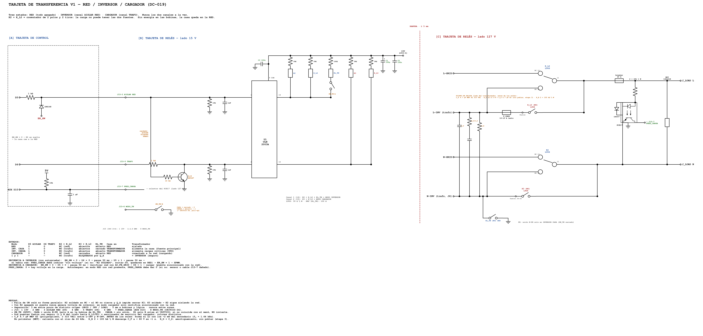
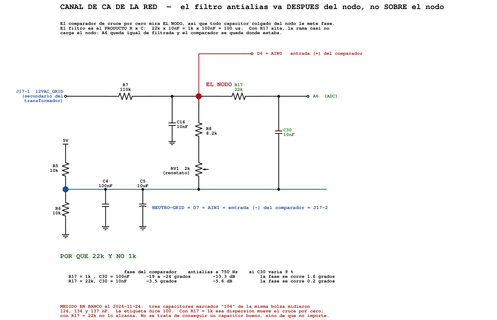

# Decisiones críticas de diseño

**Proyecto:** Isla del Sol — Puente H SPWM (inversor 48 V → 127 V / 60 Hz, 1000 W; modo cargador 1 kVA)
**Documento:** bitácora de decisiones del arquitecto (*Architecture Decision Record*, ADR)
**Estado:** vivo. Crece con el proyecto; las decisiones no se borran, se reemplazan por otras nuevas que las citan.
**Inicio:** 2026-11-06

> **Entre más información se transfiere, más se estabiliza el sistema.**

---

## Para qué existe este documento

El cobre muestra **qué** se hizo, pero no **por qué**. Un técnico de trinchera sabe medir, soldar y sustituir; lo que no puede adivinar es lo que el arquitecto consideró: la falla que evita un valor, el margen que protege una pieza, la opción que se descartó y por qué. Esa información es la primera que se pierde, y sin ella una "mejora" bien intencionada puede romper algo que estaba bien pensado.

Cada entrada tiene el mismo formato:
- **Contexto:** el problema y sus restricciones.
- **Alternativas consideradas:** con la razón para aceptarlas o descartarlas.
- **Decisión.**
- **Consecuencias:** lo que se gana, lo que se paga y lo que queda pendiente.

Las decisiones de este documento **pueden criticarse**, y deben hacerlo: si alguien encuentra un error o una opción mejor, se abre una entrada nueva que la reemplace, citando a la anterior. Vamos gateando; con la crítica, vamos a caminar.

---

## Índice

| ID | Decisión | Tarjeta | Fecha | Estado |
| --- | --- | --- | --- | --- |
| [DC-001](#dc-001-cascada-de-alimentación-de-baja-tensión-48--15--8--5-v) | Cascada de alimentación de baja tensión: 48 → 15 → 8 → 5 V | Control | 2026-11-06 | Vigente |
| [DC-002](#dc-002-buck-de-48-a-15-v-módulo-xl7015-en-socket-mixto) | Buck de 48 a 15 V: módulo XL7015 en socket mixto | Control | 2026-11-06 | Vigente |
| [DC-003](#dc-003-protección-de-la-entrada-de-48-v) | Protección de la entrada de 48 V | Control | 2026-11-06 | Vigente |
| [DC-004](#dc-004-pre-regulador-de-15-a-8-v-mp1584-en-socket-con-puente) | Pre-regulador de 15 a 8 V: MP1584 en socket con puente | Control | 2026-11-06 | Vigente |
| [DC-005](#dc-005-regulador-lineal-7805-para-el-riel-de-5-v) | Regulador lineal 7805 para el riel de 5 V | Control | 2026-11-06 | Vigente |
| [DC-006](#dc-006-sensado-ac-con-dos-transformadores-de-12-v-directos-al-adc) | Sensado AC con dos transformadores de 12 V directos al ADC | Control | 2026-11-06 | Vigente |
| [DC-007](#dc-007-sensado-del-voltaje-de-la-batería) | Sensado del voltaje de la batería | Control | 2026-11-06 | Vigente |
| [DC-008](#dc-008-tablero-de-diagnóstico-de-la-alimentación-led-test-points-y-valores-de-referencia) | Tablero de diagnóstico de la alimentación: LED, test points y valores de referencia | Control | 2026-11-06 | Vigente |
| [DC-009](#dc-009-objetivo-a-futuro-holgura-de-diseño-para-capacidad-médica) | Objetivo a futuro: holgura de diseño para capacidad médica | Todo el sistema | 2026-11-06 | Objetivo (no vigente) |
| [DC-010](#dc-010-reparto-de-tareas-entre-los-dos-atmega-enlace-i2c-con-latido-y-can-para-el-bms) | Reparto de tareas entre los dos ATmega, enlace I2C con latido y CAN para el BMS | Control | 2026-11-07 | Vigente (el papel en el bus lo revisa DC-027) |
| [DC-011](#dc-011-lectura-de-p9-las-dos-ramas-en-un-solo-pin-analógico-nunca-en-paralelo-directo) | Lectura de P9: las dos ramas en un solo pin analógico, nunca en paralelo directo | Control | 2026-11-07 | Vigente |
| [DC-012](#dc-012-los-nano-se-alimentan-por-5v-pin-27-nunca-por-vin) | Los Nano se alimentan por +5V (pin 27), nunca por VIN | Control | 2026-11-07 | Vigente |
| [DC-013](#dc-013-corriente-ac-con-pinza-sct-013-015-en-el-crítico-a2) | Corriente AC con pinza SCT-013-015 en el CRÍTICO (A2) | Control | 2026-11-07 | Vigente |
| [DC-014](#dc-014-corte-del-pwm-por-hardware-con-lógica-fail-safe-sensor_ok-y-doble-candado) | Corte del PWM por hardware con lógica fail-safe (SENSOR_OK) y doble candado | Control + sensor DC | 2026-11-08 | Vigente |
| [DC-015](#dc-015-corriente-de-fuga-y-aislamiento-se-diseñan-en-la-versión-2-después-de-validar-la-versión-1-en-campo) | Corriente de fuga y aislamiento: se diseñan en la versión 2, después de validar la versión 1 en campo | Sistema | 2026-11-08 | Diferida (V2) |
| [DC-016](#dc-016-corto-circuito-en-ac-niveles-de-protección-arranque-de-motores-arco-transferencia-y-reintentos) | Corto circuito en AC: niveles de protección, arranque de motores, arco, transferencia y reintentos | Control + potencia | 2026-11-08 | Vigente (V1) |
| [DC-017](#dc-017-presupuesto-de-cpu-y-memoria-de-los-atmega328p-y-alternativa-en-el-mismo-socket-nano-every-atmega4809) | Presupuesto de CPU y memoria de los ATmega328P, y alternativa en el mismo socket: Nano Every (ATmega4809) | Control | 2026-11-08 | Vigente (V1) / alternativa abierta |
| [DC-018](#dc-018-modulación-híbrida-a-24-khz-también-en-el-cargador-y-socket-multimodelo-atmega328p--atmega4809) | Modulación híbrida a 24 kHz también en el cargador, y socket multimodelo ATmega328P / ATmega4809 | Control | 2026-11-08 | Vigente (V1, por validar en banco) |
| [DC-019](#dc-019-transferencia-red--inversor--cargador-tres-estados-y-ninguna-falla-de-un-relé-forma-paralelo) | Transferencia red / inversor / cargador: tres estados y ninguna falla de un relé forma paralelo | Tarjeta de relés | 2026-11-08 | Vigente (V1, por validar en banco) |
| [DC-020](#dc-020-reloj-del-adc-a-128-y-muestreo-amarrado-a-la-portadora-precisión-antes-que-velocidad) | Reloj del ADC a /128 y muestreo amarrado a la portadora: precisión antes que velocidad | Control | 2026-11-16 | Vigente (V1, por validar en banco) |
| [DC-021](#dc-021-transformador-fuera-de-rango-qué-pasa-qué-se-detecta-solo-y-qué-no) | Transformador fuera de rango: qué pasa, qué se detecta solo y qué no | Potencia | 2026-11-18 | Vigente |
| [DC-022](#dc-022-socket-de-diagnóstico-autodiagnóstico-de-la-etapa-de-potencia-antes-de-la-primera-energización) | Socket de diagnóstico: autodiagnóstico de la etapa de potencia antes de la primera energización | Control + potencia | 2026-11-21 | Objetivo (no vigente) |
| [DC-023](#dc-023-comparador-analógico-interno-para-el-cruce-por-cero-y-tn_cmd-se-muda-a-d13) | Comparador analógico interno para el cruce por cero, y `TN_CMD` se muda a D13 | Control | 2026-11-21 | Vigente (V1, ruteado y verificado) |
| [DC-024](#dc-024-análisis-armónico-selectivo-goertzel-fuera-de-la-v1-y-qué-haría-falta-para-la-v2) | Análisis armónico selectivo (Goertzel): fuera de la V1, y qué haría falta para la V2 | Control | 2026-11-22 | Objetivo (V2, no vigente) |
| [DC-025](#dc-025-reparto-del-adc-entre-los-canales-tres-prioridades-y-por-qué-caben) | Reparto del ADC entre los canales: tres prioridades y por qué caben | Control | 2026-11-22 | Vigente |
| [DC-026](#dc-026-la-regla-del-cli-el-costo-se-paga-por-vuelta-del-lazo-no-por-unidad-de-tiempo) | La regla del `cli()`: el costo se paga por vuelta del lazo, no por unidad de tiempo | Control | 2026-11-22 | Vigente (medido en banco) |
| [DC-027](#dc-027-el-enlace-i2c-al-revés-el-crítico-es-maestro-del-bus-y-maestro-del-bus-no-es-quien-manda) | El enlace I2C al revés: el CRÍTICO es maestro del bus, y maestro del bus no es quien manda | Control | 2026-11-23 | Vigente (medido en banco) |
| [DC-028](#dc-028-el-lazo-de-control-de-ca-comparador-para-el-cruce-rms-de-medio-ciclo-por-pares) | El lazo de control de CA: comparador para el cruce, RMS de medio ciclo por pares | Control | 2026-11-24 | Vigente (medido en banco) |
| [DC-029](#dc-029-la-referencia-del-adc-es-avcc-y-eso-se-lleva-la-calibración-adentro) | La referencia del ADC es AVCC, y eso se lleva la calibración adentro | Control | 2026-11-24 | Vigente (por implementar) |
| [DC-030](#dc-030-el-enlace-can-con-el-bms-la-batería-es-la-autoridad-sobre-los-límites-y-nosotros-nada-más-latimos) | El enlace CAN con el BMS: la batería es la autoridad sobre los límites | Control | 2026-11-24 | Vigente (por implementar) |
| [DC-031](#dc-031-r3-del-canal-de-batería-sube-de-1-kω-a-47-kω-y-por-qué-un-zener-no-servía) | R3 del canal de batería sube de 1 kΩ a 47 kΩ, y por qué un zener no servía | Control | 2026-11-24 | Vigente |
| [DC-032](#dc-032-el-filtro-antialias-va-después-del-nodo-no-sobre-el-nodo-r17-sube-de-1-kω-a-22-kω) | El filtro del nodo: por qué R17 se queda en 1 kΩ (decisión revertida en banco) | Control | 2026-11-24 | ⚠️ Revertida |
| [DC-033](#dc-033-el-contrato-con-la-fuente-de-afuera-ventanas-de-red-y-de-generador-y-cuándo-cortar) | El contrato con la fuente de afuera: ventanas de red y de generador, y cuándo cortar | Control | 2026-11-25 | Vigente (por implementar) |
| [DC-034](#dc-034-programación-de-la-corriente-de-carga-el-límite-se-hace-cumplir-en-ca-no-en-la-batería) | Programación de la corriente de carga: el límite se hace cumplir en CA | Control | 2026-11-25 | Vigente (por implementar) |
| [Críticas esperadas](#críticas-esperadas-y-preguntas-abiertas) | Lo que sabemos que se puede discutir | — | 2026-11-06 | Abierto |

---

## DC-001. Cascada de alimentación de baja tensión: 48 → 15 → 8 → 5 V

> **En resumen: pagamos complejidad para comprar pureza en las lecturas del ADC.** El ADC es los ojos del inversor: si ve con ruido, el lazo de control y la sincronía con la red deciden mal.

**Contexto**

La tarjeta de control necesita dos rieles:
- **15 V** para los gate drivers (y su bootstrap), los relés y un ventilador;
- **5 V** para los dos Arduino Nano (ATmega328P), el LCD I2C y los sensores.

El riel de 5 V **no es solo alimentación: es la referencia del ADC** (AVCC). De él sale también el bias de 2.5 V del sensado AC, y de su limpieza depende la sincronía con la red.

**Consumo estimado**

| Riel | Carga | Corriente aprox. |
| --- | --- | --- |
| 15 V | Drivers (2 MOSFET a 24 kHz + 2 a 60 Hz) | 20–40 mA |
| 15 V | Relés (2–3) | 60–150 mA |
| 15 V | Ventilador de 12 V (si lo hay) | 100–200 mA |
| 5 V | 2 microcontroladores (Arduino Nano) + LCD con luz de fondo + sensores | 100–170 mA |
| **48 V** | **Entrada total** | **~0.1–0.2 A** (5–8 W) |

**Alternativas consideradas**

| Alternativa | Por qué no |
| --- | --- |
| 7805 directo de 15 a 5 V | Cae 10 V en el regulador: a 150 mA son **1.5 W**. Sin disipador, Tj ≈ 115 °C a 40 °C de ambiente; a 200 mA, cerca del corte térmico |
| Buck directo de 15 a 5 V | Frío, pero su rizo de **20–50 mV** cae en el AVCC: son **4–10 cuentas** de ruido del ADC (1 cuenta ≈ 4.9 mV), justo en las lecturas AC de las que depende la sincronía |
| Buck directo de 48 a 5 V | El mismo problema de rizo, y un segundo módulo de alto voltaje |

**Decisión**

Una cascada de tres etapas, cada una haciendo lo que mejor sabe hacer:

```
48 V ──[XL7015, buck]──► 15 V ──[MP1584, buck]──► 8 V ──[7805, lineal]──► 5 V
 batería          drivers, relés,          cae solo 3 V:            MCU, LCD, 
                  ventilador               ~0.45 W a 150 mA         sensores, AVCC
```

- **Los bucks hacen el trabajo pesado** (eficiencia de ~85–90 %).
- **El 7805 trabaja frío y limpia el rizo** del MP1584: rechaza ~60 dB a baja frecuencia.
- **El 7805 necesita al menos ~7 V de entrada** (su caída es de ~2 V); por eso el MP1584 se ajusta a **7–8 V**.

**Consecuencias**

- ✅ El 5 V queda limpio para el ADC y los reguladores van fríos.
- ✅ Cada etapa es reemplazable por separado (sockets).
- ⚠️ Son tres etapas en serie: si una falla, se cae todo lo que está después. Cada riel tiene su test point para encontrar la falla con el multímetro.
- ⚠️ **Los relés no van en 5 V:** una bobina de 5 V consume 70–90 mA, y con dos el 7805 se sale de su presupuesto térmico. Van en 12 o 15 V.

---

## DC-002. Buck de 48 a 15 V: módulo XL7015 en socket mixto

**Contexto**

La batería de 48 V llega hasta **58.4 V** (LiFePO4 16S cargada) o **62–64 V** (plomo-ácido en ecualización), más los picos de conexión. El buck tiene que aguantar eso y conseguirse en cualquier rincón.

**Alternativas consideradas**

| Alternativa | Entrada máxima | Por qué sí o por qué no |
| --- | --- | --- |
| LM2596 | 40 V | ❌ Descartado: no aguanta ni la batería nominal |
| LM2596HV | 60 V | ❌ Descartado: queda debajo de la batería de plomo-ácido en ecualización |
| **XL7015 (módulo)** | **80 V**, 0.8 A [1] | ✅ **Elegido:** se encuentra en todo el mundo y cuesta menos que una botella de agua |
| LM5164 (diseño propio) | 100 V, 1 A, síncrono, UVLO programable [2] | Mejor margen, pero se consigue con distribuidor: queda como opción "de producción" |

**Decisión**

- **Módulo XL7015 en un socket mixto:** el área y los pines admiten el **módulo amplio o el reducido**. Solo se instala uno.
- **El módulo de trinchera define el estándar.** El área, la posición de los pines y la altura se toman del XL7015. Quien diseñe un buck más robusto (con el LM5164, por ejemplo) debe caber en esa misma huella, con sus pines en el mismo lugar.
- **Contrato de interfaz del área:**
  - entrada de 40–64 V en operación, y el diseño debe aguantar ≥80 V;
  - salida de **15 V ±5 %**, ≥0.8 A continuos, con rizo ≤100 mV pico a pico.

**Consecuencias**

- ✅ Se usa el módulo que haya en el cajón ese día.
- ⚠️ **El margen de 80 V es justo:** sobre 64 V queda un ~25 %. La protección de la entrada (DC-003) es parte de esta decisión, no un extra.
- ⚠️ **Muchos clones traen el electrolítico de entrada de 63 V.** Con plomo-ácido en ecualización queda al límite. **Revisión obligatoria:** si es de 63 V, se cambia por uno de 100 V.
- ⚠️ **El XL7015 no tiene UVLO ajustable:** sigue consumiendo con la batería casi vacía. El firmware, con la lectura de la batería (DC-007), debe apagar el inversor por bajo voltaje. Más adelante, el BMS o un relé de corte desconecta todo.
- **Advertencias en la serigrafía** (el poka-yoke):
  - **"AJUSTAR A 15V ANTES DE INSERTAR"**, dentro del contorno del módulo: se ve justo cuando el socket está vacío. El potenciómetro puede venir de fábrica en 20 V o más.
  - **"⚠ NUNCA PUENTEAR IN → OUT"**. En el MP1584 (DC-004) sí se puentea; aquí meterías **48 V al riel de 15 V** y quemarías los drivers, el 7805 y los microcontroladores de un golpe.
  - **"SOLO UNO"** (amplio o reducido).

---

## DC-003. Protección de la entrada de 48 V

**Contexto**

Los picos vienen de conectar la batería (la inductancia del cable cargando los capacitores), de relés y ventiladores que conmutan cerca, y de un fusible o un cable que se abren con carga.

**Decisión**

| Componente | Función | Prioridad |
| --- | --- | --- |
| **R14 de 2.2 Ω (½ W THT) + fusible T1A**, en J8 del puente H | Fusible de bajo costo y limitador de la corriente de arranque | Obligatorio |
| **D1, TVS SMBJ58A** (LiFePO4) o **SMBJ64A** (plomo-ácido) | Última línea contra los picos rápidos | Obligatorio |
| **C17, 1 µF / 100 V X7R (1210)** | Picos de alta frecuencia, pegado a la entrada del módulo | Obligatorio |
| El electrolítico del propio módulo, **revisado que sea de 100 V** | Energía local del buck | Obligatorio |
| **C18, 47–100 µF / 100 V** | Junto con R14 forma un filtro RC (τ ≈ 220 µs) que aplana los picos de conexión | Opcional, recomendado |

**Por qué el SMBJ58A y no otro** [3]

| Parámetro | SMBJ58A | Qué significa |
| --- | --- | --- |
| VRWM | 58 V | Hasta aquí no conduce (fuga de µA) |
| VBR | 64.4–71.2 V | Aquí empieza a conducir |
| VC | 93.6 V a ~6.4 A | El peor caso con un pico grande |

- Es el TVS **más bajo que no estorba a la batería LiFePO4 cargada** (58.4 V). Uno más bajo se calentaría con la batería llena.
- **Con plomo-ácido en ecualización (62–64 V)** quedaría pegado a la ruptura: se usa el **SMBJ64A**.
- **Para ser honestos:** con un pico grande, el TVS recorta en ~94 V, **arriba de los 80 V del XL7015**. Con los picos chicos conduce cerca de su VBR (~65–70 V) y sí protege. Contra los picos grandes, **la defensa real es el filtro R14 + C18**; por eso C18 se recomienda aunque no sea obligatorio.
- **Polaridad:** el cátodo (la banda) va a 48 V. Si se pone al revés, es un corto a GND al conectar la batería.

**Consecuencias**

- ✅ Protección en capas: filtro, TVS y fusible.
- ⚠️ C18 es opcional porque el módulo ya trae su propio electrolítico. Sin C18, la entrada depende más del TVS.
- **Separación del cobre de 48 V:** 0.6 mm en pistas y 1 mm en los terminales (IPC-2221, tabla B2: conductores externos sin recubrimiento, 31–100 V).

---

## DC-004. Pre-regulador de 15 a 8 V: MP1584 en socket con puente

**Contexto**

El 7805 necesita bajar su caída de voltaje para ir frío (DC-001), pero no se le puede meter un buck directo a 5 V.

**Decisión**

- **Módulo MP1584EN en socket,** ajustado a **7–8 V**.
- **"SIN MÓDULO: PUENTE IN_POS → OUT_POS".** Sin el MP1584, el 7805 recibe los 15 V directo: funciona igual, solo que necesita disipador. La tarjeta nunca se queda parada por falta de un módulo.

**Consecuencias**

- ✅ El 7805 cae solo ~3 V: ~0.45 W a 150 mA, sin disipador.
- ✅ Puentear aquí es seguro: el 7805 aguanta hasta 35 V en la entrada.
- ⚠️ **Esta regla es la contraria a la del XL7015** (DC-002). Por eso las dos advertencias están escritas en la serigrafía, una junto a la otra.

---

## DC-005. Regulador lineal 7805 para el riel de 5 V

**Decisión**

- **Huella doble: TO-220 (U1) o D2PAK (U2), solo uno.** Se usa el que haya.
- **Salida:** 100 µF + 10 µF + 1 µF. El 7805 es estable con eso.
- **Entrada:** 1 µF pegado al pin IN. La hoja de datos pide ≥0.33 µF cuando el regulador queda lejos del capacitor de la fuente.

**Consecuencias**

- ✅ Un 5 V limpio para el AVCC y el bias del sensado AC.
- ⚠️ **El D2PAK depende del cobre** para disipar. Con el MP1584 en su lugar no hay problema; sin él (con 15 V en la entrada), el TO-220 con disipador es la opción segura.

---

## DC-006. Sensado AC con dos transformadores de 12 V directos al ADC

**Contexto**

Se necesitan dos lecturas AC: la salida del inversor (para el lazo de amplitud) y la red (para sincronizarse antes de transferir). Las dos van al ATmega 2, junto con los relés de transferencia.

**Alternativas consideradas**

| Alternativa | Por qué sí o por qué no |
| --- | --- |
| ZMPT101B | Bueno, pero no se encuentra en todas partes: queda como mejora opcional |
| Transformador con la señal rectificada | ❌ Pierde la polaridad y el cruce por cero: no sirve para la sincronía |
| Un solo transformador conmutado | ❌ Agrega un relé en la ruta de la señal, más tiempo de conmutación y más puntos de falla |
| **Dos transformadores de 120 a 12 V, sin rectificar, con bias de 2.5 V** | ✅ **Elegido:** pieza de trinchera y el ADC ve la onda completa |

**Decisión y valores**

- **Divisor:** **110 kΩ** + (8.2 kΩ + **trimmer Bourns 3296W de 2 kΩ**).

  > ⚠️ **Actualizado con mediciones de banco; el texto original decía 100 kΩ y «16 VAC en vacío».** La Parte A mostró el 2026-11-21 que **con 100 kΩ la cadena recorta con la red a 140 V**, con cualquiera de las dos crestas supuestas, así que `Rt` subió a 110 kΩ (montada como 100 k + 10 k en serie, efectiva 109.6 kΩ). Y el dimensionado ya no se hace contra «16 VAC en vacío» —que equivalen a unos 135 V de red— sino **contra el máximo que la [DC-033](#dc-033-el-contrato-con-la-fuente-de-afuera-ventanas-de-red-y-de-generador-y-cuándo-cortar) tolera.**
  >
  > **El trimmer se calibra contra ese máximo, nunca contra el nominal.** Ajustarlo mirando los 127 V del día se come la reserva justo cuando hace falta.
- **El trimmer se conecta como reóstato** (el cursor unido a un extremo): si el cursor pierde contacto, la resistencia se va a 2 kΩ y el canal no queda flotando.
- **Bias de 2.5 V con 10k/10k + 10 µF + 100 nF,** uno por canal, para que una señal no se cuele en la otra.
- **Filtro antialias en el pin** (A0 y A6): `R17` de 1 kΩ en serie con `C30` de 100 nF al bias, más `C16` de 100 nF en el nodo.

  > ⚠️ **El texto original decía «10 nF, desfase de ~2°, igual en los dos canales, así que se cancela». Las tres partes resultaron falsas** y la [DC-032](#dc-032-el-filtro-antialias-va-después-del-nodo-no-sobre-el-nodo-r17-sube-de-1-kω-a-22-kω) las corrigió con mediciones: los valores son de 100 nF, el desfase real del cruce por cero anda en **−19 a −24°**, y **no se cancela** en lo que importa, porque el instante del cruce lo da el comparador y no la comparación entre canales. Además la rama de `R17` **ancla el nodo contra el ruido**, que es una tercera función que este texto no contaba: subirla a 22 kΩ se probó en banco y empeoró el comparador.
- **A6 solo existe en el ATmega328P TQFP** (el del Nano). En el DIP-28 no hay A6: hay que usar A1–A3.
- **Serigrafía "12VAC / RET",** no "L1 / N": nadie debe pensar que ahí entra la red de 120 V.

**Consecuencias**

- ⚠️ **Firmware:** el ADC lee un canal a la vez (~104 µs por conversión). Eso equivale a **~2.25° de desfase** entre las dos lecturas, casi la mitad de la ventana de sincronía de 5°. El firmware debe restarlo o alternar el orden de las lecturas. → **Resuelto en [DC-020](#dc-020-reloj-del-adc-a-128-y-muestreo-amarrado-a-la-portadora-precisión-antes-que-velocidad):** el instante de la medición es determinista, así que el desfase entre canales deja de ser un error y pasa a ser una constante conocida (2.70° a 60 Hz) que se resta.
- **Calibración en trinchera:** se mide la salida con el multímetro y se gira el trimmer hasta que el ATmega reporte el mismo valor. La corrección fina va por software, en la EEPROM.

---

## DC-007. Sensado del voltaje de la batería

**Decisión**

- **Divisor 68k + 68k + 10k** (ganancia de 0.0685): 48 V → 3.29 V; 58.4 V → 4.00 V; el ADC llega a 5 V con **~73 V**. Cubre cualquier química de 48 V.
- **Dos de 68k en serie:** si una se pone en corto, la otra sigue limitando, y cada una solo ve ~27 V.
- **R3 de 47k + C1 de 1 µF en el pin A3:** C1 es la fuente de baja impedancia para el ADC y R3 limita la corriente hacia los diodos de protección. **R3 subió de 1 kΩ a 47 kΩ el 2026-11-24** ([DC-031](#dc-031-r3-del-canal-de-batería-sube-de-1-kω-a-47-kω-y-por-qué-un-zener-no-servía)): con 1 kΩ, un error de cableado que llevara el nodo a BAT+ metía 48 mA al pin, arriba del máximo absoluto.
- **Falla segura:** si R4 se abre, la lectura sube, el firmware ve un "sobrevoltaje" y apaga.

**Consecuencias**

- ⚠️ **El filtro es lento a propósito** (τ ≈ 10 ms, corte en ~15 Hz): sirve para la caída lenta de la batería y para la protección por bajo voltaje. **No sirve** para compensar el rizo de 120 Hz del bus en la SPWM; eso lo corrige el lazo PI de amplitud con la lectura AC. Si algún día se quiere compensar el rizo de 120 Hz por feedforward, C1 baja a 100 nF.
- ⚠️ Si el 48 V del sensado comparte cable con la alimentación del buck, la lectura queda después de R14: con ~0.2 A caen ~0.4 V. Para una lectura más exacta, el sensado lleva su propio cable.
- **Separación:** 1 mm en el terminal y 0.6 mm en el divisor.

---

## DC-008. Tablero de diagnóstico de la alimentación: LED, test points y valores de referencia

> **Los datos cuantitativos de diagnóstico son oro.** El LED dice *dónde* está la falla; el test point, con su valor de referencia, dice *qué tan mal* está.

**Contexto**

La cascada de DC-001 tiene tres etapas en serie: cuando algo falla, se apaga todo lo que está después. El usuario necesita saber **en qué etapa** está la falla sin abrir el README, y el técnico necesita **números** contra los cuales comparar su multímetro.

**Decisión 1: un LED por riel, en fila y en el orden de la cascada**

LED rojos o verdes, **los cuatro del mismo tipo y color** (Vf ≈ 2 V), a **~1.3 mA** para que todos brillen parejo. Todas las resistencias son de **¼ W** y de valores E12.

| LED | Confirma | Resistencia | Corriente | Potencia en R |
| --- | --- | --- | --- | --- |
| **48 V** | Hay batería; el fusible y R14 están bien | **47 kΩ ¼ W** | 0.98 mA (1.3 mA a 64 V) | 80 mW a 64 V |
| **15 V** | El XL7015 funciona | 10 kΩ | 1.3 mA | 17 mW |
| **8 V** | El MP1584 funciona (o está el puente) | 4.7 kΩ | 1.3 mA | 8 mW |
| **5 V** | El 7805 funciona | 2.2 kΩ | 1.4 mA | 4 mW |

*Historial:* la primera versión usaba 22 kΩ de ½ W en el LED de 48 V y ~3 mA en los demás. Se cambió a 47 kΩ (propuesta del arquitecto): basta una resistencia de ¼ W, se calienta menos junto al cobre de 48 V y gasta menos batería; los demás LED se bajaron a ~1.3 mA para que brillen igual. Un LED blanco o azul (Vf ≈ 3 V) brillaría menos con estos valores.

**El LED de 48 V es obligatorio:** es el único que se alimenta directo de la batería, no de la cascada. Sin él, "todo apagado" no distingue una falla de batería de una falla del XL7015.

**Cómo se lee el tablero**

| 48V | 15V | 8V | 5V | Diagnóstico |
| --- | --- | --- | --- | --- |
| ⚫ | ⚫ | ⚫ | ⚫ | No llega batería: fusible, R14 o cable |
| 🟢 | ⚫ | ⚫ | ⚫ | El XL7015 falta, falla, o no está bien insertado |
| 🟢 | 🟢 | ⚫ | ⚫ | Falla el MP1584, o falta el puente sin módulo |
| 🟢 | 🟢 | 🟢 | ⚫ | Falla el 7805 (abierto), o hay un corto en el riel de 5 V |
| 🟢 | 🟢 | 🟢 | 🟢 | Hay voltaje en todos los rieles. **Confirmar los valores con los test points** |

Para distinguir el 7805 de un corto en el riel de 5 V: se desconectan las cargas de 5 V (los microcontroladores, el LCD). Si el LED prende, el corto está en una carga; si sigue apagado, es el 7805.

Serigrafía junto a los LED: **"TODOS ENCENDIDOS = HAY VOLTAJE · EL PRIMERO APAGADO = ETAPA EN FALLA"**.

**Decisión 2: valores de referencia para cada test point**

| Test point | Nominal | Rango aceptable | Debajo del rango | Arriba del rango |
| --- | --- | --- | --- | --- |
| **48 V** (BAT) | 51.2 V (LiFePO4) / 48 V (plomo) | 40–58.4 V (LiFePO4) · 42–64 V (plomo) | Batería descargada: el firmware apaga el inversor | Cargador mal ajustado; revisar el TVS (DC-003) |
| **15 V** | 15.0 V | **14.25–15.75 V** (±5 %) | < 12 V: los drivers pierden margen sobre su UVLO | > 16.5 V: XL7015 mal ajustado; el zener de 18 V del bootstrap empieza a trabajar |
| **8 V** | 7.5–8 V | **7.0–9.0 V** | < 7 V: el 7805 sale de regulación (su caída es de ~2 V) | > 10 V: el 7805 se calienta (> 0.75 W a 150 mA) |
| **5 V** | 5.00 V | **4.80–5.20 V** (L7805C: ±4 %) | Sobrecarga o 7805 dañado | **> 5.5 V: sospechar que el 7805 falló en corto.** El ATmega328P aguanta como máximo 6.0 V |
| **Bias AC** (2.5 V) | 2.50 V | 2.45–2.55 V (resistencias al 1 %) | — | Una resistencia del bias equivocada o abierta |

**Consumo de referencia en la entrada de 48 V, con el inversor apagado:** ~0.1–0.2 A. **Más de 0.3 A sin inversor** indica un corto o una carga que no debería estar en los rieles de baja tensión.

**Decisión 3: protección contra el 7805 en corto**

**Un 7805 puede fallar en corto,** con la entrada unida a la salida. Entonces los 8 V pasan al riel de 5 V, el LED de 5 V **sigue prendido** (un poco más brillante) y el tablero **no lo detecta**. A 8 V se queman los microcontroladores y el LCD.

| Componente | Función |
| --- | --- |
| **TVS SMAJ5.0A**, del riel de 5 V a GND | Conduce si el riel sube de ~6.4 V |
| **Fusible reseteable (PTC) de ~500 mA**, en la entrada de 8 V del 7805 | Cuando el TVS conduce, la corriente sube y el PTC se abre: protege a los microcontroladores |

**Decisión 4: autodiagnóstico por firmware (costo cero de hardware)**

- **El 5 V se mide a sí mismo:** el ATmega328P puede leer su **referencia interna de 1.1 V** usando AVCC como referencia. Entonces **VCC = 1.1 V × 1023 / lectura**. La referencia interna varía entre 1.0 y 1.2 V según la hoja de datos, así que se calibra una vez contra el multímetro y la constante se guarda en la EEPROM.
- **El 48 V ya se mide** con el sensado de la batería (DC-007).
- **Opcional:** el riel de 15 V en un pin analógico libre del **AUX** (en el CRÍTICO, A2 se usa para la corriente AC, DC-013, y A7 para P9, DC-011), con un divisor de **47 kΩ / 10 kΩ** (15 V → 2.63 V; llega a 5 V con 28.5 V).
- **El LCD muestra los valores reales:** el usuario lee "BAT 51.2V · 15V OK · 5V 4.98V" en lugar de adivinar.

**Consecuencias**

- ✅ El usuario sabe **dónde** está la falla (los LED), y el técnico sabe **qué tan mal** está (los test points con su valor de referencia).
- ⚠️ **El LED dice "hay voltaje", no "el voltaje es correcto".** Un XL7015 ajustado a 20 V prende el LED de 15 V igual. El valor lo confirman el test point o el LCD.
- ✅ Los cuatro LED suman ~5 mA repartidos en los cuatro rieles: **~0.1 W** vistos desde la batería. Es el precio de poder ver el estado de la cascada.

---

## DC-009. Objetivo a futuro: holgura de diseño para capacidad médica

> **Lo más grande que puede lograr la Isla del Sol es ayudar a salvar una vida.** Cerca de mil millones de personas se atienden en centros de salud sin electricidad o con electricidad poco confiable [7]. Para llegar ahí, hay que esforzarse más en los requerimientos de diseño.

**Estado:** objetivo, no vigente. **El prototipo actual (versión 1) NO es apto para cargas de soporte vital ni para el entorno del paciente** (ver DC-015). Esta entrada deja registrado lo que el diseño tendría que cumplir para acercarse a esa capacidad, para que cada decisión nueva lo tome en cuenta desde ahora.

**Por escalones (de menor a mayor exigencia)**

| Escalón | Cargas | Qué exige |
| --- | --- | --- |
| 1. Salud comunitaria | Iluminación de partos, refrigerador de vacunas e insulina, carga de oxímetros y de radios | Validación en banco completa, horas de operación, prueba de arranque de compresores |
| 2. Clínica | Concentradores de oxígeno pequeños, equipos de diagnóstico | Lo anterior, más certificación de seguridad como convertidor o UPS, y transferencia sin interrupción |
| 3. Quirófano | Soporte vital | Instalación hospitalaria certificada, redundancia y normas de lugares médicos. Fuera del alcance de un solo equipo: es el sistema completo |

**Holguras de diseño a considerar desde ahora**

| Tema | Hoy (prototipo) | Para capacidad médica |
| --- | --- | --- |
| **Reducción de esfuerzo de los componentes** (*derating*) | Rizo por Rubycon al **95–97 %** de su capacidad (auditoría) | Componentes al **≤ 50–70 %** de su capacidad: más capacitores en el bus, MOSFET y cobre con margen |
| **Margen térmico** | Tj ≈ 62 °C a 40 °C de ambiente, con sensibilidad de −33/+70 % | Validado con termopar, más margen por gabinete cerrado, polvo y alta temperatura ambiente |
| **Arranque de cargas** | Por validar ("la prueba de la margarita") | Arrancar compresores y motores de forma repetida sin disparar la protección |
| **Calidad de la onda** | Por medir | Distorsión armónica baja (orden de < 5 %), regulación de voltaje y frecuencia medida bajo carga |
| **Continuidad** | Transferencia por relés | Tiempo de transferencia medido y documentado; sin un punto único de falla |
| **Aislamiento y fuga** | Transformador de salida (aislamiento galvánico). **No se consideró la fuga en la tarjeta de control ni en el puente H: ver DC-015** | Diseño de la versión 2 con datos de campo de la V1 (DC-015): fuga ≤ 100 µA de contacto, aislamiento 2 MOOP/2 MOPP, monitor de aislamiento |
| **Diagnóstico** | Tablero de LED y test points (DC-008) | Alarmas audibles, registro de eventos, autodiagnóstico continuo |
| **Fiabilidad** | Sin datos | Horas de quemado (*burn-in*), pruebas de falla inducida, registro de fallas en campo |
| **Fabricación** | Tarjetas de trinchera | Recubrimiento conformado contra humedad, trazabilidad de componentes |

**Normas de referencia (verificar la versión vigente antes de usarlas)**
- **IEC 62109-1:** seguridad de convertidores de potencia para sistemas fotovoltaicos.
- **IEC 62040-1 y 62040-3:** seguridad y desempeño de sistemas de alimentación ininterrumpida (UPS).
- **IEC 60601-1:** seguridad de equipo electromédico. Aplica a los equipos que se alimentan, no al inversor, pero define lo que esos equipos esperan de su alimentación.
- **IEC 60364-7-710:** instalaciones eléctricas en lugares médicos.
- **México:** NOM-001-SEDE, artículo 517 (instalaciones en lugares de atención de la salud).

**Consecuencias**

- ✅ Cada decisión nueva puede preguntarse: *¿esto acerca o aleja a la Isla del Sol del escalón 1?*
- ⚠️ **La primera holgura que hay que atender es el rizo de los Rubycon** (95–97 %): para uso médico es un margen demasiado corto.
- ⚠️ **Ningún documento sustituye la validación:** solo un equipo con historial medido se gana el derecho de estar cerca de un paciente.

---

## DC-010. Reparto de tareas entre los dos ATmega, enlace I2C con latido y CAN para el BMS

> **Lo que decide la onda y la protegen vive en un solo micro. Lo que informa y conversa vive en el otro.**

**Contexto**

La tarjeta de control usa dos Arduino Nano (ATmega328P TQFP). Hay que repartir:
- la SPWM;
- los sensados AC y la sincronía con la red;
- los relés de transferencia;
- el BMS por CAN, el LCD, el ventilador y el buzzer.

**Esta entrada reemplaza** lo que decía el borrador de la arquitectura de control: los sensados AC y los relés iban al ATmega 2.

**Decisión**

| ATmega 1 — **CRÍTICO** | ATmega 2 — **AUX** |
| --- | --- |
| SPWM: HA/LA en D9/D10 (Timer1), HB/LB en D11/D3 | CAN con el BMS: MCP2515 por SPI (CS en D9, INT en D2) |
| Sensado AC del inversor (A0) y de la red (A6) | LCD por I2C **en un bus aparte** (D4/D5, I2C por software) |
| Batería (A3) y temperatura (A1) | ~~Sensor de corriente AC ZMCT103C (A1)~~ → reemplazado por el SCT-013-015 en el CRÍTICO (DC-013); el AUX recibe el monitor del riel de 15 V |
| Relés de transferencia (D4, D5, D6) y encendido (D12) | Ventilador (D6), buzzer, LED y botón (D8) |
| **Maestro del enlace I2C (A4/A5)** — abre, reporta y recoge órdenes ([DC-027](#dc-027-el-enlace-i2c-al-revés-el-crítico-es-maestro-del-bus-y-maestro-del-bus-no-es-quien-manda)) | **Esclavo del enlace I2C (A4/A5) en 0x21 — y el que manda** ([DC-027](#dc-027-el-enlace-i2c-al-revés-el-crítico-es-maestro-del-bus-y-maestro-del-bus-no-es-quien-manda)) |

**Por qué los sensados AC y los relés van en el CRÍTICO:** para sincronizarse con la red hay que **ajustar la fase de la tabla de senos**, y eso solo lo puede hacer el micro que genera la SPWM. Si la sincronía pasara por el enlace I2C, el retraso del enlace se comería parte de la ventana de 5°. La transferencia de los relés tiene que ocurrir en el instante que decide la sincronía, en el mismo micro.

**Por qué el LCD va en un bus aparte:** si el LCD se cuelga, se desconecta o tiene un falso contacto, **no tumba el enlace entre los dos ATmega**.

**El enlace I2C**
- **Pull-ups de 4.7 kΩ a 5 V en A4/A5,** un solo par para todo el bus (R10 y R11). El Nano no los trae, y los internos del ATmega (20–50 kΩ) son demasiado débiles. Con ~100 pF, el flanco sube en ≈ 0.4 µs, contra 1 µs como máximo a 100 kHz. El mínimo permitido es ≈ 1.5 kΩ (3 mA por pin) [8].
- ⚠️ **Quién abre el bus: revisado por [DC-027](#dc-027-el-enlace-i2c-al-revés-el-crítico-es-maestro-del-bus-y-maestro-del-bus-no-es-quien-manda).** Esta entrada dejaba abierto «esclavo o maestro» y en el firmware se cerró del lado equivocado: el CRÍTICO quedó de esclavo con el argumento de que «nunca espera al bus». En banco eso costó pasos de la onda, y ahora **el CRÍTICO es maestro del bus**. Dos cosas que conviene no confundir y que DC-027 explica en detalle:
  - **Maestro del bus no es quien manda.** El AUX sigue mandando: pide los perfiles, trae los permisos del BMS y tiene el AUX_KILL por hardware. El CRÍTICO lleva el reloj; en cada transferencia nada más reporta su estado y recoge órdenes.
  - **El bloqueo del enlace es del lazo, no de las interrupciones.** 2.63 ms por transferencia, 2.6 % del lazo a 10/s, y la ISR del SPWM no se entera. Ésa es la distinción que faltaba aquí.
- **Latido (*heartbeat*):** el AUX manda un mensaje cada ~100 ms con los permisos de carga y descarga del BMS. **Si el CRÍTICO no recibe nada en ~500 ms, deja de cargar** y sigue protegiendo la batería con su propia lectura de A3.
- **El CRÍTICO nunca depende del enlace para protegerse:** la sobrecorriente, el bajo voltaje y la temperatura se deciden con sus propias lecturas.
- **El bus no se debe colgar:** se usa `Wire.setWireTimeout()` (núcleo AVR de Arduino).
- **Mensajes cortos:** cada byte dispara una interrupción de TWI en el CRÍTICO, y mientras corre, la interrupción de la SPWM espera. El Timer1 actualiza con doble búfer y tolera retrasos de unos µs. **Medido en banco:** con el enlace corriendo, el costo propio de la ISR del SPWM queda en 218 ciclos (32.7 % del periodo de portadora) y la ocupación peor en ~51 %, sin perder un solo paso de la onda hasta 192 transferencias por segundo — 20 veces el tráfico de producción ([DC-027](#dc-027-el-enlace-i2c-al-revés-el-crítico-es-maestro-del-bus-y-maestro-del-bus-no-es-quien-manda)).

**El CAN con el BMS**
- **Módulo MCP2515 + TJA1050 (HW-184)** en un socket de 7 pines, en el mismo orden que el módulo: VCC, GND, CS, SO, SI, SCK, INT.
- **RJ45 tipo Pylontech:** pin 4 = CAN_H, pin 5 = CAN_L, pin 6 = GND [9]. Los pines 4 y 5 forman un par trenzado en un cable de red. Antes de conectar una batería de otra marca, se revisa el manual de su puerto CAN.
- **El header J13 (H/L) va en paralelo** al RJ45, para conectar con cable suelto.
- **El cristal del módulo es de 8 MHz:** en el firmware se declara `MCP_8MHZ` a **500 kbps**. Muchas bibliotecas asumen 16 MHz, y con eso el bus queda a la mitad de velocidad y no se comunica con nada.
- **D10 (SS) del AUX queda como salida** en el firmware. Si se queda como entrada y recibe un nivel bajo, el SPI del AVR se pasa a modo esclavo y el CAN se cae.
- **Terminación de 120 Ω:** jumper J1 del módulo puesto, porque el inversor es un extremo del bus. El bus lleva exactamente dos terminaciones.

**Consecuencias**

- ✅ La sincronía y la transferencia no dependen de ningún enlace.
- ✅ Una falla del LCD o del CAN no afecta la generación de la onda.
- ✅ **El CRÍTICO carga con más trabajo, y ya está medido.** La SPWM a 24 kHz deja 666 ciclos de reloj por periodo. Con el SPWM, los tres canales de ADC y el enlace corriendo juntos: **218 ciclos de costo propio (32.7 %)** y ~51 % de ocupación en el peor caso, con cero pasos perdidos. Medir con un pin no habría alcanzado: el pin no ve el vector de interrupción ni el prólogo del compilador, que son 74 ciclos — **38 % del costo real**. Se midió leyendo `TCNT1` desde dentro de la propia ISR (Parte C del protocolo de banco, etapa 1).
- **Pines libres para crecer:**
  - en el CRÍTICO: D2 (reservado para el FAULT), D8 y D13 (A2 se usa para la corriente AC, DC-013; A7 para P9, DC-011);
  - en el AUX: D3, D7, A0, A1, A2, A3, A6 y A7 (uno de ellos, para el monitor del riel de 15 V, DC-013).

---

## DC-011. Lectura de P9: las dos ramas en un solo pin analógico, nunca en paralelo directo

> **El poka-yoke se diseña para lo que puede pasar, no para lo que debería pasar.**

**Contexto**

Cada módulo de gate driver declara su tiempo muerto por P9: **GND = 500 ns** (IRS2186, UCC21520) y **abierto = 1 µs** (TLP250). Los módulos son intercambiables por diseño, así que en la trinchera **puede haber módulos mezclados**: por ejemplo, se quema un UCC21520 y en el cajón solo hay un TLP250.

**Alternativas consideradas**

| Alternativa | Por qué sí o por qué no |
| --- | --- |
| P9A y P9B en paralelo, en un solo pin digital | ❌ **Descartada.** En paralelo **gana el GND**: con un UCC en una rama y un TLP250 en la otra, el ATmega lee 500 ns y **el TLP250 conduce cruzado**. Rompe la falla segura |
| Paralelo + la regla escrita "NO MEZCLAR MÓDULOS" | ❌ Es una regla, no un poka-yoke: en la trinchera las reglas se rompen por necesidad |
| Un pin digital por rama (D8 y A2) | Seguro, pero usa dos pines libres del CRÍTICO |
| **Un pin analógico con tres resistencias de distinto valor** | ✅ **Elegida:** un solo pin, segura con módulos mezclados, y dice cuál rama es distinta |

**Decisión (bloque "SPWM DT CONFIG")**

```
5V ──[R12 10k]──┬──► A7 (solo analógico)
                ├──[R13 10k]── P9_A (J1-5)
                └──[R14 20k]── P9_B (J3-5)
```

| Rama A | Rama B | Voltaje en A7 | Cuentas del ADC (10 bits, 5 V) | Firmware |
| --- | --- | --- | --- | --- |
| Abierto | Abierto | **5.00 V** | ~1023 | 1 µs |
| Abierto | GND | **3.33 V** | ~682 | 1 µs, con aviso "DT MIXTO (A)" (la rama A tiene el módulo de 1 µs) |
| GND | Abierto | **2.50 V** | ~512 | 1 µs, con aviso "DT MIXTO (B)" |
| GND | GND | **2.00 V** | ~409 | **500 ns** |
| — | — | **< 1.8 V** | < ~368 | 1 µs, con aviso "FALLA P9" (corto a GND en el nodo) |

- **Solo se permiten 500 ns si la lectura cae entre 1.8 y 2.2 V** (~368 a ~450 cuentas). Cualquier otro valor da 1 µs.
- **Margen:** entre el caso de 500 ns (2.00 V) y el más cercano (2.50 V) hay ~100 cuentas. Con resistencias al 1 % sobra.
- **R13 y R14 también protegen el pin:** limitan la corriente si llega un voltaje indebido por el cable de P9.
- **100 nF de A7 a GND,** junto al microcontrolador, para filtrar el ruido de la conmutación de 24 kHz.
- **A7 es el uso ideal:** es solo analógico, y aquí solo se necesita una lectura analógica. **El monitor del riel de 15 V (DC-008) pasa al AUX** (DC-013).
- **D2 (INT0) queda reservado** para el FAULT de sobrecorriente del sensor DC.

**Reglas del firmware**
1. Leer A7 **al arrancar, antes de habilitar la SPWM**, varias veces seguidas, y promediar.
2. **Si las ramas no coinciden, se usa 1 µs en las dos** y se avisa en el LCD con la rama que tiene el módulo distinto.
3. **Nunca invertir la lógica** (abierto = 500 ns): es la regla de la sección 2.1 de `identificacion_dt_pin9.md`.
4. **Si se cambia una resistencia del bloque, se recalcula la tabla.** R13 y R14 deben ser distintas: si son iguales, los dos casos mixtos dan el mismo voltaje y ya no se sabe cuál rama es distinta (aunque la falla segura se mantiene).

Serigrafía junto al bloque: **"P9: GND=500ns · ABIERTO=1µs · R13≠R14"**.

**Consecuencias**

- ✅ Un cable roto, un módulo ausente, una mezcla de módulos o un corto en el nodo llevan siempre a 1 µs: la falla segura se mantiene.
- ✅ Usa un solo pin, y el LCD dice cuál rama tiene el módulo distinto.
- ⚠️ La lectura depende del ADC y de la referencia de 5 V. Las ventanas son anchas a propósito para tolerar el ±4 % del 7805.

---

## DC-012. Los Nano se alimentan por +5V (pin 27), nunca por VIN

> **Una etiqueta que dice "5V" no garantiza que el micro reciba 5 V: importa a qué pin llega.**

**Contexto (la lección)**

En la primera versión del esquemático, el 5V de la tarjeta llegaba al **pin 30 (VIN)** de los dos Nano. VIN es la **entrada del regulador interno** del Nano (tipo AMS1117-5.0), que necesita ~1 V o más de diferencia para regular. Con 5 V en VIN:
- el ATmega quedaba en **~3.8–4 V**, al límite de lo que pide su hoja de datos a 16 MHz;
- **la referencia del ADC (AVCC) quedaba en ~3.9 V,** mientras que el bias de los sensores AC, el divisor de la batería, los pull-ups de I2C y el bloque de P9 salían del 5 V de la tarjeta. Las lecturas se desfasaban, y el caso "P9 abierto" (5 V) saturaba el ADC;
- los pull-ups de I2C a 5 V quedaban arriba del VCC del micro, metiendo corriente por sus diodos de protección.

La red se llamaba "5V" en el esquemático y en el PCB, así que el error **no se veía**. Se detectó leyendo la etiqueta del pad 27: `unconnected-(A1-+5V-Pad27)`.

**Decisión**

- **El 5V de la tarjeta (del 7805, DC-005) va al pin 27 (+5V) de los dos Nano.**
- **El pin 30 (VIN) queda sin conectar**, con su marca de no conexión en el esquemático.
- **1 µF X7R** de +5V a GND junto a cada Nano (C15 y C19).

**Consecuencias**

- ✅ El ATmega, el ADC, el bias, los pull-ups y P9 comparten **la misma referencia de 5 V**. Todas las tablas de este documento (DC-008, DC-011) son válidas.
- ✅ Con el USB conectado para programar no hay conflicto: el Nano tiene un diodo entre el USB y su riel de 5 V.
- **Prueba en banco:** con la tarjeta alimentada, entre el **pin 27 y GND** debe haber **4.80–5.20 V**. Si se mide ~3.9 V, el 5V está entrando por VIN.

---

## DC-013. Corriente AC con pinza SCT-013-015 en el CRÍTICO (A2)

> **Un solo sensor, en el lugar correcto, sirve para los dos modos y para la compensación del tiempo muerto.**

**Contexto**

Se necesita medir la corriente AC para:
1. el **modo inversor** (DC → AC): corriente, watts reales, factor de potencia y apagado por sobrecarga sostenida;
2. el **modo cargador** (AC → DC): la corriente que viene de la red;
3. la **compensación adaptativa del tiempo muerto**, que usa `d_comando = d_ideal + signo(i) · DT · f_sw` (`docs/compensacion_adaptativa_tiempo_muerto.md`).

**Alternativas consideradas**

| Alternativa | Por qué sí o por qué no |
| --- | --- |
| Módulo ZMCT103C | Rango de 0–10 A (lineal hasta 6 A); el cable de 127 V tiene que **pasar por el agujero**, así que hay que cortarlo o pasarlo, y meterlo cerca de la tarjeta [10] |
| **Pinza SCT-013-015** | ✅ **Elegida:** núcleo abierto, se abraza el cable sin cortarlo; **los 127 V nunca entran a la tarjeta de control**; 15 A → 1 V RMS con la resistencia de carga integrada; plug de 3.5 mm; se cambia sin herramientas [11] |
| En el AUX | ❌ El signo de la corriente se necesita en cada periodo de la portadora, dentro de la interrupción de la SPWM: por I2C llegaría tarde. Tampoco se podrían medir watts reales con el voltaje en un micro y la corriente en otro |

**Decisión**

- **SCT-013-015 en el CRÍTICO, pin A2.** El monitor del riel de 15 V (DC-008) pasa al **AUX**.
- **La pinza abraza el cable del devanado de 127 V del transformador,** entre el transformador y los relés de transferencia. Ahí pasa la corriente de los dos modos:
  - **inversor:** del transformador hacia la carga, signo **positivo**;
  - **cargador:** de la red hacia el transformador, signo **negativo**. El signo también dice hacia dónde va la energía.
- **La flecha "K→L" del SCT apunta del transformador hacia la carga.** Un signo invertido hace que la compensación **empeore** el 3er armónico.
- **Abraza un solo conductor** (la fase). Si abraza fase y neutro juntos, las corrientes se cancelan.

**Circuito en la tarjeta de control**

```
Jack 3.5 mm (PJ-320A)
 Punta (tip) ──[1 kΩ]──┬──► A2 del CRÍTICO
                       ║ 10 nF a GND (junto al microcontrolador)
 Cuerpo (sleeve) ──────┴── BIAS 2.5 V (10k/10k + 10 µF + 100 nF)
 Anillo (ring) ──── sin conexión
```

| Corriente | Pico del SCT | En el ADC |
| --- | --- | --- |
| 7.9 A RMS (1000 W a 127 V) | ±0.75 V | 1.75–3.25 V |
| 15 A RMS | ±1.41 V | 1.09–3.91 V |
| Saturación del ADC | ±2.5 V | ~18.7 A RMS (~26.5 A de pico) |

- **Resolución:** ~52 mA por cuenta.
- **Sin divisor y sin resistencia de carga extra:** el SCT-013-015 ya entrega volts.
- **Poka-yoke:** el **SCT-013-000** (100 A, salida de corriente) usa el mismo plug y **no** trae resistencia de carga. Serigrafía junto al jack: **"SOLO SCT-013-015 (15A/1V)"**. La resistencia de 1 kΩ limita la corriente hacia el pin si se conecta el equivocado. Opcional: una huella de resistencia de carga marcada **"NO INSTALAR (solo SCT-013-000)"**.

**El ADC del CRÍTICO**

Con 4 canales (A0, A6, A3 y A2) a ~104 µs por conversión, cada canal se lee cada ~416 µs (~9° de la onda): demasiado grueso para el signo cerca del cruce por cero.
- **Leer la corriente intercalada** (corriente, voltaje, corriente, red, corriente, batería…): se actualiza cada ~208 µs (~4.5°).
- **O subir el reloj del ADC a 500 kHz** (prescaler de 32): ~26 µs por conversión. Arriba de 200 kHz se pierde algo de resolución, pero alcanza para el signo y el RMS [6].
- **El desfase entre canales** por el multiplexor se resta por firmware, igual que en DC-006.

**Límites (para no pedirle al SCT lo que no puede dar)**

| Límite | Consecuencia | Qué hacer |
| --- | --- | --- |
| No ve la corriente de magnetización (solo circula por el primario) | Con poca carga, el signo cerca del cruce por cero puede salir mal | La zona lineal `I_TH` de la compensación ya lo suaviza; la compensación rinde más con carga media y alta |
| Error de fase de la pinza (unos grados, mayor con poca corriente) | El cambio de signo se corre unos grados, y los watts y el factor de potencia salen con error | Calibrar el desfase en el banco con una carga resistiva conocida |
| **No ve corriente DC** | **No detecta la componente DC del primario** (la que satura el núcleo) | **El shunt + INA240 del primario sigue en el plan** (`docs/sensado_corriente.md`). El SCT no lo reemplaza |
| Se satura en arranques muy grandes | No sirve como protección rápida | La protección por sobrecorriente sigue siendo el sensor DC con su FAULT por hardware (D2) |

**Consecuencias**

- ✅ Un solo sensor da la corriente de los dos modos, los watts reales y el factor de potencia, y el signo para el tiempo muerto adaptativo.
- ✅ Los 127 V se quedan fuera de la tarjeta de control.
- ⚠️ El CRÍTICO suma un cuarto canal de ADC: hay que medir en el banco el tiempo de las interrupciones (DC-010).
- **Pines del CRÍTICO después de este cambio:** D2 reservado para el FAULT, D8 y D13 libres; ya no quedan entradas analógicas libres.

### Actualización 2026-11-25: el modelo que se consigue es de 30 A, y se compensa con vueltas

El `SCT-013-015` no se consigue; **el más chico disponible es el `-030`**. No hace falta cambiar un solo componente del circuito: los dos son de **salida de voltaje con la resistencia de carga adentro** y los dos dan **1 V RMS a fondo de escala**, así que los niveles son idénticos. Lo único que cambia es a cuántos amperes corresponde ese volt.

> ⚠️ **Tiene que ser un modelo de salida de voltaje (`-005` … `-060`).** El `-000` es de **salida de corriente** (100 A : 50 mA) y **sin resistencia interna**: con ése el circuito no mide, y además la pinza queda en circuito abierto, que es donde una pinza genera decenas de volts. Se ven idénticos por fuera.

**La resolución se recupera pasando el cable dos veces por la ventana.** Una pinza mide **ampere-vuelta**, así que con dos vueltas un `-030` se comporta exactamente como el `-015`:

| corriente | `-030`, 1 vuelta | `-030`, **2 vueltas** |
| --- | --- | --- |
| inversor 1 kW (7.9 A) | 54 cuentas | **107** |
| cargador a 105 V (10.4 A) | 71 | **142** |

La ventana del SCT-013 es de 13 mm y un calibre 12 con aislamiento anda en 4 mm: dos vueltas entran cómodas.

⚠️ **Lo que cuesta:** con 2 vueltas el núcleo **satura a 15 A de cable** (30 A-vuelta), así que el arranque de un motor va a leer bajo. No importa para proteger — el corte rápido cuelga del comparador de CD ([DC-014](#dc-014-corte-del-pwm-por-hardware-con-lógica-fail-safe-sensor_ok-y-doble-candado)), no de aquí. Y **si una vuelta se zafa, la lectura se va a la mitad sin avisar**: el cable se amarra.

### El piso: el RMS de cero no es cero

El bias **se cancela exacto**, porque el RMS resta la media. Lo que no se cancela es el ruido:

```
RMS medido = √(señal² + ruido²)
```

Promediar más ventanas reduce la **dispersión de la estimación**, no la estimación: con corriente cero el canal converge al RMS de su propio ruido. Con **1 cuenta** de ruido y 2 vueltas:

| | corriente | a 127 V |
| --- | --- | --- |
| **Piso** | 0.07 A | **9 W** |
| Útil (±15 %) | 0.22 A | 28 W |
| Exacto (±1 %) | 0.51 A | 65 W |

⏳ **Ese «1 cuenta» es estimación, no medición, y se mide directo:** pinza cerrada en el aire o sobre un cable sin corriente, y **lo que lea el RMS *es* el piso**. Misma técnica de nulidad con la que se cerró la impedancia del bias el 24-nov.

### Detección de pinza desconectada, que sale gratis

En el esquemático el bias le llega al pin **a través de la bobina de la pinza**:

```
BIAS_I_AC → manga del jack → BOBINA → punta → R15 → A2
```

| | `CD` del canal |
| --- | --- |
| pinza conectada | **≈ 511** (el bias) |
| pinza desconectada | **≈ 0** — el pin pierde su camino de CD |

**Importa porque sin esto una pinza floja se ve igual que «no hay carga»**, y de este canal cuelga la alarma de relé pegado de [DC-019](#dc-019-transferencia-red--inversor--cargador-tres-estados-y-ninguna-falla-de-un-relé-forma-paralelo). Implementado en `sct_pinza_presente()`.

### Lo que cambió en el firmware

**La rotación del ADC pasó de 4 a 8 pasos** (`A0 A6 A0 A3 A0 A6 A0 A2`), y el punto es que **A0 no se mueve**: sigue tocando 4 de cada 8, los mismos 3003 muestras/s, **con lo que se conserva intacta la alineación exacta de 25 muestras por semiciclo de [DC-023](#dc-023-comparador-analógico-interno-para-el-cruce-por-cero-y-tn_cmd-se-muda-a-d13)**, que es frágil y está validada en banco. A6 también se queda igual. El que paga es A3, que baja de 1501.5 a 750.75 — y le sobra, porque con `R3` en 47 kΩ su constante de tiempo es de 56 ms ([DC-031](#dc-031-r3-del-canal-de-batería-sube-de-1-kω-a-47-kω-y-por-qué-un-zener-no-servía)).

A2 queda en **750.75 muestras/s = 12.5 por ciclo**, y la ventana son **25 muestras = 2 ciclos exactos**, el mismo truco de cerrar por cuenta en vez de por cruce.

⚠️ **Y un error que se corrigió antes de subirlo:** la primera versión hacía la raíz entera y dos divisiones de 32 bits **dentro de la ISR**. Es el mismo error que costó 14 pasos de onda en la etapa 4 cuando la estadística del jitter se metió en la ISR del comparador. Ahora la ISR sólo acumula y copia; la cuenta la hace `sct_atender()` desde el lazo.

**Costo medido en el binario: +4 instrucciones en la ISR del ADC** (98 → 102), porque el filtro de ranura es un `inline` del encabezado. Dejándolo dentro de la función eran **+10**, ya que el compilador empuja cuatro registros antes de mirar la ranura y las 7 muestras de 8 que no son la pinza pagaban el prólogo completo.

⏳ **Pendiente de banco:** el costo real en ciclos y que `SOBREPASOS` siga en 0. El presupuesto de las cuatro interrupciones está en 507 de 666 ciclos.

---

## DC-014. Corte del PWM por hardware con lógica fail-safe (SENSOR_OK) y doble candado

> **El inversor solo conmuta si cuatro condiciones dicen "sí" a la vez. Si algo falta, se suelta o se muere, el resultado es "apagado".**

Documento completo, con cálculos, prueba en banco y diagnóstico: **[Corte del PWM por hardware](corte_por_hardware.md)**.

**Contexto**

Una sobrecorriente destruye un MOSFET en microsegundos; el firmware tarda de 10 a 100 µs o más en reaccionar, y con el micro en reset o colgado el PWM puede seguir corriendo. La primera versión usaba una señal **FAULT activa en 0** desde el comparador del sensor DC: funcionaba contra la sobrecorriente, pero **con el sensor ausente, el cable roto o el sensor sin alimentación, la línea quedaba en "sin falla"** y el inversor operaba sin protección.

**Alternativas consideradas**

| Alternativa | Por qué no |
| --- | --- |
| Solo firmware (ADC + decisión) | Demasiado lento; no protege con el micro en reset o colgado |
| FAULT activo en 0 con diodo a EN_HW | Un sensor ausente "no reporta falla": opera sin protección |
| Revisar la presencia del sensor por firmware | Puede desactivarse "para probar" y olvidarse. Se pidió expresamente que fuera físico |
| 74HC00 (NAND) como compuerta | Con EN_HW = 0 pone las 4 salidas en 1: **enciende los 4 MOSFET** |
| Latch 100 % hardware (74HC74) | Más piezas; se deja como mejora futura (ver límites) |

**Decisión**

- **Barrera:** 74HC08 (AND) en zócalo: cada salida al driver = PWM AND EN_HW.
- **EN_HW** = D12 del CRÍTICO (por R25 1 kΩ) en serie con el **switch ON/OFF**, con **R24 10 kΩ** de pull-down: reset, switch en OFF o cable suelto = apagado.
- **Lógica invertida (SENSOR_OK):** en la tarjeta del sensor, **Q_OK** jala la línea a 0 V mientras todo está bien. En la tarjeta de control, **R26** (pull-up) empuja a **Q1 (Q_EN)** a cortar EN_HW, y solo Q_OK se lo impide. Sin sensor, sin cable, sin alimentación o con sobrecorriente: **corte en ~2–4 µs** (estimado, por medir).
- **J_RIESGO:** jumper rojo físico para operar sin sensor. Anula también la protección de sobrecorriente; quien lo pone acepta el riesgo.
- **Doble candado**, porque el corte de Q1 no es enclavado: el AUX vigila SENSOR_OK en **D3 (INT1)** y enclava con **AUX_KILL (D7 → D9 1N4148)**; el CRÍTICO vigila EN_HW en **D8 (PCINT0)** y baja D12. Rearme solo con ENTER y con el sensor en 0.

**Consecuencias**

- ✅ Protección contra sobrecorriente, sensor ausente, cable roto, sensor sin alimentación, micro en reset y cable del switch suelto, con piezas de menos de un dólar.
- ✅ El estado de cada condición es medible con multímetro en un solo punto (EN_HW).
- ⚠️ El enclavamiento depende de los dos micros (con watchdog y latido I2C).
- ⚠️ **Q_OK en corto C-E** anula la protección sin que se note: la prueba de sobrecorriente simulada debe repetirse en cada mantenimiento.
- ⚠️ La tierra del sensor y la de control deben unirse en un solo punto; SENSOR_OK viaja trenzado con su GND.
- **Prueba en banco mínima:** con J6 desconectado, SW en ON y D12 = 1, EN_HW debe medir **< 0.3 V**. Si mide ~4.5 V, el bloque no protege.

---

## DC-015. Corriente de fuga y aislamiento: se diseñan en la versión 2, después de validar la versión 1 en campo

> **No se puede presumir lo que no se ha medido. Primero la versión 1 demuestra que funciona en campo; con sus datos se diseña la versión 2 para estar cerca de un paciente.**

**Contexto (la omisión)**

DC-009 dejó el objetivo médico, pero la fuga quedó en una sola fila ("corriente de fuga medida"). **Nunca se consideró en la tarjeta de control ni en el puente H.** En una aplicación médica es de lo primero que se revisa (IEC 60601-1, 3.ª edición; verificar la versión vigente):

| Corriente | Condición normal | Primera falla |
| --- | --- | --- |
| De contacto (gabinete, partes que se tocan) | 100 µA | 500 µA |
| De paciente, tipo B y BF | 100 µA | 500 µA |
| De paciente, tipo CF | 10 µA | 50 µA |

El inversor no es equipo electromédico, pero si alimenta uno dentro del entorno del paciente forma parte de un **sistema electromédico**, y esos límites aplican al conjunto.

**Dónde nace la fuga en la Isla del Sol**

1. **Transformador de salida (la fuente principal):** la pierna A conmuta 48 V a 24 kHz y la capacitancia entre devanados (cientos de pF a nF) inyecta modo común en la salida. Estimación sin ponderar: del orden de 1–2 mA con ~1 nF. **Por medir.**
2. **Capacitores Y del filtro EMI** a tierra: ~50 µA por nF a 127 V / 60 Hz.
3. **Tarjeta de control como barrera:** sensado AC, SCT-013, relés K1–K3 (si van en ella) y el USB del microcontrolador. En primera falla, 127 V podrían llegar al LCD, los botones o el cable del switch.
4. **Unión neutro–tierra y chasis:** sin una política definida.

**Decisión**

- **La versión 1 no se modifica por fuga.** Se valida en campo como está.
- **La versión 1 queda declarada NO apta para el entorno del paciente** ni para cargas médicas.
- **La versión 2 se diseña con los datos de campo de la versión 1** y cubre cuatro pilares: **medir, diseñar baja, vigilar y probar**.

**Lo que sí se hace en la versión 1 (sin rediseño, para alimentar la versión 2)**

| Acción | Por qué |
| --- | --- |
| Medir la fuga de la V1 si hay instrumento (o con la red MD de la norma armada a mano), en condición normal, polaridad invertida, neutro abierto y tierra abierta | Es la línea base: dice cuánto hay que bajar y dónde |
| Medir la capacitancia entre devanados del transformador de salida | Define si la V2 necesita pantalla electrostática |
| Registrar si la salida opera flotante o con neutro a tierra en cada instalación | Base para elegir la arquitectura de la V2 |
| El USB del microcontrolador solo para programar, con el inversor apagado | Una laptop conectada a la red cierra un camino de fuga y de ruido |
| Anotar en DC-009 y en el README que la V1 no es apta para uso médico | Que nadie lo suponga |

**Alcance de la versión 2 (para no olvidarlo)**

| Pilar | Contenido |
| --- | --- |
| Medir | Analizador de seguridad eléctrica o red MD casera, multímetro *true RMS* con ancho de banda suficiente para 24 kHz, *hipot* y megóhmetro |
| Diseñar baja | Pantalla electrostática entre devanados; filtro EMI sin capacitores Y a tierra (o Y1 pequeños); 127 V fuera de la tarjeta de control o con ranura y 5–8 mm de distancia de fuga (2 MOOP / 2 MOPP); transformador de sensado de seguridad; recubrimiento conformado; borne de medición en el gabinete |
| Vigilar | **Decisión pendiente:** (A) salida flotante tipo **sistema IT médico** con monitor de aislamiento IEC 61557-8 (alarma a 50 kΩ; la Isla ya tiene el transformador aislador y está en el rango de 0.5–10 kVA), o (B) neutro a tierra con monitor de corriente diferencial (detecta mA, no µA). Pines libres del AUX: A1, A2, A3, A6 |
| Probar | Rigidez dieléctrica, resistencia de aislamiento y fuga en condición normal y primera falla, repetidas en cada mantenimiento |

**Consecuencias**

- ✅ La versión 1 no se retrasa y se valida con lo que ya tiene.
- ✅ La versión 2 se diseña con datos medidos, no con suposiciones.
- ⚠️ Hasta la versión 2, **la Isla del Sol no alimenta equipo médico conectado a un paciente.** El escalón 1 de DC-009 (refrigerador de vacunas, iluminación, carga de equipos) no implica contacto con el paciente y sigue siendo el objetivo alcanzable.
- **Pendiente:** dónde van los relés K1–K3 (si en la tarjeta de control, la V2 necesita zona aislada).

**Referencias:** [12] a [15].

---

## DC-016. Corto circuito en AC: niveles de protección, arranque de motores, arco, transferencia y reintentos

> **Un motor que arranca y un corto se parecen en los primeros milisegundos: los dos jalan corriente y los dos hunden el voltaje. Los separan tres cosas: qué tan hondo cae el voltaje, hacia dónde va la corriente ciclo a ciclo, y el desfase entre los dos.**

**Contexto (la omisión)**

DC-014 protege a los MOSFET de una sobrecorriente con el shunt DC, pero nunca se evaluó **el corto en la salida de 127 V** como escenario completo. En campo pasa: un cable aplastado, una clavija dañada, un aparato en corto. Además:

- **El shunt DC está ciego en los estados cero:** con la modulación híbrida, la corriente del primario circula dentro del puente sin pasar por el shunt. La ve en el siguiente pulso activo, pero cerca del cruce por cero los pulsos son más cortos que el *blanking* de 1 µs.
- **La corriente de corto la limita solo la inductancia de dispersión del transformador** (no medida). Con 10 µH referidos al primario sube 48 V / 10 µH = 4.8 A/µs: en los ~4 µs del corte, ~19 A **por encima** del umbral. Con 5 µH, el doble.
- **Un solo umbral con candado** dispara en cada arranque de compresor: el refrigerador de vacunas de DC-009 no podría arrancar.
- **El inversor no dispara los interruptores de la instalación:** entrega ~8 A en la salida; un breaker de 15 A no se entera. **El que protege es el inversor.** La protección de personas no puede depender del breaker (ver DC-015).

**Cómo se distingue un arranque de motor, un corto y un arco**

Los tres hunden el voltaje. El voltaje solo no basta; hay que verlo **junto con la corriente** (impedancia aparente Z = V/I) y **en el tiempo**. Referencia: carga nominal a 127 V / 1000 W → Z ≈ **16 Ω**, I ≈ **7.9 A**.

| Rasgo (por medio ciclo) | Arranque de motor | Corto franco | Arco paralelo (fase–neutro por aislamiento carbonizado) | Arco serie (conexión floja) |
| --- | --- | --- | --- | --- |
| Caída de voltaje en la salida | **Parcial** (el voltaje se sostiene al 40–70 %) | **Colapso** (< 10–30 %) | Variable, a saltos | Casi ninguna |
| Z = V/I | Baja (~1/3 a 1/6 de la nominal) **y sube** ciclo a ciclo | Muy baja (< ~1.6 Ω) **y no sube** | Errática | Mayor que la nominal (la corriente **baja**) |
| Corriente ciclo a ciclo | **Pico decreciente**: el rotor acelera | Constante o creciente | **Caótica**, medios ciclos sueltos | Ligeramente menor, irregular |
| Desfase V–I | **Inductivo**: factor de potencia bajo (~0.3–0.6) | Lo fija el cable y la dispersión | Variable | — |
| Duración | 0.1–3 s y termina solo | No termina | Intermitente | Intermitente |
| Ruido de alta frecuencia (~100 kHz–1 MHz) | Al conmutar (motores de escobillas) | No | **Sí, de banda ancha** | **Sí, de banda ancha** |

Los detectores de arco comerciales usan estas mismas firmas: inhiben la detección durante ~0.3 s después de varios medios ciclos con factor de potencia no unitario (arranque de motor) o con pico decreciente (arranque de cargas), y declaran falla por la **variación caótica** entre medios ciclos y el ruido de alta frecuencia [16]. **El arco serie no aumenta la corriente**: ninguna protección de sobrecorriente lo ve.

**Decisión: cuatro niveles**

| Nivel | Qué | Dónde | Tiempo | Candado |
| --- | --- | --- | --- | --- |
| 0. Disparo duro | Shunt DC + LM393 canal 1 + 74HC08 (DC-014). Umbral fijado por el pico seguro del MOSFET, **con el sobretiro medido** | Hardware | ~2–4 µs | Sí (AUX_KILL + D12) |
| 1. Límite de corriente | LM393 **canal 2** (ya está en el chip) con umbral más bajo (~2.5–3 × nominal) → **D2 del CRÍTICO (INT0, libre)** → el firmware baja el índice de modulación ese ciclo y los siguientes | Hardware + firmware | 1 ciclo de portadora | **No**: el voltaje se dobla, la carga sigue alimentada |
| 2. Clasificación | Mientras el nivel 1 está activo, el CRÍTICO calcula por medio ciclo V<sub>rms</sub> (A0), I<sub>rms</sub> (A2, SCT-013), Z, factor de potencia y la tendencia del pico | Firmware | 2–3 ciclos (~50 ms) | Según el resultado |
| 3. Sobrecarga térmica | Curva I²t con I<sub>rms</sub>: permite 150 % unos segundos, 110 % minutos | Firmware | s–min | Sí |

**Clasificación del nivel 2: tres huellas, y por defecto se corta**

La lógica es la misma de SENSOR_OK (DC-014): **la tolerancia se gana, no se supone.** Ante una sobrecorriente, el inversor corta a los 2–3 ciclos **salvo que la huella del motor se confirme desde el primer ciclo y se siga confirmando en cada medio ciclo.** Las huellas de corto y de arco adelantan el corte; la del motor es la única que lo pospone.

Medición común por medio ciclo (el CRÍTICO, sincronizado con el cruce por cero de A0):

| Variable | De dónde | Para qué |
| --- | --- | --- |
| V<sub>rms</sub> | A0 (AC_FB_A0, voltaje de salida) | Profundidad de la caída |
| I<sub>rms</sub>, I<sub>pico</sub> | A2 (I_AC, SCT-013) | Magnitud y tendencia |
| Z = V<sub>rms</sub> / I<sub>rms</sub> | Calculado | Corto contra motor |
| FP = P / (V<sub>rms</sub> · I<sub>rms</sub>), con P = promedio de v·i | Calculado (muestras alternadas de A0 y A2, corrigiendo el desfase de muestreo) | Inductivo (motor) o no |
| Variación de I<sub>pico</sub> entre medios ciclos de la misma polaridad | Calculado | Caos (arco) |

Con el ADC a ~9.6 kHz alternando A0 y A2: ~4.8 kHz por canal, **~40 muestras por medio ciclo**. Suficiente para RMS, pico y factor de potencia; no para el ruido de alta frecuencia del arco serie.

| Función | Devuelve verdadero si… (valores iniciales, se calibran con datos de campo de la V1) | Acción |
| --- | --- | --- |
| `huella_corto()` | Z < ~1.6 Ω **o** V<sub>rms</sub> < ~30 % de 127 V, durante 2 medios ciclos seguidos | **Cortar** (D12 = 0), candado, reintentos |
| `huella_arco()` | Variación de I<sub>pico</sub> > ~20 % entre medios ciclos de la misma polaridad, o medios ciclos de corriente alta sueltos, o saltos de V<sub>rms</sub> | **Cortar**, candado, "REVISAR CABLEADO" |
| `huella_motor()` | **Todo a la vez:** Z entre ~1.6 y ~8 Ω, V<sub>rms</sub> > ~40 %, FP < ~0.6, I<sub>pico</sub> **bajando** y Z **subiendo** medio ciclo a medio ciclo | **Sostener** el límite, máximo 3 s y presupuesto I²t |
| Ninguna (sobrecorriente sin huella) | — | **Cortar a los 2–3 ciclos** |
| `huella_motor()` deja de cumplirse antes de 3 s, o llega a 3 s | **Rotor bloqueado** o algo que se disfrazó de motor | **Cortar**, candado |

```c
// CRÍTICO: se llama al final de cada medio ciclo mientras el nivel 1 (límite) está activo
void clasificar(const MedioCiclo *m) {
  if (huella_corto(m))  { cortar(F_CORTO); return; }       // D12 = 0 → EN_HW → 74HC08
  if (huella_arco(m))   { cortar(F_ARCO);  return; }
  if (huella_motor(m))  {
    if (++mc_motor > MAX_MC_MOTOR /* 3 s = 360 medios ciclos */ || i2t_agotado()) cortar(F_ROTOR);
    return;                                               // se sostiene: la huella se gana cada medio ciclo
  }
  if (++mc_sin_huella >= 5) cortar(F_SOBRECORRIENTE);      // por defecto: cortar (~40 ms)
}
```

**Energía en un arco paralelo con este esquema** (límite ~24 A, arco de ~40 V ≈ 960 W): corte a ~50 ms ≈ **~48 J**. El criterio con que IEC 62606 fijó los tiempos de los detectores de arco es del orden de **100 J con 40 V**, y les permite hasta **0.12 s a 32 A** [17]. Con la regla anterior (3 s para todo lo que "pareciera motor") eran ~2.9 kJ: 30 veces el criterio. **Un arco que se disfrace de motor pierde la tolerancia en cuanto deja de evolucionar como motor.**

**Arco serie (terminal floja): no detectable en la V1.** La corriente no sube, así que ninguna huella lo ve. Límite declarado; la V2 necesita un detector de arco con banda de alta frecuencia. Mitigación en la V1: **NTC pegado a las terminales de salida** hacia el AUX (A1, A3 o A6 libres; apagar y avisar "TERMINAL CALIENTE" arriba de ~70 °C), punteras en los cables y revisión de apriete en cada mantenimiento.

**Chispa e incendio: lo que la electrónica no evita**

- **La chispa inicial no se puede evitar:** nace al tocarse los conductores, en µs, y la primera energía sale del capacitor del filtro de salida (½·C·V²; con 10 µF a 180 V pico, ~160 mJ). Eso es **mil veces** la energía mínima de ignición del hidrógeno (0.016 mJ) y unas 600 veces la de vapores de solventes o propano (~0.2–0.25 mJ) [18]. **Con vapores inflamables, ninguna protección evita la ignición: se controla con el lugar de instalación.**
- **Lo que sí controla la protección** es cuánto dura el arco y cuánta energía recibe.
- **El lado de 48 V DC es el más peligroso:** un arco en DC no se apaga solo (no hay cruce por cero) y una batería de litio entrega miles de amperes. Ahí no protege el inversor: solo el **fusible DC clase T pegado al borne de la batería**.
- **Instalación de trinchera:** gabinete metálico cerrado; nada inflamable cerca (combustible, solventes, tela, paja); ventilación si la batería es de plomo-ácido (hidrógeno); cables de calibre correcto, en tubo, sin empalmes al aire; extintor clase C a la mano.

**Inconsistencia de umbrales detectada (resolver con la medición de la V1)**

El umbral duro del shunt DC (60–80 A en el bus, [sensado de corriente](sensado_corriente.md)) es **menor** que el pico de un arranque de motor en el primario (90–140 A, misma tabla). Tal como está, **el nivel 0 dispararía con cada arranque de compresor antes de que el nivel 2 pueda clasificar.** Opciones: subir el umbral duro arriba de ~140 A (los MOSFET deben aguantar ese pico más el sobretiro medido) o limitar el arranque a ~1.5 × nominal. Lo decide la inductancia de dispersión medida.

**Resolución (2026-11-08):** con los **3 shunts de diseño** (0.333 mΩ) y la escalera de 5 resistencias del módulo V0.2, el **límite queda en ±75 A** (1.6 × el pico nominal de 46 A) y el **disparo duro en ±105 A** (2.3 ×). El arranque se sostiene en el límite (hasta ~12.8 A<sub>rms</sub> en la salida) y no llega al disparo. Queda por medir el sobretiro sobre los 105 A con la inductancia de dispersión.

**Nota sobre la pinza:** el SCT-013-015 entrega 1 V a 15 A. Con el límite de ~24 A son ~1.6 V<sub>rms</sub> (2.26 V pico) sobre el bias de 2.5 V: cabe en 0–5 V, pero **justo**. Un corto franco antes del límite recorta la lectura; la clasificación debe hacerse con el límite ya activo.

**Reintentos después de un corto:** 3 intentos separados 5–10 s, con arranque suave. Después, bloqueo con "CORTO EN SALIDA" en el LCD y rearme solo con ENTER. Un motor que arranca no llega al tercer intento; un corto real sí.

**Transferencia red/inversor (corto por paralelo fuera de fase):** antes de cerrar un relé hacia la red, EN_HW = 0, esperar ~20 ms, abrir el relé que estaba cerrado, cerrar el nuevo, verificar con AC_FB y AC_FB_GRID, y solo entonces rearmar. Nunca dos relés cerrados a la vez.

**Modo cargador:** si un MOSFET falla en corto con la red conectada, la corriente la limita **la red**. Solo protegen el **breaker o fusible de entrada AC** y el **fusible DC de la batería**, con capacidad de interrupción en DC para la corriente de corto de la batería (en litio, miles de A; por ejemplo clase T).

**Lo que se mide en la V1 (antes de fijar umbrales)**

1. **Inductancia de dispersión:** secundario en corto, medir el primario con un medidor LCR. Da el sobretiro real en los MOSFET y fija el umbral del nivel 0.
2. **Corto real en banco:** bus reducido (12–24 V), fuente con límite de corriente, salida en corto. Osciloscopio: pico de corriente y tiempo de corte.
3. **Arranques reales** ("la prueba de la margarita"): refrigerador, bomba, herramienta. Registrar V<sub>rms</sub>, I<sub>rms</sub>, Z y factor de potencia por medio ciclo durante el arranque. **Con esos datos se ajustan las reglas del nivel 2.**

**Consecuencias**

- ✅ Los arranques de motor dejan de disparar la protección; los cortos y los arcos paralelos se apagan en ~50 ms (~48 J en el arco) con candado; el MOSFET sigue protegido en µs.
- ✅ Por defecto se corta: la tolerancia del motor se gana medio ciclo a medio ciclo.
- ✅ Todo con piezas que ya están: el segundo canal del LM393, D2 del CRÍTICO, A0 y A2.
- ⚠️ El nivel 2 depende del firmware del CRÍTICO: si se cuelga, quedan el nivel 0 (hardware) y el watchdog.
- ⚠️ El shunt DC no ve los estados cero: el sensor AC del primario ([sensado de corriente](sensado_corriente.md), sección 4) cierra ese hueco en una revisión posterior.
- ⚠️ **El arco serie no se detecta en la V1.** Una conexión floja puede calentarse sin que el inversor lo note: apriete y revisión de terminales en cada mantenimiento.
- **Resuelto (2026-11-08, módulo del sensor V0.2):** el canal B del LM393 original ya cuidaba el sentido de carga, así que el límite se hizo con **un segundo LM393 (U4)** en el módulo, con salida **I_LIM por J2-5 / J6-5** hacia D2 del CRÍTICO (pull-up 10 kΩ, 1 kΩ en serie y 1 nF). Ver el [README del módulo](../hardware/sensores/sensor-dc-ina-comparador/README.md).

**Referencias:** [16], [17], [18].

---

## DC-017. Presupuesto de CPU y memoria de los ATmega328P, y alternativa en el mismo socket: Nano Every (ATmega4809)

> **El CRÍTICO carga con lo más pesado: SPWM inversor-cargador, protecciones en tiempo real, huellas de corto, arco y motor (DC-016) y el enlace con el AUX. Con 2 KB de RAM, alcanza solo con disciplina, y hay que medirlo, no suponerlo.**

**Contexto (la preocupación)**

El ATmega328P trabaja a 16 MHz con **2 KB de RAM**, 32 KB de flash y 1 KB de EEPROM. Cada decisión de esta bitácora le ha ido sumando trabajo al CRÍTICO. Si se programa con las funciones normales de Arduino (`analogRead()`, `digitalWrite()`, `float`, `Serial`, `Wire` como maestro), **no alcanza**: `analogRead()` bloquea ~112 µs y `Wire.endTransmission()` bloquea hasta que el bus responde.

**Presupuesto estimado del CRÍTICO (por medir)**

Inversor y cargador **nunca corren al mismo tiempo**: el presupuesto es el del modo más pesado, no la suma.

| Tarea | Frecuencia | Ciclos por llamada | Carga del CPU |
| --- | --- | --- | --- |
| Actualizar el SPWM (tabla seno × índice) | 24 kHz | ~80–120 | 12–18 % |
| ADC: acumular v, i, v², i², v·i (sin guardar muestras) | 9.6 kHz | ~100 | ~6 % |
| Lazo de corriente del cargador (PI) | ~4.8 kHz | ~200 | ~6 % (solo cargador) |
| Huellas, RMS y regulación (enteros) | 120 Hz | ~3,000–5,000 | 2–4 % |
| PCINT de D8, INT0 de D2 | Solo con eventos | Pocos | ~0 % |
| I2C con el AUX | 10–20 mensajes/s | Interrupción corta | < 1 % |
| **Total** | | | **~25–35 %** |

| Recurso | Uso estimado | Disponible |
| --- | --- | --- |
| RAM | Acumuladores ~100 B + buffers de Wire ~160 B + variables ~200 B + pila ~300 B ≈ **800 B** | 2,048 B |
| Flash | ≈ **10–16 KB** (tabla seno de un cuarto de onda: 100–200 B) | ~30 KB con Optiboot |
| EEPROM | Calibraciones | 1 KB |

El riesgo no es el promedio sino **la latencia**: el AVR no tiene prioridades entre interrupciones. Una interrupción larga retrasa la del SPWM y **deforma la onda**, pero no quita protección: el corte duro es hardware (DC-014).

**Decisión (V1): reglas de programación obligatorias en el CRÍTICO**

1. **El CRÍTICO es esclavo I2C; el AUX es el maestro.** El CRÍTICO nunca espera al bus.
2. **ADC por interrupción con disparo automático por timer.** Nunca `analogRead()`.
3. **Registros directos** (`PORTB`, `PINB`) en las interrupciones. Nunca `digitalWrite()`.
4. **Enteros y punto fijo, sin `float`.** El RMS se compara al cuadrado, sin raíz.
5. **Sin `Serial`.** La depuración sale por I2C al AUX y de ahí al LCD.
6. **Acumuladores, no buffers:** las huellas suman por medio ciclo y se reinician en el cruce por cero.
7. **Al AUX va todo lo que no es tiempo real:** LCD, buzzer, registro de eventos, curva térmica I²t (con los RMS que manda el CRÍTICO), CAN con el BMS, ventiladores, reintentos y mensajes.

**Cómo se mide en la V1 (con la placa real)**

- **CPU:** el **D7 del CRÍTICO** (libre) se pone en 1 al entrar a cada interrupción y en 0 al salir. En el osciloscopio, el porcentaje del tiempo en alto es la carga del CPU, y el pulso más ancho es la peor latencia.
- **Flash:** el reporte de `avr-size` al compilar.
- **RAM:** una función de RAM libre que el AUX muestra en el LCD.
- **Criterio de aceptación:** CPU < 50 % en el peor modo y RAM libre > 30 %. Si no se cumple: primero bajar la actualización del SPWM a 12 kHz (una de cada dos portadoras, con más distorsión). **Nunca se quita una protección para ganar espacio.**

**Alternativa en el mismo socket: Nano Every (ATmega4809)**

Mismo tamaño y misma distribución de pines que el Nano (D0–D13, A0–A7, +5V, GND): **entra en el mismo socket** [19][20].

| Punto | Nano (328P) | Nano Every (4809) | Impacto |
| --- | --- | --- | --- |
| Socket, posiciones, lógica de 5 V | — | Iguales | ✅ |
| RAM / flash | 2 KB / 32 KB | **6 KB / 48 KB** | ✅ 3 veces la RAM |
| PWM por hardware | D3, D5, D6, D9, D10, D11 | D3 (TCB1), D5, D9, D10 (TCA0), D6 (TCB0). **D11 sin PWM** | ⚠️ |
| Timers y registros | Timer1 y Timer2 (OC1A/B, OC2A/B) | Otra arquitectura (TCA0, TCB) | ❌ El código del SPWM a nivel registro se reescribe |
| Interrupciones externas | Solo D2 (INT0) y D3 (INT1) | En todos los pines | ✅ El código cambia |
| A6 / A7 | Solo analógicos | También digitales | ✅ |
| I2C (A4/A5), SPI (D11–D13) | — | Mismos pines | ✅ |
| EEPROM | 1 KB | **256 B** | ⚠️ Contarla |
| Programación | Bootloader por USB | UPDI por el mismo USB (puente SAMD11) | Solo cambia la herramienta |

**Dónde sí y dónde no:**

- **AUX: cambio directo, sin tocar la tarjeta.** LCD, CAN por SPI, I2C, ventilador por PWM en D6 (TCB0), buzzer, SENSOR_OK en D3 y BOTON_LCD en A7 no dependen de registros del 328P. Se adapta el firmware y el AUX gana 3 veces la RAM, justo donde más se ocupa: LCD, CAN, registro de eventos e I²t.
- **CRÍTICO: no es directo.** El modo inversor (híbrida) cabe: la pierna A a 24 kHz en el TCA0 (D9/D10) y la pierna B a 60 Hz por software. Pero **el modo cargador (unipolar) necesita las dos piernas a 24 kHz, 4 canales PWM rápidos**, y en el Every D11 no tiene PWM y D3 está en un TCB más limitado. **Requiere reasignar HB/LB en la PCB.**

**Ruta**

1. **V1:** los dos Nano con 328P (pines validados). Medir CPU y RAM con el método de arriba.
2. **Si el AUX se queda corto:** cambiar a Nano Every en el mismo socket.
3. **Si el CRÍTICO se queda corto:** decisión de V2 con reasignación de pines del SPWM (Nano Every, o un STM32 con entrada de falla del PWM por hardware, ver [sensado de corriente](sensado_corriente.md)).

**Consecuencias**

- ✅ El presupuesto queda escrito y se puede verificar con un osciloscopio en la trinchera.
- ✅ Hay una salida de emergencia para el AUX sin rediseñar la tarjeta.
- ⚠️ El firmware del CRÍTICO no puede escribirse "estilo Arduino": las siete reglas son obligatorias, y quien lo modifique debe conocerlas.
- ⚠️ El presupuesto es estimado. La medición de la V1 manda.
- **Idea para la V2 del CRÍTICO:** el diseño de la PCB podría dejar HB/LB en pines con PWM rápido en **ambos** micros, para que el cambio al Every también sea directo en el CRÍTICO.

**Referencias:** [19], [20].

---

## DC-018. Modulación híbrida a 24 kHz también en el cargador, y socket multimodelo ATmega328P / ATmega4809

> **Una sola tarjeta, el mismo socket y la misma función, con dos firmwares. Si un Nano clásico no se consigue o se queda corto, se pone un Nano Every y se carga su firmware, sin soldar nada.**

**Contexto (el hallazgo)**

[Modulación SPWM](modulacion_spwm.md) define el inversor como **híbrido** (pierna A a 24 kHz, pierna B a 60 Hz) y el cargador como **unipolar** (las dos piernas a 24 kHz, sincronizadas). Al revisar la compatibilidad con el ATmega4809 (DC-017) apareció que **el cargador unipolar no cabe bien ni en el 328P**:

- La pierna A (HA D9 / LA D10) está en **Timer1**, de 16 bits, y es la única documentada en [identificación por P9](identificacion_dt_pin9.md): TOP = 333, OCR1B = OCR1A + DT.
- La pierna B (HB D11 / LB D3) está en **Timer2**, de 8 bits. Con las dos salidas activas, Timer2 no puede fijar 24 kHz exactos (con TOP fijo da ~31.4 kHz) y es un timer distinto del de la pierna A.
- En el 4809, **D11 no tiene PWM** y D3 está en un TCB de 8 bits no sincronizado [19].

**Alternativas consideradas**

| Alternativa | Por qué sí o por qué no |
| --- | --- |
| Cargador unipolar a 24 kHz en el 328P | Timer2 no da 24 kHz con las dos salidas. **Descartada** |
| **Cargador unipolar a ~31.4 kHz en el 328P:** Timer1 y Timer2 en *phase-correct* de 8 bits (TOP = 255, sin preescalador: 16 MHz / 510 = 31.37 kHz), sincronizados con `GTCCR` (`TSM`, `PSRSYNC`, `PSRASY`, contadores a cero y liberación conjunta) | Funciona, pero con ~30 % más pérdidas de conmutación, el tiempo muerto pesa más (1 µs = 3.1 % del periodo), la resolución baja a 255 pasos y **solo funciona en el 328P**. **Respaldo** si el rizo del híbrido resulta excesivo |
| Reasignar la pierna B a pines con PWM en los dos chips (D5/D6) | En el 328P cae en Timer0 (se pierde `millis()`, 8 bits); en el 4809, D6 está en un TCB no sincronizado. **Descartada** |
| **Cargador híbrido: pierna A a 24 kHz, pierna B a 60 Hz** (topología *totem-pole*: una pierna rápida y una lenta a la frecuencia de la red) | La pierna B no necesita PWM: D11 y D3 son salidas digitales en los dos chips. Usa el mismo par rápido del inversor. **Elegida** |

**Decisión**

1. **Inversor y cargador usan modulación híbrida a 24 kHz.** La pierna A (D9/D10) conmuta a 24 kHz con el tiempo muerto de P9; la pierna B (D11/D3) cambia de estado en cada cruce por cero.
2. **El socket del CRÍTICO y del AUX es multimodelo:** Nano (ATmega328P) o Nano Every (ATmega4809), sin cambios en la PCB. Los dos se alimentan por **+5V (pin 27)**, que está en la misma posición; VIN sin conectar (DC-012).
3. **Dos firmwares con lógica común:** la lógica (SPWM, tiempo muerto, huellas de DC-016, protecciones, I2C) se escribe una vez; la capa que toca timers, ADC e interrupciones se escribe **una por chip**, en archivos separados.
4. **El 4809 trabaja a 20 MHz** (con MegaCoreX; el *core* oficial corre a 16 MHz).

**Equivalencias en el CRÍTICO**

| Parte | 328P a 16 MHz | 4809 a 20 MHz |
| --- | --- | --- |
| Pierna A, 24 kHz (D9/D10) | Timer1, 16 bits, *phase-correct*, TOP = 333 (24.02 kHz) | TCA0, 16 bits, *dual-slope*, PER = 416 (24.04 kHz) |
| Tiempo muerto | OC1B invertido, OCR1B = OCR1A + DT | Salida invertida en el pin (INVEN), CMP1 = CMP0 + DT |
| Paso del tiempo muerto | 62.5 ns | **50 ns** |
| Tiempo muerto de 500 ns / 1 µs (P9) | 8 / 16 cuentas | 10 / 20 cuentas |
| Resolución del ciclo de trabajo | 333 pasos | 416 pasos (+25 %) |
| Pierna B, 60 Hz (D11/D3) | Salidas digitales | Salidas digitales |
| D2 (límite de corriente), D8 (EN_HW_SENSE) | INT0 y PCINT0 | Interrupción en cualquier pin |
| A0, A2, A7 | ADC de 10 bits | ADC de 10 bits, referencia VDD |
| I2C (A4/A5) | ✅ | ✅ |
| CPU disponible (presupuesto de DC-017) | ~25–35 % de uso | ~20–28 % de uso |
| EEPROM | 1 KB | **256 B** |
| Reloj | Resonador externo | **Oscilador interno**, ±1.5 % a 25 °C, ±2–3 % en todo el rango [21] |

**Reglas para el 4809 a 20 MHz**

- **Voltaje:** a 20 MHz el chip necesita 4.5–5.5 V. El 7805 entrega 5.0 V ±4 %: cumple. **Detector de bajo voltaje (BOD) a ~4.3 V**: si el 5 V cae, el chip se reinicia; mientras tanto R24 deja EN_HW en 0 y el inversor queda apagado (DC-014).
- **Precisión de los 60 Hz:** con el oscilador interno, la salida en modo inversor quedaría en 60 Hz ±1–2 Hz. Corrección sin hardware: cuando hay red (modo cargador), el CRÍTICO mide el periodo real de 60 Hz con su timer, calcula el error de su reloj y lo guarda en EEPROM; en modo inversor ajusta el paso del SPWM con ese factor. En modo cargador no importa, porque se sincroniza con la red.
- **Constantes a partir de `F_CPU`:** PER, cuentas del tiempo muerto, preescalador del ADC y velocidad del I2C se calculan, no se escriben fijas.
- **TCA0 en modo de 16 bits** deja sin `analogWrite()` a D5, D9 y D10. No afecta al CRÍTICO: el SPWM usa registros directos (DC-017).

**Lo que se valida en banco (V1)**

1. **Rizo del cargador híbrido:** el doble que el unipolar (relación 2:1 de [modulación SPWM](modulacion_spwm.md)). Medir la corriente de carga y su rizo; si es excesivo, pasar al respaldo unipolar a 31.4 kHz (solo 328P).
2. **Transición de la pierna B en el cruce por cero,** en modo cargador: corriente y voltaje con el osciloscopio.
3. **Mismo comportamiento con los dos chips:** las pruebas de [corte por hardware](corte_por_hardware.md) y las huellas de DC-016 con el 328P y con el 4809.
4. **Frecuencia de salida del 4809 en modo inversor,** antes y después de la calibración contra la red.

**Consecuencias**

- ✅ El cargador funciona en el 328P actual sin cambiar la tarjeta.
- ✅ La trinchera tiene dos opciones de micro en el mismo socket: el 328P de lo que haya en la tienda y el 4809 de más capacidad.
- ✅ Las protecciones por hardware (74HC08, SENSOR_OK, EN_HW, AUX_KILL) no dependen del micro.
- ⚠️ Dos firmwares que mantener. Cada cambio en la lógica común se prueba en los dos.
- ⚠️ El cargador híbrido tiene más rizo y está sin validar.
- ⚠️ El 4809 depende de la calibración contra la red para tener 60 Hz precisos en modo inversor.
- **Reemplaza** la elección del cargador unipolar de [modulación SPWM](modulacion_spwm.md), que debe actualizarse con esta decisión.

**Referencias:** [19], [21].

---

## DC-019. Transferencia red / inversor / cargador: tres estados y ninguna falla de un relé forma paralelo

> **La casa nunca puede tener dos fuentes a la vez, ni siquiera si un relé se suelda. Sin energía en las bobinas, la casa queda en la red.**



*Script: [`img/esquematico_transferencia_v1_dc019.py`](img/esquematico_transferencia_v1_dc019.py).*

**Contexto**

Los relés de transferencia van en **su propia tarjeta**: los 127 V quedan fuera de la tarjeta de control (DC-015). El CRÍTICO los manda por J15 a través de un ULN2003. Hacía falta decidir la topología, el relé y qué pasa cuando algo falla. Como referencia se revisó un inversor comercial de inyección a red: usa **4 relés NO** (dos en serie en L y dos en N) porque IEC 62109-2 y VDE 0126-1-1 piden **dos interruptores en serie** para que un contacto soldado no deje energizada la red [22]. La Isla del Sol no inyecta a la red; su objetivo es el respaldo con transferencia. Lo que sí aplica es el principio: **una sola falla no puede poner las dos fuentes en paralelo.**

**Alternativas consideradas**

| Alternativa | Por qué no / por qué sí |
| --- | --- |
| Relés de PCB pequeños (SRD, 10 A) cargando al motor | 1 HP a 115 V = 16 A a plena carga y del orden de 6 veces al arrancar: un SRD se suelda. **Descartada para potencia** |
| Contactores con enclavamiento mecánico, manejados por relés SRD | La opción más robusta para muchos arranques al día. Queda como **alternativa** (diagrama de contactores) |
| 4 relés NO en serie (estilo inversor de inyección) | Con el microcontrolador apagado la casa se queda sin energía; pensado para otro objetivo. **Descartada** |
| **K2 + K_L2 conmutados (SPDT) + K3 + K_L3 (NO), Rayex L90S** | Conmutador de 2 polos y 2 tiros (DPDT), el interruptor de transferencia básico [23]: la carga no puede tener las dos fuentes. Fail-safe a la red. **Elegida** |

**Decisión**

1. **Topología (la misma en L y en N):**

| Relé | COM (11) | NC (12) | NO (14) |
| --- | --- | --- | --- |
| K2 (N) / K_L2 (L): transferencia | LOAD | GRID | INV (transformador) |
| K3 (N) / K_L3 (L): conexión del cargador | INV (transformador, por puente faston con seguro) | sin conectar | LOAD |

2. **Un canal por modo, no por relé:**

| Canal (ULN2003) | Pin del CRÍTICO | Bobinas |
| --- | --- | --- |
| AISLAR RED (salida 16) | D5 → J15-3 | K2 + K_L2 |
| TRAFO (salida 15) | D6 → J15-5 | K3 + K_L3 |
| TN (salida 14) | **AUX D10** → J15-7, **a través de Q2 (AND con AISLAR)** | RL_TN |

   **Actualización 2026-11-11 (tarjeta de control V0.1, [`hardware/control/`](../hardware/control/README.md)):** la asignación construida es **J15-3 INV_CMD ← D4 del CRÍTICO (por R39, 1 kΩ)**, **J15-5 CARG_CMD ← D5 del CRÍTICO** y **J15-7 TN_CMD ← D13 del CRÍTICO** (se mudó de D6 el 2026-11-21, ver [DC-023](#dc-023-comparador-analógico-interno-para-el-cruce-por-cero-y-tn_cmd-se-muda-a-d13): D6 quedó para `AIN0` del comparador, que está cableado en silicio. **Q2 es lo que hace seguro ese pin**, porque el bootloader parpadea D13 en cada reset). La orden TN sale del CRÍTICO (no del AUX D10), porque es el que decide el instante de la transferencia; el modo CASA/CARGA lo elige el SETUP y el AUX se lo pasa por I2C. Los nombres de las señales son los mismos en las dos tarjetas.

   **Actualización 2026-11-09:** RL_TN pasa a canal propio para que el firmware decida la unión N–PE según el escenario. **Q2** (BC547 en seguidor de emisor: colector ← J15-7 por 1 kΩ, base ← AISLAR por 10 kΩ, emisor → I3 con 10 kΩ + 10 nF a GND) deja pasar TN **solo si AISLAR está activo**. En modo cargador o red, K2 sigue uniendo N-LOAD con N-GRID, y Q2 impide que RL_TN haga una doble unión con la de la red eléctrica aunque el AUX se equivoque, se cuelgue o el cable esté pelado. Referencias del esquemático KiCad: K_L2 = K4, K2 = K2, K_L3 = K1, K3 = K3, RL_TN = K5; todos Rayex L90S.

3. **Tres estados; K2 + K3 a la vez no se usa:**

| Modo | AISLAR | TRAFO | Casa en | Transformador |
| --- | --- | --- | --- | --- |
| **Red** (microcontrolador apagado, en reset, cable suelto) | 0 | 0 | Red | Aislado |
| **Inversor CASA** (fuente principal) | 1 | 0 | Transformador, **N unido a PE** por RL_TN (TN = 1) | Alimenta la casa |
| **Inversor CARGA** (UPS de cargas críticas) | 1 | 0 | Transformador, **sin unión N–PE** (TN = 0 y SW_TN en CARGA) | Alimenta las cargas críticas |
| **Cargador** | 0 | 1 | Red | Conectado a la red (a través del nodo de la carga) |

4. **Candado por hardware (un BC547, Q_A):** la orden AISLAR jala a 0 V la entrada del canal TRAFO (base con 10 kΩ desde la orden cruda; 1 kΩ en serie en el canal TRAFO). Si llegan las dos órdenes, solo queda AISLAR = inversor.
5. **Caída automática a la red:** en la tarjeta de control, D5 → 1 kΩ → J15-3, con un **1N4148 hacia EN_HW** (cátodo a EN_HW). Si el inversor se detiene por cualquier causa (SENSOR_OK, AUX_KILL, switch, reset), K2 se suelta solo y la casa cae a la red, sin esperar al firmware.
   **Actualización 2026-11-11 (tarjeta de control V0.1, [`hardware/control/`](../hardware/control/README.md)):** implementada con **R39 (1 kΩ) entre D4 e INV_CMD** y **D11 (1N4148) de INV_CMD a EN_HW**, cátodo a EN_HW. Pendiente de banco: con el corte por AUX_KILL (D9), EN_HW queda en ~0.8 V e INV_CMD en ~1.5 V; hay que verificar que los relés suelten.
6. **~~Autoprueba contra relé soldado (PC817 → PRES_CARGA)~~ — eliminada el 2026-11-09:** J15-7 y AUX D10 pasan a la orden TN. **Consecuencia aceptada:** un contacto soldado (K_L2 o K2) ya no se detecta automáticamente. Caso a vigilar: K_L2 soldado en NC, con red presente e inversor con unión → la casa queda con L de la red eléctrica y N del inversor unido a PE, y la corriente regresa por la tierra (sin paralelo red–inversor, porque K_L3 y el NO de K_L2 siguen abiertos). **Mitigaciones:** prueba manual periódica (con orden INV: 0 V entre L-GRID y L-LOAD; LED + multímetro), alarma de firmware si el LCD dice INV con carga y el inversor no entrega corriente (SCT), y **huella del PC817 sin poblar (DNP)** para recuperar la verificación si se necesita.
7. **Relés:** **Rayex L90S** para K2, K_L2, K3 y K_L3 (NO 30 A / NC 20 A a 240 VAC, 2500 VAC bobina–contacto, bobina de 12 V con 160 Ω / 0.9 W) [24], con **39 Ω ½ W** en serie desde 15 V. RL_TN: también L90S con 39 Ω (en el esquemático KiCad, K5). ULN2003 con **COM (pin 9) a 15 V**: sus diodos internos son el flyback de las bobinas.
   **Actualización 2026-11-11 (tarjeta V0.1, [`hardware/transferencia_reles/`](../hardware/transferencia_reles/README.md)):** la auditoría térmica mostró que la 39 Ω en huella DIN0204 (¼ W) trabajaba al **93 %** (0.233 W, cuerpo ~120 °C con 40 °C de ambiente). **Decisión: relés de 30 A tipo T90 con bobina de 15 V** (p. ej. Picker PTRH-1C-15S, 375 Ω, cierre ≤ 10.25 V) y un **puente** en el lugar de cada 39 Ω: ~37 mA y ~0.52 W por bobina, sin calor en serie. Las huellas (DIN0207, ½ W) se conservan para usar el L90S de 12 V con 39 Ω ≥ ½ W si es lo que se consigue. Antes de fabricar hay que comparar los pines del relé de 15 V contra la huella del L90S.
8. **Protecciones de potencia:** fusible lento de **10–12 A** entre K_L3 y el transformador (solo el camino del cargador); **breaker de 20 A** hacia la carga; **MOV 14D241K** en J_LOAD. Sin capacitores en paralelo con los contactos.
8b. **Capacitor del filtro de salida en la entrada del transformador:** **C_F 4.7 µF MKP X2, ≥ 310 VAC**, entre L-INV y N-INV, **antes de los relés** (siempre del lado del transformador). Con los ~2 mH del secundario (dispersión + inductor E65 N87) forma el filtro LC de f₀ ≈ 1.64 kHz que quita la portadora de 24 kHz ([compensación adaptativa del tiempo muerto](compensacion_adaptativa_tiempo_muerto.md)). **Actualización 2026-11-09:** el inductor **L_F (E65 N87) va en serie con el NEUTRO del transformador, antes de C_F**, igual que el OutBack FX (estudio de referencia): N-TRAFO → L_F → N-INV. Es eléctricamente equivalente a ponerlo en el vivo (la corriente diferencial es la misma), deja el vivo corto y directo, y el bobinado queda en la pata de bajo voltaje respecto a tierra. Va **fuera de la tarjeta**, en el chasis, por peso y calor, con fastons. Condiciones: entrehierro para no saturar con el pico de arranque (~18 A) y alambre que nunca se abra (el neutro no se interrumpe); la unión N–PE (RL_TN) queda del lado de N-INV, después del inductor. Su valor se fija restando la dispersión medida a los ~2 mH. **R_D + C_D:** huella opcional sin poblar; se pobla solo si el banco muestra oscilación de ~1.6 kHz en vacío.
8c. **Filtro EMI de la red (2026-11-10, tomado del OutBack FX):** **CX_RED 0.1 µF X2 (275–310 VAC)** entre L-GRID y N-GRID, junto a J2/J1, con **descarga 2 × 470 kΩ ½ W** en paralelo (τ ≈ 0.1 s, para que los bornes no queden cargados al desconectar la red), y **CY_RED 0.1 µF Y2** entre **N-GRID y PE**. N-GRID siempre está referido a la unión de la acometida de la red eléctrica (casi 0 V respecto a PE): CY_RED deja pasar una corriente despreciable a 60 Hz (26.5 kΩ) y desvía el ruido de alta frecuencia; en modo inversor K2 lo separa de la salida, así que tampoco afecta al modo CARGA flotante. **Prohibido:** un capacitor Y en un vivo (0.1 µF a 127 V = ~4.8 mA de fuga permanente) o entre N-INV y PE (en modo CARGA "amarraría" la salida flotante a tierra). El capacitor a tierra debe ser clase **Y2** (falla abierto); nunca un X2 ni un MKP común. Referencia: el FX usa CX vivo–neutro y CY neutro–chasis, y ningún capacitor vivo–chasis ([estudio](referencia_outback_fx.md), M12).
   - **Polipropileno (MKP) clase X2, no poliéster (MKT):** el poliéster tiene más pérdidas y se calienta con el rizo de 24 kHz; la clase X2 está hecha para ir entre fase y neutro de la red.
   - **R_B 2 × 100 kΩ ½ W en paralelo:** descarga C_F a menos de 60 V en ~1 s (τ = 200 kΩ × 4.7 µF ≈ 0.94 s) después de apagar; disipa ~0.08 W.
   - **R_D 22 Ω 5 W + C_D 4.7 µF X2, sin poblar:** red de amortiguamiento para la etapa 3 (pico de los armónicos 27° y 29°).
   - En modo cargador, C_F queda conectado a la red por K3/K_L3: ~0.22 A reactivos a 127 V / 60 Hz, sin problema para los relés.
9. **J15:** 1 15V · 2 GND · 3 AISLAR RED (D5) · 4 GND · 5 TRAFO (D6) · 6 GND · 7 **TN (AUX D10, salida)** · 8 **MODO_TN (CRÍTICO D4)**. C1 100 µF + C2 100 nF en la entrada de 15 V; C3 100 nF en COM; 10 kΩ y 1 nF (10 nF en I3) en cada entrada usada del ULN2003; **I4–I7 a GND**.
   **Actualización 2026-11-11 (tarjeta de control V0.1, [`hardware/control/`](../hardware/control/README.md)):** J15 queda 1 15V · 2 GND · 3 INV_CMD (D4) · 4 GND · 5 CARG_CMD (D5) · 6 GND · 7 TN_CMD (**D13**, antes D6 — ver [DC-023](#dc-023-comparador-analógico-interno-para-el-cruce-por-cero-y-tn_cmd-se-muda-a-d13)) · 8 GND.
   **Actualización 2026-11-11 (tarjeta V0.1, [`hardware/transferencia_reles/`](../hardware/transferencia_reles/README.md)):** con la eliminación de SW_TN (punto 10), **J15-8 queda en GND**; MODO_TN ya no existe.

10. **Dos modos de inversor: CASA (con unión N–PE) y CARGA (sin unión N–PE).** Se eligen en el SETUP por menú **y** con un selector físico; los dos tienen que coincidir.
   **Actualización 2026-11-11 (tarjeta V0.1, [`hardware/transferencia_reles/`](../hardware/transferencia_reles/README.md)):** **se elimina el selector físico SW_TN.** El modo CASA / CARGA se elige **solo en el SETUP**, y la unión N–PE es automática: en CASA el microcontrolador manda TN = 1 junto con AISLAR; en CARGA, TN = 0. Q2 sigue bloqueando TN sin AISLAR, así que en modo red o cargador no puede haber doble unión. Quedan **dos permisos** (firmware y Q2) en vez de tres; en CARGA, la ausencia de unión depende del firmware (valor de fábrica CARGA, regreso a CARGA si falla el CRC, cambio de modo solo en espera y con doble confirmación). Variante para un sitio aislado sin red: K5 sin poblar y una unión fija en el tablero. Los subpuntos de SW_TN y de la regla de coincidencia que siguen quedan como historia.

| Modo (menú del SETUP) | Uso | Unión N–PE al invertir | SW_TN | Prioridad de energía |
| --- | --- | --- | --- | --- |
| **INVERSOR CASA** | **Fuente principal** de la casa o del sitio aislado; alimenta un tablero de cargas | **Sí.** RL_TN une N–PE (sistema derivado separadamente, NOM 250-30) | **CASA** (cerrado) | Inversor y batería primero; la red o la planta como respaldo y para cargar |
| **INVERSOR CARGA** | **UPS de cargas críticas**, derivado de un circuito de la red | **No.** La salida queda flotante respecto a PE; la tierra de los equipos pasa directa (PE IN = PE OUT) | **CARGA** (abierto) | Red primero; el inversor solo entra cuando la red falla |

   - **SW_TN:** selector deslizable **DPDT** en la tarjeta de relés, lado 15 V (no toca 127 V).
     - **Polo A:** en serie con la bobina de RL_TN. En CARGA, RL_TN no puede cerrar aunque AISLAR y TN estén activos. Así la unión exige **tres permisos en serie**: SW_TN (instalador) Y AISLAR (CRÍTICO, por Q2) Y TN (AUX, según el escenario).
     - **Polo B:** lleva **MODO_TN** por J15-8 al **CRÍTICO D4** (pull-up de 10 kΩ y 1 nF): CASA = 0, CARGA = 1.
   - **Regla de coincidencia:** el CRÍTICO compara MODO_TN con el modo del menú (que le pasa el AUX por I2C) **antes de cada arranque del inversor**. Si no coinciden, **no invierte**, se queda en la red y muestra "CONFIG N–PE NO COINCIDE". Un cable J15 suelto lee 1 (CARGA): si el menú dice CASA, también bloquea.
   - **El software no puede cambiar la unión:** solo la verifica. Cambiar de modo exige mover el selector físico **y** confirmar dos veces en el menú, con el inversor en espera; el cambio queda en el registro de eventos.
   - **Valor de fábrica:** menú en **INVERSOR CARGA**, SW_TN en **CARGA**; también es el modo al que vuelve el menú si la EEPROM falla (CRC).
   - **Requisitos de instalación del modo CARGA:**
     - solo para cargas conectadas **aguas abajo del equipo** (contactos o circuitos dedicados), **nunca un tablero con su propia unión N–PE**;
     - la PE de los equipos debe llegar desde la PE de la casa (borne PE IN);
     - es la práctica de los UPS enchufables: verificar contra IEC 62040-1 / UL 1778 antes de certificar;
     - con la salida flotante, una primera falla a chasis **no dispara** ninguna protección y no se detecta hasta tener el monitor de aislamiento de la V2 (DC-015).
   - **Requisitos de instalación del modo CASA:**
     - electrodo de puesta a tierra (250-50 / 250-52) en sitio aislado;
     - **ninguna otra unión N–PE aguas abajo** (tableros, planta).
     - Con red conectada no se forma doble unión: K2 abre el neutro de la red antes de que RL_TN cierre, y en modo RED la unión es solo la de la acometida.

11. **LED de diagnóstico en la tarjeta de relés (lado 15 V):**
   **Actualización 2026-11-11 (tarjeta V0.1, [`hardware/transferencia_reles/`](../hardware/transferencia_reles/README.md)):** en la tarjeta construida hay **un LED por canal** (D8 = AISLAR, D6 = TRAFO, D9 = TN), todos verdes y **todos con 4.7 kΩ** (~2.6 mA), más el LED de 15 V (D5). El LED de TN muestra la orden a la bobina de K5.
   - **LED 15V** verde junto al ULN2003 (15 V → 4.7 kΩ → LED → GND, ~3 mA): la tarjeta recibe energía por J15-1.
   - **Un LED por relé**, a un lado de su bobina (15 V → 2.2 kΩ ¼ W → LED → lado bajo de la bobina, ~6 mA): azules K2, K_L2 y RL_TN (canal AISLAR); ámbar K3 y K_L3 (canal TRAFO). El LED de RL_TN va **después de SW_TN-A**: en modo CARGA queda apagado, así muestra la unión N–PE real.
   - **El LED indica que la bobina recibe la orden, no que el contacto cerró** (con la bobina abierta enciende igual); el contacto se confirma con la prueba manual (multímetro) o con la corriente del inversor en el LCD.
   - **Diagnóstico del cable J15:** 15V apagado = sin energía (cable, XL7015) → todo a la red · LED de relé apagado con orden en el LCD = J15-3 o J15-5 abierto · **LED encendido sin orden = línea pelada contra 15 V: revisar el cable IDC de inmediato** · parpadeo = GND flojo o IDC mal prensado.

**Análisis de falla de un solo relé**

| Falla | Consecuencia |
| --- | --- |
| K2 soldado en NC | Al pedir inversor el NO no puede cerrar; Q_A impide cerrar K3 → el neutro de la casa sigue en la red y no hay paralelo. **Sin PC817 no se detecta solo**: prueba manual periódica |
| K2 soldado en NO | La casa queda en el transformador; la red no entra. Sin paralelo |
| K3 soldado cerrado | En inversor, K2 sigue aislando la red. En modo red, el transformador queda en la red con el puente apagado: el pico del secundario (~180 V / 4.16 ≈ 43 V) es menor que la batería, los diodos del puente no conducen |
| Bobinas sin energía (microcontrolador, cable, 15 V) | Todo a la red |
| RL_TN cerrado sin orden (Q2 en corto C–E y TN = 1 en modo cargador) | Doble unión mientras carga: requiere **dos** fallas (Q2 dañado **y** orden TN errónea) |
| RL_TN no cierra (bobina, contacto, Q2 o SW_TN) en modo CASA | Salida sin unión N–PE (queda como en modo CARGA): una falla a chasis no dispara. Se detectará con el monitor de aislamiento de la V2 (DC-015); mientras tanto, prueba de continuidad N–PE en el arranque del sitio |

**Reglas de firmware (obligatorias)**

- **A inversor:** EN_HW = 0 → TRAFO = 0 → pausa 50 ms → AISLAR = 1 → pausa 50 ms → AUX: TN (D10) según el escenario → EN_HW = 1 → SPWM.
- **Salir de inversor:** EN_HW = 0 → TN = 0 → AISLAR = 0. Si el AUX pierde el I2C con el CRÍTICO, suelta TN.
- **A cargador:** EN_HW = 0 → AISLAR = 0 → pausa 50 ms → verificar red con AC_FB_GRID → TRAFO = 1 → el puente solo rectifica, sincronizado con la red.
- **Con AISLAR = 0, el puente nunca genera voltaje de inversor.**
- **Si el inversor se detiene, se sueltan los dos canales** (además del diodo de EN_HW).
- **Antes de cada arranque del inversor:** MODO_TN (D4) debe coincidir con el modo del menú (CASA = 0, CARGA = 1); si no, no invertir y alarma "CONFIG N–PE NO COINCIDE".
- **TN solo con AISLAR:** el AUX nunca pide TN sin que el CRÍTICO confirme modo inversor por I2C (Q2 lo bloquea de todos modos).

**Reglas de PCB**

- Los relés **atraviesan la ranura**: bobina del lado de 15 V, contactos del lado de 127 V.
- **3 mm** entre pours de distinto origen (GRID, INV, LOAD), **5 mm** a bobinas y lógica.
- Corriente de la carga (16 A con 1 oz): pour de ~9 mm en una capa o ~5 mm en cada capa con vías; estañar o soldar cable de 2.5 mm². Conectores Phoenix SPT 2,5 (22 A, 2.5 mm²) con puntera.
- Dos puentes faston con seguro (L y N del transformador hacia K_L3 y K3), de colores distintos: seccionador de servicio del cargador.

**Consecuencias**

- ✅ Ninguna falla de un solo relé pone la red en paralelo con el inversor.
- ✅ Fail-safe: sin bobinas energizadas, la casa está en la red.
- ✅ Desde cargador, la transferencia a inversor solo suelta la red.
- ⚠️ La sincronización del cargador con la red y la autoprueba dependen del firmware.
- ⚠️ El L90S no publica clasificación en HP; el NC (red) pasa 16 A continuos con 1 HP. Validar con la caída de voltaje en el contacto (< 80 mV a plena carga) y la temperatura (< 70 °C después de 1 h).
- ⚠️ No es un inversor de inyección: no aplica IEC 62109-2 / VDE 0126 tal cual. La instalación en una casa debe cumplir la **NOM-001-SEDE** y la revisa un electricista o una unidad de verificación.
- **Reemplaza** la asignación anterior de J15 (K1_D4_L1, K2_D5_N, K3_D6_TN).

**Anexo: referencia industrial (OutBack FX, 2026-11-09 y 10).** Se midió en banco la tarjeta de AC de un OutBack FX de 120 V: **dos relés solo en el vivo** (Deltrol 375P, 3 polos NO en paralelo, para la red; Zettler AZ2850-2A, 2 polos NO en paralelo, para el transformador; sin energía la salida queda muerta), **neutro común** (IN = OUT = XFMR NEU, ningún relé lo abre), **tierra de chasis pasante** (2 bornes PE) y **sin unión N–PE interna**: la unión la decide y la hace el instalador, una sola vez (NOM-001-SEDE-2012 250-24 / 250-30). Como el FX no conmuta el neutro, no es un sistema derivado separadamente y no necesita RL_TN. La V1 sí conmuta el neutro (K2), así que en modo inversor **sí** es sistema derivado separadamente: en **INVERSOR CASA** RL_TN hace la unión; en **INVERSOR CARGA** (UPS de cargas críticas) SW_TN la bloquea (punto 10). El FX también valida C_F ≈ 5 µF en el transformador (C1 505J 400 V). Estudio completo, fotos, mediciones y guía de los 4 casos de instalación: [`referencia_outback_fx.md`](referencia_outback_fx.md). **No cambia la V1**; es la base de la versión de bajo costo (relé 3PDT con clasificación HP, neutro sólido, puente J_TN).

**Referencias:** [22], [23], [24], [25].

---

## DC-020. Reloj del ADC a /128 y muestreo amarrado a la portadora: precisión antes que velocidad

> **En resumen: al ADC no se le pide velocidad, se le pide exactitud y un instante conocido.** Lo rápido ya está resuelto en hardware ([DC-014](#dc-014-corte-del-pwm-por-hardware-con-lógica-fail-safe-sensor_ok-y-doble-candado)); lo que el PLL necesita no es llegar pronto, es saber *exactamente cuándo* midió.

**Contexto**

[DC-006](#dc-006-sensado-ac-con-dos-transformadores-de-12-v-directos-al-adc) fijó el cobre de los dos canales AC — **A0 (inversor) y A6 (red)**, transformador de 12 VAC, bias de 2.5 V — y dejó el firmware abierto, con una advertencia: el ADC lee un canal a la vez, y eso mete desfase entre las dos lecturas.

Al llegar al PLL y al cruce por cero hay que decidir dos cosas que parecen independientes y no lo son:

1. **A qué velocidad corre el ADC** (el preescalador `ADPS`).
2. **En qué instante del periodo de portadora se toma la muestra.**

El reflejo es pedirle velocidad al ADC: más muestras por ciclo, mejor cruce por cero. **Es el reflejo equivocado**, y la hoja de datos lo dice sin ambigüedad.

**Alternativas consideradas**

Con el CPU a 16 MHz, la hoja de datos exige un reloj de ADC **entre 50 kHz y 200 kHz para obtener la resolución máxima**; por arriba de 200 kHz se puede muestrear más rápido, pero con menos de 10 bits útiles [6], [26].

| `ADPS` | Reloj ADC | ¿En especificación? | 1 conversión | Muestras / ciclo 60 Hz | Por qué sí o por qué no |
| --- | --- | --- | --- | --- | --- |
| **/128** | **125 kHz** | **sí** | 104 µs | 160 | ✅ **Elegido:** único valor con 10 bits plenos, y aun así sobran muestras |
| /64 | 250 kHz | ❌ no (25 % arriba) | 52 µs | 321 | ❌ Compra muestras pagando con los bits que el cruce por cero necesita |
| /32 | 500 kHz | ❌ no | 26 µs | 641 | ❌ ~9 bits |
| /16 | 1 MHz | ❌ no | 13 µs | 1282 | ❌ ~8 bits |

La tentación de los preescaladores rápidos nace de suponer que la sincronía es una carrera. No lo es: **el PLL engancha en segundos**, no en un ciclo. En 1 s caben 60 ciclos de red, así que la parte aleatoria del error de fase baja ×√60 ≈ 7.7. Lo que no se recupera promediando son los bits que el ADC dejó de resolver.

**Decisión y valores**

- **`ADPS` = /128 (125 kHz), fijo.** No es negociable mientras el CPU corra a 16 MHz: es el único valor dentro de la ventana de la hoja de datos.
- **Conversión normal: 13 ciclos de ADC = 104 µs.** La primera después de habilitar el ADC toma 25 ciclos = 200 µs (inicializa la parte analógica): **se descarta**.
> ⚠️ **Medido el 22-nov-2026: el instante es determinista DENTRO DE UN RELOJ DE ADC, no absolutamente.**
>
> El analizador midió el intervalo entre conversiones y no salió un número con ruido alrededor de 166.5 µs: salieron **dos valores discretos**, 168.000 y 160.000 µs, mezclados.
>
> La razón es que **el ADC no arranca la conversión cuando se escribe `ADSC`**: arranca en el siguiente flanco de su propio reloj, que corre libre. A /128 ese reloj tiene un periodo de **8 µs**, y el disparo no cae en su rejilla:
>
> ```
> 166.5 µs ÷ 8 µs = 20.8125 pasos    →  cada intervalo es de 21 pasos (168 µs)
>                                        o de 20 (160 µs), nunca de 20.8125
> ```
>
> La mezcla la fija la fracción, y el banco la confirmó:
>
> | | |
> | --- | --- |
> | Predicho: intervalos de 168 µs | **81.25 %** |
> | Medido (8 de 10) | **80.0 %** |
>
> **Qué significa.** El *sample-and-hold* sigue ocurriendo 12 µs después del **arranque de la conversión** — eso no cambia. Lo que salta es **cuándo arranca la conversión respecto al disparo**: hasta 8 µs, al azar.
>
> ```
> 8 µs a 60 Hz                              =  0.173°
> promediado sobre 25 muestras por ciclo     =  0.035°
> ```
>
> **Para el PLL no es problema siempre que promedie**, que es lo que va a hacer. Pero **una estimación de fase a partir de una sola muestra carga 0.173° de error aleatorio**, y eso no estaba escrito en ningún lado.
>
> **No se puede quitar con esta configuración**, y las salidas conocidas se estorban entre sí:
>
> | Salida | Qué cuesta |
> | --- | --- |
> | `TOP` múltiplo de 16 (el periodo cae en la rejilla del ADC) | la frecuencia de salida empeora: con `TOP` = 336 son 60.125 Hz |
> | Reiniciar el preescalador apagando y prendiendo `ADEN` | la primera conversión tarda 25 ciclos en vez de 13 = 200 µs, así que obliga a disparar cada 5 periodos y `fs` baja de 6006 a 4805 Hz |
> | Disparar cada 64 periodos (ahí sí cae en la rejilla) | 2.7 ms entre muestras: inservible |
>
> ⚠️ **Y choca con la otra mejora pendiente.** `TOP` = 330 con 404 muestras daría 60.006 Hz en vez de 60.060 (ver la Parte C del protocolo), pero 660 ciclos **no** caen en la rejilla del ADC. `TOP` = 336 sí cae en la rejilla pero da peor frecuencia. **Con esta arquitectura hay que escoger una de las dos**, y por ahora la frecuencia pesa más, porque el error de fase se promedia y el de frecuencia no.

- **El valor no se captura al final de la conversión.** El *sample-and-hold* ocurre **1.5 ciclos de ADC después del disparo = 12 µs**, que son **192 cuentas del Timer1** [26]. Ese, y no el final, es el instante de la medición — y es determinista.
- **Disparo desde la ISR de desborde del Timer1** (modo 8: el desborde es en BOTTOM), **una conversión cada 4 desbordes**: 4 × 41.625 µs = **166.5 µs > 104 µs**, con 62.5 µs de holgura. `fs` = **6006 Hz**.

> ⚠️ **Corregido el 22-nov-2026: eran 3 desbordes y el banco dijo 4.**
>
> Con 3 desbordes la cuenta de la hoja de datos cerraba —124.875 µs > 104 µs— pero **en banco se perdían 434 muestras por segundo**. Al pasar a 4, los perdidos bajaron a **0** y el déficit de muestreo de −0.233 % a **+0.0008 %**, que es el piso de ±1 muestra.
>
> **El error estaba en comparar la conversión contra la ventana, y no contra la holgura.** Lo que importa no es que 104 µs quepan en 124.875: es que **la ISR del ADC alcance a correr en lo que sobra**, y en esa holgura puede caer una ISR del SPWM.
>
> Con el costo del SPWM ya **medido** (12.75 µs, Parte C del protocolo de banco, 22-nov-2026) la cuenta sale sola:
>
> ```
> cada 3 desbordes:  124.875 − 104 = 20.9 µs de holgura
>                    1 ISR de SPWM (12.75) + ISR del ADC (~13) = 25.8 µs   NO CABE
>
> cada 4 desbordes:  166.5 − 104 = 62.5 µs de holgura
>                    2 ISR de SPWM (25.5) + ISR del ADC (~13) = 38.5 µs    CABE
> ```
>
> Cada vez que un desborde del Timer1 caía dentro de esos 20.9 µs, la ISR del ADC no terminaba antes del siguiente disparo y la muestra se perdía. A 24 024 desbordes por segundo, eso da el orden de magnitud de los 434 perdidos.
>
> **Los 434 perdidos por segundo eran la medición más barata del costo de la ISR del SPWM, y no la supimos leer en su momento.**
- **Multiplexado alternado A0 / A6:** 66.7 muestras por canal por ciclo de 60 Hz (80.1 a 50 Hz). Entre muestra y muestra del mismo canal hay 5.39°.
- **Sesgo entre canales: 166.5 µs = 3.60° a 60 Hz** (3.00° a 50 Hz). **Constante y conocido: se resta en firmware.** Esto cierra el pendiente de DC-006. *(Eran 2.70° con 3 desbordes; ver la corrección de arriba.)*
- **Rechazo de muestras sucias.** La muestra cae siempre en la cuenta 192 del Timer1; el flanco de conmutación está en la cuenta `d`, que el firmware acaba de escribir. Cuando `|d − 192|` cae dentro de una ventana de guarda, **esa muestra se descarta**: el firmware sabe cuáles salieron sucias porque él mismo puso el flanco ahí. Son ~2 de cada 67 por medio ciclo (**3 %**), y cuesta una comparación.

**Por qué el disparo es por software y no con el auto-trigger del ADC.** De las fuentes de `ADTS`, la de comparación con OC1B no está disponible porque **`OCR1B` es el tiempo muerto** de este diseño, y la de captura tampoco porque **`ICR1` es el TOP del modo 8**. Queda el desborde del Timer1, que dispara cada 41.6 µs — demasiado seguido para una conversión de 104 µs. Por eso la conversión se arranca contando a 4 dentro de la ISR de desborde **que ya existe** para actualizar el SPWM: el costo es un contador y un `ADSC`, y el jitter es la latencia de la ISR (unos pocos microsegundos, repetible mientras ninguna otra interrupción la retrase).

**Consecuencias**

- **El motivo para amarrar el ADC a la portadora es el ruido, no la velocidad.** Si el ADC muestrea libre, tarde o temprano cae encima de un flanco del puente y esa muestra sale sucia sin que nadie lo sepa. Amarrado, cae siempre en el mismo punto del periodo, y las pocas que coinciden con el flanco se identifican y se tiran.
- **La protección rápida no depende del ADC:** vive en hardware (DC-014 y [`corte_por_hardware.md`](corte_por_hardware.md)). El ADC mide para el PLL, para el RMS y para la pantalla, y las tres cosas toleran decenas de milisegundos. El ADC nunca tiene que llegar a tiempo a nada.
- **Resuelve la advertencia de DC-006:** el desfase entre canales deja de ser un error que hay que acotar y pasa a ser una constante que se resta.
- ⚠️ **El techo de exactitud de fase ya no lo pone el ADC.** Lo pone el desfase propio del transformador de 12 VAC más los 10 nF del pin (~2° según DC-006). Para **transferencia** se cancela, porque es igual en los dos canales. Para **inyección a red** (V3) hay que calibrarlo contra un patrón: queda apuntado como pendiente de esa versión.
- ⚠️ **Parcialmente medido.** Lo que era aritmética sobre la hoja de datos empezó a contrastarse en banco el 22-nov-2026:
  - ✅ **`fs` real:** verificado con 4 desbordes — déficit +0.0008 %, 0 muestras perdidas.
  - ✅ **El costo de la ISR del SPWM:** 12.75 µs medidos, que es lo que explica por qué 3 desbordes no alcanzaban.
  - ✅ **La tasa de conversión:** 6.003 kHz medidos contra 6006 teóricos, que es exactamente lo que predice el cristal 0.030 % lento.
  - ⚠️ **El instante de muestreo:** medido, y resultó determinista **sólo dentro de un reloj de ADC** (8 µs = 0.173° a 60 Hz). Ver el aviso de arriba.
  - ✅ **El reparto entre canales** (DC-025): 2:1:1 exacto, con 0 disparos perdidos.
  - ⏳ **El ruido con el puente conmutando** y el rechazo del 3 %: pendientes, **etapa 5**.
- ⚠️ **Si se cambia de micro** (Nano Every, ESP32, Blue Pill), lo que se conserva **no es el /128**: es la metodología — el reloj del ADC dentro de la ventana que pida *su* hoja de datos, el instante de muestreo conocido, y la muestra amarrada a un punto fijo del periodo de portadora. Misma regla que en [`base_de_tiempo_spwm.md`](base_de_tiempo_spwm.md) para la base de tiempo del SPWM.

**Referencias:** [6], [26].

---

## DC-021. Transformador fuera de rango: qué pasa, qué se detecta solo y qué no

> **En resumen: el proyecto no controla qué transformador le conectan, así que el diseño tiene que asumir el equivocado. Pero lo primero que salió al hacer las cuentas es que el arranque a amplitud plena satura el núcleo incluso con el transformador CORRECTO, así que la rampa y el techo de amplitud por flujo no son protección contra piezas ajenas: son requisito del diseño nominal.**

**Contexto**

Este repositorio es abierto y está dirigido a la trinchera. **La gente va a usar el transformador que encuentre**, y los que se consiguen en México son de 120 V a 30, 18 o 14 V — el de 18 V es el más común.

El diseño usa un transformador de **24–26 V a 120 V**, con el puente H alimentado de un bus de 48 V y una batería 16S LiFePO4 que va de **40 V (corte) a 56 V (100 % SOC)**.

**La relación que gobierna todo**, y que hay que tener presente porque es donde es fácil equivocarse: en un puente completo con SPWM el fundamental en el primario **no es el voltaje del bus**, es

```
V_primario_RMS = amplitud × V_bus / √2
```

A 48 V de bus y amplitud plena eso son **33.9 V RMS**, no 48. Por eso un primario de 24 V corresponde al 71 % de amplitud y uno de 26 V al 77 %: **el diseño trabaja alrededor de tres cuartos de amplitud, no al tope.**

**Lo que se calculó**

**1. La holgura de amplitud no es sobrante: es presupuesto.**

El diseño trabaja alrededor del 75 % **a propósito**. Lo que compra ese 20 % que sobra son tres cosas, y las tres son requisitos:

1. **El rango de la batería.** De 56 V (100 % SOC) a 40 V (corte) la amplitud tiene que subir **1.40×** para sostener la misma salida.
2. **La salida que escoja el trinchero.** De 110 a 130 V son otro **1.18×**. No todos quieren 127: hay quien quiere 110 para alargar la vida de los focos y quien quiere 130 porque su casa está al final de la línea.
3. **El hundimiento al arrancar un motor.** Cuando el refrigerador o la bomba jalan corriente de arranque, el bus se hunde y **la amplitud tiene que subir para regular**. Sin holgura, la salida se cae junto con la batería.

El sobre completo pide un recorrido de amplitud de **(130/40) ÷ (110/56) = 1.655×**. Con el techo en 95 %, el piso tiene que estar en 57 %. **Eso es exactamente lo que da el transformador de 24 → 120**, que recorre de 55.6 % a 91.9 %: un recorrido de 1.653×. El diseño está dimensionado al sobre, no sobrado.

**La matriz completa.** Amplitud necesaria; `*` marca lo que se pasa del techo de 95 % y se cae:

| Transformador | Salida | Bat. 56 V | Bat. 48 V | Bat. 44 V | Bat. 40 V | Bus mínimo |
| --- | --- | --- | --- | --- | --- | --- |
| **24 → 120** | 110 V | 55.6 % | 64.8 % | 70.7 % | 77.8 % | 32.8 V |
| *(diseño)* | 117 V | 59.1 % | 68.9 % | 75.2 % | 82.7 % | 34.8 V |
| | 127 V | 64.1 % | 74.8 % | 81.6 % | **89.8 %** | 37.8 V |
| | 130 V | 65.7 % | 76.6 % | 83.6 % | **91.9 %** | 38.7 V |
| **26 → 120** | 117 V | 64.0 % | 74.7 % | 81.5 % | 89.6 % | 37.7 V |
| | 127 V | 69.5 % | 81.1 % | 88.4 % | **97.3 %\*** | 41.0 V |
| | 130 V | 71.1 % | 83.0 % | 90.5 % | **99.6 %\*** | 41.9 V |
| **30 → 120** | 110 V | 69.4 % | 81.0 % | 88.4 % | **97.2 %\*** | 40.9 V |
| | 127 V | 80.2 % | 93.5 % | **102 %\*** | **112 %\*** | 47.3 V |
| | 130 V | 82.1 % | **95.8 %\*** | **105 %\*** | **115 %\*** | 48.4 V |
| **18 → 120** | 127 V | 48.1 % | 56.1 % | 61.2 % | 67.4 % | 28.4 V |
| | 130 V | 49.2 % | 57.5 % | 62.7 % | 68.9 % | 29.0 V |
| **14 → 120** | 127 V | 37.4 % | 43.7 % | 47.6 % | 52.4 % | 22.1 V |
| | 130 V | 38.3 % | 44.7 % | 48.7 % | 53.6 % | 22.6 V |

**Lo que dice la última columna es el margen contra el arranque de motores:**

| Transformador | A 127 V aguanta el bus hasta | Hundimiento tolerado desde 48 V |
| --- | --- | --- |
| **24 → 120** | 37.8 V | **10.2 V** |
| 26 → 120 | 41.0 V | 7.0 V |
| 30 → 120 | 47.3 V | **0.7 V** |

> **El de 30 → 120 no tiene margen de maniobra.** A 130 V no sostiene ni con la batería en 48 V, y su tolerancia al hundimiento es de **−0.4 V**: cualquier arranque de motor le tumba la salida. Y el de 26 → 120 pierde 127 y 130 V con la batería en corte. **Dentro del propio rango del diseño, 24 V es el que cubre el sobre completo y 26 V no.**

Los de 18 y 14 V, al revés, **sobran de margen de regulación** —sostendrían 130 V con el bus en 29 y 22.6 V, muy por debajo del corte de la batería— y lo pagan en resolución y en flujo de arranque, que es lo que viene abajo.

**2. Resolución y tiempo muerto, a batería nominal.** El Timer1 en modo 8 a 16 MHz da 333 cuentas a amplitud plena:

| Transformador | Amplitud | Cuentas | Distorsión por tiempo muerto |
| --- | --- | --- | --- |
| 30 → 120 | 93.5 % | 312 | 1.28 % |
| **26 → 120** *(diseño)* | 81.1 % | 270 | 1.48 % |
| **24 → 120** *(diseño)* | 74.8 % | 249 | 1.61 % |
| 18 → 120 | 56.1 % | 187 | 2.14 % |
| 14 → 120 | 43.7 % | 145 | **2.75 %** |

El error de tiempo muerto son `V_bus × t_muerto / T_portadora` = 48 × 0.5 µs / 41.6 µs = **0.577 V fijos en el primario**, sin importar la amplitud; como fracción del fundamental crece cuando la amplitud baja. Del diseño al de 14 V **sube 1.7 veces**, no se dispara. Es el error que corrige la compensación adaptativa de [DC-013](#dc-013-corriente-ac-con-pinza-sct-013-015-en-el-crítico-a2), y **mientras más alta la razón, más se apoya el diseño en esa compensación.**

**3. El flujo, que resultó ser el hallazgo de verdad.**

En régimen el flujo lo fija **solamente el voltaje de salida**: pedirle 127 V a un transformador de 120 V son 127/120 = **1.06× su flujo nominal**, sin importar la batería ni la razón. Eso está bien.

El peligro es **el arranque a amplitud plena, antes de que el lazo tome el control**, con la batería cargada. A 56 V de bus y amplitud 1.00 el primario ve 39.6 V RMS:

| Transformador | Veces su flujo nominal |
| --- | --- |
| 30 → 120 | 1.32× |
| **26 → 120** *(diseño)* | **1.52×** |
| **24 → 120** *(diseño)* | **1.65×** |
| 18 → 120 | 2.20× |
| 14 → 120 | 2.83× |

> ⚠️ **El transformador correcto también satura.** Arriba de ~1.3× el núcleo entra en saturación: la inductancia magnetizante se desploma y el primario se vuelve, para el puente, un corto. Y el diseño nominal queda en **1.65×**. Esto no es una protección contra transformadores ajenos — **es un requisito del diseño nominal**, y además dice que un techo de amplitud fijo en 95 % es peligroso: el techo tiene que seguir al flujo, no a un porcentaje.

**4. El VA, que no depende de la razón y es el que más quema.** Para 1000 W a 127 V:

- el devanado de **alta** lleva **7.87 A**
- el de **baja**, a 25 V de primario y 90 % de eficiencia, lleva **~44 A RMS** *(ojo: ése no es el consumo del bus, que son ~23 A promedio a 48 V)*

Un transformador de 120 V y *X* VA tiene su lado de alta limitado a *X*/120 A:

| VA | Corriente en alta | Potencia que aguanta |
| --- | --- | --- |
| 100 VA | 0.83 A | 106 W |
| 300 VA | 2.50 A | 318 W |
| 500 VA | 4.17 A | 529 W |
| **1000 VA** | **8.33 A** | **1058 W** |

**Abajo de ~1000 VA el devanado se quema a plena carga, con la razón que sea.** Y el de baja de un transformador de 1000 VA y 24 V está en 41.7 A nominales contra los ~44 A que pide el diseño: **también al límite.** Es la falla más probable en la práctica — alguien usa el de 300 VA que encontró, funciona a 300 W, y se quema a 800 W.

**Decisión**

**1. Rampa de arranque, y techo de amplitud por flujo, no por porcentaje.** Es lo primero porque lo exige el diseño nominal, no el caso raro. El techo es

```
amplitud_max = V_primario_nominal × √2 / V_bus
```

que a 40 V de bus da 85 %, a 48 V da 71 % y a 56 V da 61 % para un primario de 24 V. Un techo fijo del 95 % permite 1.57× de flujo con la batería cargada.

**2. Identificar el transformador al arrancar, en lazo abierto.** A una amplitud conocida y chica (25 %), despejar:

```
razón_medida = V_salida_medida / (V_batería × amplitud / √2)
```

Una medición, una división y una comparación. Con eso el firmware **sabe qué transformador le conectaron**: si esperaba 5.0 y le sale 6.67, le pusieron uno de 18 V. Se hace sin carga y antes de que nada esté en riesgo. **La misma prueba caza una cadena de sensado mal escalada**, porque un sensado 1.36× sobre-sensible da una razón 1.36× alta.

**3. Techo de amplitud pegado → falla.** Si la amplitud lleva N segundos en su máximo y la salida sigue abajo del 90 % del objetivo: *«razón de transformador insuficiente o batería baja»*. Es el caso de 30 → 120 y el del propio 26 → 120 con batería baja, donde hoy **nada se dispara**: la salida se queda corta, la pantalla lo reporta bien, y los motores se queman en subtensión sin que ninguna protección opine.

**4. Piso de amplitud → advertencia, no falla.** Abajo del 35 % sostenido, avisar que la resolución y la distorsión están degradadas.

**5. El VA va en la documentación, porque el firmware no lo puede medir.** El README tiene que pedir **≥ 1000 VA** con la tabla de arriba, y advertir que el devanado de baja debe aguantar **~44 A RMS**.

**Consecuencias**

- **El rango de razón aceptable queda acotado por los dos lados, y lo acota el sobre de operación completo.** Abajo de ~5.0 el lazo no cubre 127–130 V con la batería en corte ni deja margen para el hundimiento de arranque de motores; arriba de ~6.7 la distorsión por tiempo muerto pasa del 2 % y el transitorio de arranque es más violento. **La razón de 5.0 del transformador de 24 V no es un punto cómodo a media escala: es el mínimo que cubre el sobre.**
- ⚠️ **Dentro del propio rango del diseño, el extremo bajo no es «preferible»: es el único que cumple.** El de 26 V pierde 127 y 130 V con la batería en corte, y su tolerancia al hundimiento de arranque baja de 10.2 a 7.0 V. **Pendiente: cerrar el rango publicado a 24 V** en vez de dejarlo como 24–26 V.
- **La rampa de arranque deja de ser una buena práctica y pasa a ser requisito**, y el techo de amplitud tiene que calcularse contra el bus en vez de ser una constante.
- ⚠️ **La misma holgura obliga a revisar el margen del sensado AC, y está sin decidir.** El criterio de A3 en [`protocolo_banco_control.md`](protocolo_banco_control.md) dimensiona el divisor contra la **red alta** (140 V), pero el inversor se produce a sí mismo excursiones mayores: si el lazo sube la amplitud a 91.9 % para sostener 130 V con la batería en corte y el bus se recupera a 48 V, la salida queda en **156 V** durante uno o dos ciclos, mientras el lazo baja. El apilamiento máximo da **182 V**. Con los 100 kΩ que escoge hoy la tabla de A3, la cadena satura con **167 V**: cubre el transitorio realista por 7 % y **no cubre el apilamiento**. Los 110 kΩ saturan en 182 V y cuestan 65 cuentas de ADC, un 8 % del rango. **Pendiente, y depende de otra decisión:** el techo de amplitud por flujo de esta misma entrada baja la salida máxima posible de 188 a ~138 V, así que si ese techo se implementa, subir la resistencia puede volverse innecesario. **Decidir el techo primero.** Nota aparte: el canal de la red no necesita ese margen, pero [DC-006](#dc-006-sensado-ac-con-dos-transformadores-de-12-v-directos-al-adc) exige canales idénticos para que las fases se cancelen, así que pagaría rango por un transitorio que sólo el otro canal puede ver.
- ⚠️ **Nada de esto está medido en banco.** Es aritmética sobre la razón de vueltas y el presupuesto de tiempo muerto de este diseño. Pendiente: verificar la saturación real en el transitorio y la distorsión a amplitud baja.
- Este análisis **no cubre** la impedancia de dispersión ni la corriente de magnetización en vacío, que cambian entre marcas y afectan el arranque. Son pendientes de banco.

> **Historia de esta entrada.** La primera redacción (18 de noviembre de 2026) tenía un error que invalidaba casi todas sus tablas: trataba la salida del puente como `amplitud × V_bus × razón`, **olvidando el √2** del fundamental del SPWM. Con ese error el diseño parecía trabajar al 100 % de amplitud y quedaba «marginal», y se llegó a escribir que un transformador de 30 → 120 estaría *más cerca del ideal que el nominal del diseño*. **Es falso, y lo contrario es lo cierto:** el de 30 V es justo el que no alcanza con batería baja, y el diseño está bien centrado. El error lo encontró el usuario al señalar que una cosa son los 48 V del bus y otra los 24–26 V del primario. Se deja asentado porque el número de la izquierda de una multiplicación es el que nadie revisa.

**Referencias:** [6], [26], y las entradas [DC-013](#dc-013-corriente-ac-con-pinza-sct-013-015-en-el-crítico-a2), [DC-014](#dc-014-corte-del-pwm-por-hardware-con-lógica-fail-safe-sensor_ok-y-doble-candado) y [DC-017](#dc-017-presupuesto-de-cpu-y-memoria-de-los-atmega328p-y-alternativa-en-el-mismo-socket-nano-every-atmega4809).

---

## DC-022. Socket de diagnóstico: autodiagnóstico de la etapa de potencia antes de la primera energización

> **«Un LED dice *estoy vivo*, y cuando no lo está no dice nada más.»** Lo que hace imposible rescatar un inversor muerto no es soldar: es no saber qué buscar.

**Estado: objetivo a futuro, no vigente.** Esta entrada no pide nada de la versión 1 y no cambia el esquemático de hoy. Se asienta ahora para que las decisiones que sí se están tomando —sobre todo el comparador de cruce por cero— se tomen sabiendo que esto viene después, **cuando el diseño ya camine**.

### Por qué existe

En un inversor comercial de 1 kW lo caro es el transformador; es la pieza de mayor valor de la caja. Lo que se muere es el módulo de control, que cuesta entre 5 y 8 dólares. Cuando muere, se tira el transformador, los MOSFET TO-220, el disipador, el inductor de salida, los capacitores del bus, el gabinete, el ventilador y los bornes.

**Se bota lo caro para no reparar lo barato**, y no se repara porque es SMD y porque nadie sabe qué falló.

Competir con un módulo EGS002 en una tarjeta nueva es pelear por siete dólares. **Resucitar la caja completa es otra cosa**, y además llega con un dueño motivado que ya tiene el fierro en la mesa. Esa es la propuesta que esta entrada habilita, y es la que vuelve al proyecto una herramienta de trinchera en vez de un producto más.

### Qué mide

Con el bus desconectado y una tensión de prueba baja, pulsando las compuertas y observando la respuesta:

| Qué | Cómo se detecta |
| --- | --- |
| MOSFET en corto | Drenaje-surtidor casi en cero, sin pulsar |
| MOSFET abierto | Se pulsa la compuerta y el drenaje no se mueve |
| Disparo cruzado | Se pulsa una rama y se mueve la otra |
| Capacitor de *bootstrap* | Se pulsa el lado bajo para cargarlo y se verifica que el alto ya pueda encender |
| Capacitores del bus | Constante de tiempo → capacidad, y a grandes rasgos el ESR |
| **Relación del transformador** | Se pulsa el primario y se mide el secundario |
| **Espiras en corto** | Ensayo de timbre (abajo) |

El penúltimo renglón importa más de lo que parece: **la razón de vueltas es justo el número que [DC-021](#dc-021-transformador-fuera-de-rango-qué-pasa-qué-se-detecta-solo-y-qué-no) necesita y que el que rescata no tiene.** Esa entrada se escribió pensando en el trinchero que compra el transformador que encuentra; el que rescata no lo escoge, lo hereda. Es el mismo problema, y el techo de amplitud por flujo de DC-021 es lo que vuelve a la tarjeta adaptable a lo que se encuentre.

### El ensayo de timbre, que es lo que un multímetro no puede hacer

Una espira en corto **es invisible al óhmetro**: la resistencia del devanado casi no cambia. Y es fatal.

El ensayo de timbre pulsa el devanado y lo deja resonar con su propia capacitancia distribuida. Una espira en corto se comporta como un secundario con carga brutal: se traga la energía y **el Q se desploma**. Un devanado sano timbra muchos ciclos antes de apagarse; uno con espira en corto, uno o dos.

**El umbral absoluto hay que establecerlo en banco por familia de transformador** —no es el mismo número para un toroidal de 1 kW que para un EI chico—, pero el colapso del Q es inequívoco y no necesita calibración fina para distinguir sano de muerto.

**Y lo cuenta el comparador analógico del ATmega328P**, el mismo que se va a poner para el cruce por cero. El timbre anda en decenas de kilohertz, demasiado rápido para una ISR, pero sondeando el bit `ACO` en un lazo apretado (del orden de 0.3 µs por vuelta) se cuentan de sobra. **Cero hardware nuevo.**

### La decisión de arquitectura

**No es un instrumento aparte: es el autodiagnóstico de arranque de la propia tarjeta.**

> La tarjeta se niega a energizar el bus hasta que la etapa de potencia pase el examen.

Así no es un accesorio que el trinchero tenga que conseguir —y que por lo tanto no va a tener—, sino **la tarjeta protegiéndose de la caja que va a manejar**. Poner una tarjeta nueva sobre una etapa de potencia en corto sólo mata la tarjeta nueva; este examen es lo que lo impide. Enlaza directo con el doble candado de [DC-014](#dc-014-corte-del-pwm-por-hardware-con-lógica-fail-safe-sensor_ok-y-doble-candado).

El veredicto se reporta en el mismo idioma que ya usa el clasificador de [DC-011](#dc-011-lectura-de-p9-las-dos-ramas-en-un-solo-pin-analógico-nunca-en-paralelo-directo): **un estado con nombre y su margen medido.** «MOSFET Q3 en corto, 0.4 Ω» le sirve a alguien; tres parpadeos y una pausa, no.

### Seguridad, y va primero en el procedimiento

**Batería fuera, bus desconectado, capacitores descargados y *verificados* descargados, antes de pulsar nada.** Pulsar compuertas con 48 V en el bus y un MOSFET en corto es exactamente cómo se hace un cortocircuito con chispas. El procedimiento escrito empieza por ahí o no sirve.

### Preguntas abiertas

- **El bus.** La mayoría de los inversores baratos del mercado son de 12 o 24 V y este diseño es de 48. La fórmula del techo por flujo de DC-021 ya es agnóstica al bus; lo que no lo es son los rangos de sensado y el manejo de compuertas. Falta decidir si la tarjeta se hace flexible o si el alcance se limita a 48 V.
- **Puente H contra *push-pull*.** Muchos inversores baratos no traen puente H sino *push-pull* con primario de tap central y MOSFET sólo del lado bajo. No son intercambiables. Vale la pena notar que el *push-pull* es **más fácil**, no más difícil: dos compuertas bajas y sin *bootstrap*.
- **Mecánica.** Medidas de tarjeta, barrenos y posición de conectores para que entre en gabinetes ajenos.
- **El triage en papel.** La capa más valiosa del diagnóstico es la que no necesita hardware: **qué medir con un multímetro, en qué orden y cuál es el criterio** para decir «esta caja se salva» o «esta caja no». Eso se puede escribir sin tocar el firmware y debería ir antes que todo lo demás.

### De qué depende

| Depende de | Estado |
| --- | --- |
| Comparador analógico en AIN0/AIN1 (cruce por cero) | **Sin entrada propia todavía** — decidido en banco el 2026‑11‑20, falta asentarlo |
| [DC-021](#dc-021-transformador-fuera-de-rango-qué-pasa-qué-se-detecta-solo-y-qué-no), techo de amplitud por flujo | Pendiente de implementar |
| [DC-014](#dc-014-corte-del-pwm-por-hardware-con-lógica-fail-safe-sensor_ok-y-doble-candado), doble candado | Vigente |

**Referencias:** las entradas [DC-011](#dc-011-lectura-de-p9-las-dos-ramas-en-un-solo-pin-analógico-nunca-en-paralelo-directo), [DC-014](#dc-014-corte-del-pwm-por-hardware-con-lógica-fail-safe-sensor_ok-y-doble-candado) y [DC-021](#dc-021-transformador-fuera-de-rango-qué-pasa-qué-se-detecta-solo-y-qué-no).

---

## DC-023. Comparador analógico interno para el cruce por cero, y `TN_CMD` se muda a D13

> **El cruce por cero es una medición de tiempo, y la estábamos sacando de un canal que mide amplitud.** El ADC no tiene problema de resolución: tiene problema de saber *cuándo* tomó la muestra.

**Estado: vigente (V1), ruteado y verificado el 22 de noviembre de 2026.** Decidido con números medidos en banco los días 20 y 21. El esquemático y el cobre de la tarjeta de control V0.1 ya traen el cambio; el resultado del ruteo está al final de esta entrada.

### La decisión

Usar el **comparador analógico interno del ATmega328P** para detectar el cruce por cero del **canal de la red (A6)**, con:

- **AIN0 = PD6 (D6)** ← el nodo del divisor AC de red, tomado en C7
- **AIN1 = PD7 (D7)** ← `NEUTRO-GRID`, la referencia de bias de ese canal

Para liberar D6, **`TN_CMD` se muda de D6 a D13**. Cero componentes nuevos: las dos entradas son nodos que ya existen.

### Por qué no se puede en otro pin

Las entradas del comparador están **cableadas en silicio**. Los dos escapes que ofrece el AVR no sirven aquí:

| Escape | Qué hace | Por qué no |
| --- | --- | --- |
| **ACME** (`ADCSRB`) | el multiplexor del ADC sustituye la entrada **negativa** | sustituye AIN1, no AIN0 — y exige `ADEN = 0`, o sea el ADC apagado |
| **ACBG** (`ACSR`) | la referencia de banda prohibida (~1.1 V) sustituye AIN0 | la señal vive en 2.5 V de bias: el punto de disparo se movería **con la amplitud** |

### Sólo hace falta uno

**El canal del inversor no necesita comparador.** Su salida la generamos nosotros: el índice de la tabla senoidal avanza una vez por periodo de portadora, así que **un ciclo de salida son un número entero de periodos de portadora por construcción**, y el cruce lo sabe el firmware — es donde el índice vale cero. El que no controlamos es la red.

Eso es lo que permite usar el comparador interno, que es uno solo, en vez de un LM393 externo.

### Qué habilita, con números medidos

| | Hoy | Con el comparador |
| --- | --- | --- |
| σ del RMS | **82.8 mV** | **~30.6 mV** |
| Ventana del RMS | 3 ciclos (50 ms) | **medio ciclo (8.33 ms)** |
| Actualizaciones del lazo | 20/s | **120/s** |
| Frecuencia | σ 0.032 Hz, atada a `millis()` | al nivel del cristal |
| Peor caso de la ISR del ADC | **28 µs** de 41.6 disponibles | **13 µs** |
| Protección por CD / asimetría | no existe | compara medios ciclos consecutivos |
| Ensayo de timbre ([DC-022](#dc-022-socket-de-diagnóstico-autodiagnóstico-de-la-etapa-de-potencia-antes-de-la-primera-energización)) | imposible | el único instrumento del chip que llega a decenas de kHz |

**1. El batido desaparece.** La ventana de 300 muestras son **3.00616 ciclos**, no 3.00000, y el pedacito sobrante rota de fase: 77 mV de error determinístico con periodo de 4 reportes, el 86 % de la varianza (ver el registro de A6 en [`protocolo_banco_control.md`](protocolo_banco_control.md)). Con la ventana delimitada por cruces son ciclos enteros **por construcción**.

**2. Medio ciclo es exacto.** Verificado numéricamente: para cualquier onda con **armónicos impares** —toda onda de AC simétrica— el RMS de medio ciclo da **0.0000 %** de error contra el de ciclo completo. Los productos cruzados se integran a cero sobre medio periodo de la fundamental. Así que acortar la ventana de 3 ciclos a medio **no cuesta nada de exactitud**, y con eso el lazo iguala la velocidad del EG8010, que corrige en 1–3 ciclos midiendo pico.

> **El pero, y es sobre nuestro propio inversor.** Medio ciclo es exacto sólo si la onda es simétrica: con 2º armónico el error es **−1.65 %** y con 5 % de CD es **+6.15 %**. La red está limpia; la salida de un puente H con asimetría de conmutación no. **Eso se detecta gratis** comparando dos medios ciclos consecutivos — iguales, el método vale; distintos, hay CD o armónicos pares. El método se audita solo, y de paso queda un detector de asimetría del puente, que es el hermano del error de 0.577 V del tiempo muerto de [DC-021](#dc-021-transformador-fuera-de-rango-qué-pasa-qué-se-detecta-solo-y-qué-no).

**3. La frecuencia deja de medir el contador de milisegundos.** La correlación entre la frecuencia reportada y la tasa de muestreo es **+0.996**: la σ de 0.032 Hz es el redondeo de `millis()`, no la red. Y `millis()` no va a existir en el firmware real.

**4. Le quita trabajo a la ISR del ADC, no se lo agrega.** Hoy la interpolación del cruce vive ahí y lleva una **división de 32 bits (~250 ciclos = 15.6 µs)**: en un cruce esa ISR llega a 28 µs, el 67 % del periodo de portadora. Con el comparador ese código se va y la ISR queda plana en 13 µs. **Contra el plazo de 41.6 µs del SPWM, el comparador baja la latencia peor en vez de subirla** — ver [DC-017](#dc-017-presupuesto-de-cpu-y-memoria-de-los-atmega328p-y-alternativa-en-el-mismo-socket-nano-every-atmega4809).

### Lo que NO arregla

- **No mejora la exactitud de la amplitud.** Ésa la fijan las constantes de calibración y el patrón, y el patrón es el multímetro del usuario.
- **No arregla el 0.24 % de muestras** sin explicar (→ B5).
- **No arregla el filtro antialias flojo** (fc 1719 Hz contra Nyquist 3003).
- **La precisión de un cruce suelto apenas mejora**: el ADC da ±6.85 µs de cuantización y el comparador tiene unos pocos µs de jitter de latencia de ISR. **Lo que cambia no es la precisión de un cruce, es que el cruce exista como evento de hardware** sobre el que construir una ventana, en vez de inferirlo de muestras que a veces faltan.

### Lo que cuesta

- **Dos pines**, D6 y D7, y la mudanza de `TN_CMD`.
- **Cero componentes.**
- **No tiene histéresis.** Hay que poner un candado por software de ~12 ms después de aceptar un flanco; los cruces están a 16.67 ms. Se configura un solo flanco (`ACIS1:0 = 11`, subida): 60 estampas por segundo bastan.
- **Hay que apagar los buffers digitales** de D6 y D7 con `DIDR1`. Esos pines van a vivir en 2.5 V, el peor punto para una entrada digital: consume corriente y mete ruido.
- **Offset de entrada de hasta ~40 mV** → ~1.1° de fase a 60 Hz. **Fijo, así que no afecta la frecuencia**; se calibra si algún día hace falta la fase absoluta.

### ⚠️ `TN_CMD` en D13: por qué es seguro, y de qué depende

**El bootloader del Nano parpadea D13 en cada arranque y en cada reset.** Con `TN_CMD` ahí, el relé de unión N–PE (K5) recibiría pulsos en cada reinicio. Solo, eso sería inaceptable: una doble unión N–PE con la de la acometida es el peligro que [DC-019](#dc-019-transferencia-red--inversor--cargador-tres-estados-y-ninguna-falla-de-un-relé-forma-paralelo) existe para evitar.

**No muerde, y la razón hay que protegerla.** Ya existe **Q2 (BC547)** en la tarjeta de transferencia, compuerta Y por hardware: `TN_CMD` en el colector por R13, `INV_CMD` en la base por R14, emisor a `TN_OK`. En un reset todos los pines quedan en alta impedancia, así que `INV_CMD` no excita la base y **`TN_OK` se queda bajo aunque D13 parpadee**. El orden lo garantiza: el bootloader corre **antes** que la aplicación. Lo mismo aplica a la programación por ICSP, donde D13 es **SCK** y conmuta a la frecuencia del programador.

> **Q2 ya no es sólo el candado contra la doble unión: también es lo que hace seguro poner `TN_CMD` en D13.** Si alguien lo quita más adelante por «redundante», reintroduce el problema sin saberlo. Queda asentado aquí y en [`hardware/transferencia_reles/README.md`](../hardware/transferencia_reles/README.md).

**De pilón:** el LED de la tarjeta queda como **indicador de la unión N–PE**. Para una señal de seguridad eso es bueno — de un vistazo se ve si el puente está comandado. Cuesta ~3 mA; con los ~5 mA de R13 son ~8 mA en el pin, muy dentro de lo que un AVR entrega.

### Lo que el DRC no atrapa

- **La señal para D6 se toma en el nodo del divisor, donde está C7**, no en el pad del Nano. Así el ADC y el comparador ven el mismo nodo filtrado; un trazo que sale del pad le cuelga una antena a un nodo de 9.36 kΩ.
- **Los trazos a D6 y D7 no deben correr paralelos** a `HA_IN`, `LA_IN`, `HB_IN`, `LB_IN` ni al I2C. Si tienen que cruzarlos, a 90°.

### De qué depende y qué habilita

| | Estado |
| --- | --- |
| Ruteo de la tarjeta de control V0.1 (3 nets en A1) | **en proceso** |
| Ventana de medio ciclo y adelanto por pico en el lazo | pendiente de firmware |
| [DC-022](#dc-022-socket-de-diagnóstico-autodiagnóstico-de-la-etapa-de-potencia-antes-de-la-primera-energización), ensayo de timbre | depende de esta entrada |
| [DC-019](#dc-019-transferencia-red--inversor--cargador-tres-estados-y-ninguna-falla-de-un-relé-forma-paralelo), Q2 como compuerta Y | **vigente, y ahora también protege D13** |

### ✅ Resultado del ruteo — 22 de noviembre de 2026

**Los cuatro pads de A1, verificados leyendo el `.kicad_pcb`:**

| Pad | | Net | |
| --- | --- | --- | --- |
| 9 | D6 — AIN0 | `AC_FB_GRID_A6` | ✅ |
| 10 | D7 — AIN1 | `NEUTRO-GRID` | ✅ |
| 16 | D13 | `TN_CMD` | ✅ |
| 25 | A6 — ADC | `AC_FB_GRID_A6` | ✅ rama, no traslado |

Y `NEUTRO-GRID` existe como **una sola net**: no se coló ningún carácter parecido al guion, que es la falla silenciosa típica al teclear etiquetas globales.

**DRC:** 0 errores · 0 no conectados · 0 sin enrutar · 381 pads · 88 vías · 714 segmentos. Los 55 avisos son relleno aislado (ver abajo) y huellas que no coinciden con la biblioteca, que es contable y no eléctrico. Las 10 exclusiones son **serigrafía de J30 recortada por el borde**, cosmético.

**Acoplamiento medido sobre la geometría del archivo** (tramos con ángulo < 30°, separación borde a borde):

| Víctima | Agresor | mm paralelos | Sep. mín. | |
| --- | --- | --- | --- | --- |
| `AC_FB_GRID_A6` | `TN_CMD` | 44.1 | **0.27 mm** | lento |
| `AC_FB_GRID_A6` | `D12_ON_OF` | 26.5 | 0.60 mm | lento |
| `NEUTRO-GRID` | `D12_ON_OF` | 24.3 | **0.20 mm** | lento |
| `NEUTRO-GRID` | `TN_CMD` | 22.5 | 0.67 mm | lento |
| `AC_FB_GRID_A6` | `I2C_SCL` | 29.5 | 2.04 mm | |
| `NEUTRO-GRID` | `HB_IN` | 10.1 | 3.58 mm | **rápido** |
| `AC_FB_GRID_A6` | `HB_IN` | 14.9 | 6.12 mm | **rápido** |
| `AC_FB_GRID_A6` | `LA_IN` / `LB_IN` / `HA_IN` | ≤ 5.2 | ≥ 12.4 mm | **rápido** |

**Lo que importa de esa tabla: las señales rápidas quedaron lejos.** Las cuatro de compuerta —24 kHz con flancos de nanosegundos— están todas a 3.6 mm o más y con tramos cortos. Los tramos pegados son con `TN_CMD` y `D12_ON_OF`, que son órdenes de relé y de permiso: **cambian de estado en una transferencia, no continuamente.** El pico acoplado se estima en ~6 mV por flanco, unos 8 µs de señal equivalente, **una vez por transferencia** — y el candado de 12 ms del comparador se lo come.

**Relleno de tierra:** 79 vías de GND más 65 pads pasantes. El punto analógico más lejano de una atadura queda a **11.9 mm**. Quedan 15 regiones de F.Cu de más de 20 mm² sin vía ni pad pasante adentro, pero **la más cercana a un trazo analógico está a 23.7 mm**: ya no son asunto del comparador. Antes del ajuste había una de **418 mm² a 9.7 mm**, y ésa se quitó.

> **Corrección de un número de esta sesión.** Al revisar el ruteo se reportó «45–47 mm a la vía GND más cercana». Ese número contaba **sólo vías**, y en una tarjeta THT los **pads pasantes de GND también unen las dos caras** — hay 65. Contándolos, la peor distancia ya era **13.8 mm antes de tocar nada**, no 45. El problema real nunca fue la costura general sino la región de 418 mm² junto a las analógicas.

### ⚠️ Consecuencia: B5 no puede usar D13 como pin de traza

`AC_FB_GRID_A6` corre **44 mm paralelo a `TN_CMD`, con 0.27 mm de separación en el tramo más cerrado.** Conmutar D13 a 24 kHz para medir la duración de las ISR serían **48 000 flancos por segundo** junto a la entrada del comparador: lo dejaría inservible durante exactamente la medición que se quiere hacer.

El reemplazo propuesto en el README de la tarjeta —usar D13— **queda descartado por este ruteo**. La salida es medir las ISR en **un Nano de protoboard** con el mismo firmware, sin tocar la tarjeta buena. Eso además no cuesta pines y permite instrumentar libremente.

**Queda abierto en el DRC:** la **paridad con el esquemático** no se ejecutó. Sustituto aplicado mientras tanto: se compararon los **355 pads** de la tarjeta contra la versión previa y **ninguno cambió de net**, más la verificación directa de los cuatro pads de A1. Vale la pena correr la paridad cuando se abra el proyecto completo.

**Referencias:** el registro de banco de A6 en [`protocolo_banco_control.md`](protocolo_banco_control.md), y las entradas [DC-006](#dc-006-sensado-ac-con-dos-transformadores-de-12-v-directos-al-adc), [DC-017](#dc-017-presupuesto-de-cpu-y-memoria-de-los-atmega328p-y-alternativa-en-el-mismo-socket-nano-every-atmega4809), [DC-019](#dc-019-transferencia-red--inversor--cargador-tres-estados-y-ninguna-falla-de-un-relé-forma-paralelo), [DC-020](#dc-020-reloj-del-adc-a-128-y-muestreo-amarrado-a-la-portadora-precisión-antes-que-velocidad) y [DC-022](#dc-022-socket-de-diagnóstico-autodiagnóstico-de-la-etapa-de-potencia-antes-de-la-primera-energización).

---

## DC-024. Análisis armónico selectivo (Goertzel): fuera de la V1, y qué haría falta para la V2

> **Ya tenemos el 90 % del valor, gratis.** El factor de forma y el de cresta dicen *que* la onda está deformada. Goertzel dice *cuál* armónica. Lo primero cuesta una suma por muestra; lo segundo cuesta cinco microsegundos por bin por muestra.

**Estado: objetivo a futuro (V2), no vigente.** La V1 se queda con factor de forma y factor de cresta. Esta entrada asienta por qué, con los números, para que la V2 arranque con la cuenta hecha en vez de rehacerla.

**Origen de la idea:** una revisión externa del proyecto (Gemini 3, 21 de noviembre de 2026) propuso usar el algoritmo de Goertzel en vez de una FFT completa. La propuesta es buena y los índices de bin que daba resultaron correctos; se verificaron aquí. El resto de aquel documento traía errores que están anotados abajo.

### Qué compraría

El factor de forma y el de cresta son **indicadores de distorsión**: dicen que la onda se apartó de una senoidal y cuánto. Lo que no dicen es **de qué armónica viene**, que es lo que hace falta para un THD de corriente o de voltaje, y para distinguir un motor con triac de una fuente conmutada.

Goertzel evalúa **un bin del espectro** con un resonador de segundo orden, sin construir la FFT completa. Para dos o tres bins es muchísimo más barato que una FFT, que además no cabría en 2 KB de RAM.

### El costo, calculado

Una multiplicación de 32 × 16 bits en AVR anda en ~45 ciclos; con las sumas y los movimientos del resonador, **~80 ciclos por bin por muestra = 5.0 µs a 16 MHz.**

**Opción A — dentro de la ISR del ADC:**

| | ISR del ADC | CPU | Peor caso con el SPWM |
| --- | --- | --- | --- |
| hoy | **13.0 µs** | — | 25 µs de 41.6 |
| + 1 bin | 18.0 µs | 3.0 % | 30 µs |
| + 2 bins (3ª y 5ª) | **23.0 µs** | 6.0 % | 35 µs |

Cabe, pero **devuelve exactamente lo que [DC-023](#dc-023-comparador-analógico-interno-para-el-cruce-por-cero-y-tn_cmd-se-muda-a-d13) acababa de ganar**: esa ISR estaba en 28 µs y bajó a 13 al sacarle la división de 32 bits de la interpolación del cruce. Volver a subirla a 23 desperdicia el trabajo, y deja 6.6 µs de margen contra un plazo de 41.6 µs cuya otra mitad —la duración real de la ISR del SPWM— **todavía no se ha medido** (B5).

**Opción B — en bloque, en el lazo principal:** cero impacto en la latencia de interrupciones, ~3 ms de cálculo. El problema se muda a la RAM:

| Ventana | Muestras | Buffer | De los 2048 B |
| --- | --- | --- | --- |
| 3 ciclos | 300 | **600 B** | 29 % |
| 60 ciclos | 6002 | 12 004 B | **586 %** |

**La ventana de 60 ciclos no se puede bufferear.** Goertzel obliga a ventana corta de 3 ciclos. 600 bytes es factible pero es mucho en un chip que además lleva pantalla, I2C, menú y pila.

### El comparador es requisito, no lujo

Con una ventana de **C ciclos enteros** —que es lo que [DC-023](#dc-023-comparador-analógico-interno-para-el-cruce-por-cero-y-tn_cmd-se-muda-a-d13) entrega— la fundamental cae en el bin `k = C` y la armónica *n* en `k = n·C`, **sin importar la frecuencia de la línea**:

```
  C = 3 ciclos  ->  fundamental k=3,  3a k=9,  5a k=15,  7a k=21
```

Sin ventana coherente hay fuga espectral y el número no vale. Los `k = 9` y `k = 15` de la propuesta original son correctos para 300 muestras a 6006/s (resolución 20.02 Hz); conviene saber que **la 7ª a 420 Hz no cae en bin** con esa resolución si la ventana no es coherente — con ventana coherente sí, en `k = 21`.

### Lo que la V1 se queda, y por qué alcanza

**Factor de forma y factor de cresta**, que ya se calculan y cuestan una suma y una comparación por muestra.

No es un consuelo: el 22 de noviembre detectaron el efecto de una carga resistiva de 1000 W sobre la forma de onda con **+0.083 % y 7.5 σ**, y el efecto resultó **reversible** al quitar la carga. Para una alerta de «la onda está deformada» eso basta y sobra.

El espectro es **refinamiento de diagnóstico, no insumo de control.** Y si algún día se quiere, no tiene que correr todo el tiempo: una vez cada varios segundos, o sólo con una pantalla de diagnóstico abierta, cuesta prácticamente nada.

### Qué haría falta para la V2

Más RAM y más ciclos. Eso es decisión de [DC-017](#dc-017-presupuesto-de-cpu-y-memoria-de-los-atmega328p-y-alternativa-en-el-mismo-socket-nano-every-atmega4809), que ya tiene el hilo del socket multimodelo abierto; esta entrada sólo aporta el requisito: **600 bytes de buffer y ~3 ms de cálculo por ventana**, o bien margen de ISR suficiente para los 5 µs por bin.

**Y el número que decide es B5**, la duración real de la ISR del SPWM con el analizador lógico. Hasta tenerlo, todo este presupuesto se apoya en una estimación de 12 µs que nunca se midió.

### Lo que NO se toma de aquella revisión

Por si el documento vuelve a circular, queda anotado lo que traía mal:

- **Llamaba al diseño *transformerless*.** No lo es: es bus de 48 V → puente H → **transformador** → 127 V, y todo [DC-021](#dc-021-transformador-fuera-de-rango-qué-pasa-qué-se-detecta-solo-y-qué-no) trata de esa razón de vueltas. No es error de etiqueta: sin transformador no hay aislamiento galvánico, y toda la arquitectura de unión N–PE de [DC-019](#dc-019-transferencia-red--inversor--cargador-tres-estados-y-ninguna-falla-de-un-relé-forma-paralelo) existe porque sí lo hay.
- **Atribuía a nuestro puente H lo que midió el inversor comercial de la casa.** Nuestro puente nunca se ha energizado; todos esos factores de forma salieron del canal A6, que mide la red.
- **Daba un FF de 1.070–1.080 para carga inductiva que no sale de ninguna medición.** Nada en ningún reporte se acerca; lo medido anda en 1.116–1.117.
- **Y construía un umbral de protección sobre ese número** («FF < 1.090 → desconectar motores»). Una protección calibrada contra un valor que nadie midió o nunca dispara, o dispara mal.
- Dos números suyos quedaron obsoletos esa misma noche: «140 V → 4.69 V en el pin» era con `Rt` = 100 kΩ (hoy son **4.51 V** con 110 kΩ), y «300 muestras = 3 ciclos exactos» son **2.997**, que es justo el supuesto que produjo el batido de 77 mV.

**Referencias:** [DC-017](#dc-017-presupuesto-de-cpu-y-memoria-de-los-atmega328p-y-alternativa-en-el-mismo-socket-nano-every-atmega4809), [DC-020](#dc-020-reloj-del-adc-a-128-y-muestreo-amarrado-a-la-portadora-precisión-antes-que-velocidad), [DC-023](#dc-023-comparador-analógico-interno-para-el-cruce-por-cero-y-tn_cmd-se-muda-a-d13), y el registro de banco de A6 en [`protocolo_banco_control.md`](protocolo_banco_control.md).

---

## DC-025. Reparto del ADC entre los canales: tres prioridades y por qué caben

> **No hace falta más ADC: hace falta repartir los disparos que ya tenemos.** Los tres canales caben en la misma ocupación del 62.5 % con la que hoy corre uno solo.

**Estado: vigente (V1).** Decidido el 22 de noviembre de 2026 con el presupuesto calculado sobre los tiempos medidos en banco.

### Las tres prioridades

1. **`A0` — voltaje de salida del inversor.** El lazo cerrado de amplitud. Es el único que necesita forma de onda completa, porque de ahí sale el RMS verdadero que regula.
2. **`A6` — voltaje de la red.** Para el enganche con la red.
3. **`A3` — bus de CD / batería.**

### Capacidad y reparto

```
  conversion del ADC a 125 kHz  = 104 us  ->  maximo absoluto 9615 conv/s
  disparos de hoy               = 6006 /s ->  ocupacion 62.5 %
```

Patrón `A0, A6, A0, A3` rotando, un canal por disparo:

| Canal | Fracción | Muestras/s | **Por ciclo a 60 Hz** |
| --- | --- | --- | --- |
| **`A0`** inversor | 2 de 4 | 3003 | **50.1** |
| **`A6`** red | 1 de 4 | 1501 | **25.0** |
| **`A3`** bus de CD | 1 de 4 | 1501 | **25.0** |

Un RMS con armónicos hasta la 13ª pide **32–50 muestras por ciclo**: `A0` cae justo en el rango bueno y los otros dos no lo necesitan. **La ocupación del ADC no sube: sigue en 62.5 %**, porque es el mismo número de disparos repartido.

### La prioridad 2 ya no le pide tiempo real al ADC

Esto lo cambió [DC-023](#dc-023-comparador-analógico-interno-para-el-cruce-por-cero-y-tn_cmd-se-muda-a-d13). **La fase de la red la da el comparador por hardware**, así que lo que le queda al ADC en `A6` es sólo la amplitud — «¿está la red y está en rango?», una pregunta lenta y promediada.

Sin el comparador, el enganche habría necesitado resolución de forma de onda en `A6` y el presupuesto se apretaba. Con él, 25 muestras por ciclo sobran. **Es la tercera vez que esa pieza se paga sola.**

### El crosstalk del multiplexor NO es problema con nuestras impedancias

Conviene dejarlo escrito porque la intuición dice lo contrario, y porque en banco se midió un caso que *parece* confirmarlo y no lo hace.

```
  capacitor de muestreo y retencion   14 pF
  impedancia de fuente del divisor    9.36 kohm
                                      ──────────
  tau                                 131 ns

  ventana de muestreo (1.5 ciclos de ADC a 125 kHz)   12 us  =  92 tau
  asentamiento a 1/2 LSB de 10 bits: ln(2048) = 7.6 tau  =  1 us
```

**No hace falta descartar la primera conversión tras cambiar de canal.** Hay doce microsegundos para un transitorio que se acaba en uno.

> **Qué fue lo que se midió el 2026-11-20, entonces.** Con el sketch de dos canales, el canal **al aire** leía el 99 % del canal anterior, retrasado exactamente un turno. Eso **no** es un defecto del multiplexor: es el caso patológico de **impedancia de fuente infinita**, donde nada descarga el capacitor. Con las tres fuentes por debajo de 10 kΩ el round-robin es limpio. La regla práctica que queda: **cualquier canal que se multiplexe debe estar manejado por menos de 10 kΩ, y ningún canal del barrido puede quedar al aire.**

### La prioridad 3 está dentro de la prioridad 1

`A3` no es monitoreo. El voltaje del bus alimenta el techo de amplitud de [DC-021](#dc-021-transformador-fuera-de-rango-qué-pasa-qué-se-detecta-solo-y-qué-no):

```
  amplitud_max = V_primario_nominal x raiz(2) / V_bus
```

**Es entrada de control.** Y trae una consecuencia práctica: durante el hundimiento de un arranque de motor el bus cae, y si la lectura de `A3` va atrasada el techo se calcula con un bus que ya no existe. El error va hacia el lado seguro —techo más bajo del necesario, no más alto— pero **limita la salida justo en el caso que el diseño existe para manejar.**

Por eso `A3` necesita ser **rápida**, no sólo exacta, y por eso lleva 25 muestras por ciclo y no cuatro. De paso, con esa tasa se ve el rizo de 120 Hz del bus, que dice tanto del banco de capacitores como del promedio.

### Cuando llegue el CT

Patrón `A0, A2, A0, A6, A0, A2, A0, A3`:

| Canal | Por ciclo |
| --- | --- |
| `A0` inversor | 50.1 |
| `A2` corriente | 25.0 |
| `A6` red | 12.5 |
| `A3` bus | 12.5 |

Sigue cabiendo en el mismo 62.5 %. Y queda anotado el error que introduce multiplexar voltaje y corriente en vez de muestrearlos a la vez:

```
  un disparo de separacion  =  166.5 us  =  3.60 grados a 60 Hz
  error en el factor de potencia  =  1 - cos(3.60 deg)  =  0.20 %
```

**Fijo, conocido y corregible por software**, porque el desfase es siempre el mismo número de disparos. No hace falta muestreo simultáneo ni un segundo ADC.

### Lo que queda abierto

- **El reparto es una propuesta con la cuenta hecha, no una medición.** Lo que lo valida es B5: hasta saber cuánto dura de verdad la ISR del SPWM no se sabe cuánto margen hay para el barrido de canales.
- **La ventana del RMS de `A0` será de medio ciclo** ([DC-023](#dc-023-comparador-analógico-interno-para-el-cruce-por-cero-y-tn_cmd-se-muda-a-d13)), que con 50 muestras por ciclo son 25 por ventana. Suficiente para el RMS, pero conviene confirmarlo en banco antes de cerrar el lazo.
- **El canal del inversor no necesita comparador** porque su periodo son un número entero de periodos de portadora por construcción; el cruce lo sabe el firmware. Eso está en DC-023 y es lo que permite que un solo comparador alcance.

**Referencias:** [DC-006](#dc-006-sensado-ac-con-dos-transformadores-de-12-v-directos-al-adc), [DC-020](#dc-020-reloj-del-adc-a-128-y-muestreo-amarrado-a-la-portadora-precisión-antes-que-velocidad), [DC-021](#dc-021-transformador-fuera-de-rango-qué-pasa-qué-se-detecta-solo-y-qué-no), [DC-023](#dc-023-comparador-analógico-interno-para-el-cruce-por-cero-y-tn_cmd-se-muda-a-d13) y el registro de banco de A6 en [`protocolo_banco_control.md`](protocolo_banco_control.md).

---

## DC-026. La regla del `cli()`: el costo se paga por vuelta del lazo, no por unidad de tiempo

> **Una sección crítica no cuesta por lo que dura: cuesta por lo seguido que se ejecuta.** Un `cli()` de 18 ciclos en un lazo que gira 55 000 veces por segundo roba más que uno de 212 ciclos que corre diez veces.

**Estado: vigente (V1).** Sale de la etapa 1 del protocolo de banco, el 22 de noviembre de 2026, y se comprobó por accidente.

### Cómo apareció

Buscando quién retrasaba la entrada a la ISR del SPWM, el instrumento de banco leía dos contadores dentro de un `ATOMIC_BLOCK` en cada vuelta del lazo: once bytes, 18 ciclos. Parecía despreciable.

Al alargar el lazo con más trabajo —intuitivamente, *peor*— las entradas tardías **bajaron de 15.1 % a 8.9 %**. Agregar trabajo redujo el robo, porque el lazo giró menos veces y la sección crítica se ejecutó menos veces.

### La cuenta

```
robo = ciclos con interrupciones apagadas × veces por segundo
```

| caso | ancho | veces/s | robo |
| --- | --- | --- | --- |
| lectura de 11 bytes en el lazo | 18 c | 55 000 | **990 000 c/s = 6.2 %** |
| copia de la foto del enlace (esclavo) | 212 c | 20 | 4 240 c/s = 0.03 % |

El bloque pequeño robaba **200 veces más** que el grande. Son dos problemas distintos y se arreglan distinto:

- **El `cli()` frecuente y corto** roba tiempo medio: se arregla **sacándolo del lazo** (muestrear cada 512 vueltas en vez de cada una, que es lo que hizo la v5 del instrumento).
- **El `cli()` raro y largo** no roba casi nada en promedio, pero **es el que pierde un paso**: cuando cae encima de un desborde, el retraso completo se le suma a la entrada de esa ISR. Se arregla **quitándolo**, no espaciándolo ([DC-027](#dc-027-el-enlace-i2c-al-revés-el-crítico-es-maestro-del-bus-y-maestro-del-bus-no-es-quien-manda)).

### La regla, para el firmware de verdad

1. **Ningún `cli()` dentro del lazo principal** si lo que protege se puede muestrear más despacio.
2. **Ningún `cli()` de más de ~40 ciclos** en ninguna parte, por raro que sea: 40 ciclos son 2.5 µs y caben en el margen que deja la ISR del SPWM.
3. **Lo que se pueda armar sin compartir, se arma sin compartir.** La forma barata de no necesitar un `cli()` es que nadie más lea la variable.
4. **Un promedio bueno no prueba nada.** Lo que pierde un paso de la onda es el peor caso, y el peor caso hay que contarlo aparte — con `TIFR1`, no con un umbral.

**Referencias:** [DC-017](#dc-017-presupuesto-de-cpu-y-memoria-de-los-atmega328p-y-alternativa-en-el-mismo-socket-nano-every-atmega4809), [DC-027](#dc-027-el-enlace-i2c-al-revés-el-crítico-es-maestro-del-bus-y-maestro-del-bus-no-es-quien-manda) y el experimento completo en [`protocolo_banco_control.md`](protocolo_banco_control.md).

---
## DC-027. El enlace I2C al revés: el CRÍTICO es maestro del bus, y maestro del bus no es quien manda

> **El que abre la conversación es el único que puede cerrarla.** Y el que lleva el reloj no es necesariamente el que manda: el CRÍTICO abre el bus, pero lo único que hace en él es entregar cuentas y recoger órdenes.

**Estado: vigente (V1).** Decidido el 23 de noviembre de 2026 y **medido en banco el mismo día**, en tres corridas de tráfico distinto. Revisa el renglón del enlace de [DC-010](#dc-010-reparto-de-tareas-entre-los-dos-atmega-enlace-i2c-con-latido-y-can-para-el-bms), que dejaba abierto «esclavo o maestro» y se cerraba del lado equivocado.

### Lo primero, porque la palabra engaña

El I2C usa «maestro» y «esclavo» para una cosa muy acotada: **quién genera el reloj y quién abre la transferencia.** No dice nada de jerarquía. Conviene tener las dos columnas separadas a la vista:

| | maestro / esclavo **del bus** | quién **manda** |
| --- | --- | --- |
| **CRÍTICO** (A1) | maestro: abre, da el reloj, cierra | reporta su estado y acata órdenes |
| **AUX** (A2) | esclavo en 0x21: contesta cuando le hablan | **manda**: es el panel |

El AUX pide los perfiles de batería, trae los permisos de carga y descarga que el BMS manda por CAN, y tiene el **AUX_KILL por hardware**, que apaga el puente sin pasar por este bus ni pedirle permiso a nadie. Nada de eso cambió al voltear los papeles del bus.

**En una línea: el CRÍTICO lleva el reloj, el AUX manda.**

Y con el límite de DC-010 intacto: **el CRÍTICO nunca depende del enlace para protegerse.** Sobrecorriente, bajo voltaje y temperatura se deciden con sus propias lecturas. El AUX manda sobre lo que se puede conversar, no sobre lo que protege.

### Por qué se volteó

DC-010 eligió esclavo con este argumento: «el CRÍTICO nunca espera al bus». En banco resultó más débil de lo que parecía, y el precio más caro.

**Un esclavo no decide cuándo se abre la comunicación.** Tiene que estar siempre escuchando y su máquina de estados queda a merced de los tiempos del otro. Si el maestro aborta a media transferencia, el esclavo se queda agarrando el bus y **no se destraba solo**: es el `SDA = 0, SCL = 0` que apareció en la etapa 3 del protocolo de banco. Los nueve pulsos de reloj de la especificación de NXP [10] no sirven ahí, porque el maestro no puede levantar una línea que el esclavo tiene clavada en bajo.

**Un maestro abre cuando quiere, manda, cierra y vuelve a empezar.** Nunca se queda colgado esperando a nadie, porque nadie más inicia nada, y si el bus se atora es él quien tiene el reloj para destrabarlo.

La exposición a trabarse no desaparece: **se muda al AUX, que es quien puede permitírselo.** El AUX no tiene trabajo de tiempo real — si se cuelga, se reinicia y no pasa nada. Cuando el que se colgaba era el CRÍTICO, se perdían pasos de la onda.

### Y de paso se lleva un defecto que no buscábamos

Siendo esclavo, la foto de estado vivía en un búfer que la interrupción de TWI podía leer en cualquier momento, así que había que copiarla con las interrupciones apagadas:

```c
ATOMIC_BLOCK(ATOMIC_RESTORESTATE) {        // la interrupción nunca ve media foto
  for (uint8_t i = 0; i < 16; i++) tx[i] = f[i];
}
```

**212 ciclos con las interrupciones apagadas**, contados en el binario: el bloqueo más largo de todo el sistema, más que `millis()`. Era el que hacía perder pasos en la etapa 3.

De maestro **ese bloque no existe**: la foto se arma y se manda en la misma llamada, nadie más la lee y no hay carrera que proteger. Verificado en el binario nuevo: el `cli` más largo que queda en el módulo son los ~4 ciclos con que el compilador protege el puntero de pila.

### Lo que cuesta, medido

| | valor | de dónde sale |
| --- | --- | --- |
| una transferencia completa | **2.63 ms** | 16 bytes de ida + 4 de vuelta a 100 kHz, medido con `micros()` |
| a 10 transferencias/s (producción) | **2.6 % del lazo** | 26.3 ms/s |
| costo propio de la ISR del SPWM | **218 ciclos = 32.7 %** | sin cambio contra la etapa 2 |

**El bloqueo es del lazo, no de las interrupciones.** La ISR del SPWM y la del ADC siguen corriendo dentro de la transferencia porque van por interrupción. Eso es lo que hace barato el cambio, y es justo lo que el argumento original de DC-010 no distinguía.

### La prueba de carga: tres corridas

Se subió el tráfico a propósito, cambiando `ENLACE_MS_ENTRE_ENVIOS`:

| transferencias/s | bus ocupado | `vueltas/s` predicho | `vueltas/s` medido | pasos perdidos |
| --- | --- | --- | --- | --- |
| 10 | 2.6 % | — (referencia) | 22 016 | **0** |
| 48.4 | 12.8 % | 19 712 | 19 700 | **0** |
| 192 | 49.8 % | 11 348 | 10 752 | **0** |

A 192 transferencias/s —**20 veces el tráfico de producción, con la mitad del lazo bloqueado**— son ~528 000 periodos de portadora sin perder uno. La diferencia de 5 % en el tercer punto tiene nombre: armar la foto y calcular el CRC-8 de 15 bytes **no bloquea pero corre 19 veces más seguido**, unos 2 200 ciclos ≈ 137 µs por transferencia.

### Consecuencias

- ✅ **Cero pasos perdidos** hasta 20× el tráfico de producción, con `PERDIDAS = 0` en el ADC y `CRC malo = 0` en los dos micros.
- ✅ El CRÍTICO ya no puede quedarse agarrado al bus, que era el único modo de falla del enlace que le costaba la onda.
- ✅ La jerarquía de control **no cambió**: el AUX sigue mandando y el AUX_KILL sigue siendo por hardware.
- ⚠️ **El AUX sí puede trabarse como esclavo.** Es el precio, y es el correcto: necesita su propio reinicio por *watchdog*, pendiente para el firmware del AUX.
- ⚠️ **La dirección del AUX es 0x21, a propósito distinta de 0x20.** Así una tarjeta con firmware viejo no contesta por error si alguien mezcla versiones en la trinchera.
- ⚠️ **El costo escala con el tráfico, no con el tiempo.** Si algún día el enlace tiene que ir más rápido que 10/s, lo que se gasta es tiempo de lazo: a 192/s se va la mitad. El margen está medido, pero no es infinito.

**Referencias:** [DC-010](#dc-010-reparto-de-tareas-entre-los-dos-atmega-enlace-i2c-con-latido-y-can-para-el-bms), [DC-017](#dc-017-presupuesto-de-cpu-y-memoria-de-los-atmega328p-y-alternativa-en-el-mismo-socket-nano-every-atmega4809), [DC-020](#dc-020-reloj-del-adc-a-128-y-muestreo-amarrado-a-la-portadora-precisión-antes-que-velocidad), [DC-025](#dc-025-reparto-del-adc-entre-los-canales-tres-prioridades-y-por-qué-caben) y el registro completo de las tres corridas en [`protocolo_banco_control.md`](protocolo_banco_control.md).

---

## DC-028. El lazo de control de CA: comparador para el cruce, RMS de medio ciclo por pares

> **El cruce por cero es una medición de tiempo, no de amplitud.** Y el RMS de medio ciclo no se puede calcular sobre medio ciclo: hay que emparejar dos ventanas, porque sobre medio seno la media no es el bias.

**Estado: vigente (V1).** Construido y validado en banco el 24 de noviembre de 2026 (etapa 4 de la Parte C, ocho versiones). Implementa el lazo que [DC-023](#dc-023-comparador-analógico-interno-para-el-cruce-por-cero-y-tn_cmd-se-muda-a-d13) y [DC-025](#dc-025-reparto-del-adc-entre-los-canales-tres-prioridades-y-por-qué-caben) habían dejado especificado pero sin escribir.

### Lo que se construyó

| Módulo | Qué hace |
| --- | --- |
| `comparador_red.{h,cpp}` | el cruce por cero de la red con el comparador analógico interno: AIN0 = D6 (nodo del divisor), AIN1 = D7 (`NEUTRO-GRID`) |
| `rms_ventana.{h,cpp}` | RMS de medio ciclo de los dos canales de CA, acumulado fuera de las interrupciones |
| `gancho_adc.h` | el enganche por el que la ISR del ADC entrega cada muestra, con el mismo mecanismo de `__has_include` del resto del proyecto |

### Tres decisiones, y la primera es la que más fácil se olvida

**1. No se puede usar la captura de entrada del Timer1, aunque el hardware la ofrece.**

El 328P puede amarrar el comparador a `ICP1` con el bit `ACIC`: el hardware guardaría `TCNT1` en `ICR1` en el instante exacto del flanco — 62.5 ns de resolución, latencia cero, sin software. Es la forma obvia de hacerlo y es la forma equivocada aquí:

> **`ICR1` ES EL TOP DE LA PORTADORA.** El SPWM corre en modo 8 con TOP = ICR1 = 333. Si el comparador escribiera ahí, cada cruce de la red cambiaría la frecuencia de conmutación del puente.

`ACIC` se queda en 0, y está dicho en el código para que nadie lo intente después. El fechado va por software: las garrapatas crudas del Timer0, 16 bits en unidades de 4 µs.

**2. El RMS se acumula fuera de las interrupciones, pero NO desde el lazo.**

Esto parece una contradicción con la etapa 3, y no lo es. Ahí se demostró que **el lazo se queda ciego mientras hay tráfico I2C**: durante los 2.7 ms de una transferencia está detenido dentro de `endTransmission()` y las ~63 interrupciones de ese rato pasan sin que nadie las recoja. Un RMS al que le faltan muestras cuando hay bus no es un RMS: es un número que depende del tráfico.

La salida es un **anillo de 128 entradas** que las ISR llenan —unos 20 ciclos— y el lazo drena. En el bloqueo del I2C entran ~12 eventos; no se pierde ninguno, se encolan. Y el anillo lleva **las muestras y las fronteras de ventana mezcladas en el orden real**, que es necesario porque la frontera de la red la pone la ISR del comparador y las muestras la del ADC: por caminos separados el lazo no sabría cuál ocurrió primero.

**3. La ventana del inversor son 25 muestras exactas, por construcción.**

```
24 024 desbordes/s ÷ 4            = 6 006 disparos de ADC/s
2 de cada 4 disparos son A0       = 3 003 muestras/s del inversor
línea de 60.06 Hz                 = 120.12 semiciclos/s
3 003 ÷ 120.12                    = 25.000 muestras por semiciclo
```

Sin redondeo, porque todo sale del mismo cristal. Son las 25 muestras que DC-023 daba por supuestas. ⚠️ **Y es frágil igual que el 2.4985 del ADC:** se cumple porque 400 muestras/ciclo, 4 desbordes por disparo y 2 ranuras de A0 de cada 4 se dividen sin resto. Cambiar cualquiera de los tres rompe la alineación sin avisar. La red, en cambio, recibe 12.50 por semiciclo —nunca entero— y por eso el par importa el doble ahí.

### Lo que el banco midió

| | medido | criterio |
| --- | --- | --- |
| Pasos de onda perdidos | **0** en 30 reportes (~740 000 periodos) | 0 |
| Peor entrada a la ISR del SPWM | **351 c** | < 491 → **140 c de margen** |
| Ocupación peor | 431 c = 64.7 % | ≤ 70 % |
| Jitter del cruce aceptado | **0.58 – 0.66°** | < 2.0° |
| Frecuencia de la red | 60.006 – 60.013 Hz (7 mHz) | ±10 mHz |
| RMS de la red | **120.19 – 120.43 V** | ±0.3 V de 120.1 medido |
| Bias de la ventana | **511, quieto** | ~511 |
| Muestras por par | **25 / 50 exactos** | exacto |
| Disparos de ADC perdidos | **0** | 0 |

**Las cuatro interrupciones caben.** Contado en el binario: 537 ciclos de 666 en el banco (81 %), 507 en producción (76 %) donde no hay instrumentación; sumando la ISR de TWI, 97 % y 93 %.

⚠️ El costo de la ISR de TWI (~112 c) **sigue siendo el único número de esa tabla que nunca se midió**. Es una estimación. Lo que decide es `SOBREPASOS`, que es exacto.

### Lo que el criterio original pedía y resultó imposible

C5.4 pedía `rechazados = 0` en el comparador. **Eso no se puede cumplir, y pedirlo era un error de criterio, no del circuito.**

El comparador del AVR no tiene histéresis y su salida no sale a ningún pin, así que no se puede realimentar. Y la pendiente en el cruce es lentísima:

```
amplitud en el nodo    334 cuentas × 4.88 mV = 1.63 V
pendiente en el cruce  1.63 V × 2π × 60     = 0.614 mV/µs
```

A esa pendiente, **10 mV de perturbación son ±16 µs de ambigüedad**, y el comparador alterna dentro de esa ventana. Se miden 60–80 flancos rechazados por segundo contra 120 cruces reales.

**El histograma de los rechazos cerró el diagnóstico sin ambigüedad:** todos abajo de 100 µs y el 97 % abajo de 50. Eso descarta el recruce por armónicos de la red —caería a cientos de µs o a ms— y deja el repique del comparador como única causa. Un filtro no lo arregla: se probó un RC de 1 kΩ + 100 nF (corte en 1.59 kHz, 24 kHz aplastado 15 veces) y `rechazados` no se movió un flanco. Un filtro no hace que la señal cruce más rápido.

**El criterio correcto es el jitter del cruce que sí se acepta**, que es lo que le importa al PLL: 0.58–0.66° contra un requisito de transferencia de ±5–10°. Se mide con la σ del semiperiodo, con `σ_cruce = σ_semi / √2` porque el semiperiodo es la diferencia de dos cruces independientes.

Y el filtro se queda puesto por otra razón: cuando entre la etapa de potencia, con el puente conmutando 1 kW al lado del nodo, ese corte en 1.59 kHz va a valer mucho. Cuesta 2.16° de retardo constante y compensable, y roba 9 % de señal que la calibración absorbe.

### Seis correcciones que el banco destapó

Se dejan escritas porque cada una es una trampa que vuelve:

| | El error | Cómo se delató |
| --- | --- | --- |
| 1 | **El RMS, mal por 2.30×.** `⟨x²⟩ − ⟨x⟩²` sobre medio ciclo quita la **media rectificada** (bias + 0.6366·A), no el bias. Da 0.3078·A contra 0.7071·A | el `CD` alternando 277 y 744 cuentas, **simétrico alrededor de 510.5** — el bias exacto |
| 2 | **El criterio de cruces, falsa alarma.** Comparaba contra 120 × segundos, y el reporte no dura un segundo: su base de tiempo son los desbordes del SPWM, ±2 % | `cruces` seguía la variación de `ISR` al pie de la letra: 114 en un reporte de 0.965 s, 121 en uno de 1.011 s |
| 3 | **La medición perturbó al sistema.** La estadística del jitter dentro de la ISR del comparador costaba **117 ciclos**: la suma de las tres ISR pasó de 91 % a **109 %** del periodo | 14 pasos de onda perdidos en 33 segundos, después de tres versiones en cero |
| 4 | **El peor caso salió saturado.** `TCNT1` en modo 8 no puede leer más que TOP, así que `t0max = 333` significaba «333 o más» | el número se clavó exactamente en 333 en varios reportes |
| 5 | **El anillo se desbordaba por el reporte serial, no por el I2C.** 900 bytes a 115200 son ~70 ms contra los 2.7 ms presupuestados | `anillo = 79` por segundo, y picos de σ del RMS de hasta 11 cuentas con el RMS cayendo de 227.0 a 225.9 |
| 6 | **Un contador que se reinicia antes de poder contar no mide nada.** `descartadas` se imprimía en la línea 2, los descartes ocurren 8.3 ms después, y el reinicio del final del reporte los borraba | imprimía 0 en todos los reportes, funcionara o no el mecanismo |

**Dos de ellas dejaron herramienta.** La corrección (4) —dos lecturas seguidas de `TCNT1` para saber la dirección del contador— **cierra la ventana ciega de 207 a 245 ciclos que se arrastraba desde la etapa 1**, donde ningún umbral podía distinguir una lectura doblada de una buena. Y el conteo de (5) fue lo que delató (6).

### Consecuencias

- ✅ **El cruce por cero sirve para cerrar el PLL** con 3× de margen sobre el requisito de transferencia. Es la puerta de [DC-019](#dc-019-transferencia-red--inversor--cargador-tres-estados-y-ninguna-falla-de-un-relé-forma-paralelo).
- ✅ **La cadena completa está validada** —señal, ADC, ventana, cruce— y sólo se podía validar cerrada: el RMS necesita el cruce para saber dónde empieza la ventana.
- ⚠️ **No hace falta histéresis de hardware**, pero si algún día hiciera falta son un pin libre y una resistencia de 1 MΩ al nodo de D6: 55 mV de histéresis, 90 µs. El firmware voltearía el pin según `ACO`.
- ⚠️ **El canal del inversor no se pudo validar**: sin etapa de potencia, A0 está al aire. Y lo que lee no es cero sino ~95 % del canal de la red, porque el condensador de muestreo del ADC se queda con el valor del canal anterior de la rotación. **Un canal desconectado lee a su vecino**, y eso es una trampa para diagnosticar más adelante.
- ⚠️ **Deuda de banco, no de diseño:** se descartan 8 de 240 ventanas por segundo (3.3 %) por el reporte serial, que en producción no existe. Y **las fronteras se pierden 7 veces más de lo que les toca** —5 % de los eventos y 37 % de las pérdidas—, sin explicación confirmada.

**Referencias:** [DC-020](#dc-020-reloj-del-adc-a-128-y-muestreo-amarrado-a-la-portadora-precisión-antes-que-velocidad), [DC-023](#dc-023-comparador-analógico-interno-para-el-cruce-por-cero-y-tn_cmd-se-muda-a-d13), [DC-025](#dc-025-reparto-del-adc-entre-los-canales-tres-prioridades-y-por-qué-caben), [DC-026](#dc-026-la-regla-del-cli-el-costo-se-paga-por-vuelta-del-lazo-no-por-unidad-de-tiempo), [DC-029](#dc-029-la-referencia-del-adc-es-avcc-y-eso-se-lleva-la-calibración-adentro) y el registro completo en [`protocolo_banco_control.md`](protocolo_banco_control.md).

---

## DC-029. La referencia del ADC es AVCC, y eso se lleva la calibración adentro

> **El ADC no mide volts: mide la razón entre su entrada y su referencia.** Y la referencia es el riel de alimentación, que se mueve.

**Estado: vigente (V1), pendiente de implementar.** Detectado al calibrar los canales de CA el 24 de noviembre de 2026.

### El problema, con números

La calibración de banco se hizo con el Nano alimentado por USB:

```
AVCC medido en el protoboard                   4.76 V
RMS de la red medido                         226.8 cuentas
contra el multímetro                         120.1 V
constante resultante                      52 954  (mV × 100 por cuenta)
```

Cuando la tarjeta de control entregue los 5.00 V de su regulador lineal:

```
las cuentas escalan como 1/AVCC   →   226.8 × 4.76/5.00 = 215.9
y la misma constante reportaría   →   114.3 V en vez de 120.1
error                             →   −5.8 V = −4.8 %
```

**19 veces el criterio de ±0.3 V.** Y no hace falta cambiar de tarjeta para que pase: basta otro puerto USB, otro cable, o más carga en el riel.

### La salida no cuesta componentes

El 328P trae un bandgap interno de ~1.1 V que **el ADC puede leer usando AVCC como referencia** (`MUX = 1110`). Como el ADC mide razones, leer una entrada conocida da la referencia:

```
cuenta_bg = 1.1 / AVCC × 1023      →      AVCC = 1.1 × 1023 / cuenta_bg
```

A 4.76 V son **236 cuentas**; a 5.00 V, **225**. Once cuentas de diferencia: el firmware se entera del cambio sin que nadie le diga. Y entonces

```
V_línea = k × (cuenta / 1023) × AVCC_medido
```

con `k` —que lo fijan las resistencias y el transformador— calibrado una vez para siempre.

⚠️ **El valor absoluto del bandgap está mal especificado:** 1.0 a 1.2 V según la hoja de datos, ±9 %. Lo que está bien es su **estabilidad** con temperatura y tiempo, que es lo que un bandgap sabe hacer. Así que lo que se calibra por tarjeta ya no es «volts por cuenta» —que se va con el riel— sino **el valor del bandgap de ese chip**, medido una vez contra el multímetro y guardado en EEPROM:

```
V_bg = AVCC_medido × cuenta_bg / 1023 = 4.76 × 236 / 1023 = 1.0981 V
```

### Lo que cuesta en la rotación del ADC: nada en los canales de CA

La rotación de DC-025 pasa de cuatro pasos a ocho:

```
A0, A6, A0, A3, A0, A6, A0, BG
```

| canal | antes | después |
| --- | --- | --- |
| A0, inversor | 3 003/s | **3 003/s** — igual |
| A6, red | 1 501/s | **1 501/s** — igual |
| A3, batería | 1 501/s | 750/s |
| bandgap | — | 750/s |

**Las ventanas de RMS no se enteran:** el inversor sigue con 25 muestras por semiciclo y la red con 12.5, así que el emparejamiento de DC-028 queda intacto. Lo único que se reparte es la batería, que es una medición de CD lenta y a 750 por segundo le sobra. Y los 150 µs de asentamiento que ya tiene la rotación cubren el arranque del bandgap, que la hoja de datos pide en ~70 µs.

### Honestidad sobre cuánto gana

236 cuentas dan 0.42 % por cuenta, y promediando queda en **~0.2 % de AVCC** — unos 0.25 V a 120 V. No regala precisión: **convierte un error del 5 % en uno del 0.2 %**, y eso es la diferencia entre inservible y dentro del criterio.

### Consecuencias

- ⚠️ **La constante `MV_POR_CUENTA_X100_RED = 52954` es de banco, no de producción**, y está marcada así en el código con esta cuenta completa.
- ⚠️ **Hay que recalibrar con la tarjeta en físico**, y ésa es la oportunidad de implementar esto en vez de volver a calibrar a mano.
- ✅ Una vez puesto, la lectura deja de depender del riel: se puede cambiar de fuente sin recalibrar.
- La corrida de validación es directa: **mover el riel a propósito y comprobar que la lectura no se mueve.**

**Referencias:** [DC-006](#dc-006-sensado-ac-con-dos-transformadores-de-12-v-directos-al-adc), [DC-025](#dc-025-reparto-del-adc-entre-los-canales-tres-prioridades-y-por-qué-caben), [DC-028](#dc-028-el-lazo-de-control-de-ca-comparador-para-el-cruce-rms-de-medio-ciclo-por-pares).

---

## DC-030. El enlace CAN con el BMS: la batería es la autoridad sobre los límites, y nosotros nada más latimos

> En I2C el CRÍTICO lleva el reloj y **el AUX manda** ([DC-027](#dc-027-el-enlace-i2c-al-revés-el-crítico-es-maestro-del-bus-y-maestro-del-bus-no-es-quien-manda)). En CAN el que manda es **la batería**: nosotros pedimos permiso y mandamos un latido.

**Estado: vigente (V1), pendiente de implementar.** El hardware quedó fijado en [DC-010](#dc-010-reparto-de-tareas-entre-los-dos-atmega-enlace-i2c-con-latido-y-can-para-el-bms); esta entrada fija el **protocolo** y lo que el protocolo implica para el reparto de autoridad. Escrita el 24 de noviembre de 2026, antes de tener la batería en la mesa.

### El hardware ya estaba decidido

De DC-010, y no se cambia:

```
MCP2515 + TJA1050 (módulo HW-184) colgado del AUX por SPI
   CS  = D9        INT = D2
RJ45 tipo Pylontech:   pin 4 = CAN_H    pin 5 = CAN_L    pin 6 = GND
```

Va en el AUX a propósito: el CRÍTICO no tiene tiempo sobrante y el CAN no es tiempo real.

### El protocolo: PYLON Low Voltage CANBUS

**500 kbit/s, identificadores de 11 bits, little-endian, un envío por segundo.** Es el protocolo de las Pylontech de baja tensión (US2000 / US3000, 48 V) y el que **emulan** los BMS «Pylontech-compatible» —JK, Seplos y varios más— que es la mitad de la razón para elegirlo.

| ID | Dirección | Contenido | Escala |
| --- | --- | --- | --- |
| `0x351` | batería → nosotros | `[0..1]` voltaje de carga sugerido · `[2..3]` corriente máxima de carga · `[4..5]` corriente máxima de descarga | 0.1 V · 0.1 A · 0.1 A |
| `0x355` | batería → nosotros | `[0..1]` SOC · `[2..3]` SOH | 1 % |
| `0x356` | batería → nosotros | `[0..1]` voltaje del banco · `[2..3]` corriente total · `[4..5]` temperatura media de celda (int16) | 0.01 V · 0.1 A · 0.1 °C |
| `0x359` | batería → nosotros | `[0..1]` banderas de protección · `[2..3]` banderas de alarma · `[4]` número de módulos · `[5..6]` ASCII `"PN"` | banderas de bit |
| `0x35C` | batería → nosotros | `[0]` bit 7 = **permiso de carga** · bit 6 = **permiso de descarga** | banderas de bit |
| `0x35E` | batería → nosotros | `[0..7]` nombre del fabricante, ASCII | — |
| **`0x305`** | **nosotros → batería** | **ocho bytes en cero** | **— (latido)** |

### La asimetría que define el diseño

`0x35C` y `0x351` convierten a la batería en **la autoridad sobre los límites**: ella dice cuánta corriente acepta, hasta qué voltaje, y si en este momento se puede cargar o descargar. Nadie más tiene esa información —la temperatura de celda y el desbalance no salen de ningún sensor nuestro.

**Y el camino hasta el CRÍTICO ya existe.** El AUX recibe los permisos por CAN y se los pasa en el campo de «permisos del BMS» que la foto de estado de DC-027 **ya lleva**. No hace falta transporte nuevo:

```
BMS  --CAN 1 s-->  AUX  --I2C 10/s, foto de DC-027-->  CRÍTICO
```

⚠️ **Con el límite de DC-010 intacto, y es lo que no se negocia:** el CRÍTICO nunca depende del enlace para protegerse. Si el AUX se calla, el CRÍTICO sigue con sus propias protecciones de voltaje de batería, corriente y temperatura. **El BMS refina los límites; no los habilita.**

De ahí sale la regla para el *timeout* del CAN, que es una decisión y no una omisión: si dejan de llegar `0x35C` y `0x351`, el sistema **no se apaga** — vuelve a los límites por ventana de voltaje de [DC-008](#dc-008-tablero-de-diagnóstico-de-la-alimentación-led-test-points-y-valores-de-referencia) —40 a 58.4 V en LiFePO4, 42 a 64 V en plomo—, que es exactamente como funciona hoy sin BMS. Dejar un quirófano sin luz por un cable de red suelto sería peor que la falla que se está evitando.

### Lo único que mandamos nosotros, y por qué es independiente

**`0x305`, ocho bytes en cero, cada segundo.** Es el latido del inversor hacia la batería; si se calla, la batería considera el enlace muerto y cierra los permisos.

⚠️ **Ese latido no se puede condicionar al enlace I2C.** El AUX tiene que mandar `0x305` aunque el CRÍTICO esté callado — si se encadenaran, una falla del I2C se convertiría en una falla del BMS, y acabaríamos con dos enlaces que fallan juntos en vez de dos enlaces independientes. **Dos enlaces, dos latidos, ninguno colgado del otro.**

### Lo que NO hay que validar: el nombre

`0x35E` trae el nombre del fabricante. Una Pylontech de verdad manda `"PYLON"`; los BMS que emulan el protocolo mandan su propia cadena —Battery-Emulator, por ejemplo, manda `"BatEmuLV"`.

**Si el firmware valida el nombre, rechaza justo a los equipos compatibles que son la razón de haber elegido este protocolo.** Se lee para diagnóstico y se imprime en el panel; no decide nada.

### Tres trampas antes de conectar

1. **El cristal del módulo HW-184 suele ser de 8 MHz, no de 16.** Si la biblioteca se configura para 16 MHz, la velocidad real sale a la mitad y no comunica nada. Es el error más común con ese módulo y el primero que hay que descartar.
2. **La terminación.** Un bus CAN lleva 120 Ω en cada extremo. La batería trae el suyo y el HW-184 suele traer uno de fábrica: hay que verificar que **no queden dos** en nuestro extremo.
3. ⚠️ **Las fuentes se contradicen en `0x351`:** el documento del protocolo da los límites de corriente como **int16 con signo** y una implementación de referencia los lee como **uint16**. Con la batería en la mesa se resuelve en un minuto —una corriente de carga nunca es negativa, así que los dos coinciden en el rango útil y sólo se separan arriba de 3276.7 A, que no existe. Se anota en vez de elegir.

**Y una nota de aislamiento:** el TJA1050 no está aislado, así que el GND del CAN (pin 6) queda unido al nuestro. No es nuevo —los dos ya comparten el negativo de la batería— pero es un segundo camino en paralelo con el cable de potencia, y de ahí sale un lazo de tierra. Con 500 kbit/s y un metro de cable no debe importar; si importa, el arreglo es un aislador en el SPI o un transceptor aislado, no quitar el GND.

### Consecuencias

- ✅ **No hace falta transporte nuevo:** la foto de estado de DC-027 ya tiene el campo de permisos del BMS.
- ✅ **El reparto de autoridad queda escrito:** la batería manda sobre los límites, el AUX sobre la operación, el CRÍTICO sobre su propia protección. Tres niveles y ninguno indispensable para el de abajo.
- ⚠️ **Hay que confirmar el modelo de batería antes de comprar.** Esto es el protocolo de **baja tensión**. Las Pylontech de alta tensión usan otro distinto, y no es compatible.
- ⚠️ **El modo cargador no se puede probar con una fuente de banco**, porque una fuente no absorbe energía. Esa validación necesita batería de verdad o carga electrónica.
- El primer firmware del módulo `can_bms` **sólo escucha y reporta**, sin que nada dependa de él. Es la forma de validar el enlace sin arriesgar una decisión de operación a un protocolo que todavía no hemos visto correr.

**Referencias:** [DC-008](#dc-008-tablero-de-diagnóstico-de-la-alimentación-led-test-points-y-valores-de-referencia), [DC-010](#dc-010-reparto-de-tareas-entre-los-dos-atmega-enlace-i2c-con-latido-y-can-para-el-bms), [DC-027](#dc-027-el-enlace-i2c-al-revés-el-crítico-es-maestro-del-bus-y-maestro-del-bus-no-es-quien-manda). Fuentes externas: [27], [28], [29] y [9].

---

## DC-031. R3 del canal de batería sube de 1 kΩ a 47 kΩ, y por qué un zener no servía

> El pin se protege con **la resistencia que ya está**, no con un componente nuevo. Un sujetador en un nodo de alta impedancia cuesta más en fuga de lo que la medición vale.

**Estado: vigente (V1).** Decidido el 24 de noviembre de 2026, al preparar la validación del canal A3 contra una batería física.

### Cómo apareció

Al preparar la medición de A3 con una Pylontech de 48 V se buscó qué pasa si el nodo del divisor toca el positivo por un error de cableado:

```
48 V por R3 = 1 kΩ   →   48 mA al diodo de protección de A3
```

Contra un **máximo absoluto de 40 mA por pin**. El micro se muere, y un fusible de 0.5 A en el cable de la batería no se entera: ve 48 mA y los deja pasar.

La propuesta inicial fue un zener de 4.7 V en el pin. **No pasa el presupuesto de fuga**, y vale la pena dejar la cuenta escrita porque es el argumento que evita que alguien lo vuelva a proponer.

### El presupuesto de fuga, que es el corazón de esta entrada

Cualquier fuga en A3 sale del divisor, y el divisor es de alta impedancia:

```
Thévenin del divisor    136 kΩ ‖ 10 kΩ = 9.32 kΩ
más R3                                   1 kΩ
                                      ─────────
                                      10.3 kΩ
```

Una cuenta del ADC son **70 mV de batería**, o sea **4.8 mV en el nodo**. De ahí sale el presupuesto:

> **466 nA.** Más que eso y la fuga del sujetador vale más que la resolución del instrumento.

| Fuga | Error en el nodo | Error en la batería | |
| --- | --- | --- | --- |
| 100 nA | 1.0 mV | 15 mV | ✅ |
| 466 nA | 4.8 mV | 70 mV = 1 cuenta | el límite |
| 2 µA | 20 mV | 0.30 V | ⚠️ |
| 10 µA | 103 mV | 1.5 V | ❌ |
| 50 µA | 515 mV | 7.5 V | ❌ |

**Un zener de 4.7 V declara 10 µA de fuga inversa máxima — medidos a 1 V.** El nodo trabaja a **4.00 V con la batería cargada**, pegado a la rodilla, donde la fuga real es mucho mayor. O sea que **aun con la cifra más favorable de su hoja de datos se pasa veinte veces del presupuesto**, y no se puede calibrar porque la fuga se duplica cada ~10 °C.

No es mala suerte, es física: los zeners **abajo de 5.6 V** conducen por efecto túnel y no por avalancha, así que tienen la rodilla suave. Es el peor rango posible para sujetar cerca del propio voltaje de trabajo. Un Schottky tipo BAT54S tampoco sirve: arranca en ~2 µA y empeora con la temperatura.

### La decisión: R3 = 47 kΩ

```
falla: el nodo toca BAT+   →   48 V / 47 kΩ = 1.02 mA
                               58.4 V / 47 kΩ = 1.24 mA
```

**Cero componentes nuevos y cero fuga agregada**, porque no se agrega nada. 1 mA es el orden que el diodo de protección del AVR maneja sin daño, contra los 48 mA de antes.

⚠️ **Con la batería cargada la falla da 1.24 mA**, un poco arriba del miliampere. Si se quisiera quedar debajo en todo el rango, **68 kΩ** da 0.86 V… 0.86 mA en el peor caso, pero cuesta más tiempo de respuesta y más margen de fuga. Se eligió 47 kΩ como el balance.

### Lo que cuesta, y lo que regala

**Cuesta tiempo de respuesta.** La constante de tiempo la fija la impedancia total, y ahora R3 domina:

| | antes | después |
| --- | --- | --- |
| τ con C1 = 1 µF | (9.32 + 1) kΩ × 1 µF = **10.3 ms** | (9.32 + 47) kΩ × 1 µF = **56.3 ms** |
| asentamiento (3τ) | 31 ms | 170 ms |
| frecuencia de corte | 15.5 Hz | 2.83 Hz |

**Y regala rechazo de rizo.** A 120 Hz la atenuación pasa de 7.7× a **42×** — 5.5 veces mejor. Con una fuente de banco en vez de batería, donde el rizo de 120 Hz llega a volts, eso viene bien.

**170 ms de asentamiento es aceptable** porque A3 es la protección de batería, un evento lento: queda muy dentro de los 500 ms del latido que ya obliga al CRÍTICO a protegerse con su propia lectura ([DC-010](#dc-010-reparto-de-tareas-entre-los-dos-atmega-enlace-i2c-con-latido-y-can-para-el-bms)).

### La fuga del pin pasa a ser un término visible, y ya estaba cubierta

Con 47 kΩ la fuga del propio pin vale `I × 56.3 kΩ` en vez de `I × 10.3 kΩ`:

```
decenas de nA típicas  →  ~2.8 mV en el nodo  →  ~41 mV de batería
```

Media cuenta. Lo que lo mantiene ahí es que **el búfer de entrada digital del pin esté desactivado**, porque la hoja de datos garantiza hasta 1 µA de fuga para ese búfer — y 1 µA serían **0.82 V de error**, fuera del presupuesto.

✅ **Ya estaba hecho:** `adc_portadora.cpp` pone `DIDR0 |= _BV(ADC0D) | _BV(ADC3D)` desde [DC-020](#dc-020-reloj-del-adc-a-128-y-muestreo-amarrado-a-la-portadora-precisión-antes-que-velocidad). Se puso para ahorrar corriente y resulta que era **la condición para que este cambio funcione**. Queda anotado para que nadie lo quite pensando que es cosmético.

⚠️ La fuga residual del multiplexor **no está garantizada en la hoja de datos**, así que no se escribe como dato: se mide en la corrida de calibración, donde cae dentro del cero y se resta.

### Por qué el ADC sigue viendo una fuente de baja impedancia

La hoja de datos pide **≤ 10 kΩ**, y 56.3 kΩ parece violarlo. No lo viola, porque lo que el ADC ve es el capacitor, no la resistencia:

```
condensador de muestreo                14 pF
salto desde el canal anterior (A0)      ~1.5 V
carga que pide                          21 pC
caída en C1 = 1 µF                      21 nV      ← nada
recarga entre muestras (A3 a 750/s)     16 nA      ← nada
```

**C1 es el tanque y R3 nada más lo rellena.** Y la batería se mueve miles de veces más lento que los 56 ms de τ, así que el tanque nunca se queda corto.

### Consecuencias

- ✅ La falla de cableado pasa de **48 mA a 1 mA**: el pin sobrevive.
- ✅ Cero componentes, cero fuga, y mejor rechazo del rizo de 120 Hz.
- ⚠️ **El esquemático y el PCB de la tarjeta de control hay que actualizarlos**: R3 de 1 kΩ a 47 kΩ. Es el único cambio.
- ⚠️ **No se quite `DIDR0`** del canal A3. Sin él el presupuesto de fuga no se cumple.
- ⚠️ **La falla segura de R4 no cambia:** si la resistencia de abajo se abre, la lectura sube y el firmware ve sobrevoltaje y apaga.
- El fusible de 0.5 A en el cable de la batería **se queda**, para lo que sí cubre: el corto franco y el arco. No protege el pin y eso está escrito aquí para que nadie lo suponga.

**Referencias:** [DC-007](#dc-007-sensado-del-voltaje-de-la-batería), [DC-010](#dc-010-reparto-de-tareas-entre-los-dos-atmega-enlace-i2c-con-latido-y-can-para-el-bms), [DC-020](#dc-020-reloj-del-adc-a-128-y-muestreo-amarrado-a-la-portadora-precisión-antes-que-velocidad), [DC-029](#dc-029-la-referencia-del-adc-es-avcc-y-eso-se-lleva-la-calibración-adentro). Hoja de datos del ATmega328P, máximos absolutos y sección del ADC (referencia 6).

---

## DC-032. El filtro antialias va después del nodo, no sobre el nodo: R17 sube de 1 kΩ a 22 kΩ

> **El comparador de cruce por cero mira el nodo.** Todo capacitor colgado del nodo le mete fase, y la fase que mete depende de un valor que el fabricante del capacitor no garantiza. La salida no es conseguir un capacitor bueno: es que el capacitor no alcance al comparador.

**Estado: ⚠️ LA DECISIÓN SE REVIRTIÓ EN BANCO EL MISMO DÍA. `R17` se queda en 1 kΩ.** El análisis de fase y la medición de la dispersión de los capacitores siguen valiendo; lo que estaba mal era la conclusión. Escrita el 24 de noviembre de 2026.

> ## ⚠️ Corrección: `R17 = 22 kΩ` se probó y empeoró el comparador
>
> Se armó en banco el mismo día y el resultado fue inequívoco:
>
> | | 1 kΩ + 100 nF | **22 kΩ + 10 nF** |
> | --- | --- | --- |
> | `rech` por segundo | 66 | **193 – 271** |
> | `por direccion` | ~25 | **179 – 228** |
> | jitter del cruce | 0.59 – 0.67° | **0.78 – 1.13°** |
> | σ del RMS | 0.0 c | **1.4 – 1.7 c** |
> | rechazos a 100–200 µs | **0** | **36 – 98** |
>
> La última fila delata la causa: **una población de rechazos que antes no existía**, a 100–200 µs, o sea ruido de 2.5 a 5 kHz cruzando el umbral.
>
> **Lo que esta entrada no contó: esa rama hacía *tres* cosas, no dos.** Además del antialias de A6 y de la fase del nodo, era **el cortocircuito de ruido del nodo** — y el nodo es lo que el comparador ve:
>
> ```
> IMPEDANCIA DEL NODO     1k+100nF    22k+10nF
>       60 Hz               7629 Ω      8460 Ω     +0.9 dB
>     1000 Hz               1320 Ω      5885 Ω    +13.0 dB
>     2500 Hz                929 Ω      4299 Ω    +13.3 dB
>     5000 Hz                838 Ω      2783 Ω    +10.4 dB
> ```
>
> **Trece decibeles más de ruido justo en la banda donde aparecieron los rechazos nuevos.** Con 1 kΩ en serie la rama anclaba el nodo a ~1 kΩ arriba del kilohertz; con 22 kΩ ya no ancla nada.
>
> **Y el conflicto resulta ser de fondo.** La carga a 60 Hz la fija **sólo el capacitor** (1/ωC); el anclaje en alta frecuencia lo fija **la resistencia**. Para aplastar el nodo a 2.5 kHz hace falta un capacitor del orden de 100 nF, y ése por física cobra los grados a 60 Hz. **Ningún valor hace las dos cosas con un solo polo**, que es lo mismo que el protocolo ya decía de C16.
>
> **Hay que elegir, y las dos opciones pasan el criterio de hoy:**
>
> | | jitter | `rech` | fase del cruce |
> | --- | --- | --- | --- |
> | ✅ **1 kΩ + 100 nF** | **0.59°** | 66 | −19 a −24°, y se mueve con el capacitor |
> | ❌ 22 kΩ + 10 nF | 0.93° | 230 | −3.5°, estable |
>
> Se elige el jitter sobre la estabilidad de fase porque **el margen de jitter es el que la etapa 5 se va a comer**: el puente conmutando al lado es exactamente el ruido que el anclaje de 1 kΩ absorbe. Un corrimiento de fase constante se compensa en firmware; el ruido en el instante del cruce, no.
>
> 📌 **Para el PCB: dejar huella sin poblar para un snubber de nodo** (resistencia + capacitor en serie, del nodo a GND). Cuesta dos huellas y cero componentes, y es lo único que no se puede agregar después de fabricar.
>
> 📌 **La lección, que es la cuarta de la misma familia en un día:** conté dos funciones de una pieza y tenía tres. **Antes de cambiar un componente de un nodo compartido hay que listar todo lo que cuelga de ese nodo y qué le pide cada uno.**



### Cómo apareció, y es una historia de dos errores míos

Preparando la etapa 4 se pidió agregar un RC en el nodo de la red para proteger el comparador del ruido de conmutación. **Ese filtro ya estaba en el esquemático** —R17 de 1 kΩ con C30 de 10 nF—, pero en el banco se armó con **100 nF**, que era el capacitor que había. Diez veces la capacidad.

Al calcular lo que eso costaba aparecieron dos errores escritos en la documentación, los dos míos:

| | Lo que decía | Lo que es |
| --- | --- | --- |
| 1 | El movimiento del bias «está en fase con la señal, así que solo cambia la atenuación» | Los 265 Ω del bias son un **capacitor**, ángulo −87°: el movimiento está en **cuadratura** y lo que produce es **fase** |
| 2 | El filtro mete «2.16° de retardo constante y compensable» | En la red completa son **−19°** con el capacitor del banco |

**Y la causa de los dos es la misma:** calculé **una rama aislada** en vez de resolver la red. El bias, C16 y C30 comparten dos nodos, y cada uno cambia lo que los otros hacen. La cuenta buena es un sistema de dos ecuaciones con números complejos, no una regla de tres con magnitudes.

### La medición que lo volvió un hecho

Tres corridas de banco del 24 de noviembre, con la red verificada **quieta en 120.35 ± 0.05 V** con el multímetro:

**(1) Quitando C30 por completo**, el RMS de la red subió de 227 a **249.9 cuentas (+10.1 %)**. El modelo predice **+9.9 %**: coincide dentro de **0.15 %**, con el trimmer y el valor real del capacitor como incógnitas. Esa coincidencia es lo que le da crédito a lo demás.

> ⚠️ **Tercera corrección de la misma tarde, y la anoto porque enseña algo.** La primera versión de esta cuenta daba +7.2 % —2.7 % de error— porque yo estaba calculando **A6 menos el bias**, que es lo que ve el comparador. **El ADC mide contra GND**, y el firmware sólo le resta la media, que quita el **CD** del bias pero **no su parte alterna**. Al usar la cantidad correcta el error se desplomó de 2.7 % a 0.15 %. Que un error se desplome al cambiar la cantidad medida es la mejor señal de que antes estaba mal planteada.
>
> ✅ **No afecta ninguna conclusión de esta entrada**, porque el comparador *sí* es diferencial —mide AIN0 contra AIN1, que es el bias— y esa cantidad siempre estuvo bien calculada.

**(2) Cambiando el capacitor por otro de la misma bolsa**, los tres marcados `104`:

| | lectura del canal | C30 que implica | fase del comparador |
| --- | --- | --- | --- |
| capacitor 1 | 120.35 V | ~126 nF | −22.0° |
| capacitor 2 | 119.10 V | ~134 nF | −23.1° |
| capacitor 3 | 118.57 V | ~137 nF | −23.5° |

Las capacitancias ajustadas quedan en **116 a 138 nF** y la fase del comparador en **−22 a −24°**, barriendo el trimmer de 0 a 2 kΩ y la impedancia del bias de 262 Ω a 2.6 Ω. **El ajuste es robusto a lo que no conocemos**, y por eso se puede firmar.

**Los tres entre 26 y 37 % arriba de la etiqueta, y 9 % dispersos entre sí.** Eso son **1.55° de fase** nada más por cambiar de capacitor. Son cerámicos Y5V o Z5U, cuya tolerancia de catálogo es **+80 / −20 %** y que además se mueven con la temperatura — eso último no se midió y es peor que la dispersión de unidad a unidad.

**(3) Y el filtro sí estaba ayudando al jitter**, cosa que nunca habíamos separado:

```
con 100 nF   jitter del cruce 0.58 – 0.66°
sin C30      jitter del cruce 0.67 – 0.72°     (+0.08°, en los diez reportes)
```

### La decisión: subir R17, no bajar C30

El filtro es el **producto** R × C. Los mismos 100 µs salen de `22 kΩ × 10 nF` igual que de `1 kΩ × 100 nF`. La diferencia es cuánto **carga el nodo** esa rama, y el nodo es lo único que el comparador ve:

| | fase del comparador | antialias a 750 Hz | a 1501 Hz | si C30 varía 9 % |
| --- | --- | --- | --- | --- |
| `1 kΩ + 100 nF` | **−19 a −24°** | −13.3 dB | −19.2 dB | ±1.6° |
| `1 kΩ + 10 nF` (el esquemático anterior) | −3.54° | −2.2 dB | −5.7 dB | ±0.2° |
| ✅ **`22 kΩ + 10 nF`** | **−3.52°** | **−5.6 dB** | **−11.4 dB** | **±0.2°** |

**Filtra dos veces y media mejor que lo que había y deja el comparador exactamente donde estaba.**

**Por qué funciona, y es lo que se va a olvidar:** la fase de A6 **no le importa a nadie**. El cruce por cero lo da el comparador, no el ADC; el RMS no tiene fase; y la comparación entre los dos canales se cancela porque los dos tienen la misma red. **El único que necesita fase limpia es el nodo.** Entonces se filtra *después* del nodo, con una rama de impedancia alta que no lo jala.

R17 es la perilla: con 47 kΩ serían −8 dB a 750 Hz y el comparador seguiría en −3.5°. El techo lo pone la impedancia de fuente del ADC, y ahí aplica el mismo argumento de [DC-031](#dc-031-r3-del-canal-de-batería-sube-de-1-kω-a-47-kω-y-por-qué-un-zener-no-servía): **quien surte al condensador de muestreo es C30, no la resistencia** — 14 pF pidiendo 21 pC a 10 nF son 2.1 mV de caída sobre 4 V, el 0.05 % contra un criterio de 0.25 %.

### Lo que está medido y lo que es modelo

⚠️ **Separado a propósito, porque no es lo mismo:**

| | |
| --- | --- |
| **Medido** | el +10.1 % al quitar C30 · la dispersión de 9 % entre tres capacitores · el jitter de 0.58–0.66 contra 0.67–0.72° |
| **Modelo** | **todos los números de fase de esta entrada** |

La fase absoluta **nunca se ha medido**: la etapa 4 midió jitter y frecuencia, y las dos son insensibles a un desfase constante. El modelo acertó la magnitud dentro del 2.7 %, y eso es lo que le da crédito, pero no es lo mismo que haberla medido.

**La corrida que lo cierra** es con el osciloscopio de dos canales: las dos tierras en GND, los dos canales en acoplamiento AC, CH1 en J17-1 y CH2 en el nodo, cursores sobre los cruces. Predicción: **881 µs con 100 nF, 164 µs con la tarjeta de 22 kΩ.** ⚠️ Y la trampa que mata el circuito: **nunca una pinza de tierra en `NEUTRO-GRID`** — ese nodo está a 2.5 V sobre GND y aterrizarlo cortocircuita el bias.

### Consecuencias

- ⚠️ **Esquemático y PCB: R17 y su gemela del canal del inversor pasan de 1 kΩ a 22 kΩ.** C30 se queda en 10 nF. Es el único cambio.
- ⚠️ **No se ponga un capacitor grande en el nodo** para mejorar el antialias. Es la trampa que esta entrada existe para evitar, y se ve razonable desde afuera.
- ✅ La tolerancia del capacitor deja de ser un problema de calidad de componente y pasa a ser un problema que el circuito ya no tiene.
- ⚠️ **El presupuesto de fase completo sigue abierto.** El comparador aporta −3.5°, la DC-020 aporta 2.70° entre canales, y el retardo propio del comparador no se ha medido. Contra una ventana de ±5°, eso hay que sumarlo bien antes de la transferencia.
- 📌 **Queda anotado que el instrumento bueno somos nosotros.** El canal repite 0.01 V y el multímetro 0.1 V. El multímetro fija el cero; para comparar dos configuraciones entre sí, el ADC es diez veces mejor — fue lo que permitió ver 0.45 % entre dos capacitores.

**Referencias:** [DC-006](#dc-006-sensado-ac-con-dos-transformadores-de-12-v-directos-al-adc), [DC-020](#dc-020-reloj-del-adc-a-128-y-muestreo-amarrado-a-la-portadora-precisión-antes-que-velocidad), [DC-023](#dc-023-comparador-analógico-interno-para-el-cruce-por-cero-y-tn_cmd-se-muda-a-d13), [DC-031](#dc-031-r3-del-canal-de-batería-sube-de-1-kω-a-47-kω-y-por-qué-un-zener-no-servía). Diagrama: [`img/acondicionamiento_ac_dc032.py`](img/acondicionamiento_ac_dc032.py).

---

## DC-033. El contrato con la fuente de afuera: ventanas de red y de generador, y cuándo cortar

> **Cortar es barato.** Para un inversor que inyecta a la red, desconectarse es perder producción, así que aguanta todo lo que puede. Para la Isla del Sol, desconectarse es **que entre la batería** — que es exactamente para lo que existe. En la duda, se corta.

**Estado: vigente (V1), pendiente de implementar.** Escrita el 25 de noviembre de 2026, antes de la etapa 6, que es la que va a dar por supuestos estos números si no están escritos.

### Por qué IEEE 1547 no nos aplica, ni siquiera de referencia

La norma de interconexión existe para que un equipo **no energice una línea muerta** mientras alguien trabaja en ella. Sus umbrales de desconexión están calibrados contra ese riesgo.

**La Isla del Sol nunca energiza la red** ([DC-019](#dc-019-transferencia-red--inversor--cargador-tres-estados-y-ninguna-falla-de-un-relé-forma-paralelo)): transfiere la carga con relés y, en modo cargador, toma de la red. No hay paralelo y no hay inyección.

Así que los números **no salen de una norma de interconexión**. Salen de dos preguntas propias:

1. ¿Qué tolera lo que vamos a alimentar?
2. ¿Con qué puede trabajar el cargador?

⚠️ **Y la segunda fuente no es la red: es un generador de gasolina viejo.** Ése es el caso que manda, porque es el más pobre.

### Lo que un generador hace y la red no

Un generador sin inversor saca la frecuencia de las **RPM del motor**. Se ajusta en vacío a 61–63 Hz para que al cargarlo caiga cerca de 60, uno gastado cae más, y con el arranque de un motor se hunde y se recupera en segundos.

> ⚠️ **Una ventana de frecuencia de ±0.5 Hz jamás dejaría entrar a un generador.**

De ahí sale la corrección más importante de esta entrada. La medición de frecuencia entrega **dos cosas distintas** y hay que usarlas por separado:

| | qué prueba | cómo se usa |
| --- | --- | --- |
| **el valor** (¿es 60 Hz?) | que la fuente es del tipo que esperamos | **ancho: 55 a 65 Hz** |
| **la consistencia** (jitter sano, sin huecos) | **que no es ruido** | **apretado, y es la condición de seguridad** |

**Lo que descarta el ruido no es que dé 60.013 Hz: es que 120 cruces seguidos sean regulares.** Un semiperiodo de 8331 µs con σ = 44 µs tiene un coeficiente de variación de 0.53 %; flancos al azar darían 100 %. Son **190 veces más apretado que el azar**, y esa regularidad la tiene un generador malo igual que la red. Lo que el generador no tiene es el valor exacto.

### Las ventanas

| V de red | qué pasa |
| --- | --- |
| lectura **pegada al tope de escala** | **corta ya, sin retardo** |
| arriba de **135 V** por más de ~2 s | **corta** |
| **130 a 135 V** | se tolera unos segundos, con alarma «RED ALTA» |
| **127 a 130 V** | normal |
| **110 a 127 V** | **normal — la ventana de operación** |
| abajo de **110 V** | **alarma «VOLTAJE DE RED BAJO»** y **el cargador baja corriente o se detiene** |
| abajo de **105 V** por más de ~2 s | **corta a inversor** |
| para volver | **112 V** sostenidos (2 V de histéresis sobre la alarma) |

**Frecuencia:** opera entre **55 y 65 Hz**, con el jitter y los huecos como condición de validez.

**Los 105 V son el peor caso que se atraviesa, no donde se opera.** Entre 105 y 110 el sistema sigue dando luz, pero ya avisa y ya dejó de cargar.

### El cargador es la primera palanca, no la última

Y esto es lo que hace que la entrada valga más que una tabla.

Si la fuente se está hundiendo, **el cargador es la única carga que nosotros controlamos.** Un generador al tope que además está cargando baterías se hunde más, lo que hunde más su propia salida: se realimenta.

> **Lo primero no es cortar la transferencia: es bajarle al cargador.** Muchas veces con eso el voltaje se recupera solo y la casa nunca pierde la red.

Por eso en la tabla la respuesta a 110 V es alarma **más** reducción de carga, y el corte espera hasta 105. Son tres niveles de respuesta, no dos.

### ⚠️ Un umbral de protección no se pone en el borde del instrumento

**Corrección del 25 de noviembre, el mismo día.** La primera versión de esta entrada ponía el corte en **140 V**, que es justamente donde el divisor de sensado recorta. **Eso está mal, y el error es de principio:**

> Si el corte está donde el medidor se queda ciego, la protección dispara en el instante en que deja de poder distinguir «141 V» de «180 V».

El margen que queda al pin del ADC antes del techo de 4.60 V, con `R7` en 110 kΩ:

| red | pico en el pin | margen | en cuentas |
| --- | --- | --- | --- |
| 127 V | 4.344 V | 256 mV | ~55 |
| 130 V | 4.388 V | 212 mV | ~45 |
| 135 V | 4.461 V | 139 mV | ~30 |
| **140 V** | 4.533 V | **67 mV** | **~14** |

**Catorce cuentas de reserva es vivir del aire**: se las come el trimmer mal puesto, una razón de transformador 0.5 % distinta, o la cresta de la red a las siete de la tarde.

**Y hay una tensión que la primera versión no vio:** cortar a 130 V significaría cortar con red legítimamente alta —el nominal es 127 y una red sana se pasea hasta 133—, y **cada corte innecesario tira de la batería**. «Cortar es barato» vale para la red caída, no para la red alta.

### La salida: comprar margen con el trimmer

**Se baja la ganancia del divisor un 11.5 %** y el margen a 140 V pasa de 67 a **300 mV**. Entonces el corte puede ponerse en 135 V con el instrumento todavía midiendo bien.

Lo que cuesta es **resolución, que es justo de lo que andamos sobrados**: el RMS pasa de ~225 a ~199 cuentas y `sigma` sigue en **0.0 cuentas**. No se pierde nada útil.

> **El ajuste, para la mesa.** Con el pin del ADC **al aire** y midiendo el pico con el multímetro:
>
> ```
> pico objetivo  =  2.50 V  +  1.80 V × (V_red / 140)
> ```
>
> | red | pico que debes ver |
> | --- | --- |
> | 120 V | 4.043 V |
> | 127 V | **4.133 V** |
> | 130 V | 4.171 V |

⚠️ **De aquí sale una regla de procedimiento que faltaba:** el trimmer **se calibra contra el máximo que toleramos, no contra el nominal.** Ajustarlo mirando los 127 V de hoy se come la reserva de los 135.

### El recorte no es una falla: es una señal

Si la lectura se pega al tope de la escala, **no sabemos cuánto hay, pero sabemos que es demasiado** — y eso alcanza para cortar. Por eso el primer renglón de la tabla corta **sin retardo**: cubre el pico del generador al soltarle la carga, donde no hace falta medir bien, hace falta reaccionar.

### Hasta dónde aguanta el transformador de potencia, que es otra cosa

Se verificó, porque la intuición dice lo contrario:

```
red a 150 V, transformador de 26 V  →  secundario 30.7 V  →  pico rectificado 43 V
el puente ya ve 64 V con la bateria en ecualizacion       →  43 V no es el que manda
IRF100P219                                                →  100 V, lejos
```

**El que sufre es el transformador.** Uno de 127 V alimentado a 150 trabaja con **18 % más flujo** del que fue diseñado: se acerca a la saturación, la corriente de magnetización se dispara y se calienta sin que haya carga.

De ahí los **140 V**, que son +10 %, el margen con el que se especifican normalmente.

⚠️ Importa con generador más que con la red: cuando a un generador se le cae una carga grande de golpe, el AVR tarda en reaccionar y **el voltaje se dispara**. Picos de 140 a 150 V por medio segundo son normales en equipo viejo.

### El derrateo, para que nadie lo reporte como falla

**A 105 V el cargador entrega ~17 % menos potencia para la misma corriente de CA.** El cargador de 1 kVA se vuelve de **~830 VA** cuando la red está baja o el generador va cargado.

No es falla, es física. Queda escrito para que aparezca en el manual y no en un reporte de bug.

### Consecuencias

- ✅ **La frecuencia se parte en dos condiciones**, y la de seguridad es la consistencia, no el valor.
- ⚠️ **Tres niveles de respuesta, no dos:** reducir carga → alarmar → cortar.
- ⚠️ **`cmp_red_presente()` hoy sólo pregunta si hubo un cruce hace menos de 50 ms.** No mira amplitud, ni frecuencia, ni jitter. Hay que extenderla antes de que la etapa 6 la use, o el sistema declarará «hay red» con ruido.
- 📌 La ventana del **cargador** puede ser más angosta que la de la **transferencia**: puede haber red suficientemente buena para darle luz a la casa pero no para cargar. Se decide a propósito, no por omisión.
- El transformador de **26 V** queda mejor que el de 24 para este rango: a 105 V pide 1.92× de boost contra 2.08×.

**Referencias:** [DC-013](#dc-013-corriente-ac-con-pinza-sct-013-015-en-el-crítico-a2), [DC-018](#dc-018-modulación-híbrida-a-24-khz-también-en-el-cargador-y-socket-multimodelo-atmega328p--atmega4809), [DC-019](#dc-019-transferencia-red--inversor--cargador-tres-estados-y-ninguna-falla-de-un-relé-forma-paralelo), [DC-034](#dc-034-programación-de-la-corriente-de-carga-el-límite-se-hace-cumplir-en-ca-no-en-la-batería). Los umbrales de IEEE 1547-2018 se consultaron como referencia y **se descartaron por no aplicar**: [NRECA, *Guide to IEEE 1547-2018*](https://outage.nrel.gov/grid/ieee-standard-1547/assets/pdfs/guide-to-ieee-1547-2018-march-2019.pdf), tablas 3 y 4.

---

## DC-034. Programación de la corriente de carga: el límite se hace cumplir en CA, no en la batería

> El usuario programa amperes de **batería**. El generador siente amperes de **CA**. Y no son proporcionales: **para la misma potencia, la corriente de CA sube cuando el voltaje baja** — justo cuando la fuente menos puede darla. Un firmware que haga cumplir el límite del lado de la batería falla exactamente en el caso para el que la función existe.

**Estado: vigente (V1), pendiente de implementar.** Escrita el 25 de noviembre de 2026.

### Por qué hace falta

Con la red da igual: sobra. **Con un generador chico, no.** Si el generador da 1 kW y el cargador pide 1 kVA, el generador se hunde, y al hundirse el cargador le pide más corriente para la misma potencia. Se realimenta hasta que algo se rinde.

Es una función de operación, no de lujo: **sin ella, la Isla del Sol no se puede usar con generador.**

### La trampa, con números

| ajuste | potencia a batería | **A de CA a 127 V** | **a 110 V** | **a 105 V** |
| --- | --- | --- | --- | --- |
| 5 A | 240 W | 2.2 A | 2.5 A | 2.6 A |
| 10 A | 480 W | 4.3 A | 5.0 A | 5.2 A |
| 15 A | 720 W | 6.4 A | 7.4 A | 7.8 A |
| **20 A** | 960 W | **8.6 A** | **9.9 A** | **10.4 A** |

Con ~88 % de eficiencia en transformador + rectificador + boost, y 48 V de batería.

**Con el generador hundido a 105 V, un ajuste de 20 A le pide 10.4 A en vez de 8.6 — un 21 % más.** Es el lazo que quema generadores chicos.

> **Decisión: el firmware hace cumplir el límite de CA.** El menú de 5 / 10 / 15 / 20 A es la forma de presentárselo al usuario, y el firmware traduce usando el voltaje de red que ya mide en A6. Si se programara sólo el lado de batería, la protección fallaría en el peor momento.

### El generador que hace falta, sólo para cargar

| ajuste | generador mínimo recomendado |
| --- | --- |
| 5 A | 500 W |
| 10 A | 900 W |
| 15 A | 1.3 kW |
| 20 A | **1.8 kW** |

A 70–75 % de placa, que es como se debe hacer trabajar un generador en continuo. ⚠️ **Y eso es sólo la carga:** las cargas de la casa van encima, porque cuelgan del mismo generador.

### ⚠️ Lo que el hardware de hoy NO permite

La pinza SCT-013-015 abraza el cable del transformador, entre el transformador y los relés ([DC-013](#dc-013-corriente-ac-con-pinza-sct-013-015-en-el-crítico-a2)). En modo cargador eso mide **exactamente la corriente del cargador**, que es justo lo que hace falta para hacer cumplir el límite.

**Pero no ve la carga de la casa.** Y la casa cuelga del mismo generador.

| | se puede hoy | hace falta |
| --- | --- | --- |
| **Límite fijo** que programa el usuario | ✅ | — |
| **Reparto automático** («toma lo que al generador le sobre») | ❌ | **una segunda pinza en la entrada de red** |

📌 **Decisión pendiente, y es de las que no se pueden agregar después de fabricar:** una segunda pinza en la entrada de red cuesta un canal de ADC y un sensor, y convierte el límite fijo en reparto automático — la función buena de los equipos comerciales. Va en la misma lista que la huella del snubber de nodo de [DC-032](#dc-032-el-filtro-antialias-va-después-del-nodo-no-sobre-el-nodo-r17-sube-de-1-kω-a-22-kω).

### Cómo se le presenta al usuario

Para un trinchero, «15 A» no significa nada. **«Generador de 1.3 kW» sí.** El menú muestra las dos cosas:

```
CARGA:  15 A  (gen. 1.3 kW)
```

Mismo ajuste, pero elegirlo deja de ser adivinanza.

El valor vive en EEPROM del AUX. ⚠️ Una escritura de EEPROM son ~3.4 ms por byte — es el bloqueo legítimo más largo del AUX y la razón de que su *watchdog* esté en 1 s, no en 15 ms.

### Consecuencias

- ✅ **El límite se hace cumplir en CA**, traducido desde el ajuste de batería con el voltaje medido en A6.
- ⚠️ Con el ajuste en 20 A y la red a 105 V, la corriente de CA llega a **10.4 A**: el dimensionamiento del cableado y del fusible de entrada del cargador se hace contra ese número, no contra los 8.6 A nominales.
- ⚠️ **Sin la segunda pinza no hay reparto automático.** Queda como límite fijo, y el usuario tiene que saber qué generador tiene.
- 📌 Esta función es también la primera palanca de [DC-033](#dc-033-el-contrato-con-la-fuente-de-afuera-ventanas-de-red-y-de-generador-y-cuándo-cortar): cuando la red baja de 110 V, lo que se reduce es esto, antes de cortar nada.

**Referencias:** [DC-013](#dc-013-corriente-ac-con-pinza-sct-013-015-en-el-crítico-a2), [DC-018](#dc-018-modulación-híbrida-a-24-khz-también-en-el-cargador-y-socket-multimodelo-atmega328p--atmega4809), [DC-033](#dc-033-el-contrato-con-la-fuente-de-afuera-ventanas-de-red-y-de-generador-y-cuándo-cortar).

---

## DC-035. El enganche de fase con la red: la perilla es el TOP de la portadora, y la fase se mide contra nuestro propio ciclo

> Para pasarle la casa a la red hay que llegar **al mismo ángulo**, no sólo a la misma frecuencia. Un ángulo malo contra una fuente rígida no es un parpadeo: es una corriente de choque. Y la forma de conseguirlo que parecía obvia —correr más rápido la tabla de senos— rompe la alineación del ADC que sostiene todo lo demás.

**Estado: vigente (V1), validado en banco.** Escrita el 27 de noviembre de 2026, después de dos días de banco y de once correcciones al propio lazo.

### Por qué hace falta

El inversor corre con su cristal y la red corre con la suya. Son dos relojes independientes: por buenos que sean, **el ángulo entre ellos se pasea**. Si el relé cierra en un momento cualquiera, los dos se encuentran con la diferencia que les haya tocado.

| diferencia de ángulo al cerrar | qué siente el puente |
| --- | --- |
| 0° | nada: las dos ondas coinciden |
| 10° | el pico de 180 V × sen(10°) = **31 V** contra la impedancia del transformador |
| 90° | **180 V** de diferencia instantánea |
| 180° | **360 V**, y el puente es quien los aguanta |

> **Decisión: el enganche de fase es requisito para entrar a la red, y no es requisito para salir de ella.** Son dos casos distintos y la asimetría es a propósito: al entrar hay con qué chocar, al salir no hay nada. Pedir enganche para salir bloquearía la transferencia justo cuando hace falta.

### La perilla es el TOP, no la tabla

La forma intuitiva de mover la frecuencia es recorrer la tabla de senos más rápido o más despacio. **Y es la mala.** El muestreo del ADC cuelga de la portadora ([DC-020](#dc-020-reloj-del-adc-a-128-y-muestreo-amarrado-a-la-portadora-precisión-antes-que-velocidad)): si se mueve la tabla sin mover la portadora, los 25 muestreos por medio ciclo se desalinean y se pierde la medición de RMS de [DC-028](#dc-028-el-lazo-de-control-de-ca-comparador-para-el-cruce-rms-de-medio-ciclo-por-pares).

La portadora y la línea salen del mismo divisor:

```
f_linea = 16 MHz / (2 × TOP × 400)

TOP = 333  ->  60.060 Hz   (portadora 24.024 kHz)
TOP = 334  ->  59.880 Hz
TOP = 332  ->  60.241 Hz
```

**Mover el TOP mueve las dos juntas.** La portadora cambia de 24.024 a 23.952 kHz y el ADC sigue cayendo exactamente donde debe, porque su disparo cuelga de la portadora que se movió. La alineación de 25 muestras por medio ciclo se conserva **por construcción**, sin tocar una línea del muestreo.

El paso de un entero es 180 mHz, demasiado grueso. Se *dithierea* el TOP entre `TOP` y `TOP+1` con un acumulador de 8 bits:

```
paso = 180 mHz / 256 = 0.70 mHz
```

> ⚠️ **El dither corre siempre**, porque el enganche es permanente (abajo). Cuesta ~13 ciclos en la ISR del SPWM, **1.95 % de CPU, pagados a propósito.**

### La fase se mide contra nuestro propio ciclo, y así no hay resta que contaminar

El primer instrumento restaba una estampa de tiempo de la ISR del comparador menos una de la ISR del SPWM. Medía mal, con un sesgo de −88°, y la causa tardó en aparecer:

> **Un déficit de reloj se cancela en una resta dentro de la misma ISR, pero no entre dos ISR distintas.** El semiperiodo tomaba las dos estampas dentro de la ISR del comparador, así que un desbordamiento pendiente de Timer0 se cancelaba — y en efecto su σ se quedó en 32–36 µs todo el tiempo. La fase restaba estampas de **dos** ISR con prioridades distintas: la del SPWM es la más alta y casi nunca ve desbordamientos pendientes; la del comparador sí. Déficits distintos, diferencia contaminada. Por eso un instrumento medía bien y el otro mal.

La solución fue **quitar la resta**, no corregirla. Nuestro cruce por cero es la posición 0 de nuestro propio ciclo, por construcción:

```c
posicion = semiciclo × 200 + muestra      /* 0..399 */
fase     = posicion × (2 × TOP) + TCNT1   /* cuentas de 62.5 ns */
```

Un solo número, una sola fuente de tiempo, ninguna resta entre ISR. Lo que se mide es **dónde, dentro de nuestro propio ciclo, cruzó la red.**

| | resolución |
| --- | --- |
| reloj de 4 µs (lo anterior) | 0.086° |
| **Timer1 a 62.5 ns** | **0.0014°** |

**60 veces más fino, quitando código.**

### El sentido se saca por alternancia, anclado por una votación lenta

El comparador estampa los dos cruces (120/s) y el SPWM define uno (60/s): hay una ambigüedad de 180°. Leer `ACO` dentro de la ISR no sirve — el propio código ya lo documentaba: *«el repique es más rápido que la entrada a la ISR y ACO ya volvió cuando lo leemos»*.

Pero los cruces **alternan de forma determinista**, y un cruce perdido se nota en el **tiempo** (la paridad del semiperiodo), que es justo lo que medimos bien:

```c
uint8_t  impares = 1;
uint16_t tope    = 12495u;            /* 1.5 semiciclos */
while (dt >= tope && impares < 8) { impares ^= 1u; tope += 8330u; }
if (impares) sentido = (uint8_t)!sentido;

if (aco == sentido) { if (voto <  60) voto++; }
else                { if (voto > -60) voto--; }
if (voto < -30)     { sentido = (uint8_t)!sentido; voto = 0; }
```

**ACO es ruidoso pero no está sesgado**, así que sirve de ancla absoluta en promedio. Verdad rápida de la alternancia, verdad lenta del sensor sucio. En banco el voto se queda clavado en `+60`.

> 📌 Las comparaciones sustituyen a una división de 16 bits que estuvo escrita y no se subió: una división dentro de la ISR del comparador es exactamente el error de la Parte C, y el presupuesto de esa ISR es de 233 instrucciones / 19 *push*.

### La parábola de frenado, sacada de la rampa que pidió el usuario

La especificación fue «rampa de aceleración de 2 s para no forzar». Eso fija el paso máximo por ciclo, y de ahí sale **la desaceleración máxima sostenible**:

```
dc/ciclo ≤ 0.1848 cuentas   ->   A = 10.8 × 0.1848 = 2.0 décimas/ciclo²
```

Con una desaceleración máxima conocida, la velocidad que se puede sostener sin pasarse es la curva de frenado clásica:

```
|v| = √(2·A·|e|)      ->      c = signo(e) × 47 × √|e|      (unidades ×256)
```

Y **ese 47 es el propio paso de la rampa.** No es una constante ajustada a mano: sale de la rampa que pidió el usuario. Tiempo mínimo, sin modos, sin *windup*. Corregir 180° cuesta 1.39 Hz, dentro del rango de ±2 Hz.

> Lo que hubo antes y no funcionó, dejado escrito porque es instructivo: un integrador puro es un oscilador sin amortiguamiento (ζ = 0); un P+I se degenera en *bang-bang* a ±0.25 Hz porque cualquier error mayor a ~1° queda limitado por la rampa y el anti-*windup* congela el integrador. **La parábola los reemplaza a los dos.**

### Alimentación directa, integrador acotado, y la trampa del integrador viejo

El error de frecuencia se corrige **midiendo la frecuencia de la red**, no integrándola:

```c
const int32_t ff = -(redMhz * PLL_TOP_X256_POR_HZ) / 1000L;
deseadoX256 = ff + corrX256 + par;
```

El integrador sólo recoge el residuo (unas 7 cuentas) y **sólo se actualiza dentro de ±5°**. Eso último fue una trampa que costó un día de banco:

> ⚠️ **Un integrador congelado fuera de su banda no puede desenrollarse nunca.** Un valor grande y viejo cancela exactamente a la parábola y estaciona el error en un equilibrio falso. Reproducido en simulación: `corr = −479` estaciona el error en **11.99°** con `aplicado = 54` — que son los números del banco (10.8–12.3°, −38 mHz) con tres cifras.

El arreglo es acotarlo a lo que de verdad tiene que hacer, más una fuga cuando está fuera de banda:

```c
#define PLL_INTEGRA_TOPE  100   /* su trabajo real son ~7 cuentas */
#define PLL_INTEGRA_FUGA    1
```

### Enganche permanente, y congelar cuando se va la red

El usuario lo puso en una frase que es la decisión entera:

> *«el PLL debe estar siempre a la frecuencia de la red … no estás pasando RED, cuarzo interno, RED, cuarzo interno»*

Un lazo que engancha, se sale de rango, se suelta y vuelve al cristal **deja al inversor en el ángulo equivocado justo en el instante en que se va la red.** Se siente el parpadeo y se apaga una PC. Así que el enganche arranca pedido y se suelta sólo a mano.

Y cuando la red se va de verdad:

```
Congelar para transferir, volver al cristal para vivir.
```

Se congela frecuencia y fase —la casa está a punto de ser nuestra, y mover la frecuencia en el instante del corte es lo contrario de lo que hace falta— y después se regresa al cristal en ~30 s (`PLL_REGRESO_X256 = 2`). **En los primeros 20 ms no se mueve nada**, que es lo único que importa: una fuente ATX aguanta 16–20 ms.

### Lo que dio el banco

Prueba de desconexión y reconexión de la red, hecha por el usuario sin que nadie la pidiera:

```
1794 ms   enganche inicial, error 0.4 a 0.9 grados
          --- se corta la red ---
          PLL SOLTADO: NO HAY RED      corrigiendo 27 mHz
          corrigiendo 0 mHz  TOP=333   <- regreso al cristal, sin brincos
          --- regresa la red ---
          error 121.2 grados, voto=-13   (reconexion sucia, como debe verse)
          crudo: 121.2 117.6 112.6 ... 92.4
2750 ms   FASE ESTABLE, ENGANCHADO     error 0.1 a 0.6 grados
```

| medición | resultado |
| --- | --- |
| enganche inicial | **1794 ms** |
| reenganche desde 121.2° | **2750 ms** |
| reportes bajo 1° de error | **76 de 86** |
| reportes declarados ENGANCHADO | 69 de 86, con corridas de 20 y 13 s seguidos |
| tiempo muerto de la pierna B, medido | **41.879 µs** = un periodo de portadora, como se diseñó |
| voto de sentido | `+60`, clavado |

### Dos defectos de hardware-firmware que esto destapó

**1. `OCR1x` tiene doble buffer; `ICR1` no.** En modo 8, `OCR1A`/`OCR1B` escritos en la ISR cargan en el siguiente BOTTOM y gobiernan el periodo N+1; `ICR1` no tiene buffer y gobierna el periodo N. Emparejarlos (`OCR1B = ICR1`) produjo un pulso pegado de **41.6 µs** en vez de 62.5 ns — 666 veces peor. Y `OC1B` está en modo invertido (`COM1B1 | COM1B0`), así que `OCR1B > TOP` significa que **no hay comparación nunca** y la salida se queda como estaba un periodo entero.

El arreglo: **no dithierear el TOP en los dos periodos del cruce**, para que `OCR1B = topEntero` sea exacto por construcción.

> 📌 La observación del usuario —*«cuando libero el PLL suelto el enlace, las anomalías desaparecen»*— es lo que apuntó al defecto. El analizador lógico lo confirmó.

**2. La prueba de regresión mentía.** `prueba_dither.cpp` aplicaba `ICR1` y los `OCR` en el mismo periodo, así que era **estructuralmente incapaz** de ver el defecto y reportaba «todo correcto» sobre código roto. Se corrigió el modelo del doble buffer y se verificó que ahora **falla** al reintroducir el defecto a propósito.

### Lo que todavía falta

1. 📌 **Medir el relé:** retardo de orden a contacto **y su dispersión**, 20–30 cierres, CH1 en `TN_CMD`/D13 y CH2 en un contacto seco. **1 ms de dispersión son 21.6° a 60 Hz**, así que ese número es el que fija el ángulo de adelanto — y decide si una PC sobrevive la transferencia.
2. ⚠️ **`SOBREPASOS` despertó dos veces**, las dos durante el reenganche, después de semanas en cero. El margen se fue en lo que se agregó: dither permanente 1.95 % (justificado) y el gancho del detector por producto 0.30 % (nunca encendido, candidato a quitarse).
3. 📌 **Nuestra propia portadora se acopla a la entrada del comparador.** Ya estaba anticipado en [DC-023](#dc-023-comparador-analógico-interno-para-el-cruce-por-cero-y-tn_cmd-se-muda-a-d13): «AC_FB_GRID_A6 corre 44 mm paralelo a TN_CMD, con 0.27 mm de separación». El detector se queda con el primer flanco de cada ráfaga, y el acoplamiento sólo puede **adelantar** el inicio de la ráfaga — por eso los errores de fase salen estrictamente negativos, nunca positivos.
4. 📌 **Resistencia de 1 MΩ del nodo de D6 a tierra**, pendiente de autorización, para darle al comparador un estado definido sin red (28.2 mV / 1.04° con 820 kΩ; 23.2 mV / 0.86° con 1 MΩ; 10.6 mV / 0.39° con 2.2 MΩ).
5. ⚠️ `cmp_red_presente()` tarda hoy **50 ms** y podría bajar a ~8.3 ms. Sumado al relé (5–15 ms) es lo que decide la transferencia contra los 16–20 ms de una ATX. Va con [DC-033](#dc-033-el-contrato-con-la-fuente-de-afuera-ventanas-de-red-y-de-generador-y-cuándo-cortar).

### Resumen

- ✅ **La perilla de frecuencia es el TOP de la portadora**, no la tabla de senos: así se conserva la alineación de 25 muestras por medio ciclo sin tocar el muestreo.
- ✅ **La fase se mide contra nuestro propio ciclo** (`posición × 2·TOP + TCNT1`), sin restar estampas entre ISR: 0.0014° de resolución.
- ✅ **El sentido sale de la alternancia**, anclado por una votación lenta de `ACO`.
- ✅ **La parábola de frenado sale de la rampa de 2 s** que pidió el usuario: el paso de la rampa *es* el coeficiente.
- ✅ **Enganche permanente**, con congelamiento al perder la red y regreso al cristal en ~30 s.
- ✅ Validado en banco: 1794 ms de enganche, 2750 ms de reenganche desde 121°, 76 de 86 reportes bajo 1°.
- 📌 **Falta el relé.** Sin su retardo y su dispersión, el ángulo de adelanto no se puede fijar.

**Referencias:** [DC-020](#dc-020-reloj-del-adc-a-128-y-muestreo-amarrado-a-la-portadora-precisión-antes-que-velocidad), [DC-023](#dc-023-comparador-analógico-interno-para-el-cruce-por-cero-y-tn_cmd-se-muda-a-d13), [DC-026](#dc-026-la-regla-del-cli-el-costo-se-paga-por-vuelta-del-lazo-no-por-unidad-de-tiempo), [DC-028](#dc-028-el-lazo-de-control-de-ca-comparador-para-el-cruce-rms-de-medio-ciclo-por-pares), [DC-033](#dc-033-el-contrato-con-la-fuente-de-afuera-ventanas-de-red-y-de-generador-y-cuándo-cortar). Fuentes 30 y 31.

---

## DC-036. La red caída se detecta por amplitud en 7.5 ms, y la lección del instrumento

> Un vencimiento de 50 ms no cabe en una fuente de PC. Y antes de poder bajarlo hubo que encontrar que ese mismo vencimiento **revivía solo cada 262 ms**, cosa que el serial llevaba semanas escondiendo y que el analizador lógico destapó en una tarde.

**Estado: vigente (V1), validado en banco** el 27 de noviembre de 2026.

### El problema, con número

[DC-035](#dc-035-el-enganche-de-fase-con-la-red-la-perilla-es-el-top-de-la-portadora-y-la-fase-se-mide-contra-nuestro-propio-ciclo) dejó el enganche funcionando y una cuenta pendiente: cuánto tardamos en darnos cuenta de que la red se fue. El criterio era un puro vencimiento de cruces, `CMP_SIN_RED_MS = 50 ms`.

| | ms |
| --- | --- |
| detección (antes) | **50.0 y 50.2**, medidos |
| relé | 5 a 15, **sin medir** |
| **total** | **55 a 65** |
| **aguante de una fuente ATX** | **16 a 20** |

Tres veces pasados de presupuesto **antes de que el relé empiece a moverse.** La PC se apaga.

### Hallazgo 1: el vencimiento revivía cada 262 ms

Sacar el veredicto de `cmp_red_presente()` a un pin (D13) y mirarlo con el analizador lógico destapó esto: **con la red apagada, el firmware decía «hay red» durante 50 ms de cada 262.**

```
periodo medido   261.9 ms      predicho 262.144 = 65 536 x 4 us
ancho   medido    53.0 ms      predicho  50.0   = CMP_SIN_RED_MS
```

**0.09 % de error en el periodo.** No hay otro 262 ms en todo el sistema.

> `reloj_4us()` es de 16 bits y envuelve cada 262.144 ms. Sin red, `tUltimo` se congela y `ahora` sigue corriendo: la resta `(ahora − t)` recorre todo el rango y **vuelve a caer debajo del umbral una vez por vuelta.** El ancho del pulso es el umbral; el periodo es el vuelco del reloj.

El veredicto estaba equivocado el **19 % del tiempo** con la red caída, y de él cuelga la transferencia entera. El mismo defecto estaba idéntico en la carpeta de producción.

> 📌 **El serial nunca lo mostró.** El reporte sale una vez por segundo y rara vez caía dentro de la ventana de 50 ms. Hizo falta un instrumento que no le preguntara al firmware.

**Arreglo:** `reloj_4us_32()`, el mismo reloj en 32 bits, que envuelve en 4.77 horas. El sello de 16 bits de la ISR se ancla al reloj largo en el lazo: `cruces` dice *si* hubo cruce (es monótono, sin aliasing) y `tUltimo` dice *cuándo*. Si el lazo se atora, el sello se queda viejo y el veredicto dice «no hay red» — **falla hacia el lado seguro.** La ISR no se tocó.

### Hallazgo 2: la amplitud, y de dónde se toma

La idea es del usuario, leyendo su propio reporte: cuando la red se va, la dispersión del RMS se dispara.

```
sana    sigma 0.0 a 2.6 cuentas   min/max 221/227, 225/225
corte   sigma  82 a 106 cuentas   min/max   0/225,   0/233
```

**La calibración fue averiguar de dónde tomarlo**, porque los dos caminos obvios son peores que lo que reemplazan:

| candidato | por qué no |
| --- | --- |
| el `sigma` del reporte | estadística de **un segundo** (~105 ventanas por `est_rms`): 20× más lento |
| la ventana de RMS | **la cierra el cruce por cero**; sin cruces cae al tope de 60 muestras → **80 ms por par** |

Lo que hace grande al sigma sí está rápido: **las muestras crudas**, que ya pasan por el anillo de `rms_atender()`, en el lazo.

**El mecanismo** es la misma receta del voto de `ACO` ([DC-035](#dc-035-el-enganche-de-fase-con-la-red-la-perilla-es-el-top-de-la-portadora-y-la-fase-se-mide-contra-nuestro-propio-ciclo)): una marca que sube cuando la muestra cae dentro de la banda muerta del bias y baja cuando sale.

```
|muestra - bias| <= 60 cuentas  ->  marca++   (techo 16)
|muestra - bias| >  60 cuentas  ->  marca--   (piso 0)
marca >= 8  ->  colapso        marca == 0  ->  hay red
```

Los 60 son el 19 % del pico de 318 cuentas (225 de RMS × √2). Una senoidal sana pasa por esa banda sólo 2·asin(60/318) = 21.8° de cada semiciclo, o sea **1 o 2 muestras seguidas** a 1501.5 muestras/s. Disparar en 8 deja **4× de margen**, y el techo de 16 da inmunidad al ruido e histeresis de regreso sin código extra.

**Prueba de escritorio**, sobre las 25 fases del ciclo:

| | resultado |
| --- | --- |
| red sana (119 V) | marca máxima **2 de 8**, 0 cortes falsos |
| red baja (105 V / 60 V) | marca 2 / 3, 0 cortes falsos |
| colapso | mejor 4.00 ms, **peor 5.33 ms** |
| regreso | limpio en 6.66 ms, **un solo cambio** |
| ruido | 0 sueltas en 500 muestras con espigas |

**Banco:** **7.53 ms**, leídos entre la última transición de D4 y la bajada de D13. Los 2.2 ms de más respecto a la simulación son el **filtro antialias**: el nodo de A6 se descarga por R17 (22 kΩ, [DC-032](#dc-032-el-filtro-antialias-va-después-del-nodo-y-r17-sube-de-1-kω-a-22-kω)) y hasta que no entra en la banda el detector no cuenta. Física que la simulación no modelaba, no un error.

> ⚠️ **Esto NO sustituye a [DC-033](#dc-033-el-contrato-con-la-fuente-de-afuera-ventanas-de-red-y-de-generador-y-cuándo-cortar).** Quedan **tres** criterios, cada uno tapando lo que los otros no ven:
>
> | criterio | para qué | qué tan rápido |
> | --- | --- | --- |
> | hundimiento 105 V / 2 s | la red regula mal — primero se le baja al cargador | **lento a propósito** |
> | colapso < banda, 8 muestras | la red se fue | **7.53 ms** |
> | sin cruces, 50 ms | hay voltaje pero la onda se descompuso | respaldo |

### Hallazgo 3: el instrumento estaba mal, no quien medía

**Tres mediciones seguidas cayeron en el flanco equivocado.** La causa no fue del usuario: el instrumento le pedía inferir el último cruce de la red a partir de la pierna B, suponiendo que el PLL estaba enganchado, contando semiciclos y distinguiendo subidas de bajadas a ojo.

El arreglo fue sacar el dato a un pin en vez de deducirlo. **D4 conmuta en cada cruce aceptado** — una cuadrada de 60 Hz amarrada a la red, que **se congela** cuando la red se va:

```
D4    conmuta conmuta conmuta ...  ultima transicion AQUI
D13   ------------------------------\____
                                    `- la demora, LEIDA
```

La siguiente medición salió a la primera. Y la captura se valida sola: **el periodo medio de D4 fue 8.35 ms** contra los 8.325 del semiciclo a 60.06 Hz.

> **La regla:** cuando una medición exige que quien la toma deduzca la referencia, el instrumento está incompleto. Si el dato existe dentro del firmware, sale a un pin.

Costo: `ldi` + `out` a `PIND` (escribir 1 en `PINx` conmuta `PORTx`) = 2 ciclos a 120 Hz, **0.0015 %**. Y se gana del otro lado: apagar el toggleo del pin en la ISR del SPWM —que corre 24 024 veces por segundo— la deja en 257 instrucciones en vez de 258, **conservando toda la contabilidad** (`PROPIO`, `t0max` y `SOBREPASOS` no cambian).

### Hallazgo 4: `int` son 16 bits, y la prueba de escritorio no lo ve

Cazado antes de subirlo. El promedio corrido del bias hacía:

```c
biasX64 = (uint16_t)((int16_t)biasX64 + ((int16_t)cuenta - bias));
```

En el AVR `int` son **16 bits**: `32704 + 318 = 33022` se sale del rango con signo, y el desbordamiento con signo es comportamiento indefinido. **En el escritorio `int` son 32 bits, así que la prueba era estructuralmente incapaz de verlo** — exactamente la misma falla que tuvo la prueba del dither con el doble buffer.

Ahora la cuenta va toda en sin signo y saturada, y compila con `-Wconversion` para AVR sin un solo aviso.

> 📌 **Van tres trampas de 16 bits en un día:** el doble buffer del dither contra `ICR1`, el vuelco de `reloj_4us()` y ésta. La regla que sale de las tres: **una prueba de escritorio sólo prueba lo que el escritorio y el AVR tienen en común.** Donde difieren —ancho de `int`, doble buffer de periféricos, vuelco de contadores— hay que modelarlo a mano o no se prueba nada.

### El presupuesto de la transferencia, al cierre del día

```
deteccion    7.53 ms       MEDIDO, dos instrumentos
alineacion   0 a 8.325 ms  esperar el cruce por cero
rele         ? ? ?         SIN MEDIR
             -----------
total        13 a 23 ms    contra 16 a 20 de una ATX
```

Y una cuenta que salió de una pregunta del usuario, y que cambia el diseño:

> **Alinear cuesta hasta un semiciclo entero.** Al detectar la pérdida hay que esperar al próximo cruce por cero y restarle el retardo del relé; si no alcanza, hay que esperar el siguiente.

| `T_relé` | mejor | medio | **peor** | ¿cabe? |
| --- | --- | --- | --- | --- |
| 5 ms | 12.5 | 16.7 | **20.9** | al límite |
| 10 ms | 17.5 | 21.7 | **25.9** | **no** |
| 15 ms | 22.5 | 26.7 | **30.9** | **no** |

**El relé tiene que ser de ~5 ms o la transferencia alineada no cabe.** Y hay que alinear: cerrar K4 energiza una casa muerta llena de capacitores de entrada descargados, y hacerlo en el pico de voltaje mete una corriente que puede disparar la protección — peor que un reinicio.

Se consideró y se descartó mover **nuestra propia fase** para que el cruce salga a encontrar al relé: mover hasta 180° pide una excursión de frecuencia muy fuera de la rampa de 2 s, y acortar un semiciclo a la fuerza mete CD en el transformador.

### Lo que falta

1. 📌 **Medir K4.** Retardo de orden a contacto, **su dispersión** (±1 ms son ±21.6° a 60 Hz, y la ventana de aceptación no puede ser más angosta que la dispersión) y **en caliente** —observación del usuario— porque el cobre sube 0.393 %/°C y una bobina con rato energizada pega más lento. La herramienta está escrita y dormida en `prueba_rele.h`; **falta el hardware**, no el firmware.
2. 📌 **La resta de la alineación**, que no se puede escribir hasta tener ese número: hacerlo con un valor inventado sería peor que no tenerla, porque aparentaría alinear mientras cae donde sea.
3. ⚠️ Si K4 sale lento, la salida es un **interruptor híbrido** (triac para el corte rápido, relé que entra después a llevar la corriente). Cambio de hardware: **se propone, no se toca.**

### Resumen

- ✅ **El vencimiento de la red revivía cada 262 ms** por el vuelco de un contador de 16 bits. Arreglado con un reloj de 32 bits; estaba también en producción.
- ✅ **La red caída se detecta por amplitud en 7.53 ms** en vez de 50, con 4× de margen contra falsos cortes y cero coste en las ISR.
- ✅ **El cruce de la red sale a un pin** (D4) en vez de deducirse de la pierna B.
- ✅ Tres criterios independientes: hundimiento lento, colapso rápido, cruces de respaldo.
- 📌 **Falta el relé**, y con él la resta de la alineación. Es todo lo que queda del presupuesto.

**Referencias:** [DC-020](#dc-020-reloj-del-adc-a-128-y-muestreo-amarrado-a-la-portadora-precisión-antes-que-velocidad), [DC-026](#dc-026-la-regla-del-cli-el-costo-se-paga-por-vuelta-del-lazo-no-por-unidad-de-tiempo), [DC-028](#dc-028-el-lazo-de-control-de-ca-comparador-para-el-cruce-rms-de-medio-ciclo-por-pares), [DC-032](#dc-032-el-filtro-antialias-va-después-del-nodo-y-r17-sube-de-1-kω-a-22-kω), [DC-033](#dc-033-el-contrato-con-la-fuente-de-afuera-ventanas-de-red-y-de-generador-y-cuándo-cortar), [DC-035](#dc-035-el-enganche-de-fase-con-la-red-la-perilla-es-el-top-de-la-portadora-y-la-fase-se-mide-contra-nuestro-propio-ciclo).

---

## Críticas esperadas y preguntas abiertas

Lo que sabemos que se puede discutir. Se deja escrito a propósito:

1. **¿Tres etapas no es demasiado?** Un solo LM5164 a 15 V más un LDO de bajo ruido sería más elegante. Se eligió la cascada porque cada pieza se consigue en cualquier tienda y se cambia sin soldar. Si cambia la disponibilidad, cambia la decisión.
2. **El margen del XL7015 (80 V) es justo** para una batería de plomo-ácido en ecualización. Es la decisión más expuesta de este documento.
3. **No hay UVLO por hardware** en el buck de 48 V: la batería depende del firmware para no descargarse de más.
4. **Los clones de los módulos varían** en tamaño, posición de los pines y calidad de los capacitores. El socket mixto ayuda, pero no elimina el problema: hay que medir cada módulo nuevo.
5. **La disipación del D2PAK** depende del cobre de la tarjeta, y todavía no se ha medido.
6. **El techo de amplitud es hoy una constante y debería seguir al flujo.** Con la batería cargada, un techo del 95 % permite 1.57 veces el flujo nominal del transformador ([DC-021](#dc-021-transformador-fuera-de-rango-qué-pasa-qué-se-detecta-solo-y-qué-no)). Está sin implementar.

Quien tenga datos (mediciones, una alternativa probada, una falla documentada) puede abrir una entrada nueva que reemplace a cualquiera de las anteriores.

---

## Referencias

1. XLSEMI, *XL7015 — 80V 0.8A 150KHz Buck DC to DC Converter*, hoja de datos. <https://wmsc.lcsc.com/wmsc/upload/file/pdf/v2/lcsc/XLSEMI-XL7015E1_C73013.pdf>
2. Texas Instruments, *LM5164 100-V input, 1-A synchronous buck DC/DC converter*. <https://www.ti.com/product/lm5164>
3. Littelfuse, *SMBJ series 600 W TVS diode*, hoja de datos del SMBJ58A. <https://datasheets.globalspec.com/ds/littelfuse/smbj58a/9783f4db-c0de-4b72-8214-b60a21d5bafc>
4. STMicroelectronics, *L78 — positive voltage regulator ICs*, hoja de datos: capacitores de entrada y salida, caída de voltaje.
5. IPC-2221, *Generic Standard on Printed Board Design*, tabla 6-1: separación entre conductores según el voltaje.
6. Microchip, *ATmega328P*, hoja de datos: ADC, tiempo de conversión, AVCC y canales ADC6/ADC7 (solo en TQFP/QFN).
7. Organización Mundial de la Salud, *Close to one billion people globally are served by health-care facilities with no electricity access or with unreliable electricity*, 14 de enero de 2023. <https://www.who.int/news/item/14-01-2023-close-to-one-billion-people-globally-are-served-by-health-care-facilities-with-no-electricity-access-or-with-unreliable-electricity>
8. NXP Semiconductors, *UM10204 — I2C-bus specification and user manual*: tiempos de subida, fórmula t ≈ 0.8473 × R × C y corriente máxima de 3 mA.
9. OpenDTU-OnBattery, *Pylontech battery*: conexión del puerto CAN (RJ45 pin 4 = CAN-H, pin 5 = CAN-L, pin 6 = GND). <https://github.com/helgeerbe/OpenDTU-OnBattery/wiki/Pylontech-battery>
10. Qingxian Zeming Langxi Electronic, *ZMCT103C*, hoja de datos: relación 1000:1, rango de 0–10 A con 50 Ω, linealidad ≤0.2 % entre el 5 % y el 120 %. <https://datasheetspdf.com/datasheet/ZMCT103C.html>
11. YHDC, *SCT-013-015 split core current transformer, 15 A / 1 V*, hoja de datos: salida de voltaje con resistencia de carga integrada, abertura de 13 × 13 mm, plug de 3.5 mm. <https://zbotic.in/wp-content/uploads/2020/06/SCT013-015-0-15A-0-1V.pdf>
12. IEC 60601-1, *Medical electrical equipment — Part 1: General requirements for basic safety and essential performance*: corrientes de fuga, MOOP/MOPP y sistemas electromédicos (cláusula 16). Resúmenes consultados: Delta, *Leakage Current Considerations for Medical Power Supplies*, <https://psu.deltaww.com/en/industry-know-how/leakage-current-considerations-for-medical-power-supplies>; Mouser/TechNote, *IEC 60601-1 3rd Edition*, <https://www.mouser.lt/pdfdocs/TechNote_IEC60601-1_3rd_Edition-2.pdf>
13. Avnet Abacus, *MOPP vs. MOOP: how to specify medical power supplies*: voltajes de prueba y distancias de fuga. <https://my.avnet.com/abacus/resources/article/mopp-vs-moop-how-to-specify-medical-power-supplies/>
14. MDDI, *Leakage Current Standards Simplified*: condiciones de medición (polaridad invertida, neutro y tierra abiertos, 110 % del voltaje). <https://www.mddionline.com/components/leakage-current-standards-simplified>
15. NICEIC, *Medical IT systems* (BS 7671 sección 710, IEC 61557-8, EN 61558-2-15): transformador aislador, monitor de aislamiento con alarma a 50 kΩ, fuga del devanado a tierra ≤ 0.5 mA. <https://niceic.com/newsletter/medical-it-systems/>
16. Eaton Corp. (X. Zhou, J. J. Shea, J. C. Engel, K. L. Parker, T. J. Miller), *Arc fault circuit interrupter and method of parallel and series arc fault detection*, patente US 7,558,033 B2, 7 de julio de 2009: firmas del arco (ruido de banda ancha, variación caótica entre medios ciclos), el arco serie no aumenta la corriente, inhibición durante el arranque de motores (factor de potencia no unitario) y de cargas con pico decreciente. <https://patents.google.com/patent/US7558033>
17. BEAMA, *Arc Fault Detection Devices (AFDD) — FAQ fact sheet*: tiempos máximos de corte de IEC 62606 (2.5 A → 1 s … 32–63 A → 0.12 s), criterio de ~100 J con 40 V para la ignición del aislamiento de un cable. <https://www.beama.org.uk/static/84330bcd-90bc-4fe3-87df9d092ec14b89/BEAMA-ARC-FAULT-DETECTION-AFDD-FAQ-Fact-Sheet.pdf>
18. Dow, *Ignition energy* (tabla de energías mínimas de ignición en aire): hidrógeno 0.016 mJ; metano 0.21 mJ; propano, hexano, heptano e isooctano 0.24–0.25 mJ; acetona 0.19 mJ. <https://nl.dow.com/content/dam/corp/documents/ehs/779-07309-06-l3g-06-05-c-10-industrieel-reinigen-bijlage-8-ignition-energy.pdf>
19. ESP32.co.uk, *Arduino Nano Every pinout (ATmega4809): GPIO, ADC, PWM, UPDI*: PWM en D3 (TCB1), D5, D9, D10 (TCA0) y D6 (TCB0); D11 sin PWM; interrupciones en todos los pines; 48 KB de flash, 6 KB de RAM, 256 B de EEPROM; distribución de pines compatible con el Nano. <https://esp32.co.uk/arduino-nano-every-pinout-atmega4809-gpio-adc-pwm-updi/>
20. Zbotic, *Arduino Nano Every vs classic Nano: full comparison*: mismo tamaño y pines, otra arquitectura de timers (el código a nivel registro del 328P no es compatible), programación por UPDI. <https://zbotic.in/arduino-nano-every-vs-classic-nano-full-comparison/>
21. Microchip, *Oscillators and Clocks* (hoja de datos de la familia AVR con OSC20M): precisión del oscilador interno de 16/20 MHz, ±1.5 % calibrado de fábrica a 25 °C, ±2 % de 0 a 70 °C, ±3 % en todo el rango; paso de calibración del usuario. <https://onlinedocs.microchip.com/oxy/GUID-C541EA24-5EC3-41E5-9648-79068F9853C0-en-US-3/GUID-E7FE8424-FF3A-4E84-8E9A-83C19635B6BF.html> *(La página no indica el número de parte: confirmar contra la hoja de datos del ATmega4809.)*
22. eeNews Europe, *Best-in-class grid-protection for next-generation PV inverters*: IEC 62109-2 y VDE 0126-1-1 piden dos interruptores en serie; relés NO monoestables; separación de contactos de 1.5 mm, ahora 1.8 mm. <https://www.eenewseurope.com/en/best-in-class-grid-protection-for-next-generation-pv-inverters/>
23. EC&M, *Transfer Switches Simplified*: el interruptor de transferencia básico es de dos polos y dos tiros; con él es imposible que las dos fuentes alimenten la carga a la vez. <https://www.ecmweb.com/basics/transfer-switches-simplified>
24. Rayex, *L90 / L90S Power Relay*: 1 Form C, 30 A (NO) / 20 A (NC) a 240 VAC, bobina de 12 V con 160 Ω y 0.9 W, 2500 VAC (L90S). <https://manualmachine.com/datasheet/l9005w/27845111-specification>
25. OutBack Power Systems, *GVFX/GTFX Series Inverter/Charger Installation Manual*, puesta a tierra: neutros comunes en todo el sistema, unión N–PE en un solo punto y retiro de las demás (incluida la de la planta). <https://manualsdir.com/manuals/407161/outback-power-systems-gvfx-series-inverter_charger-installation-manual-gtfx-series-inverter_charger-installation-manual.html?page=74>
27. Pylontech, *PYLON Low Voltage CANBUS protocol*, V1.2: 500 kbit/s, identificadores de 11 bits, little-endian, envío cada segundo; tramas 0x351, 0x355, 0x356, 0x359, 0x35C y 0x35E de la batería y 0x305 del inversor. <https://akkudoktor.net/uploads/short-url/oLZIl9bFdMC1doN4OnIvXbazHMl.pdf>
28. dalathegreat, *Battery-Emulator — Pylontech LV CAN protocol*: implementación de referencia con los desplazamientos de byte, tipos y escalas de cada trama; 0x305 de ocho bytes en cero como latido del inversor; nombre de fabricante propio en 0x35E. <https://deepwiki.com/dalathegreat/Battery-Emulator/5.5-pylontech-lv-can-protocol>
29. Set Fire Labs, *Pylontech US2000/US3000: reading and replicating the CAN bus*: captura del bus de una batería real y verificación del latido. <https://www.setfirelabs.com/green-energy/pylontech-can-reading-can-replication>
26. Microchip, *Prescaling and Conversion Timing* (mismo periférico ADC que el ATmega328P): «the successive approximation circuitry requires an input clock frequency between 50kHz and 200kHz to get maximum resolution»; conversión normal de 13 ciclos de ADC, primera conversión de 25 ciclos, *sample-and-hold* a 1.5 ciclos de ADC del inicio de una conversión normal (13.5 en la primera). <https://onlinedocs.microchip.com/oxy/GUID-EC8D3BAB-0B5E-454F-AB6E-6A7C91C6F103-en-US-3/GUID-6E3CE6D6-C382-4489-A654-C4664BA15691.html>

30. Microchip, *ATmega328P datasheet*, Timer/Counter1 — *Output Compare Units* y *Input Capture Unit*: los registros OCR1A/OCR1B tienen doble buffer y se cargan en BOTTOM, mientras que ICR1 no tiene doble buffer; en el modo 8 (PWM de fase y frecuencia correctas) ICR1 define el TOP. <https://ww1.microchip.com/downloads/en/DeviceDoc/ATmega48A-PA-88A-PA-168A-PA-328-P-DS-DS40002061B.pdf>
31. E. A. A. Coelho et al., *Arduino PLL* (detector por producto sobre un AVR de 8 bits): Sc = Σ(v·cos), Ss = Σ(v·sen), θ₀ = atan2(−Sc, Ss); la amplitud se cancela en el cociente, la componente de CD se cancela en un ciclo completo y una muestra corrompida pesa 1/25. Costo reportado: 78 % de la CPU. <https://ernane-aac.github.io/Arduino-PLL/>

---

*Documentación bajo licencia CC BY-SA 4.0 (ver `LICENSE.md` en la raíz).*
