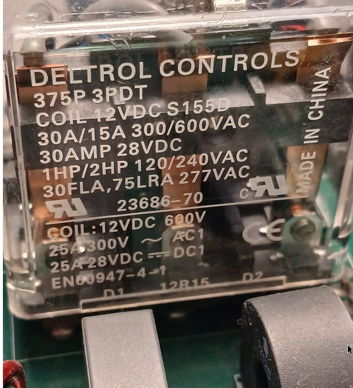
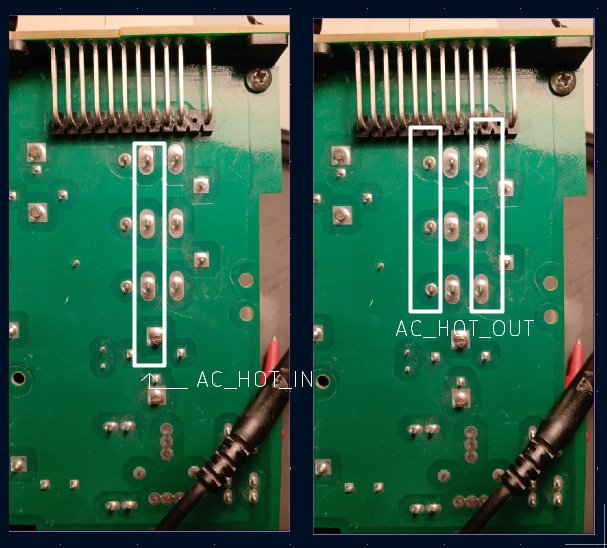
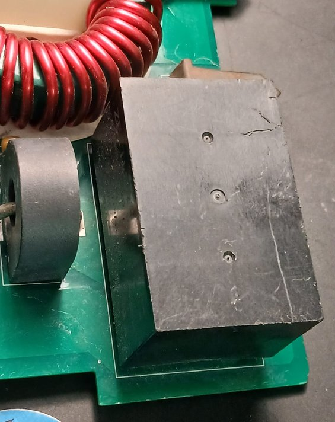
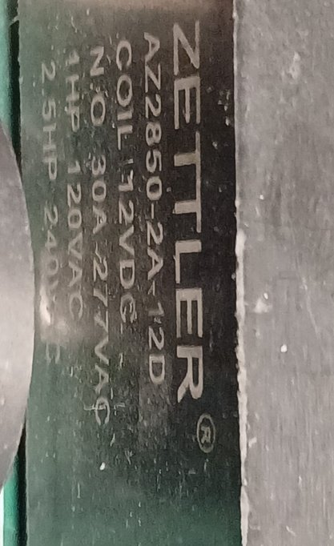
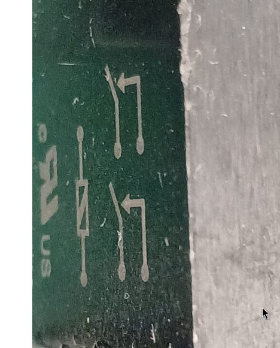
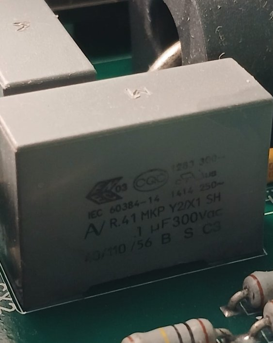

# Referencia industrial: OutBack FX 120 V (neutro común, tierra de chasis y unión N–PE manual)

> **Estado:** estudio de referencia. **No cambia el diseño de la V1** (DC-019, 5 relés). Sirve para documentar cómo resuelve la industria la misma etapa y como base de la futura **versión de bajo costo y versátil**.
> **Fecha de las mediciones:** 2026-11-09 y 2026-11-10, en banco, sin energía.
> **Equipo:** tarjeta de AC de un inversor-cargador **OutBack serie FX, 120 VAC 60 Hz** (serigrafía "OutBack Power Systems", bornes "120VAC 60Hz").

---

> **Aviso legal y uso de marcas.** *OutBack Power*, *Deltrol Controls*, *American Zettler*, *Arcotronics/KEMET*, *Weidmüller* y *EFC* son marcas de sus respectivos titulares. Se mencionan **solo para identificar** el equipo y las piezas estudiadas (uso nominativo o referencial).
> - Este documento es un **análisis técnico con fines educativos, de investigación y de referencia**, hecho sobre un equipo **adquirido legalmente**, mediante inspección y mediciones propias sin energía.
> - **Isla del Sol no está afiliado a estos fabricantes ni cuenta con su respaldo o aprobación.** Ninguna afirmación de este estudio representa información oficial de ellos.
> - Las **fotografías son propias**. Los datos de piezas provienen de su marcado físico y de las hojas de datos públicas citadas en las referencias; no se reproducen documentos del fabricante, solo se citan.
> - Isla del Sol **no copia** el diseño estudiado: lo usa como punto de comparación, y sus decisiones propias están justificadas en la bitácora (DC-019).
> - Las mediciones corresponden a **una unidad y una revisión de tarjeta**; otras versiones pueden ser distintas. Este documento **no sustituye** al manual ni a las instrucciones de instalación del fabricante.
> - **Seguridad:** las mediciones se hicieron **sin red, sin batería y con los capacitores descargados**. No intentes repetirlas con el equipo energizado.

## 1. Por qué estudiamos esta tarjeta

El FX es un inversor-cargador de transformador de baja frecuencia, igual que Isla del Sol. Lleva años en campo, en sitios aislados y como respaldo, y está listado bajo UL. Ver cómo resolvió la transferencia, el filtro de salida y la puesta a tierra nos dice:

- qué partes de nuestro diseño coinciden con la práctica industrial (eso valida);
- dónde tomamos un camino distinto, y por qué (eso documenta);
- qué podemos simplificar en una versión de bajo costo (eso orienta el trabajo futuro).

---

## 2. Evidencia fotográfica

| Vista | Foto |
| --- | --- |
| Cara superior: relé Deltrol, toroide rojo, C1 505J, fastons XFMR |  |
| Frente: bornes de potencia y panel de control |  |
| Cara inferior: pads de potencia, matriz del relé 3PDT |  |
| Detalle: pines de los bornes Weidmüller doblados a la tarjeta |  |
| Marcado del relé de red: Deltrol 375P 3PDT |  |
| Cara inferior del Deltrol: fila NO = AC HOT IN; filas COM y NC = AC HOT OUT (M7, M8) |  |
| Relé del transformador: Zettler AZ2850-2A-12D (cuerpo, marcado y símbolo 2 Form A) |    |
| Capacitor de supresión Arcotronics R.41 MKP X1/Y2 0.1 µF (serigrafía "CY2"): mismo tipo para CX y CY (M12) |  |

---

## 3. Piezas identificadas

| Pieza | Marcado | Función (✅ medido · 🔎 por inspección · ❓ hipótesis) |
| --- | --- | --- |
| **C1** | EFC SP1213TC **505J 400V** 1124R | ✅ Capacitor del filtro de salida, **5 µF ±5 %**, entre XFMR HOT y XFMR NEU. Mismo lugar y valor que nuestro **C_F 4.7 µF** (DC-019, punto 8b). |
| **Toroide rojo** | sin marcado | ✅ Inductor **en serie con el NEUTRO** (no con el vivo), entre el neutro común y XFMR NEU. ❓ Falta su valor (M11). |
| **K_RED** | **Deltrol 375P 3PDT** · COIL 12VDC S155D · 23686-70 · 30 A/15 A 300/600 VAC · 30 A 28 VDC · **1 HP / 2 HP 120/240 VAC · 30 FLA / 75 LRA 277 VAC** (UL, cURus) · **25 A 300 V AC-1 / 25 A 28 VDC DC-1, EN 60947-4-1** (CE) | ✅ Relé de **red**: los **3 polos en paralelo**, **NO = AC HOT IN** y COM + NC = AC HOT OUT (el NC queda sin función). Sin energía, **la red no pasa** (M7, M8). Ficha: [R6]. Bobina A–B ≈ 56 Ω (catálogo). |
| **K_INV** | **American Zettler AZ2850-2A-12D** · COIL 12VDC · N.O. 30 A 277 VAC · 1 HP 120 VAC · 2.5 HP 240 VAC | ✅ Relé del **transformador**: **2 Form A (DPST-NO)**, los **2 polos en paralelo**: pines 2 y 6 = AC HOT OUT, pines 4 y 8 = XFMR HOT (M9). Bobina 86 Ω / 140 mA / 1.7 W; opera desde 9 V; 4000 VAC bobina–contacto; cierre 15 ms y apertura 10 ms típicos [R7]. |
| **CX** | Arcotronics (KEMET) **R.41 MKP Y2/X1 SH, 0.1 µF 300 VAC**, IEC 60384-14, 40/110/56 | ✅ Capacitor de supresión **entre el VIVO y el NEUTRO** (EMI diferencial y picos del relé). ❓ Falta saber si está del lado HOT IN o HOT OUT (M12). |
| **CY** | Mismo tipo que CX (serigrafía "CY2") | ✅ Capacitor **entre el NEUTRO común y el CHASIS**: "unión capacitiva" para el ruido de alta frecuencia, sin unión a 60 Hz (M12). |
| **Sensor Hall** | por identificar (M14) | ✅ Sensor de **corriente** de efecto Hall en el camino del **vivo**, con salida aislada hacia el conector IDC. |
| **R1–R8** | resistencias en fila | ✅ **Sensado de voltaje** de AC: cadena de alto valor desde el nodo del vivo (donde llegan CX y el sensor Hall) hacia el conector IDC, repartida en varias piezas por voltaje y distancia de fuga (M13). |
| **Toroides negros y gris** | — | 🔎 Transformadores de corriente (un cable que pasa por el centro). El gris, junto al Zettler, probablemente mide la corriente del transformador. Equivalen a nuestra pinza SCT-013 (DC-013). |
| **PTC1** | disco amarillo | 🔎 Termistor PTC: protección por sobrecorriente de algún circuito auxiliar. |
| **Bornes de potencia** | Weidmüller **LU 10/16**, 10 mm² | 🔎 6 bornes: `HOT IN · NEUTRAL IN · PE · PE · NEUTRAL OUT · HOT OUT`. |
| **Panel de control** | BATTERY TEMP, MATE/HUB (RJ), INVERTER ON/OFF, AUX, XCT, JP1 | 🔎 Interfaz con el usuario y el sistema; fuera del alcance de este estudio. |

**Dato del fabricante:** la hoja de datos del FX2012T especifica **corriente máxima de entrada AC de 60 A** y entrada de 80 a 150 VAC [R3]. El Deltrol da 30 A por polo según UL, pero solo **25 A en AC-1** según la norma europea: con **3 polos en paralelo** (medido, M8) OutBack tiene 75 A de AC-1 contra 60 A de entrada.

---

## 4. Mediciones de banco (2026-11-09)

Condición: tarjeta sin energía, batería desconectada, C1 descargado.

| # | Medición | Resultado | Conclusión |
| --- | --- | --- | --- |
| M1 | XFMR HOT y XFMR NEU → terminales de C1 | Continuidad | C1 está **directo sobre el transformador** |
| M2 | Neutro → toroide rojo | Continuidad | El inductor del filtro está **en el neutro** |
| M3 | AC NEUTRAL IN ↔ AC NEUTRAL OUT | **Continuidad en la terminal** | **El neutro no se conmuta** |
| M4 | Terminal de neutro ↔ faston XFMR NEU | Continuidad | El neutro del transformador **es** el neutro de la red y de la carga |
| M5 | Neutro ↔ CHASSIS GROUND/PE | **Separado** | **No hay unión N–PE dentro del equipo** |
| M6 | CHASSIS GROUND/PE (2 bornes) ↔ chasis | Unidos | La tierra **pasa** de la entrada a la salida, con el gabinete aterrizado |

**Mediciones del 2026-11-10** (mismas condiciones; pines identificados con las fichas [R6] y [R7]):

| # | Medición | Resultado | Conclusión |
| --- | --- | --- | --- |
| M7 | AC HOT IN ↔ AC HOT OUT, bobinas sin energía | **Abierto** | La red entra por el **NO** del Deltrol: **sin energía, el FX no deja pasar la red** |
| M8 | Matriz del Deltrol: fila NO de los 3 polos ↔ AC HOT IN; filas COM y NC ↔ AC HOT OUT | Unidas por fila | **Los 3 polos en paralelo**; el NC queda unido al COM (sin función) |
| M9 | Zettler: 2 ↔ 6 y 4 ↔ 8 con continuidad; 4 y 8 ↔ XFMR HOT; 2 y 6 ↔ AC HOT OUT | Confirmado | **Corrige la hipótesis anterior:** el transformador **no** está siempre en la salida. El Zettler (2 polos NO en paralelo) lo conecta a AC HOT OUT solo cuando invierte o carga |
| M12 | Los dos capacitores R.41 de 0.1 µF | **CX:** vivo ↔ neutro · **CY:** neutro común ↔ chasis del inversor | Filtro EMI **sin ningún capacitor entre el vivo y el chasis** |
| M13 | Resistencias R1–R8 | Desde el nodo del vivo (CX y sensor Hall) hacia el conector IDC | Sensado de voltaje por divisor de alta impedancia |
| M14 | Pieza que parecía un shunt | Es un **sensor de corriente de efecto Hall** en el vivo, con salida al IDC | Sensado de corriente aislado |

---

## 5. La arquitectura del FX


```
            K_RED: Deltrol 375P (3 polos NO en paralelo)   sensor Hall
AC HOT IN ──┬──────────/ ──────────────────────────────────[ I ]──┬──────── AC HOT OUT
           CX 0.1 µF                                             │  (R1–R8 → IDC: voltaje)
            │                     K_INV: Zettler AZ2850-2A (2 polos NO en paralelo)
            │                                            ┌───────/ ┘
            │                       XFMR HOT ──┬─────────┴──┐
            │                            C1 5 µF        secundario
            │                       XFMR NEU ──┴────────────┘
            │                          [toroide en el neutro]
N IN ═══════╧══════╤══════════════════════╧═════════════════════════════════ N OUT
                  CY 0.1 µF          NEUTRO COMÚN: ningún relé lo abre
CHASSIS/PE IN ─────┴─────────────────── chasis ───────────────────────────── CHASSIS/PE OUT
                       (sin unión N–PE interna · ningún capacitor vivo–chasis)
```

| Estado | K_RED (Deltrol) | K_INV (Zettler) | La salida tiene |
| --- | --- | --- | --- |
| Sin energía | abierto | abierto | **Nada**: el FX apagado no deja pasar la red |
| Inversor | abierto | cerrado | Transformador |
| Red, sin cargar | cerrado | abierto | Red |
| Red, cargando | cerrado | cerrado | Red + transformador (puente sincronizado con la red) |

### 5.1 Neutro común

El neutro de la red, el del transformador y el de la carga son **el mismo conductor**. El manual del fabricante lo dice así: *"The neutral lines are common throughout the system"* [R1]. El relé solo **mete o saca el vivo de la red**.

Consecuencias:
- **Dos relés, los dos en el vivo:** K_RED (Deltrol) mete o saca la red; K_INV (Zettler) mete o saca el transformador. Es el equivalente de nuestros **K_L2 + K_L3** (KiCad K4 + K1), pero **sin conmutar el neutro**: por eso el FX no necesita K2, K3 ni relé de unión N–PE.
- **Sin energía, la salida queda muerta** (los dos relés son NO). Es la filosofía opuesta a la V1, donde sin energía la casa queda en la red. OutBack prioriza no retroalimentar a la red; la V1, la continuidad del servicio.
- **Para cargar, cierran los dos relés** y el puente H rectifica, sincronizado con la red.
- **Antes de cerrar K_RED con el transformador conectado, el inversor tiene que estar en fase con la red.** Y cuando la red cae, debe abrir K_RED antes de seguir alimentando (anti-isla, UL 1741 / IEEE 1547 [R5]). Esa responsabilidad queda en el firmware.

> **Corrección (2026-11-10):** la primera versión de este estudio suponía que el transformador estaba siempre conectado a la salida. La medición M9 mostró el segundo relé (Zettler) y la corrigió.

### 5.2 Filtro de salida y filtro EMI (M12)

| Pieza | Entre | Función | Corriente a 60 Hz |
| --- | --- | --- | --- |
| C1 505J (5 µF) | XFMR HOT – XFMR NEU | LC contra la portadora del PWM, con el toroide | Reactiva, ~0.24 A, regresa por el neutro |
| Toroide rojo | En serie con el neutro (XFMR NEU – neutro común) | La L del filtro | Toda la corriente de carga |
| **CX** 0.1 µF X1/Y2 | **Vivo – neutro** | EMI diferencial y picos al abrir el relé | Reactiva, ~4.8 mA. **No es fuga**: regresa por el neutro |
| **CY** 0.1 µF X1/Y2 | **Neutro común – chasis** | EMI de modo común: "unión capacitiva" (26.5 kΩ a 60 Hz, 1.6 Ω a 1 MHz) | Despreciable: el neutro está casi a 0 V respecto al chasis |
| — | **Vivo – chasis** | **Nada, a propósito** | Así no hay fuga permanente a tierra (un Y de 0.1 µF ahí dejaría pasar ~4.8 mA) |

**Lección:** la unión capacitiva CY une neutro y chasis **solo para el ruido**. A 60 Hz siguen separados, así que no es una segunda unión N–PE (250-24) ni provoca disparos de los diferenciales.

### 5.3 Sensado (M13, M14)

- **Voltaje:** cadena R1–R8 desde el nodo del vivo hacia el conector IDC (divisor de alta impedancia, casi sin desfase; exige respetar distancias de fuga).
- **Corriente:** sensor de efecto Hall en el vivo, con salida aislada hacia el IDC (mide AC y DC, rápido).
- Isla del Sol usa en cambio un transformador de sensado de 120 → 12 V (aislamiento galvánico) y la pinza SCT-013 (DC-013). El divisor y el sensor Hall quedan como referencia para el lazo de control rápido (etapa posterior).

### 5.4 Tierra de chasis pasante

Los dos bornes CHASSIS GROUND/PE son la **entrada y la salida del conductor de puesta a tierra de equipos**. El chasis queda unido a ellos. La tierra no se interrumpe ni se conmuta nunca.

### 5.5 Unión N–PE: la decide el instalador

El FX **no trae unión N–PE interna**. El manual pide que el sistema tenga **una sola unión**, normalmente en el tablero principal, y que se quite cualquier otra, en especial la de una planta generadora [R1]:

> *"The electrical system should have neutral and ground bonded together at a single point… usually performed in the main electrical panel… If any other neutral-ground bonds are present in the system, particularly in the generator, they must be removed."*

**Quien instala el FX debe saber de puesta a tierra.** El equipo deja esa decisión en sus manos.

---

## 6. Base normativa: por qué el FX puede dejar la unión afuera

La NOM-001-SEDE-2012 [R2] (misma numeración que el NEC):

- **250-24(a)(5):** prohíbe unir neutro y tierra **aguas abajo de la acometida**. La unión va en el medio de desconexión principal.
- **250-30:** un **sistema derivado separadamente** (una fuente cuyo neutro no está unido sólidamente al neutro de la acometida) debe tener **su propia** unión N–PE y su electrodo.
- **250-50 / 250-52:** sistema de electrodos de puesta a tierra (varilla, etc.).

| Diseño | ¿Conmuta el neutro? | ¿Sistema derivado separadamente? | ¿Dónde va la unión N–PE? |
| --- | --- | --- | --- |
| **OutBack FX** | No | **No.** Comparte el neutro de la acometida | **Una sola vez**, en la acometida o, en sitio aislado, en el tablero de cargas |
| **Isla del Sol V1** (DC-019) | Sí (K2) | **Sí**, en modo inversor | **En el inversor** mientras alimenta aislado. Por eso existe **RL_TN** |

---

## 7. Guía para el instalador: ¿se une o no se une? (topología de neutro común)

**La pregunta no es "¿respaldo o principal?", sino: ¿ya existe una unión N–PE aguas arriba, unida por el mismo neutro?**

| Caso | ¿Hay red en la entrada AC? | ¿Unión N–PE en el inversor o su tablero? |
| --- | --- | --- |
| **1. Respaldo** de una casa con CFE | Sí, y la unión está en la acometida | **NO.** Sería doble unión (250-24(a)(5)) |
| **2. Inversor principal de toda la casa, con la red conectada** a la entrada AC | Sí | **NO.** Es igual al caso 1, aunque el inversor alimente todo |
| **3. Inversor principal en sitio aislado** | No | **SÍ, una sola vez**, en el tablero de cargas, con **electrodo** (250-50 / 250-52) |
| **4. Sitio aislado con planta** en la entrada AC | La planta hace de red | Unión en el tablero (caso 3) y **quitar la unión de la planta** si la trae |

**Errores típicos:**
- **Caso 2 mal hecho** ("es mi inversor principal" y le ponen la unión): queda **doble unión**. La corriente del neutro circula por la tierra, las tuberías y el chasis, y los diferenciales (GFCI) se disparan sin razón.
- **Caso 4 mal hecho:** el sitio está bien unido, pero la planta trae su propia unión: también queda doble unión.
- **Caso 3 sin unión:** una falla a chasis **no dispara** la protección, y el gabinete puede quedar energizado.

---

## 8. Comparación con Isla del Sol V1

| Aspecto | OutBack FX | Isla del Sol V1 (DC-019) |
| --- | --- | --- |
| Relés de potencia | 2, solo en el vivo: Deltrol 375P (3 polos ∥, red) + Zettler AZ2850-2A (2 polos ∥, transformador) | 5 (K2, K_L2, K3, K_L3, RL_TN) |
| Neutro | Común, nunca se abre | Conmutado (K2/K3) |
| Unión N–PE | Manual, la hace el instalador, sin verificación | **Según el escenario:** RL_TN la hace por orden del AUX (D10), y **Q2** solo la deja pasar con el modo inversor activo (DC-019). Selector físico SW_TN: decisión pendiente |
| Estado sin energía | **Salida muerta**: ni red ni transformador (M7) | **Carga en la RED** (fail-safe) |
| Transformador | Lo conecta el Zettler al invertir o cargar (M9) | K_L2/K2 al invertir, K_L3/K3 al cargar |
| Si se pega un relé | Con K_RED pegado y el inversor invirtiendo, la red queda unida al transformador: el firmware debe detectarlo (anti-isla) | Ninguna falla de un solo relé forma paralelo red–inversor |
| Filtro de salida | C1 5 µF en el transformador + toroide en el neutro | C_F 4.7 µF MKP X2 + L_F E65 en el neutro (DC-019, 8b) |
| Filtro EMI | CX vivo–neutro + CY neutro–chasis; nada vivo–chasis | CX_RED vivo–neutro y CY_RED neutro de red–tierra, en el lado de la red (DC-019) |
| Bornes | Weidmüller 10 mm², vivos en los extremos | Phoenix SPT 2.5 |
| Exige al instalador | Saber de puesta a tierra (250-24 / 250-30) | Elegir el escenario CASA o CARGA en el menú; el hardware (Q2) impide la doble unión |
| Modo de uso (respaldo o principal) | Lo define la instalación y la unión que haga el instalador | **Se elige en el SETUP por menú:** DERIVADOR TIPO UPS o FUENTE PRINCIPAL (sección 8.1) |

**Lectura:** el FX es más simple y barato en relés, pero **traslada la responsabilidad** de la unión N–PE al instalador y la de la sincronía y el anti-isla al firmware. La V1 gasta más relés y un selector verificado contra el menú para que **un error del instalador no pase sin ser detectado**: si la unión elegida no coincide con el modo, el equipo no arranca. Las dos son válidas; están pensadas para usuarios distintos.

### 8.1 Modo de operación de la V1: se configura en el SETUP, por menú

El FX deja al instalador decidir **cómo** se usa el equipo. En la V1 esa decisión se toma **en la puesta en marcha, desde el menú del SETUP**, y queda guardada:

| Opción del menú | Uso | Prioridad | Sin red | Carga desde la red |
| --- | --- | --- | --- | --- |
| **1. DERIVADOR TIPO UPS** de un circuito de red | Respaldo de uno o varios circuitos de una casa con CFE | **RED primero.** El inversor entra solo cuando la red falla o sale de rango, y regresa a la red cuando vuelve estable (con tiempo de confirmación) | **Es una falla:** alarma "SIN RED" y registro del evento | Sí, normal: mantiene la batería llena |
| **2. FUENTE PRINCIPAL** de energía | Sitio aislado, o casa donde la batería y el sol son la fuente principal | **INVERSOR primero.** La red o la planta en la entrada AC solo se usan como respaldo (batería baja) y para cargar | **Es lo normal:** sin alarma | Solo cuando la batería baja del umbral configurado, o por orden del usuario |

**Reglas del menú:**

1. **Lo maneja el AUX** (interfaz de usuario, DC-010): guarda el modo en EEPROM con verificación (CRC) y se lo pasa al CRÍTICO por I2C.
2. **Valor de fábrica, y respuesta ante una EEPROM dañada: modo 1, DERIVADOR TIPO UPS.** Es el modo conservador: funciona con red o sin ella, y nunca deja de usar la red si existe.
3. **Cambiar el modo exige confirmar dos veces** en el SETUP y solo se permite con el inversor **en espera** (sin invertir). El cambio queda en el registro de eventos.
4. **El modo cambia la POLÍTICA de transferencia, NO la seguridad.** El candado Q_A, la secuencia EN_HW = 0 → soltar → pausa ≥ 50 ms → activar (DC-016/DC-019) y el valor por defecto en RED sin energía son iguales en los dos modos.

**La unión N–PE en la V1 sigue al modo, con doble confirmación (DC-019, punto 10):**

| Modo del menú | Equivale a | Unión N–PE al invertir | Selector físico SW_TN |
| --- | --- | --- | --- |
| **INVERSOR CASA** | Fuente principal (opción 2) | **Sí**, la hace RL_TN | CASA |
| **INVERSOR CARGA** | Derivador tipo UPS de cargas críticas (opción 1) | **No**, la salida queda flotante y la PE pasa directa | CARGA |

- **Actualización 2026-11-09:** la orden de unión sale del **AUX (D10 → J15-7)** según el escenario, y **Q2** (compuerta AND por hardware) solo la deja pasar si el canal INVERSOR está activo. Así ni un error de menú ni uno de firmware pueden hacer una doble unión con CFE.
- El selector físico **SW_TN** (polo A en la bobina de RL_TN, polo B como MODO_TN hacia D4) queda como **decisión pendiente**: sin él, en modo inversor la unión depende solo del firmware del AUX.
- El valor de fábrica es CARGA/UPS (sin unión).

**Diferencia con el FX:** en el FX el instalador hace la unión con cables, y nada la verifica. En la V1 la unión la decide el escenario configurado, y el hardware impide la combinación peligrosa.

---

## 9. Lecciones que sí aplican a la V1 (sin cambiar el diseño)

1. **C_F de ~5 µF en el lado del transformador** queda validado por un equipo comercial. Un 505J de 400 V recuperado de un FX sirve como C_F de prototipo, si no está inflado.
2. **Orden de bornes:** vivos en los extremos y PE en el centro. Conviene copiarlo en la serigrafía y el orden de nuestros Phoenix.
3. **Islas de cobre** con márgenes anchos entre nodos de 127 V; la ranura es un extra, no algo obligatorio.
4. **Fastons atornillados o remachados** para los cables del transformador, para que el esfuerzo mecánico no quede en la soldadura.
5. **Relés con clasificación en HP y LRA** para cargas con motor: el mismo criterio que usamos con el L90S.
6. **Contactos en paralelo para corriente:** OutBack pone 3 polos del Deltrol y 2 del Zettler en paralelo. Ojo con la clasificación europea: 25 A en AC-1 por polo.
7. **Filtro EMI sin capacitores vivo–chasis:** CX entre vivo y neutro, CY solo entre neutro y chasis. Para la V1: **CX_RED + R de descarga + CY_RED en el lado de la red** (DC-019), y nunca un Y en un vivo ni en el lado del inversor (modo CARGA flotante).
8. **Tiempos de relé de referencia** para la transferencia rápida (DC-020, por escribir): el Zettler cierra en 15 ms y abre en 10 ms típicos (25 ms máx.).

## 10. Para la versión de bajo costo y versátil (trabajo futuro, NO agregar a la V1)

- **Un relé 3PDT con clasificación HP** (tipo Deltrol 375P) en el HOT, con **neutro sólido**.
- **Puente J_TN** (faston con seguro), **abierto de fábrica**, con serigrafía:
  > **J_TN: CERRAR SOLO SI NO HAY RED NI PLANTA UNIDA EN LA ENTRADA AC. SI HAY CFE CONECTADA (AUNQUE SEA RESPALDO): ABIERTO. NOM 250-24 / 250-30.**
- **Requisitos de firmware:** sincronía de fase antes de cerrar el relé y detección de pérdida de red con apertura del relé antes de seguir invirtiendo (anti-isla).
- **Manual de instalación** con los 4 casos de la sección 7, dibujados.
- **Advertencia en la documentación:** *"Esta versión exige que el instalador tenga conocimientos de puesta a tierra."*

---

## 11. Mediciones pendientes

| # | Medición | Para saber |
| --- | --- | --- |
| M10 | Seguir el cobre desde XFMR NEU, o medir con LCR entre XFMR NEU y la pata de C1 (~0 µH = C1 antes del toroide) | Si el filtro es **LC** (toroide antes de C1) o **CL** (después) |
| M11 | Inductancia del toroide rojo (LCR) y calibre de su alambre | Compararlo con nuestros ~2 mH |
| M12b | ¿CX está del lado AC HOT IN o AC HOT OUT? | Completar el filtro EMI |
| M14b | Marca y número del sensor Hall | Identificar su hoja de datos y su aislamiento |
| M15 | Con 12 V en cada bobina (fuente limitada, IDC desconectado): HOT IN ↔ HOT OUT y XFMR HOT ↔ HOT OUT | Confirmar en vivo la tabla de estados |

---

## Referencias

- **[R1]** OutBack Power Systems, *GVFX/GTFX Series Inverter/Charger Installation Manual*, sección de puesta a tierra: neutros comunes en todo el sistema, unión N–PE en un solo punto (normalmente el tablero principal) y retiro de cualquier otra unión, en especial la de la planta. <https://manualsdir.com/manuals/407161/outback-power-systems-gvfx-series-inverter_charger-installation-manual-gtfx-series-inverter_charger-installation-manual.html?page=74>
- **[R2]** Secretaría de Energía, *NOM-001-SEDE-2012, Instalaciones eléctricas (utilización)*, artículo 250: 250-24 (unión en la acometida; prohibida aguas abajo), 250-30 (sistemas derivados separadamente), 250-50 y 250-52 (electrodos de puesta a tierra).
- **[R3]** OutBack Power, *FX / VFX Series (US) spec sheet*: FX2012T, 120 VAC, corriente máxima de entrada AC de 60 A, entrada de 80–150 VAC. <https://www.portlandiaelectric.supply/cdn/shop/files/OutBack_FX-VFX-US_specsheet.pdf>
- **[R4]** Deltrol Controls, relé serie 375, marcado de la pieza: 3PDT, bobina de 12 VDC, 30 A / 15 A 300/600 VAC, 1 HP / 2 HP 120/240 VAC, 30 FLA / 75 LRA (leído de la pieza física).
- **[R5]** UL 1741 / IEEE 1547: requisitos de protección anti-isla para inversores conectados a la red.
- **[R6]** Deltrol Controls, *Power Relays 375 Series* (catálogo): 30 A UL / 25 A EN 60947-4-1 AC-1, bobina en pines A–B, contactos 1–9 en filas NC / NO / COM ("swingers"). <https://pdf.directindustry.com/pdf/deltrol-controls/power-relays-375-series/12092-157979.html>
- **[R7]** American Zettler, *AZ2850 30 A miniature power relay* (hoja de datos): 2 Form A, NO 30–40 A 277 VAC, 1 HP 120 VAC / 2.5 HP 240 VAC, bobina de 12 VDC 86 Ω, 4000 VAC bobina–contacto, cierre 15 ms y apertura 10 ms típicos. <https://www.azettler.com/pdfs/az2850.pdf>
- Mediciones propias, 2026-11-09 y 2026-11-10 (sección 4).

---

*Documentación bajo licencia CC BY-SA 4.0 (ver `LICENSE.md` en la raíz).*
