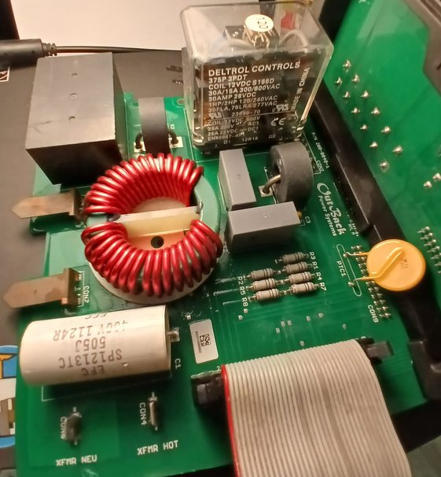
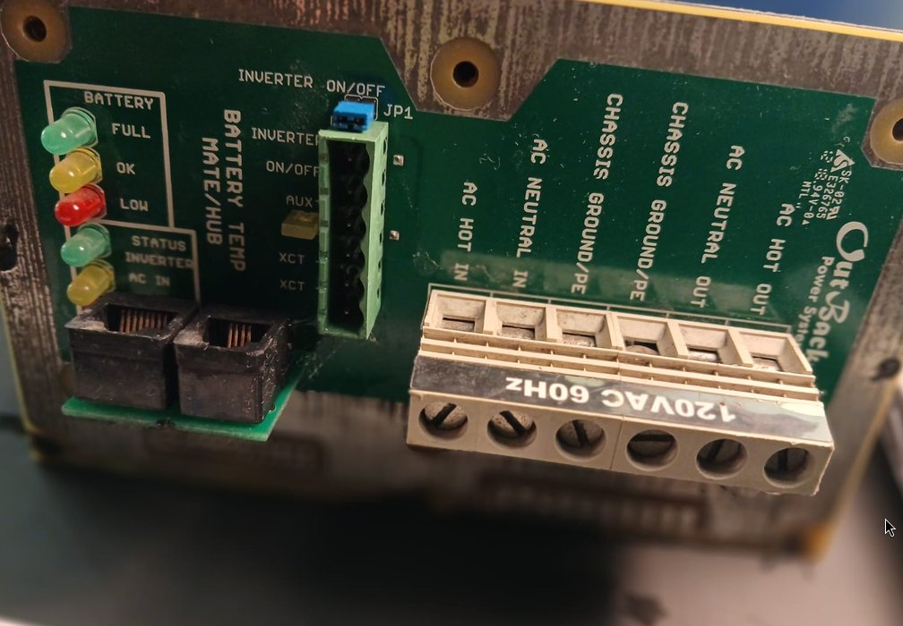
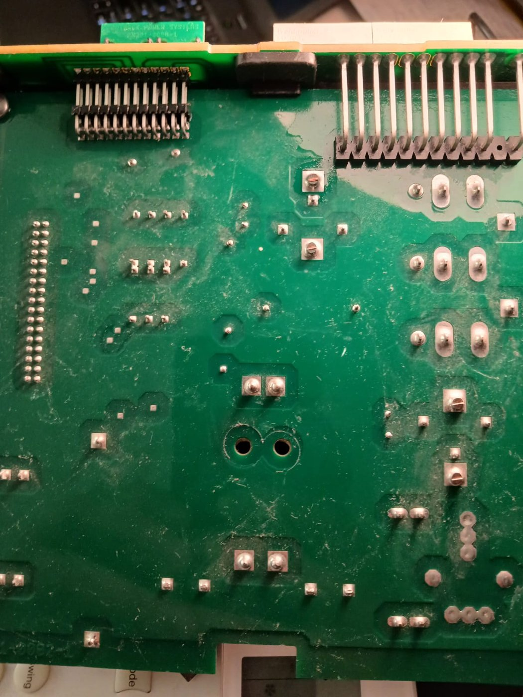
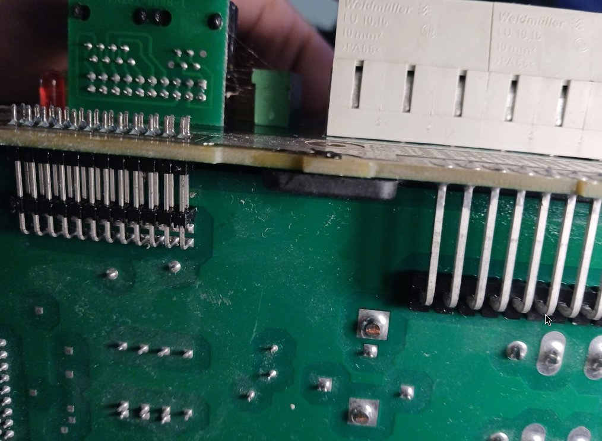
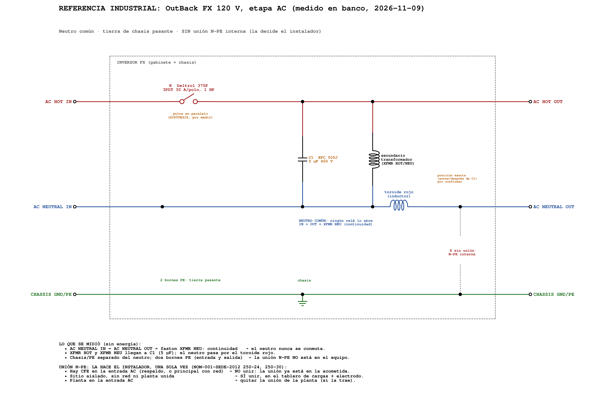

# Referencia industrial: OutBack FX 120 V (neutro común, tierra de chasis y unión N–PE manual)

> **Estado:** estudio de referencia. **No cambia el diseño de la V1** (DC-019, 5 relés). Sirve para documentar cómo resuelve la industria la misma etapa y como base de la futura **versión de bajo costo y versátil**.
> **Fecha de las mediciones:** 2026-11-09, en banco, sin energía.
> **Equipo:** tarjeta de AC de un inversor-cargador **OutBack serie FX, 120 VAC 60 Hz** (serigrafía "OutBack Power Systems", bornes "120VAC 60Hz").

---

## 1. Por qué estudiamos esta tarjeta

El FX es un inversor-cargador de transformador de baja frecuencia, igual que Isla del Sol. Lleva años en campo, en sitios aislados y como respaldo, y está listado bajo UL. Ver cómo resolvió la transferencia, el filtro de salida y la puesta a tierra nos dice:

- qué partes de nuestro diseño coinciden con la práctica industrial (eso valida);
- dónde tomamos un camino distinto, y por qué (eso documenta);
- qué podemos simplificar en una versión de bajo costo (eso orienta el trabajo futuro).

---

## 2. Evidencia fotográfica

| Vista | Foto |
| --- | --- |
| Cara superior: relé Deltrol, toroide rojo, C1 505J, fastons XFMR |  |
| Frente: bornes de potencia y panel de control |  |
| Cara inferior: pads de potencia, matriz del relé 3PDT |  |
| Detalle: pines de los bornes Weidmüller doblados a la tarjeta |  |

---

## 3. Piezas identificadas

| Pieza | Marcado | Función (✅ medido · 🔎 por inspección · ❓ hipótesis) |
| --- | --- | --- |
| **C1** | EFC SP1213TC **505J 400V** 1124R | ✅ Capacitor del filtro de salida, **5 µF ±5 %**, entre XFMR HOT y XFMR NEU. Mismo lugar y valor que nuestro **C_F 4.7 µF** (DC-019, punto 8b). |
| **Toroide rojo** | sin marcado | ✅ Inductor **en serie con el NEUTRO** (no con el vivo). ❓ Falta saber si está antes o después de C1 (sección 6). |
| **K** | **Deltrol 375P 3PDT**, bobina 12 VDC, 30 A/15 A 300/600 VAC, **1 HP / 2 HP 120/240 VAC, 30 FLA / 75 LRA** | 🔎 Relé de transferencia. En la cara inferior se ve una matriz de **3 × 3 pads** (COM/NO/NC por polo) más 2 pads de bobina. ❓ No toca el neutro (medido), así que sus polos estarían **en paralelo en el HOT**. |
| **Toroides negros** | — | 🔎 Transformadores de corriente (un cable que pasa por el centro). Equivalen a nuestra pinza SCT-013 (DC-013). |
| **PTC1** | disco amarillo | 🔎 Termistor PTC: protección por sobrecorriente de algún circuito auxiliar. |
| **R1–R8** | resistencias en fila | 🔎 Divisor de alto valor para sensar voltaje, repartido en varias piezas por voltaje y distancia de fuga. |
| **Bornes de potencia** | Weidmüller **LU 10/16**, 10 mm² | 🔎 6 bornes: `HOT IN · NEUTRAL IN · PE · PE · NEUTRAL OUT · HOT OUT`. |
| **Panel de control** | BATTERY TEMP, MATE/HUB (RJ), INVERTER ON/OFF, AUX, XCT, JP1 | 🔎 Interfaz con el usuario y el sistema; fuera del alcance de este estudio. |

**Dato del fabricante:** la hoja de datos del FX2012T especifica **corriente máxima de entrada AC de 60 A** y entrada de 80 a 150 VAC [R3]. Con 30 A por polo, el Deltrol necesita **al menos 2 polos en paralelo** para 60 A. Eso apoya la hipótesis de los polos en paralelo, pero falta confirmarla midiendo (sección 6).

---

## 4. Mediciones de banco (2026-11-09)

Condición: tarjeta sin energía, batería desconectada, C1 descargado.

| # | Medición | Resultado | Conclusión |
| --- | --- | --- | --- |
| M1 | XFMR HOT y XFMR NEU → terminales de C1 | Continuidad | C1 está **directo sobre el transformador** |
| M2 | Neutro → toroide rojo | Continuidad | El inductor del filtro está **en el neutro** |
| M3 | AC NEUTRAL IN ↔ AC NEUTRAL OUT | **Continuidad en la terminal** | **El neutro no se conmuta** |
| M4 | Terminal de neutro ↔ faston XFMR NEU | Continuidad | El neutro del transformador **es** el neutro de la red y de la carga |
| M5 | Neutro ↔ CHASSIS GROUND/PE | **Separado** | **No hay unión N–PE dentro del equipo** |
| M6 | CHASSIS GROUND/PE (2 bornes) ↔ chasis | Unidos | La tierra **pasa** de la entrada a la salida, con el gabinete aterrizado |

---

## 5. La arquitectura del FX



```
               K Deltrol 375P (polos en paralelo, por confirmar)
AC HOT IN ──────────/ ────────┬──────────┬────────────── AC HOT OUT
                              │          │
                         C1  ═╪═      secundario
                        5 µF  │      transformador
                              │          │
AC NEUTRAL IN ════════════════╧══════════╧══[toroide]═══ AC NEUTRAL OUT
                 NEUTRO COMÚN: ningún relé lo abre

CHASSIS/PE IN ───────────────┬────────────────────────── CHASSIS/PE OUT
                           chasis         (sin unión N–PE interna)
```

### 5.1 Neutro común

El neutro de la red, el del transformador y el de la carga son **el mismo conductor**. El manual del fabricante lo dice así: *"The neutral lines are common throughout the system"* [R1]. El relé solo **mete o saca el vivo de la red**.

Consecuencias:
- **El transformador está siempre conectado a la salida.** Para cargar baterías no hace falta otro relé (nuestro K3): basta cerrar K y poner el puente H en modo rectificador, sincronizado con la red.
- **Antes de cerrar K, el inversor tiene que estar en fase con la red.** Y cuando la red cae, debe abrir K antes de seguir alimentando (anti-isla, UL 1741 / IEEE 1547 [R5]). Esa responsabilidad queda en el firmware.

### 5.2 Tierra de chasis pasante

Los dos bornes CHASSIS GROUND/PE son la **entrada y la salida del conductor de puesta a tierra de equipos**. El chasis queda unido a ellos. La tierra no se interrumpe ni se conmuta nunca.

### 5.3 Unión N–PE: la decide el instalador

El FX **no trae unión N–PE interna**. El manual pide que el sistema tenga **una sola unión**, normalmente en el tablero principal, y que se quite cualquier otra, en especial la de una planta generadora [R1]:

> *"The electrical system should have neutral and ground bonded together at a single point… usually performed in the main electrical panel… If any other neutral-ground bonds are present in the system, particularly in the generator, they must be removed."*

**Quien instala el FX debe saber de puesta a tierra.** El equipo deja esa decisión en sus manos.

---

## 6. Base normativa: por qué el FX puede dejar la unión afuera

La NOM-001-SEDE-2012 [R2] (misma numeración que el NEC):

- **250-24(a)(5):** prohíbe unir neutro y tierra **aguas abajo de la acometida**. La unión va en el medio de desconexión principal.
- **250-30:** un **sistema derivado separadamente** (una fuente cuyo neutro no está unido sólidamente al neutro de la acometida) debe tener **su propia** unión N–PE y su electrodo.
- **250-50 / 250-52:** sistema de electrodos de puesta a tierra (varilla, etc.).

| Diseño | ¿Conmuta el neutro? | ¿Sistema derivado separadamente? | ¿Dónde va la unión N–PE? |
| --- | --- | --- | --- |
| **OutBack FX** | No | **No.** Comparte el neutro de la acometida | **Una sola vez**, en la acometida o, en sitio aislado, en el tablero de cargas |
| **Isla del Sol V1** (DC-019) | Sí (K2) | **Sí**, en modo inversor | **En el inversor** mientras alimenta aislado. Por eso existe **RL_TN** |

---

## 7. Guía para el instalador: ¿se une o no se une? (topología de neutro común)

**La pregunta no es "¿respaldo o principal?", sino: ¿ya existe una unión N–PE aguas arriba, unida por el mismo neutro?**

| Caso | ¿Hay red en la entrada AC? | ¿Unión N–PE en el inversor o su tablero? |
| --- | --- | --- |
| **1. Respaldo** de una casa con CFE | Sí, y la unión está en la acometida | **NO.** Sería doble unión (250-24(a)(5)) |
| **2. Inversor principal de toda la casa, con la red conectada** a la entrada AC | Sí | **NO.** Es igual al caso 1, aunque el inversor alimente todo |
| **3. Inversor principal en sitio aislado** | No | **SÍ, una sola vez**, en el tablero de cargas, con **electrodo** (250-50 / 250-52) |
| **4. Sitio aislado con planta** en la entrada AC | La planta hace de red | Unión en el tablero (caso 3) y **quitar la unión de la planta** si la trae |

**Errores típicos:**
- **Caso 2 mal hecho** ("es mi inversor principal" y le ponen la unión): queda **doble unión**. La corriente del neutro circula por la tierra, las tuberías y el chasis, y los diferenciales (GFCI) se disparan sin razón.
- **Caso 4 mal hecho:** el sitio está bien unido, pero la planta trae su propia unión: también queda doble unión.
- **Caso 3 sin unión:** una falla a chasis **no dispara** la protección, y el gabinete puede quedar energizado.

---

## 8. Comparación con Isla del Sol V1

| Aspecto | OutBack FX | Isla del Sol V1 (DC-019) |
| --- | --- | --- |
| Relés de potencia | 1 (3PDT, polos en paralelo, por confirmar) | 5 (K2, K_L2, K3, K_L3, RL_TN) |
| Neutro | Común, nunca se abre | Conmutado (K2/K3) |
| Unión N–PE | Manual, la hace el instalador | **Automática** (RL_TN, solo en modo inversor) |
| Estado sin energía | ❓ Salida del lado del inversor (por medir, M7) | **Carga en la RED** (fail-safe) |
| Transformador | Siempre en la salida | Lo conecta K3/K_L3 solo para cargar |
| Si se pega un relé | La red queda unida al inversor: el firmware debe detectarlo (anti-isla) | Ninguna falla de un solo relé forma paralelo red–inversor |
| Filtro de salida | C1 5 µF en el transformador + toroide en el neutro | C_F 4.7 µF MKP X2 en el transformador, antes de los relés |
| Bornes | Weidmüller 10 mm², vivos en los extremos | Phoenix SPT 2.5 |
| Exige al instalador | Saber de puesta a tierra (250-24 / 250-30) | Nada sobre la unión N–PE: el equipo la resuelve |
| Modo de uso (respaldo o principal) | Lo define la instalación y la unión que haga el instalador | **Se elige en el SETUP por menú:** DERIVADOR TIPO UPS o FUENTE PRINCIPAL (sección 8.1) |

**Lectura:** el FX es más simple y barato en relés, pero **traslada la responsabilidad** de la unión N–PE al instalador y la de la sincronía y el anti-isla al firmware. La V1 gasta más relés para que **un trinchero sin formación en puesta a tierra** no pueda equivocarse. Las dos son válidas; están pensadas para usuarios distintos.

### 8.1 Modo de operación de la V1: se configura en el SETUP, por menú

El FX deja al instalador decidir **cómo** se usa el equipo. En la V1 esa decisión se toma **en la puesta en marcha, desde el menú del SETUP**, y queda guardada:

| Opción del menú | Uso | Prioridad | Sin red | Carga desde la red |
| --- | --- | --- | --- | --- |
| **1. DERIVADOR TIPO UPS** de un circuito de red | Respaldo de uno o varios circuitos de una casa con CFE | **RED primero.** El inversor entra solo cuando la red falla o sale de rango, y regresa a la red cuando vuelve estable (con tiempo de confirmación) | **Es una falla:** alarma "SIN RED" y registro del evento | Sí, normal: mantiene la batería llena |
| **2. FUENTE PRINCIPAL** de energía | Sitio aislado, o casa donde la batería y el sol son la fuente principal | **INVERSOR primero.** La red o la planta en la entrada AC solo se usan como respaldo (batería baja) y para cargar | **Es lo normal:** sin alarma | Solo cuando la batería baja del umbral configurado, o por orden del usuario |

**Reglas del menú:**

1. **Lo maneja el AUX** (interfaz de usuario, DC-010): guarda el modo en EEPROM con verificación (CRC) y se lo pasa al CRÍTICO por I2C.
2. **Valor de fábrica, y respuesta ante una EEPROM dañada: modo 1, DERIVADOR TIPO UPS.** Es el modo conservador: funciona con red o sin ella, y nunca deja de usar la red si existe.
3. **Cambiar el modo exige confirmar dos veces** en el SETUP y solo se permite con el inversor **en espera** (sin invertir). El cambio queda en el registro de eventos.
4. **El modo cambia la POLÍTICA de transferencia, NO la seguridad.** El candado Q_A, la secuencia EN_HW = 0 → soltar → pausa ≥ 50 ms → activar (DC-016/DC-019) y el valor por defecto en RED sin energía son iguales en los dos modos.

**La unión N–PE en la V1 no depende del modo:**

- Como la V1 **conmuta el neutro** (K2), cada vez que el inversor alimenta, su salida queda **aislada** del neutro de la red: es un sistema derivado separadamente (250-30) **en los dos modos**. Por eso RL_TN une N–PE siempre que se aísla, sea UPS o principal. No se forma doble unión, porque el neutro de la acometida ya no está conectado.
- **RL_TN comparte canal con K2 y K_L2** (AISLAR, D5). Por diseño, **el software no puede apagarlo por separado**: una falla de firmware o de menú no puede dejar la salida sin unión.
- Si un instalador necesita **unión externa** (por ejemplo, un tablero de cargas propio que ya trae su unión), la decisión es **física**: se quita el faston con seguro **J_TN** que abre el contacto de RL_TN, y se anota en la etiqueta del equipo. **El menú puede mostrar el estado de J_TN** (si se agrega su lectura), pero no lo cambia.

**Diferencia con el FX:** en el FX, el modo de uso (respaldo o principal) **obliga** al instalador a decidir la unión N–PE (sección 7). En la V1, el menú solo decide **la prioridad de la energía**, y la unión la resuelve el hardware.

---

## 9. Lecciones que sí aplican a la V1 (sin cambiar el diseño)

1. **C_F de ~5 µF en el lado del transformador** queda validado por un equipo comercial. Un 505J de 400 V recuperado de un FX sirve como C_F de prototipo, si no está inflado.
2. **Orden de bornes:** vivos en los extremos y PE en el centro. Conviene copiarlo en la serigrafía y el orden de nuestros Phoenix.
3. **Islas de cobre** con márgenes anchos entre nodos de 127 V; la ranura es un extra, no algo obligatorio.
4. **Fastons atornillados o remachados** para los cables del transformador, para que el esfuerzo mecánico no quede en la soldadura.
5. **Relés con clasificación en HP y LRA** para cargas con motor: el mismo criterio que usamos con el L90S.

## 10. Para la versión de bajo costo y versátil (trabajo futuro, NO agregar a la V1)

- **Un relé 3PDT con clasificación HP** (tipo Deltrol 375P) en el HOT, con **neutro sólido**.
- **Puente J_TN** (faston con seguro), **abierto de fábrica**, con serigrafía:
  > **J_TN: CERRAR SOLO SI NO HAY RED NI PLANTA UNIDA EN LA ENTRADA AC. SI HAY CFE CONECTADA (AUNQUE SEA RESPALDO): ABIERTO. NOM 250-24 / 250-30.**
- **Requisitos de firmware:** sincronía de fase antes de cerrar el relé y detección de pérdida de red con apertura del relé antes de seguir invirtiendo (anti-isla).
- **Manual de instalación** con los 4 casos de la sección 7, dibujados.
- **Advertencia en la documentación:** *"Esta versión exige que el instalador tenga conocimientos de puesta a tierra."*

---

## 11. Mediciones pendientes

| # | Medición | Para saber |
| --- | --- | --- |
| M7 | HOT IN ↔ HOT OUT sin bobina, y con 12 V en la bobina (fuente limitada a ~300 mA) | Qué estado tiene el FX sin energía |
| M8 | Continuidad entre los 3 COM del Deltrol, y entre los 3 NO | Si los polos están en paralelo |
| M9 | XFMR HOT ↔ HOT OUT | Si el transformador está siempre en la salida |
| M10 | Seguir el cobre desde XFMR NEU, o medir con LCR entre XFMR NEU y la pata de C1 (~0 µH = C1 antes del toroide) | Si el filtro es **LC** (toroide antes de C1) o **CL** (después) |
| M11 | Inductancia del toroide rojo (LCR) y calibre de su alambre | Compararlo con nuestros ~2 mH |

---

## Referencias

- **[R1]** OutBack Power Systems, *GVFX/GTFX Series Inverter/Charger Installation Manual*, sección de puesta a tierra: neutros comunes en todo el sistema, unión N–PE en un solo punto (normalmente el tablero principal) y retiro de cualquier otra unión, en especial la de la planta. <https://manualsdir.com/manuals/407161/outback-power-systems-gvfx-series-inverter_charger-installation-manual-gtfx-series-inverter_charger-installation-manual.html?page=74>
- **[R2]** Secretaría de Energía, *NOM-001-SEDE-2012, Instalaciones eléctricas (utilización)*, artículo 250: 250-24 (unión en la acometida; prohibida aguas abajo), 250-30 (sistemas derivados separadamente), 250-50 y 250-52 (electrodos de puesta a tierra).
- **[R3]** OutBack Power, *FX / VFX Series (US) spec sheet*: FX2012T, 120 VAC, corriente máxima de entrada AC de 60 A, entrada de 80–150 VAC. <https://www.portlandiaelectric.supply/cdn/shop/files/OutBack_FX-VFX-US_specsheet.pdf>
- **[R4]** Deltrol Controls, relé serie 375, marcado de la pieza: 3PDT, bobina de 12 VDC, 30 A / 15 A 300/600 VAC, 1 HP / 2 HP 120/240 VAC, 30 FLA / 75 LRA (leído de la pieza física).
- **[R5]** UL 1741 / IEEE 1547: requisitos de protección anti-isla para inversores conectados a la red.
- Mediciones propias, 2026-11-09 (sección 4).

---

*Documentación bajo licencia CC BY-SA 4.0 (ver `LICENSE.md` en la raíz).*
