# Firmware del CRÍTICO (A1): SPWM, sensado y protecciones

**Proyecto:** Isla del Sol: inversor 48 V → 127 V / 60 Hz, 1000 W, con cargador de 1 kVA

**Micro:** CRÍTICO (A1) de la [tarjeta de control](../../hardware/control/README.md). Va en zócalo de Nano: ATmega328P a 16 MHz o Nano Every (ATmega4809) a 20 MHz ([DC-018](../../docs/decisiones_criticas.md)).

**Licencia:** MIT ([LICENSE.md](../../LICENSE.md))

**Estado:** ✅ **ETAPA BASE COMPLETADA (2026-11-12): generación de la SPWM híbrida validada en hardware real a 50 Hz y 60 Hz, con tiempo muerto de 1 µs y de 500 ns.** Etiqueta git `critico-etapa-base`. Prueba de banco **sin potencia**: D12 (EN_HW) queda en 0 y las señales no pasan de la compuerta AND a los gate drivers.

### Etapa base: qué quedó validado

| Qué | Cómo se validó |
| --- | --- |
| Portadora de 24.02 kHz (TOP 333) sincronizada con la línea | Reporte de arranque y analizador lógico |
| Salida de **60 Hz** (400 muestras) | 60.04 Hz, LB 49.75 %, 600–601 ciclos en 10 s (sección 7.0) |
| Salida de **50 Hz** (480 muestras) | 50.033 Hz, LB 49.79 %, 501 ciclos en 10 s (sección 7.0b) |
| Tiempo muerto de la pierna A hecho por el timer | **1000 ns** exactos a 60 y 50 Hz; **500 ns** exactos a 60 Hz, en los dos flancos (sección 7.0c) |
| Pierna B con un periodo de tiempo muerto en el cruce | **40.4–42.2 µs**, nunca encimadas |
| Secuencia del cruce por cero y pulso solitario de HA | Explicada y reproducida por el modelo de la PC |
| LUT de cuarto de onda, techo del 95 %, pulso mínimo, amplitud por ciclo | Prueba en la PC (`pruebas/prueba_spwm.cpp`): todo correcto |

### Siguientes etapas

1. **Lectura de P9 (A7):** elegir 500 ns o 1 µs según el módulo. **Paso 3 escrito y verificado en la PC; falta la prueba de banco** (sección 7.2).
2. **Arranque suave y lazo de voltaje** (`ac_fb_inversor`).
3. **ADC disparado por la portadora:** batería, corriente y temperatura.
4. **Protecciones** y secuencia de permiso D12 ([corte por hardware](../../docs/corte_por_hardware.md)).
5. **PLL con la red** (TOP fraccionario) y transferencia (`ac_fb_grid`).
6. **Enlace I2C** con el AUX: ✅ **validado en banco** (sección 7.3). Falta definir los comandos reales (arranque, paro, lecturas) y quitar el `Serial` del CRÍTICO (DC-017, regla 5).
7. **ATmega4809** (Nano Every).

---

## 1. Cómo abrirlo

1. Abre `ISLA_CRITICO/ISLA_CRITICO.ino` en el Arduino IDE. La carpeta debe llamarse igual que el `.ino`, y todos los archivos de la carpeta aparecen como pestañas.
2. Elige la placa en el IDE:
   - **Arduino Nano** (ATmega328P): sin más cambios.
   - **Nano Every** (ATmega4809): con el core **MegaCoreX** a **20 MHz**. El core oficial corre a 16 MHz y el firmware no compila con él, a propósito.
3. Abre el Monitor Serie a **115200** baudios y compara el reporte de arranque con la [tabla de la sección 3](#3-valores-de-la-portadora).

> Si eliges otra placa u otro reloj, **el firmware no compila** y el mensaje dice por qué. Es intencional: un reloj equivocado cambia la frecuencia de salida y el tiempo muerto.

## 2. Organización por módulos

Cada archivo hace una sola cosa y empieza con un bloque que dice qué hace, qué pines usa, a qué tarjeta y conector corresponde y qué timer o interrupción es suyo. Los comentarios no ocupan flash ni RAM: el compilador los quita.

| Archivo | Qué hace | Estado |
| --- | --- | --- |
| `ISLA_CRITICO.ino` | `setup()` y `loop()`: solo llama a los módulos | ✅ Paso 2: reporte + SPWM con rampa de banco (D12 = 0) |
| `config_portadora.h` | Portadora, muestras, TOP y tiempo muerto en cuentas. Solo constantes, sin registros | ✅ |
| `config_spwm.h` | Pulso mínimo y amplitud máxima | ✅ Valores iniciales, por validar en banco |
| `tabla_seno.h` | Dos cuartos de onda Q16 en flash: 100 muestras (60 Hz) y 120 (50 Hz). **Generado** por `herramientas/genera_tabla_seno.py` | ✅ |
| `spwm.h` + `spwm_328p.cpp` | SPWM híbrida: Timer1, ISR de portadora, pierna B en el cruce por cero, apagado | ✅ 328P |
| `spwm_4809.cpp` | La misma SPWM con TCA0 | Pendiente: hoy da error al compilar, a propósito |
| Arranque suave | Rampa de amplitud con el lazo de voltaje | Pendiente (va con `ac_fb_inversor`) |
| `dt_p9.h/.cpp` | Lectura de P9 en A7 al encender (16 lecturas) y vigilancia cada 50 ms ([identificación por P9](../../docs/identificacion_dt_pin9.md)) | ✅ Paso 3: verificado en la PC; banco pendiente (7.2) |
| `adc_bateria.h/.cpp` | Voltaje y corriente de batería | Pendiente |
| `ac_fb_inversor.h/.cpp` | Retroalimentación del voltaje de salida y lazo | Pendiente |
| `ac_fb_grid.h/.cpp` | Red: presencia, frecuencia, fase y PLL; transferencia | Pendiente |
| `protecciones.h/.cpp` | Fallas y apagado seguro (junto con el [corte por hardware](../../docs/corte_por_hardware.md)) | Pendiente |
| `enlace_protocolo.h` + `enlace_i2c.h/.cpp` | Enlace con el AUX: el CRÍTICO es **esclavo 0x20** (DC-017). PING del AUX y foto de estado de 16 bytes con CRC-8, avisos de AUX conectado/perdido, reinicio del TWI si se traba | ✅ Validado en banco (7.3) |

**Pines:** la asignación de cada pin del CRÍTICO y del AUX (función, entrada/salida, estado al encender y timer dueño) está en el [mapa de pines de la tarjeta de control](../../hardware/control/README.md#11-mapa-de-pines), verificado contra el esquemático. **El firmware no usa ningún pin que no esté en esa tabla.**

**Reglas entre módulos:**
1. **Cada timer tiene un solo dueño.** El timer de la pierna A es de `spwm`.
2. **Las variables que comparte una interrupción van como `volatile`.** Si son de más de 1 byte, se leen con las interrupciones apagadas.
3. **Sin `analogRead()` ni `delay()` en operación:** el ADC lo dispara la portadora.
4. **Los números de diseño van solo en los `config_*.h`.** El código no lleva valores sueltos.
5. **La capa por chip** (registros de timers, ADC e interrupciones) va en archivos `_328p` / `_4809`. La lógica es común (DC-018).

## 3. Valores de la portadora

Las constantes se calculan al compilar a partir de `F_CPU`. El reporte de arranque debe dar exactamente esto:

| Valor | ATmega328P (16 MHz) | ATmega4809 (20 MHz) | De dónde sale |
| --- | --- | --- | --- |
| Portadora objetivo | 24 000 Hz | 24 000 Hz | 400 × 60 Hz ([modulación SPWM](../../docs/modulacion_spwm.md), 4.3) |
| TOP (cuentas) | **333** | **416** | reloj / (2 × 24 kHz), truncado |
| Portadora real | 24 024.02 Hz | 24 038.46 Hz | reloj / (2 × TOP) |
| Ciclos de CPU por periodo | 666 | 832 | Presupuesto de la ISR ([DC-017](../../docs/decisiones_criticas.md)) |
| Muestras por ciclo / semiciclo / cuarto, 60 Hz | 400 / 200 / 100 | 400 / 200 / 100 | Tabla seno de un cuarto de onda en flash |
| Muestras por ciclo / semiciclo / cuarto, 50 Hz | 480 / 240 / 120 | 480 / 240 / 120 | Ídem |
| Frecuencia de salida, 60 Hz | **60.060 Hz** (+1000 ppm) | **60.096 Hz** (+1600 ppm) | Portadora real / 400 |
| Frecuencia de salida, 50 Hz | **50.050 Hz** (+1000 ppm) | **50.080 Hz** (+1600 ppm) | Portadora real / 480 |
| Tiempo por cuenta | 62.5 ns | 50 ns | 1 / reloj |
| Tiempo muerto 500 ns (P9 a GND) | **8 cuentas** | **10 cuentas** | Redondeo hacia arriba |
| Tiempo muerto 1 µs (P9 abierto) | **16 cuentas** | **20 cuentas** | Redondeo hacia arriba |
| Comparador alto máximo | 317 | 396 | TOP − tiempo muerto legacy |
| Tiempo muerto / periodo | 1.2 % / 2.4 % | 1.2 % / 2.4 % | Igual que en modulación SPWM |
| Pulso mínimo | 8 cuentas (500 ns) | 10 cuentas (500 ns) | `config_spwm.h` |
| Techo absoluto de modulación | **95 %** | **95 %** | Decisión del proyecto |
| Amplitud máxima, DT 500 ns | **316** (m = 0.949, techo) | 395 (m = 0.950, techo) | La menor entre 95 % y TOP − DT − pulso mínimo / 2 |
| Amplitud máxima, DT 1 µs | **313** (m = 0.939, físico) | 391 (m = 0.940, físico) | Ídem |

### 3.1 Por qué estos números

- **Portadora sincronizada a 400 × 60 Hz.** Cada ciclo de salida tiene exactamente 400 periodos de portadora: no hay subarmónicos y el cruce por cero cae siempre en el mismo punto.
- **Tabla seno de un cuarto de onda (100 muestras a 60 Hz, 200 B en flash; 120 a 50 Hz).** La senoidal es simétrica: la subida de 0° a 90° se lee tal cual, la bajada de 90° a 180° es la misma tabla leída al revés (`tabla[199 − k]` a 60 Hz, `tabla[239 − k]` a 50 Hz) y el semiciclo negativo usa los mismos valores, porque la polaridad la pone la **pierna B**. Ocupa 200 B en lugar de 800 B, y el espejo cuesta ~3–4 ciclos de 666 por periodo. Va en flash (`PROGMEM`): en RAM, una tabla completa se comería el 40 % de los 2 KB del 328P.

  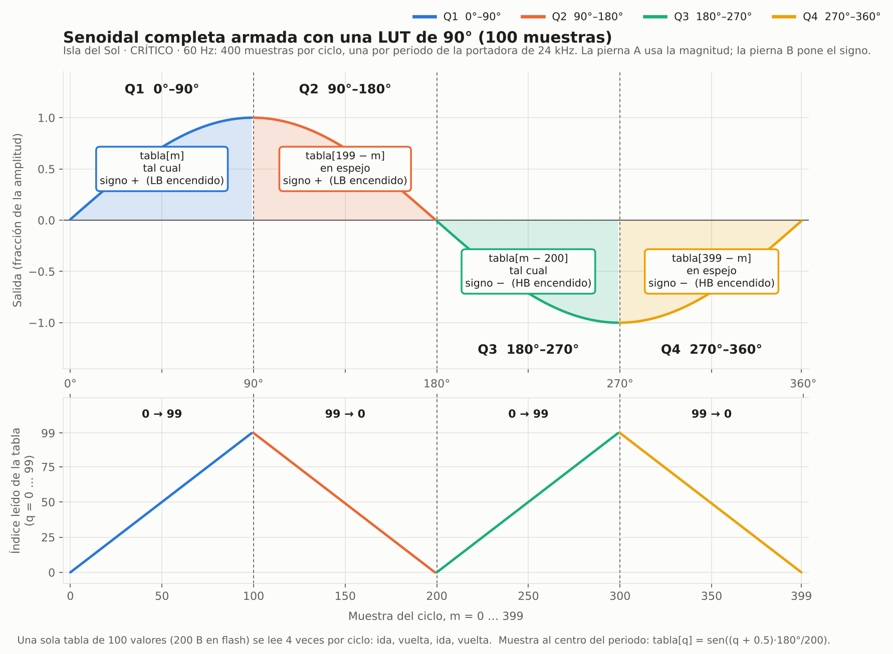

  *Arriba, la salida del ciclo con un color por cuadrante y qué índice se lee en cada uno. Abajo, el índice de la tabla: ida, vuelta, ida, vuelta. Generado por `herramientas/grafica_lut.py`.*

  > **Maximizando la SPWM de trinchera sin coprocesador matemático ni hardware dedicado (como un DSP o un microcontrolador ARM con periféricos de PWM avanzados): las matemáticas básicas maximizan los recursos.** El ATmega328P no tiene unidad de punto flotante ni generador de tiempo muerto: el seno sale de una tabla de enteros y el tiempo muerto de un desfase entre comparadores (OCR1B = OCR1A + DT). Dos identidades de bachillerato, **sen(180° − x) = sen(x)** (el espejo) y **sen(180° + x) = −sen(x)** (el signo), **ahorran el 75 % de la tabla**: 100 valores en lugar de 400, es decir 200 B en lugar de 800 B de flash.

- **Cada muestra se toma al centro de su periodo:** sen((k + 0.5) · 180° / 200), no sen(k · 180° / 200). Así la muestra k y la 199 − k valen lo mismo y el espejo sale exacto. En el borde, el pico queda sin pareja, la onda sale asimétrica y aparece componente par.
- **Doble pendiente** (*phase-correct* / *dual-slope*). Los pulsos quedan centrados en el periodo. Con el lado bajo invertido y su comparador DT cuentas más arriba (`OCR1B = OCR1A + DT`), se abre el tiempo muerto **en cada flanco** con el mismo timer.
- **Redondeo hacia arriba en el tiempo muerto.** Nunca queda menos del pedido.
- **Comparador alto limitado a TOP − DT legacy.** El comparador del lado bajo nunca pasa del TOP, con cualquier módulo que se conecte.
- **Salida a 60.06 Hz en modo isla** (0.1 % arriba de 60 Hz). Es el precio de un TOP entero con este reloj. Las cargas no lo notan. En modo red, el PLL de `ac_fb_grid` ajustará el TOP para seguir la frecuencia de la red.

### 3.2 Protecciones al compilar

El firmware **no compila** si pasa algo de esto:
- Chip distinto de 328P o 4809, o reloj distinto de 16 / 20 MHz.
- Portadora fuera de 20–25 kHz, o que no sea múltiplo de 60 Hz.
- Salida más de 0.5 % lejos de 60 Hz.
- Tiempo muerto legacy menor o igual al moderno, o cualquiera de los dos por debajo de su valor en ns.
- Tiempo muerto mayor que el 10 % del semiperiodo.

## 4. SPWM híbrida (`spwm_328p.cpp`)

### 4.1 Qué hace cada pierna

| Semiciclo | Pierna B (60 o 50 Hz, por la ISR) | Pierna A (24 kHz, por el Timer1) | Salida |
| --- | --- | --- | --- |
| **+** | **LB** (D3) encendido | **HA** lleva el pulso de potencia; LA es su complemento | +Vbus × d / TOP |
| **−** | **HB** (D11) encendido | **LA** lleva el pulso de potencia; HA es su complemento | −Vbus × d / TOP |

d = amplitud × |sen θ| (en cuentas). El timer y sus salidas son **los mismos en los dos semiciclos**: solo cambia qué lado de la pierna A lleva el pulso.

| Semiciclo | OCR1A (HA) | OCR1B (LA) |
| --- | --- | --- |
| + | d | d + DT |
| − | TOP − d − DT | TOP − d |

### 4.2 El tiempo muerto lo hace el timer, no el programa

```
TCNT1   TOP ..........    /\          /\
                         /  \        /  \
        OCR1B (LA) ---- /----\------/----\----
        OCR1A (HA) --- /------\----/------\---
        BOTTOM ...... /        \  /        \  /
                                \/          \/
HA: alta mientras TCNT1 < OCR1A (no invertida, centrada en BOTTOM)
LA: alta mientras TCNT1 > OCR1B (invertida,    centrada en TOP)
```

Entre OCR1A y OCR1B hay DT cuentas: en la subida de la rampa, HA se apaga y DT cuentas después prende LA; en la bajada es al revés. **El hueco lo garantiza el hardware en cada flanco**, aunque el programa se atrase o se cuelgue. OCR1A y OCR1B tienen doble búfer: la ISR escribe en BOTTOM los valores del periodo **siguiente**, y tiene 666 ciclos para hacerlo.

### 4.3 Cruce por cero

| Muestra del semiciclo | Pierna A | Pierna B |
| --- | --- | --- |
| 1 … S−2 | Patrón del semiciclo | Fija |
| **S−1** (199 a 60 Hz, 239 a 50 Hz) | Apagada (OCR1A = 0, OCR1B = TOP) | **Se apaga** el interruptor que sale |
| **0** | Apagada | **Se enciende** el interruptor que entra |

- **Tiempo muerto de la pierna B: un periodo completo, 41.6 µs.** Nunca coinciden HB y LB.
- En las muestras 0 y S−1 el seno vale 0.8 % (60 Hz) o 0.65 % (50 Hz), así que el pulso sería menor que el mínimo y no se generaría de todos modos. No se pierde onda.
- **La amplitud solo cambia al inicio de un ciclo** (semiciclo +). Los dos semiciclos de cada ciclo salen iguales y **no aparece CD en el transformador**, aunque el lazo cambie la amplitud a cada rato.

### 4.4 Límites del ciclo de trabajo (`config_spwm.h`)

- **Pulso mínimo de 500 ns.** Un pulso más angosto no se genera: el MOSFET no alcanza a encender completo y se calienta sin entregar energía. El pulso centrado en BOTTOM se arma con dos mitades de periodos vecinos y puede quedar con una sola, por eso el umbral es el ancho **completo** (8 cuentas).
- **Amplitud máxima: la menor entre el techo absoluto del 95 % y el límite físico del tiempo muerto en uso.**
  - Módulos de 500 ns (IRS2186, UCC21520): 316 cuentas, m = 0.949 (manda el techo).
  - Módulos de 1 µs (TLP250, IR2110): 313 cuentas, m = 0.939 (manda el límite físico).
  - El límite físico deja siempre un pulso del lado complementario. **Ese pulso recarga el capacitor de bootstrap** del lado alto en cada periodo: sin él, el lado alto se quedaría sin voltaje de compuerta. Por eso un techo fijo de 95 % con un módulo de 1 µs no es seguro: dejaría un pulso de 125 ns.
  - El techo deja margen al lazo de voltaje y al PLL, que puede bajar el TOP.

### 4.5 Presupuesto de CPU (medido en simulador, simavr)

| Medición | Ciclos | % de 666 |
| --- | --- | --- |
| ISR, mediana | 169 | 25 % |
| ISR, peor caso | 180 | 27 % |
| Con latencia de entrada y `reti` | ~190 | **~29 %** |

Igual en 60 y 50 Hz. Leer la tabla y los límites de la frecuencia elegida desde variables cuesta ~10 ciclos.

Más de lo que estimó [DC-017](../../docs/decisiones_criticas.md) (80–120 ciclos): casi todo es la multiplicación de 32 bits y los registros que guarda. **Pendiente: medirlo en el chip real con D7 del CRÍTICO** (libre y reservado para esto por DC-017): en 1 al entrar a la interrupción y en 0 al salir; con el analizador, el ancho del pulso es la duración real. Sobra margen para el Timer0 de `millis()` y el puerto serie dentro del periodo. **Pendiente:** medir en banco y, si hace falta espacio para el ADC, optimizar la multiplicación.

## 5. Frecuencia de línea: 50 o 60 Hz

El mismo firmware trae las dos frecuencias. **Se elige solo en `config_portadora.h` y se vuelve a cargar el firmware; no hay opción en el menú SETUP.** Pasar de 60 a 50 Hz obliga a cambiar el transformador ([5.2](#52--cambiar-a-50-hz-no-basta-con-el-firmware)). Quien hace ese cambio de hardware cambia esta línea, y nadie cambia la frecuencia por accidente desde los botones.

```cpp
constexpr uint8_t FRECUENCIA_LINEA_HZ = LINEA_60_HZ;   // <-- 60 o 50
```

| Región (confirma siempre con la placa de la red o del generador) | Frecuencia |
| --- | --- |
| México, Centroamérica, Colombia, Venezuela, Ecuador, Perú, Brasil (la mayor parte), EUA, Canadá | **60 Hz** |
| Casi toda África, Europa, Medio Oriente, Argentina, Chile, Uruguay, Paraguay, Bolivia, gran parte de Asia | **50 Hz** |

### 5.1 Qué cambia y qué no

| | 60 Hz | 50 Hz |
| --- | --- | --- |
| Portadora | 24 kHz | **24 kHz (igual)** |
| TOP, tiempo muerto, pulso mínimo, amplitud máxima | iguales | iguales |
| Muestras por ciclo | 400 | **480** |
| Tabla en flash | 100 muestras (200 B) | 120 muestras (240 B) |
| Salida real (328P) | 60.060 Hz | 50.050 Hz |

**Por qué la portadora no cambia.** Otra opción era bajarla a 20 kHz para conservar 400 muestras y dar 50.000 Hz exactos. A 20 kHz, el rizo de corriente en el filtro de salida sube 20 % y el zumbido queda en el borde de lo audible. Con 24 kHz fijos no cambian el filtro, las pérdidas ni el tiempo muerto: solo la tabla. A cambio, la salida queda 0.1 % arriba, igual que a 60 Hz.

### 5.2 ⚠ Cambiar a 50 Hz no basta con el firmware

- **Transformador:** a 50 Hz el núcleo trabaja con **20 % más flujo** que a 60 Hz (flujo ∝ V / f). Un transformador diseñado solo para 60 Hz puede **saturarse y calentarse**. Debe estar especificado para 50 Hz o "50/60 Hz".
- **Voltaje:** casi todas las redes de 50 Hz son de **220–240 V**, no de 127 V. El transformador de 48 V → 127 V **no sirve**: hace falta otra relación de vueltas, además de relés, capacitores y fusibles de salida para 250 V.

### 5.3 Pendiente

- **Con red presente:** medir la frecuencia de la red (`ac_fb_grid`) y **no sincronizar** si no coincide con la elegida, con aviso en el LCD.
- **Reporte:** el AUX mostrará en el LCD la frecuencia con la que se compiló el firmware (solo lectura).

## 6. Prueba en la PC (`pruebas/`)

`pruebas/prueba_spwm.cpp` compila **el mismo `spwm_328p.cpp` que va al Nano**, con los registros simulados (`pruebas/avr_simulado/`). Recorre cada periodo cuenta por cuenta con la regla del comparador de la hoja de datos del ATmega328P (modo 8). Incluye la **regla del nivel en BOTTOM** medida en banco: al cargar OCR nuevos, cada salida queda en el nivel que le toca aunque no haya coincidencia. También imprime los flancos de la pierna A alrededor del cruce + → −, para compararlos con una captura. Verifica:

1. HA y LA nunca encendidos juntos; HB y LB tampoco.
2. Tiempo muerto de la pierna A ≥ DT pedido, en cada flanco.
3. Tiempo muerto de la pierna B ≥ 1 periodo.
4. Ningún pulso de la pierna A menor que el pulso mínimo.
5. Sin CD por ciclo.
6. Fundamental de la salida igual a la amplitud pedida (error < 1 %).
7. Apagado: D12 = 0, las 4 salidas en bajo y el timer detenido.

Se prueba con **60 Hz y 50 Hz**, con DT de 500 ns, de 1 µs y con un valor inválido (debe caer en 1 µs), con amplitudes de 0 a 400 (se recorta a 316 o 313 según el DT, nunca arriba de 95 %). Una frecuencia inválida (55 Hz) debe rechazarse y quedar en 60 Hz.

```
cd firmware/critico
g++ -std=gnu++11 -O2 -D__AVR_ATmega328P__ -DF_CPU=16000000UL \
    -Ipruebas/avr_simulado -IISLA_CRITICO \
    pruebas/prueba_spwm.cpp ISLA_CRITICO/spwm_328p.cpp -o prueba_spwm
./prueba_spwm
```

Resultado actual: **todo correcto** en las dos frecuencias. DT mínimo de 8 / 16 cuentas exactas, pierna B 666 cuentas, CD < 0.0001, error de la fundamental −0.24 % (60 Hz) y −0.23 % (50 Hz) a amplitud máxima. Ese error viene de los pulsos que se quitan cerca del cruce por cero.

**Prueba de P9** (`pruebas/prueba_p9.cpp`, compila el mismo `dt_p9.cpp` que va al Nano):
- **Umbrales:** las 4 combinaciones de P9 con todas las tolerancias de R12, R13 y R14 (±1 % y ±5 %) y ±2 cuentas de error del ADC.
- **Regla:** 500 ns solo con las dos ramas a GND.
- **Arranque:** una lectura distinta da INESTABLE y 1 µs; A7 bajo no arranca.
- **Vigilancia:** 1 o 2 lecturas de ruido no disparan; 3 seguidas sí (~150–250 ms).

```
g++ -std=gnu++11 -O2 -D__AVR_ATmega328P__ -DF_CPU=16000000UL \
    -Ipruebas/avr_simulado -IISLA_CRITICO pruebas/prueba_p9.cpp ISLA_CRITICO/dt_p9.cpp -o prueba_p9
./prueba_p9
```

Resultado actual: **todo correcto**.

> **Correr esta prueba cada vez que alguien toque `spwm_328p.cpp` o `config_spwm.h`.** Ya encontró un error: con el umbral a la mitad salían pulsos de 250 ns.

## 7. Prueba de banco del paso 2

**Sin etapa de potencia. Solo el Nano por USB, o la tarjeta de control sin módulos ni puente.**

1. Carga el sketch. El Monitor Serie a 115200 debe mostrar los valores de la sección 3 y **"DT en uso: 16"**: todavía no se lee P9 y se usa el seguro.
2. Cada 10 s debe imprimir **"Ciclos en 10 s: 600"** o 601 (60.06 Hz). Con `FRECUENCIA_LINEA_HZ = LINEA_50_HZ`: **500** o 501 (50.05 Hz).
3. Con osciloscopio de 2 canales, en los pines del Nano:
   - **D9 y D10 a la vez:** pulsos de 24.02 kHz, nunca altos juntos. Con zoom en un flanco, **el hueco entre los dos debe ser ≥ 1 µs**.
   - **D11 y D3 a la vez:** ondas cuadradas de 60.06 Hz (o 50.05 Hz), opuestas, con **~41.6 µs** en que los dos están en bajo en cada cambio.
   - **D9 con disparo en D3:** el ancho de los pulsos de D9 crece y baja como seno durante el semiciclo en que D3 está alto. En el otro semiciclo, D10 hace lo mismo.
4. **D12 debe estar en 0 V todo el tiempo.** Si la tarjeta de control está armada, en la salida de la compuerta AND (74HC08) no debe haber ningún pulso.

> Si cualquiera de estos puntos falla, **no conectes la etapa de potencia**.

### 7.0 Resultado de la primera prueba real (2026-11-12)

Arduino Nano (ATmega328P) por USB, **sin etapa de potencia**, analizador lógico genérico a 16 MHz con PulseView. **Validado:** pierna A, pierna B y frecuencia.

**Método:** medición **manual en la interfaz gráfica de PulseView**. Nada se midió con el script `analiza_captura.py`:
- **Decodificador PWM** (*Duty cycle* y *Period*) sobre LB: fracción en alto y periodo de cada ciclo.
- **Decodificador Timing** (*Time* y *Average*) sobre HB y LB: periodo y frecuencia ciclo por ciclo.
- **Cursores** con zoom en los flancos: tiempo muerto de la pierna A (HA ↓ → LA ↑) y de la pierna B (HB ↓ → LB ↑ y LB ↓ → HB ↑).
- **Monitor Serie** del Arduino IDE: reporte de arranque y ciclos en 10 s.

| Medición | Predicho (prueba en la PC) | Medido en el Nano | |
| --- | --- | --- | --- |
| Reporte de arranque | TOP 333, 24 024.02 Hz, 400 muestras, DT 16, amplitud 313, m 0.939 | Igual | ✅ |
| Ciclos en 10 s | 600–601 | 601, 601, 600 | ✅ |
| Periodo de la pierna B (HB y LB) | 16.650 ms (60.060 Hz) | **16.656 ms (60.040 Hz)** | ✅ |
| Fracción de LB en alto | 199 / 400 = 49.75 % | **49.7476 %** | ✅ |
| Tiempo muerto de la pierna A (HA ↓ → LA ↑) | 16 cuentas = 1000 ns | **1000 ns** | ✅ |
| Tiempo muerto de la pierna B, HB ↓ → LB ↑ (fin del semiciclo −) | 41.625 µs (1 periodo de portadora) | **42.000 µs** y **41.751 µs** en dos cruces distintos (varía por la latencia de la interrupción; ver nota) | ✅ |
| Tiempo muerto de la pierna B, LB ↓ → HB ↑ (fin del semiciclo +) | ~41.6 µs ± unos µs de latencia | **42.188 µs** (675 muestras a 16 MHz) | ✅ |
| Pierna A alrededor del cruce | Apagada en las muestras 199 y 0 (~2 periodos); antes del cruce, HA ancho y LA angosto; después, al revés | Igual en la captura | ✅ |

- **La diferencia de 0.02 Hz** (60.040 contra 60.060) viene de la tolerancia del cristal del Nano y del reloj del analizador, ~330 ppm. Está dentro de lo esperado para un cristal de 16 MHz de clon. En modo red, el PLL la corrige.
- **Los caracteres raros al inicio del Monitor Serie** son normales: el Nano se reinicia al abrir el puerto y el bootloader envía bytes antes de `Serial.begin()`.
- **Captura de 2 M muestras (125 ms, ~7.5 ciclos):**

  | Medición | Valor |
  | --- | --- |
  | Frecuencia de salida, ciclo por ciclo | 60.038–60.043 Hz |
  | LB en alto, ciclo por ciclo | 49.7469–49.7512 % (predicho 49.75 %) |
  | Pierna B, HB ↓ → LB ↑ (otro cruce) | **40.437 µs** |
  | Pierna B, LB ↓ → HB ↑ (otro cruce) | **41.500 µs** |
  | **Rango de la pierna B en 5 cruces medidos** | **40.437–42.188 µs** (1.75 µs = 28 ciclos de CPU) |

  El valor más bajo, 40.4 µs, sigue siendo ~40 veces lo que necesita un gate driver.

- **El hueco de la pierna B varía entre cruces: de 40.437 a 42.188 µs** en cinco mediciones. No es un valor fijo por transición. La pierna B la mueve el programa dentro de la interrupción, y la interrupción no siempre entra en el mismo ciclo:
  - el CPU termina la instrucción en curso (1–4 ciclos);
  - si en ese momento corre otra interrupción (Timer0 de `millis()`, puerto serie), espera a que termine (hasta ~5 µs);
  - las lecturas atómicas de `loop()` apagan las interrupciones unos ciclos.

  Por eso el hueco puede variar unos µs alrededor de 41.6 µs. En el peor caso queda en ~36 µs, contra ~1 µs que necesita un gate driver. **La pierna A no tiene esta variación:** su tiempo muerto lo hace el hardware del timer (1000 ns exactos). Antes atribuí la diferencia a los caminos del código; con esta tercera medición, la causa principal es la latencia de la interrupción.
- **Pulso solitario de HA al inicio del semiciclo −** (captura de 2 M muestras):
  - **Qué se ve:** en la muestra 1 del semiciclo − (~83 µs después de que baja LB), HA sube sola **~20 µs**, baja **~2 µs** y luego empiezan los pulsos anchos normales.
  - **Por qué:** en esa muestra OCR1A pasa de 0 (pierna A apagada en el cruce) a TOP − DT. En ese BOTTOM el ATmega328P pone la salida en el nivel que le toca ("alta mientras TCNT1 < OCR1A") **aunque no haya coincidencia del comparador**. HA sube en BOTTOM, baja al llegar a TOP − DT (19.8 µs) y vuelve a subir 2 µs después, en la bajada de la rampa.
  - **Es seguro:** LA está apagada (OCR1B = TOP) y HB encendido, así que HA + HB da salida de 0 V. Es justo lo que pide el seno en ese punto: con d = 0 en el semiciclo −, la pierna A debe estar arriba.
  - **El modelo de la PC no lo predecía:** suponía que una salida solo cambia al coincidir el comparador. Se agregó la regla del nivel en BOTTOM a `pruebas/prueba_spwm.cpp`. El modelo reproduce el pulso con los mismos tiempos (83.25 → 103.06 µs, 2 µs abajo, vuelve a subir) y **todas las verificaciones siguen pasando**: tiempo muerto de 8 / 16 cuentas, sin traslapes, pulso mínimo respetado.
  - **Lección:** el banco encontró un comportamiento del chip que la simulación no tenía. Por eso cada paso se valida en hardware real.

- **No verificado todavía en hardware** (solo en la prueba de la PC): el pulso más angosto (≥ 500 ns), la forma senoidal en todos los pulsos, la amplitud real en el pico y que D12 nunca suba (D12 no se conectó al analizador). Se puede hacer con `analiza_captura.py` sobre un `.sr` completo (sección 7.1), o a mano con cursores en PulseView.

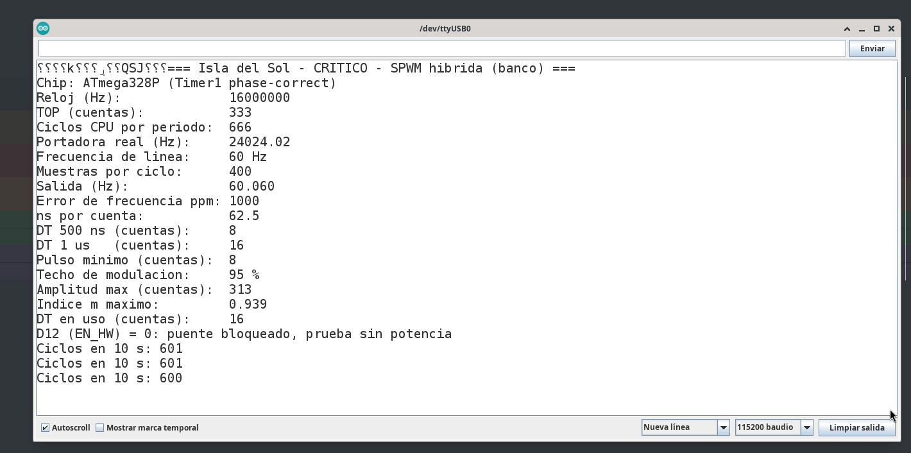
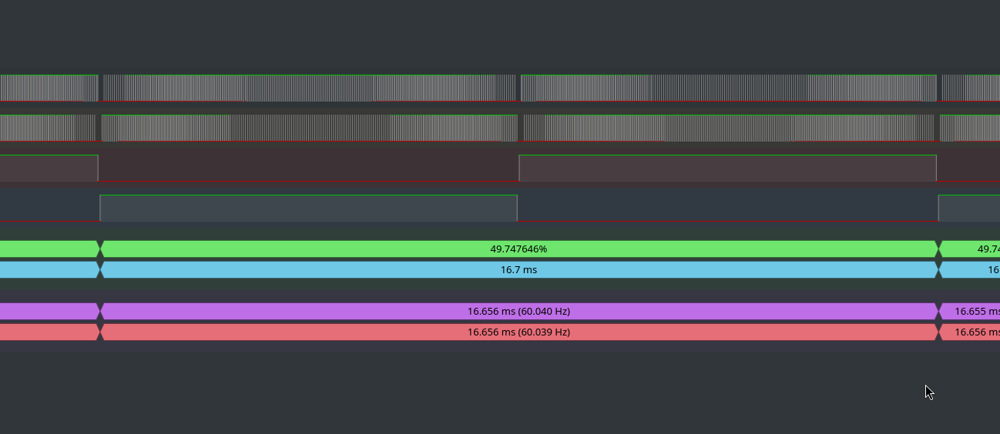
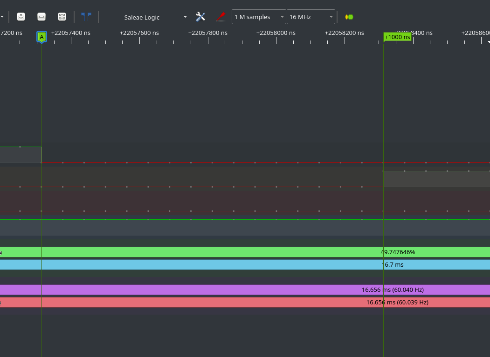
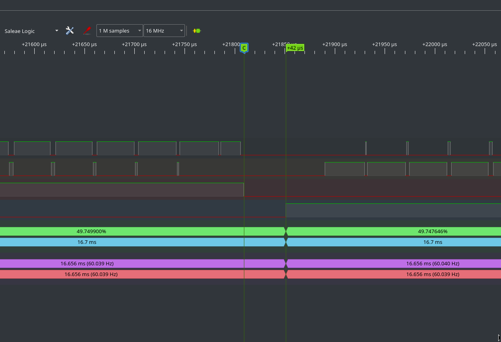
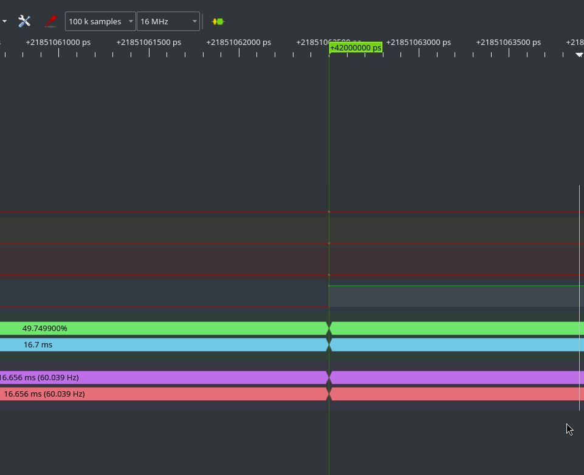
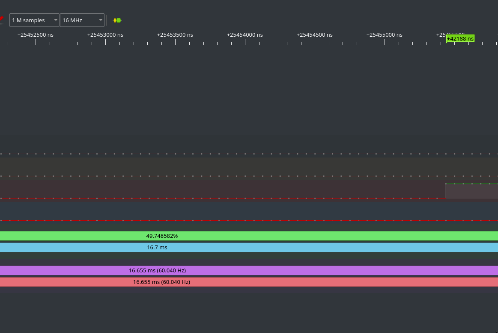
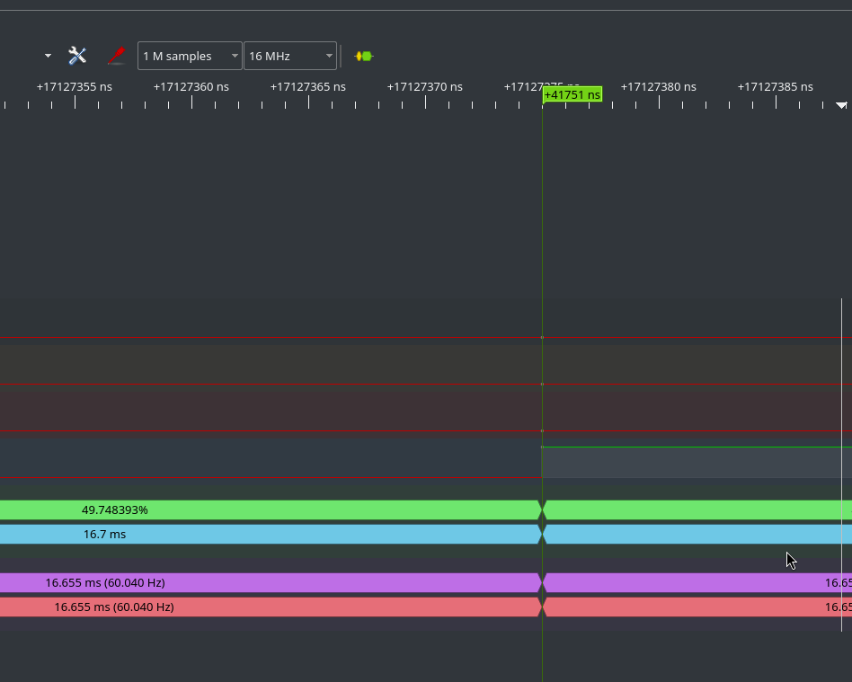
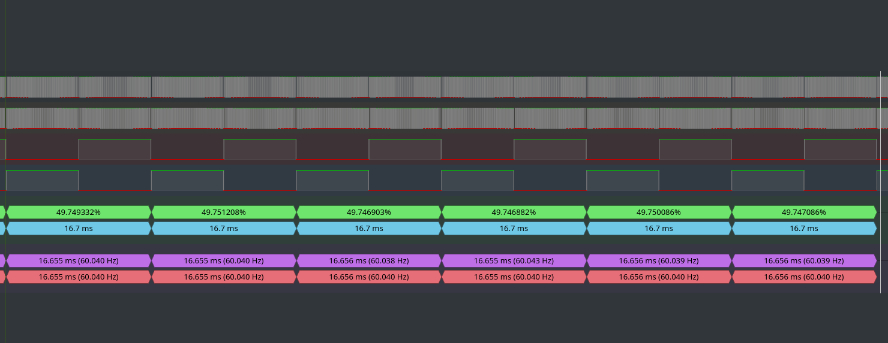
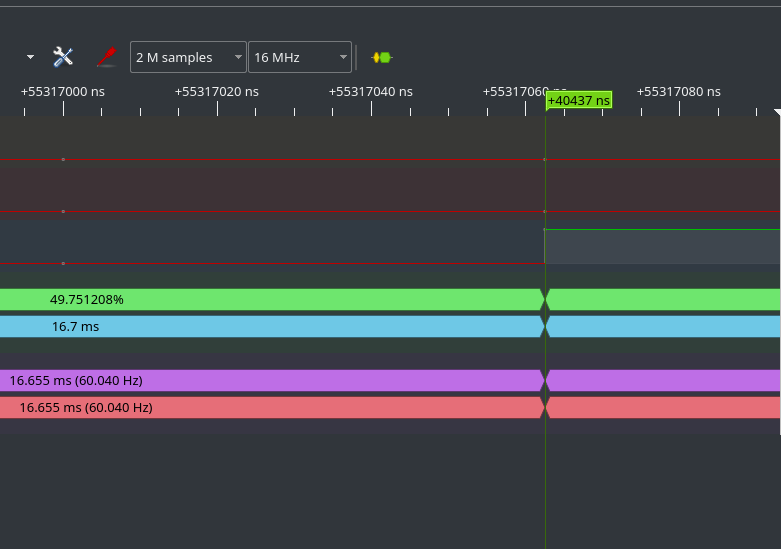
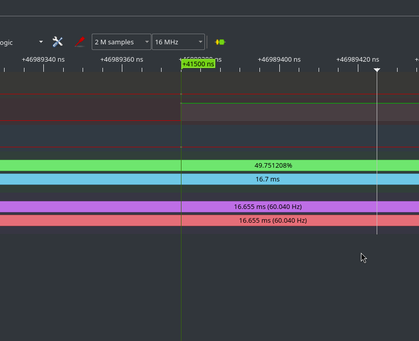
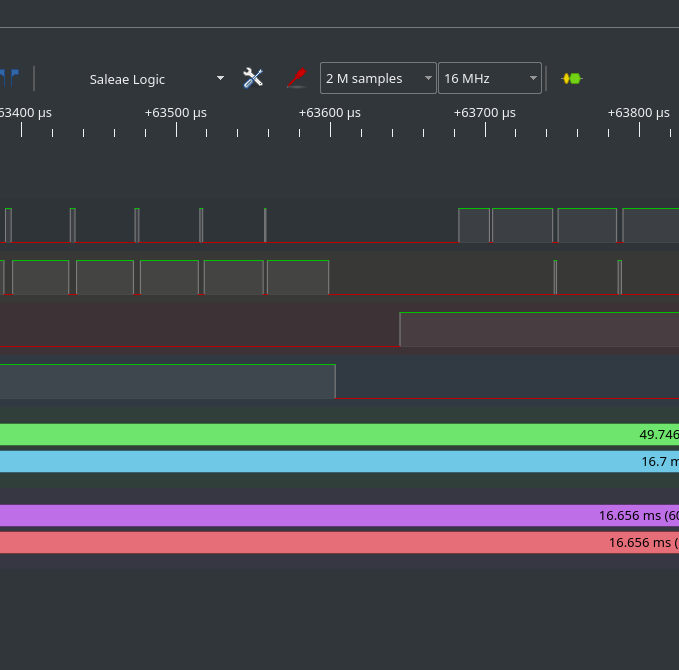

### 7.0b Prueba real a 50 Hz (2026-11-12)

Mismo Nano y mismo analizador (2 M muestras a 16 MHz), con `FRECUENCIA_LINEA_HZ = LINEA_50_HZ`. **Validado**, con el mismo método: medición manual en PulseView (decodificadores PWM y Timing, cursores) y Monitor Serie.

| Medición | Predicho | Medido en el Nano | |
| --- | --- | --- | --- |
| Reporte de arranque | 50 Hz, 480 muestras, 50.050 Hz; TOP, DT, amplitud y m iguales que a 60 Hz | Igual | ✅ |
| Ciclos en 10 s | 500–501 | 501 | ✅ |
| Periodo de la pierna B | ~19.98 ms (50.03–50.05 Hz) | **19.987 ms (50.032–50.034 Hz)**, igual en 5 ciclos | ✅ |
| LB en alto | 239 / 480 = 49.79 % | **49.7906–49.8033 %** | ✅ |
| Tiempo muerto de la pierna A | 1000 ns | **1000 ns** | ✅ |
| Hueco de la pierna B | ~40–42 µs | **42 µs** y **41.812 µs** | ✅ |
| Pierna A en el cruce | Apagada ~2 periodos; el patrón se invierte | Igual | ✅ |

- **La frecuencia, 50.033 Hz contra 50.050 Hz,** tiene la misma desviación de ~330 ppm que a 60 Hz: es el cristal del Nano. Sale igual en las dos frecuencias, lo que confirma que la diferencia es del reloj y no del firmware.
- **LB al 49.79 %** confirma 240 muestras por semiciclo, con la pierna B apagada una antes del cruce.

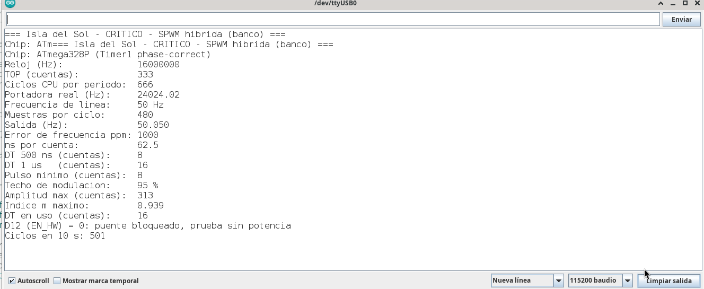
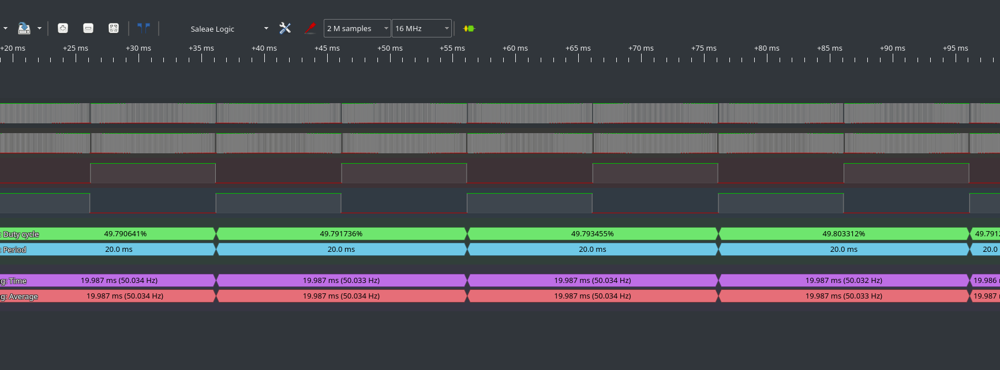
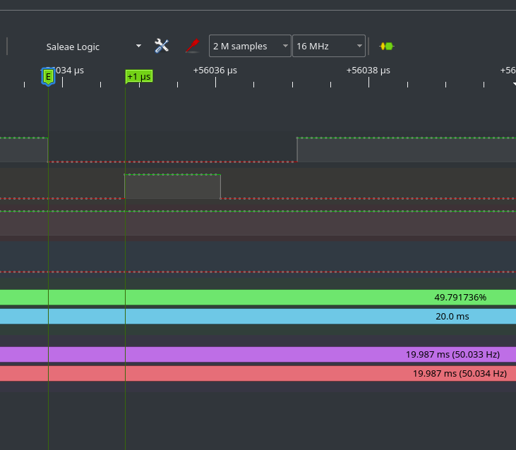
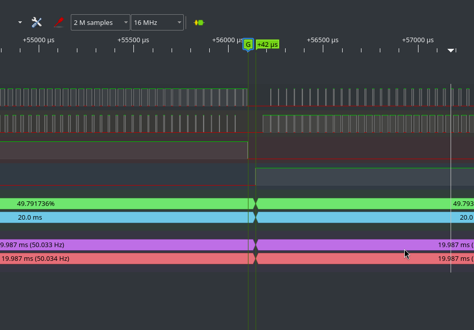
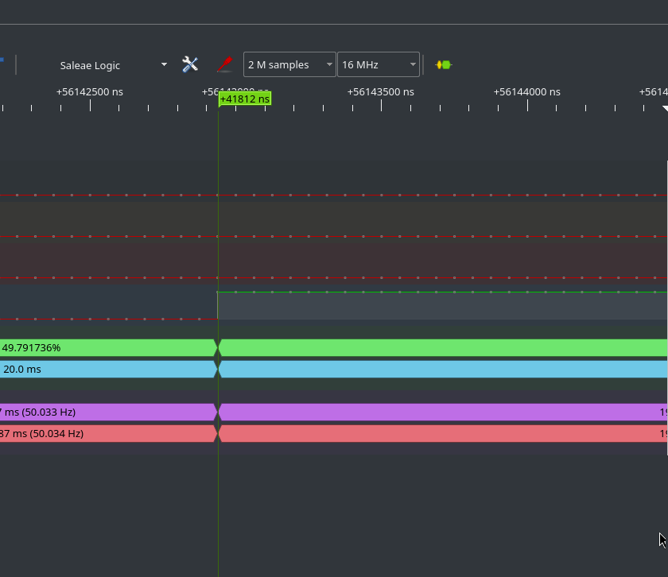

### 7.0c Prueba real con tiempo muerto de 500 ns a 60 Hz (2026-11-12)

Mismo Nano y mismo analizador (2 M muestras a 16 MHz). Cambio temporal en `setup()`: `spwm_preparar(DT_MODERNO_CUENTAS, ...)`, el valor que pedirán los módulos IRS2186 y UCC21520 con P9 a GND. Mismo método: medición manual en PulseView y Monitor Serie. **Validado.**

| Medición | Predicho | Medido en el Nano | |
| --- | --- | --- | --- |
| DT en uso | 8 cuentas | 8 | ✅ |
| Amplitud máxima / m | 316 / 0.948 (manda el techo del 95 %) | 316 / 0.948 | ✅ |
| Frecuencia, TOP, ciclos en 10 s | 60.060 Hz, 333, 600–601 | Igual (601, 601) | ✅ |
| **Tiempo muerto de la pierna A, en los dos flancos** (HA ↓ → LA ↑ y LA ↓ → HA ↑) | **500 ns** (8 cuentas) | **500 ns** en los dos | ✅ |

- **Así quedan validados en hardware los dos tiempos muertos que puede pedir P9:** 1 µs (60 y 50 Hz) y 500 ns (60 Hz).
- **En el repositorio el `.ino` sigue con `DT_LEGACY_CUENTAS` (1 µs).** Mientras no se lea P9, es el valor seguro. Con un módulo TLP250 o IR2110, 500 ns podría causar conducción cruzada.

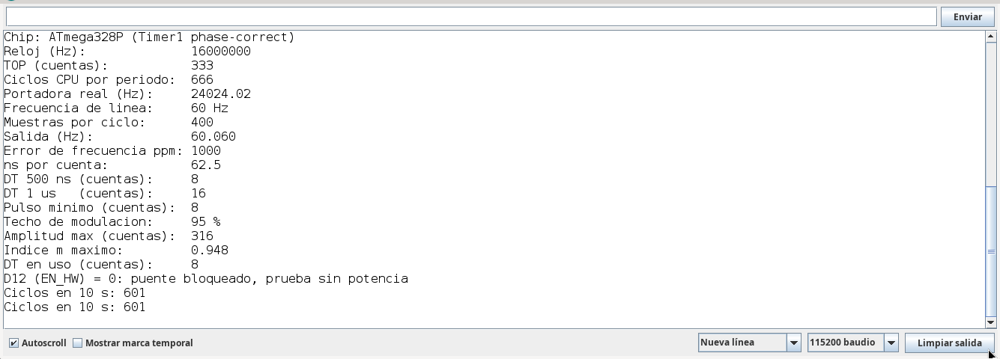
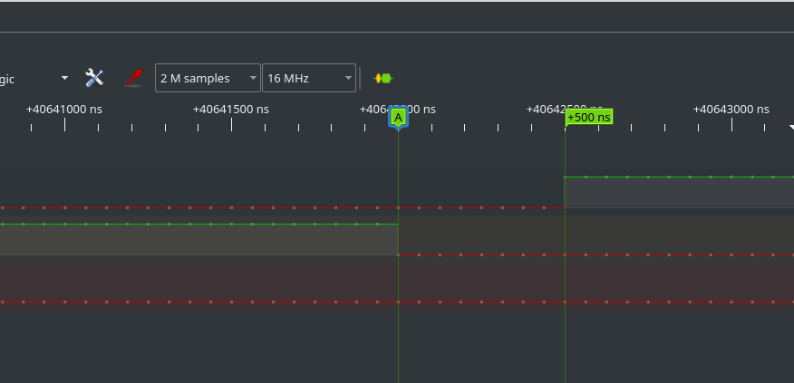

### 7.2 Prueba de banco del paso 3: lectura de P9 (pendiente)

Simula en la protoboard la red de A7 de la tarjeta de control (sección 13) y los P9 de los dos módulos con cables. **Sin etapa de potencia; D12 sigue en 0.**

**Material:** 2 resistencias de **10 kΩ** (R12, R13), 1 de **20 kΩ** (R14) y, opcional, un capacitor de **100 nF** (C18). Sirven de 5 % o mejores.

```
   5V ──[R12 10k]──┬──────────── A7 del Nano
                   ├──[R13 10k]──── cable "P9_A"  (a GND = módulo de 500 ns; suelto = de 1 µs)
                   ├──[R14 20k]──── cable "P9_B"  (a GND = módulo de 500 ns; suelto = de 1 µs)
                   └──[C18 100n]─── GND   (opcional)
```

**Procedimiento:** para cada combinación, deja los cables como dice la tabla, **reinicia el Nano** (P9 se lee al encender) y anota lo que sale en el Monitor Serie. Luego mide el tiempo muerto de la pierna A en PulseView, igual que en la 7.0c.

| # | P9_A | P9_B | Monitor Serie: "P9 en A7" | DT en uso | PulseView: HA ↔ LA |
| --- | --- | --- | --- | --- | --- |
| 1 | GND | GND | ~409 cuentas, ~2.00 V, `500 ns` | **8 (500 ns)** | **500 ns** |
| 2 | GND | suelto | ~512 cuentas, ~2.50 V, `MIXTO, se usa 1 us` | 16 (1 µs) | 1000 ns |
| 3 | suelto | GND | ~682 cuentas, ~3.33 V, `MIXTO, se usa 1 us` | 16 (1 µs) | 1000 ns |
| 4 | suelto | suelto | ~1023 cuentas, ~5.00 V, `1 us` | 16 (1 µs) | 1000 ns |

Con resistencias de ±5 % las cuentas pueden variar: 383–436, 484–539, 657–706 y 1021–1023. Los umbrales están a la mitad, en 460, 598 y 863 (`pruebas/prueba_p9.cpp`).

**Pruebas de falla:**

| # | Qué hacer | Qué debe pasar |
| --- | --- | --- |
| 5 | Arranca en el caso 1 (500 ns) y, **con la SPWM corriendo**, suelta P9_B | En ~150–250 ms: `FALLA: P9 cambio con la SPWM corriendo`, la lectura nueva (~512) y `SPWM DETENIDA`. En PulseView, D9, D10, D11 y D3 quedan en 0 |
| 6 | Toca y suelta rápido un cable de P9 con la SPWM corriendo (menos de 100 ms) | No debe detenerse: hacen falta 3 lecturas seguidas distintas |
| 7 | Conecta A7 directo a GND y reinicia | `FUERA DE RANGO` y `La SPWM NO arranca`. En PulseView no hay pulsos |
| 8 | Quita R12, deja los dos P9 **sueltos** y reinicia varias veces | **Prueba para medir un riesgo, no para aprobar.** A7 queda flotando y puede leer cualquier cosa, **incluso la banda de 500 ns**. Anota qué sale en cada reinicio |

> **Riesgo conocido (caso 8):** la falla segura de P9 depende de que **R12 esté presente**. Si R12 se abre, A7 queda flotando y el firmware no lo puede distinguir de una lectura válida, porque A7 es solo analógico y no tiene pull-up interno. Mitigaciones posibles, a decidir con el resultado del caso 8: R12 en el lado de componentes con soldadura inspeccionada, o una segunda resistencia de pull-up en paralelo.

> **El caso 1 es el único en que el firmware usa 500 ns.** Si en cualquier otro caso PulseView mide 500 ns, **es una falla grave**: detén las pruebas y avísame.

### 7.3 Prueba de banco del enlace I2C CRÍTICO ↔ AUX (validada, 2026-11-13)

Dos Nanos: el **CRÍTICO** con `ISLA_CRITICO.ino` (paso 3 + enlace) y el **AUX** con [`firmware/aux/ISLA_AUX_PRUEBA_I2C`](../aux/ISLA_AUX_PRUEBA_I2C/ISLA_AUX_PRUEBA_I2C.ino). **Sin potencia.**

#### Protocolo (`enlace_protocolo.h`, idéntico en los dos sketches)

- **Roles (DC-017):** el **CRÍTICO es esclavo (0x20)** y nunca espera al bus; el **AUX es el maestro**. A 100 kHz.
- **Comando del AUX, 4 bytes:** tipo, secuencia, dato y CRC-8. Hoy solo existe `PING` (0x01).
- **Foto del CRÍTICO, 16 bytes:** versión, secuencia, eco del último PING, banderas (SPWM activa, detenida por P9, 50 Hz), estado de P9, DT, ciclos, lectura de A7, amplitud máxima, comandos con CRC malo, y CRC-8.
- **CRC-8 SMBus:** polinomio 0x07, valor inicial 0. Los números de 16 bits van con el byte bajo primero.
- **La interrupción de I2C solo copia bytes.** El CRÍTICO valida los comandos y arma la foto en `loop()`, cada 50 ms, y la copia de forma atómica: el AUX nunca recibe media foto.

#### Detección y recuperación

| Lado | Aviso (líneas `>>>`) | Cuándo |
| --- | --- | --- |
| AUX | `ENLACE ESTABLECIDO` / `ENLACE RECUPERADO` | Primera foto válida |
| AUX | `ENLACE PERDIDO` | 3 fallas seguidas (~300 ms). Luego **libera el bus** cada ~1 s: hasta 9 pulsos en SCL, un STOP y reinicio del TWI (NXP UM10204, "bus clear") |
| AUX | `CRITICO CONGELADO` | Responde, pero su foto no avanza en 300 ms (programa trabado) |
| AUX | — | **Nunca muestra una foto de más de 300 ms** como si fuera actual |
| CRÍTICO | `AUX conectado` / `AUX perdido` | Primer PING válido / 500 ms sin PING. Sin PING, reinicia su TWI esclavo cada 1 s |

#### Resultados

| Prueba | Resultado |
| --- | --- |
| Enlace al arrancar | `AUX conectado` a los **114 ms** |
| PING sin pérdidas | **+100 cada 10 s** (10 por segundo), **CRC malo 0**, más de 1 700 PING seguidos |
| Desconectar y reconectar el CRÍTICO o el AUX, varias veces | Se detecta y **se recupera solo** en los dos sentidos; ninguno se cuelga |
| Tiempo muerto de la pierna A **con y sin** el enlace | **1 µs** en los dos casos: el I2C no lo afecta (lo hace el hardware del Timer1) |
| Pierna B (cruce por cero) con el enlace | **~42 µs**, como sin el enlace |
| Una fuente y una tierra, 20 M muestras (1.25 s) | **Sin anomalías** |
| Memoria | CRÍTICO 9.9 KB de flash (32 %) y 517 B de RAM (25 %); AUX 9.2 KB |

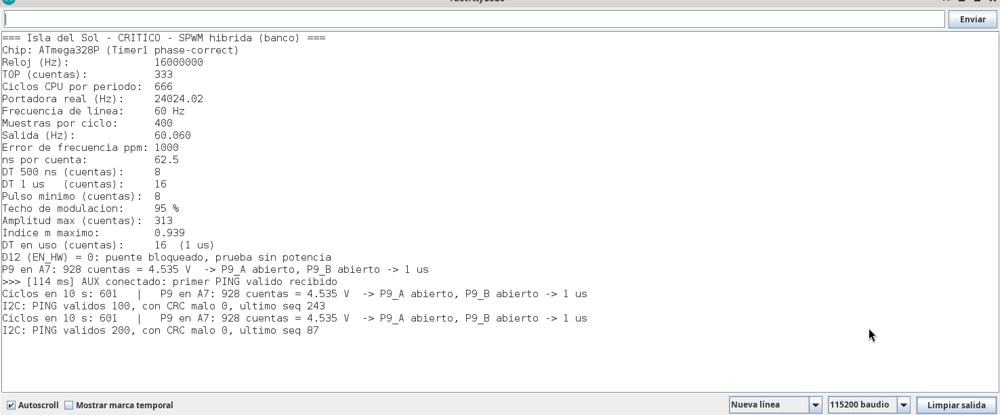
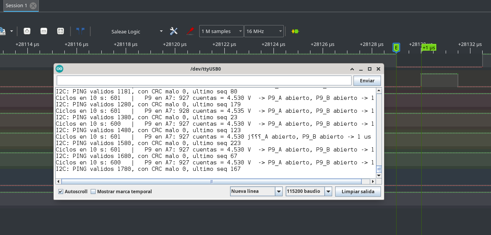
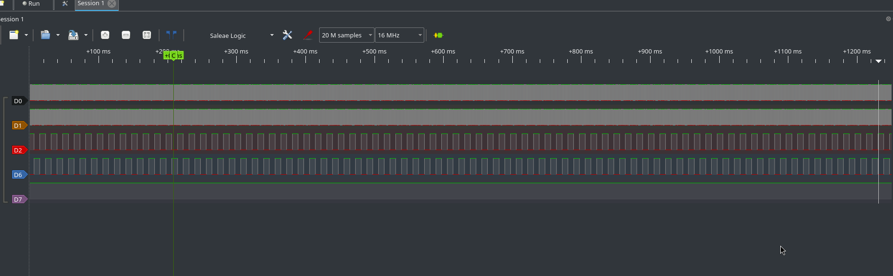
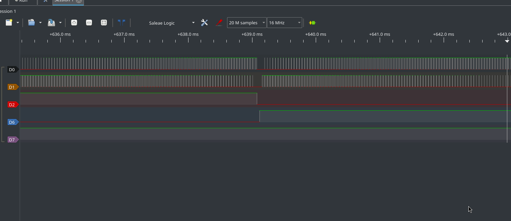

#### Lo que se aprendió en el banco

- **"El AUX no imprime después de reconectarlo":** era el Monitor Serie de la PC. Al quitar el USB con el Monitor abierto, Linux le asigna otro puerto (`ttyUSB1`). **Cierra el Monitor antes de desconectar** y revisa *Herramientas → Puerto*. El log del CRÍTICO (PING válidos) probaba que el AUX seguía funcionando.
- **Sin el USB del CRÍTICO,** las pull-up del AUX pueden alimentarlo un poco por SDA y SCL. En la tarjeta real no pasa: los dos comparten el mismo 5 V.
- **Pulsos de 63 ns en todas las señales a la vez:** no eran del firmware. Solo la interrupción del SPWM escribe en los pines de la pierna B, y lo hace solo en las muestras 199 y 0. Era un **lazo de tierra** entre dos computadoras. Ver la advertencia de abajo.

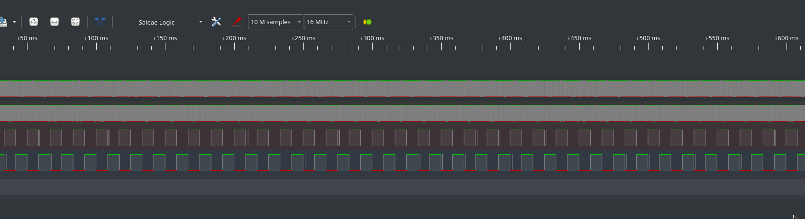
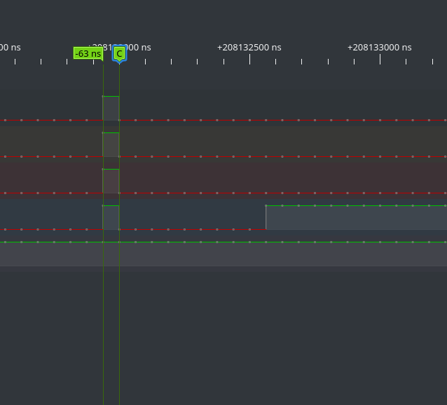

> ⚠ **Advertencia para el trinchero: nunca monitorear con dos laptops a la vez**
>
> No conectes el CRÍTICO a una computadora y el AUX a otra (ni el analizador lógico a una tercera) mientras los dos Nanos estén unidos por el I2C (A4, A5 y GND).
>
> **Por qué:** cada computadora tiene su propia tierra. Al unir los Nanos por GND, las tierras de las dos computadoras quedan conectadas por ese cable y se forma un **lazo de tierra**. Por ahí circulan corrientes de ruido de los cargadores y del USB, que:
> - generan **pulsos falsos de ~63 ns en todas las señales a la vez** al medir con el analizador (parecen cortos en el puente H, pero no lo son);
> - pueden dar **errores de comunicación** y, en el peor caso, dañar un puerto USB o un Nano.
>
> **Cómo se hace bien:**
> - **Una sola computadora y una sola tierra:** el CRÍTICO por USB, y el AUX alimentado desde sus pines (5 V → 5 V, GND → GND), más A4 y A5. El estado del enlace se ve en el Monitor del CRÍTICO (`AUX conectado`, `PING validos`).
> - **Si necesitas ver los dos Monitores,** conecta los dos Nanos por USB a la **misma** computadora, y el analizador también a esa.
>
> *Evidencia: prueba del enlace del 2026-11-13. Con dos laptops aparecían pulsos de 63 ns en los cuatro canales; con una sola fuente y una sola tierra, 20 M muestras sin anomalías.*

### 7.1 Análisis automático con script (opcional)

> **Estado:** el script **no se ha usado todavía con capturas reales**. La etapa base se validó a mano en PulseView (secciones 7.0 y 7.0b). El script solo se probó con capturas sintéticas. Sirve para revisar de una vez miles de flancos y lo que no se mide bien con cursores: pulso más angosto, forma senoidal y D12.

Sirve el clon de Saleae de 24 MHz con **PulseView** (sigrok, gratuito, driver `fx2lafw`) o con el software Logic de Saleae. A 24 MHz cada muestra vale 41.7 ns: el tiempo muerto de 1 µs se mide con ±42 ns.

| Canal | Pin del Nano | Señal |
| --- | --- | --- |
| 0 | D9 | HA |
| 1 | D10 | LA |
| 2 | D11 | HB |
| 3 | D3 | LB |
| 4 | D12 | EN_HW |
| GND | GND | **Obligatorio** |

1. Muestreo **24 MHz**, al menos **100 ms**, disparo en **flanco de subida del canal 3** (inicio del semiciclo +). Espera ~2 s después de encender para que la rampa llegue al máximo.
2. Guarda la sesión (`.sr` en PulseView) o exporta a CSV (PulseView o Saleae).
3. Analízala:

```
python3 pruebas/analiza_captura.py captura.sr                     # 60 Hz, DT 1 µs (sin P9)
python3 pruebas/analiza_captura.py captura.sr --hz 50 --dt-ns 500
python3 pruebas/analiza_captura.py captura_saleae.csv --fs 24e6
```

El script verifica: HA/LA y HB/LB nunca juntos, tiempo muerto de cada flanco, hueco de la pierna B, portadora, frecuencia de salida, pulso más angosto, forma senoidal y amplitud (m), D12 en 0 y el estado al inicio de la captura. Termina con **"RESULTADO: todo correcto"** o con la lista de fallas.

Se probó con capturas sintéticas de 24 MHz en los tres formatos (60 y 50 Hz). Una captura con **un solo flanco sin tiempo muerto entre 5 642** se marca como **FALLA**.

> Una captura extra **justo al encender** muestra la rampa y comprueba que ninguna señal se mueve antes de que arranque la SPWM.

## 8. Qué se tomó del borrador antiguo y qué cambió

El borrador de 4400 líneas (sin probar, derivado de un código GPL v3) se usó **solo como referencia de estudio**. Todo el código de esta carpeta está escrito desde cero (MIT).

| Tema | Borrador | Isla del Sol | Por qué |
| --- | --- | --- | --- |
| Timer y modo | Timer1, modo 8, TOP 333 | Igual | Mismo chip y portadora: el resultado es el mismo |
| Tiempo muerto | Lo hace el timer (OCR1B = OCR1A + TM, OC1B invertida). **TM fijo al compilar** (`TIEMPO_MUERTO_SEL`, según la red de compuerta montada) | Mismo método de hardware. **DT elegido al encender por P9** (8 o 16 cuentas); valor inválido → 16 | Un solo firmware para todos los módulos: el técnico cambia el módulo, no el código |
| Bordes del semiciclo | Valores especiales (0/0 = lado bajo fijo, TOP/TOP = lado alto fijo) y una bandera de "medio pulso pendiente" entre periodos | **Nunca** se usa un lado fijo encendido: siempre d con su DT, o la pierna A apagada (0/TOP) | Al pasar de un periodo con un lado fijo encendido al siguiente, los dos flancos pueden caer en la misma cuenta (DT = 0); así no hace falta la bandera. Probado cuenta por cuenta |
| Cruce por cero | Pierna B con ~42.75 µs de tiempo muerto | Igual idea: 2 periodos con la pierna A apagada, pierna B a 1 periodo | Coincide; aquí se verifica en la prueba de la PC |
| Tabla seno | Medio ciclo en **RAM**, calculada al arrancar | **Cuarto de onda en flash**, muestreada al centro del periodo | 0 B de RAM; espejo exacto |
| Amplitud | Se aplica por ciclo | Igual: solo al inicio del semiciclo + | Sin CD en el transformador |
| Pulso mínimo y amplitud máxima | Límite fijo del comparador | Pulso mínimo de 500 ns + amplitud que **siempre** deja pulso de bootstrap | Corregido con la prueba: el pulso de borde puede quedar con una sola mitad |
| Permiso del puente | No existía (el borrador no tiene la compuerta AND) | **D12 = 0 primero** al apagar; el SPWM nunca lo sube | Corte por hardware ([corte por hardware](../../docs/corte_por_hardware.md)) |
| Todo en un archivo | 4400 líneas con `#if` | Un archivo por módulo | Lo pediste así: cada archivo se entiende solo |

## 9. Bitácora

| Fecha | Cambio |
| --- | --- |
| 2026-11-12 | Paso 1: `config_portadora.h` (portadora, muestras, TOP, tiempo muerto en cuentas, protecciones al compilar) y `ISLA_CRITICO.ino` con salidas seguras y reporte. Explicación del cuarto de onda en el código y en la sección 3.1. Compila en 328P: 4.0 KB de flash, 199 B de RAM. Escrito desde cero (MIT); el borrador antiguo de 4400 líneas solo se usó como referencia de estudio |
| 2026-11-12 | **Soporte de 50 Hz y 60 Hz** (`FRECUENCIA_LINEA_HZ`): portadora fija de 24 kHz, 480 muestras a 50 Hz con su propia tabla de cuarto de onda (120). `spwm_preparar(dt, frecuencia)` rechaza valores inválidos y queda en 60 Hz. Decisión: la frecuencia se elige solo en el código, no desde el SETUP. Advertencias de transformador y voltaje en la sección 5. Prueba en la PC: todo correcto en las dos frecuencias. ISR de 169–180 ciclos. Compila: 5.7 KB de flash, 233 B de RAM |
| 2026-11-12 | **Techo absoluto de modulación del 95 %** (`M_TECHO_PORCIENTO`). Amplitud máxima = la menor entre el techo y el límite físico del DT en uso: 316 (500 ns) / 313 (1 µs). `spwm_amplitud_max()`. Prueba en la PC: todo correcto |
| 2026-11-12 | `pruebas/analiza_captura.py`: valida la SPWM real con un analizador lógico de 24 MHz (`.sr` de PulseView, CSV de PulseView o de Saleae). Probado con capturas sintéticas; detecta un solo flanco sin tiempo muerto. Sección 7.1 |
| 2026-11-12 | **Primera prueba real en un Nano: validada.** Pierna A, pierna B (40.44–42.19 µs en 5 cruces) y frecuencia (60.04 Hz estable en 7.5 ciclos). Analizador lógico a 16 MHz: pierna B a 16.656 ms (60.040 Hz), LB 49.7476 % (predicho 49.75 %), tiempo muerto de la pierna A = 1000 ns, 600–601 ciclos en 10 s. Capturas en `img/`. Sección 7.0 |
| 2026-11-12 | **Pulso solitario de HA** en la muestra 1 del semiciclo − (~20 µs), encontrado en banco: el chip fija el nivel de la salida en BOTTOM al cambiar OCR1A de 0. Es seguro (HA + HB = 0 V, LA apagada). El modelo de la PC se corrigió con esa regla y lo reproduce; todas las verificaciones pasan. Nota en `spwm_328p.cpp` |
| 2026-11-12 | **Prueba real a 50 Hz: validada.** 19.987 ms (50.033 Hz), LB 49.79 %, tiempo muerto de la pierna A 1000 ns, pierna B 41.8–42 µs, 501 ciclos en 10 s. Sección 7.0b |
| 2026-11-12 | ✅ **ETAPA BASE COMPLETADA:** generación de la SPWM híbrida validada en hardware real a 50 y 60 Hz. Etiqueta `critico-etapa-base` |
| 2026-11-12 | Aclarado el **método de validación**: la etapa base se midió a mano en la interfaz gráfica de PulseView (decodificadores PWM y Timing, cursores) y en el Monitor Serie. `analiza_captura.py` es opcional y aún no se ha usado con capturas reales |
| 2026-11-12 | **Tiempo muerto de 500 ns validado en hardware real a 60 Hz:** 500 ns en los dos flancos de la pierna A, amplitud 316 (m 0.948), 601 ciclos en 10 s. Sección 7.0c. El `.ino` del repo sigue en 1 µs |
| 2026-11-13 | Enlace al nuevo **mapa de pines** de la tarjeta de control (sección 1.1). D7 del CRÍTICO para medir la duración real de la ISR |
| 2026-11-13 | Gráfica de la LUT de 90° por cuadrantes (`img/lut_cuarto_de_onda.png`, `herramientas/grafica_lut.py`) en la sección 3.1 |
| 2026-11-13 | **Paso 3: lectura de P9** (`dt_p9.h/.cpp`): 16 lecturas de A7 al encender, 500 ns solo con las dos ramas a GND, mixto o inestable → 1 µs, fuera de rango → no arranca, vigilancia cada 50 ms (3 lecturas distintas → SPWM detenida). Prueba en la PC (`pruebas/prueba_p9.cpp`): todo correcto. Compila: 7.3 KB de flash, 253 B de RAM. Prueba de banco pendiente (7.2) |
| 2026-11-13 | **Enlace I2C CRÍTICO ↔ AUX validado en banco** (sección 7.3): CRÍTICO esclavo 0x20, PING + foto de 16 bytes con CRC-8, avisos y recuperación en los dos lados, liberación del bus en el AUX. Más de 1 700 PING sin pérdidas, CRC 0. No afecta al tiempo muerto (1 µs) ni a la pierna B (~42 µs). Advertencia de las dos laptops (lazo de tierra) |
