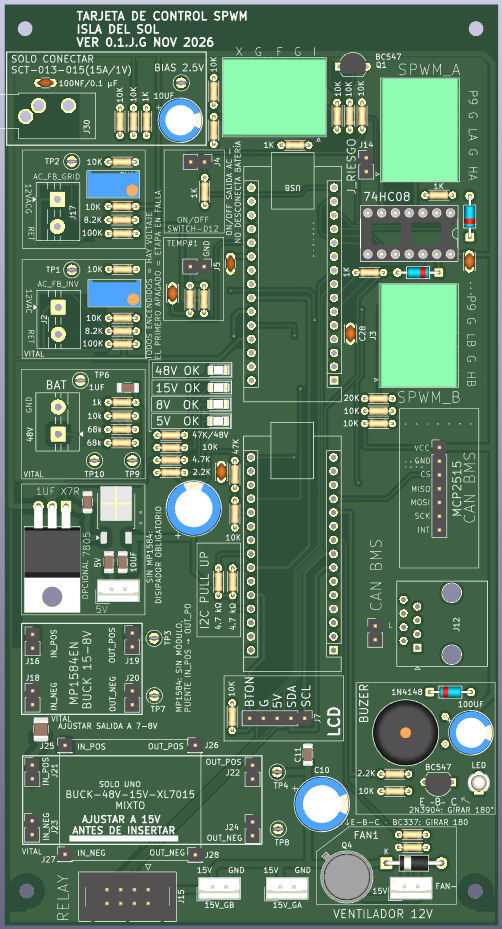
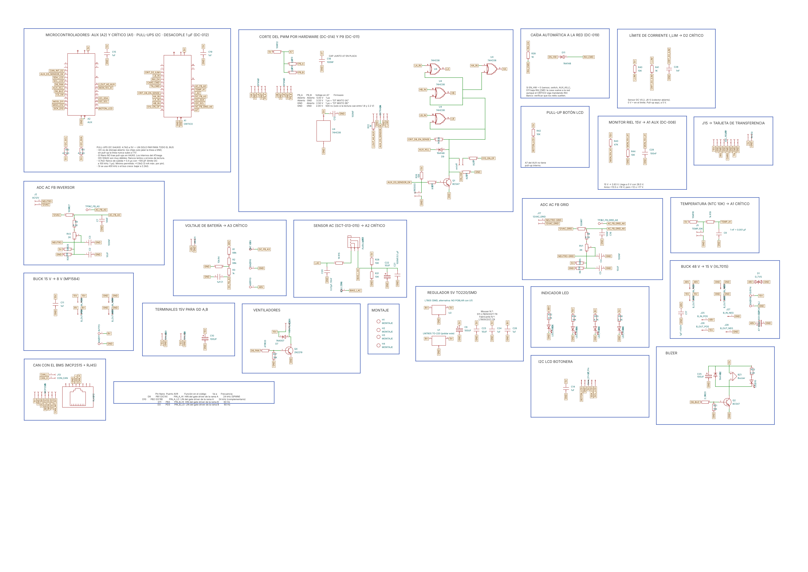
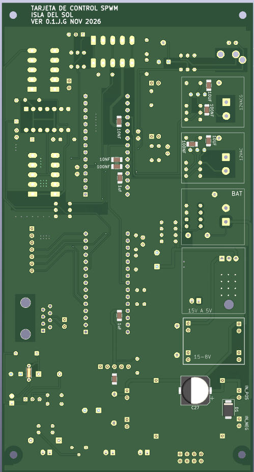
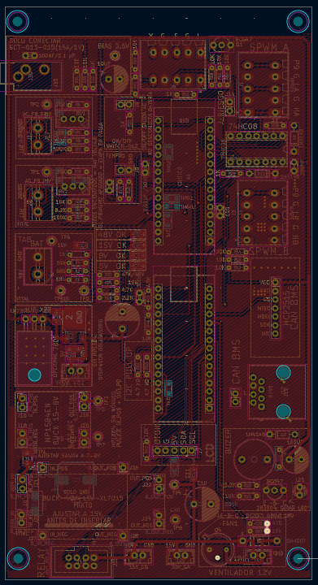
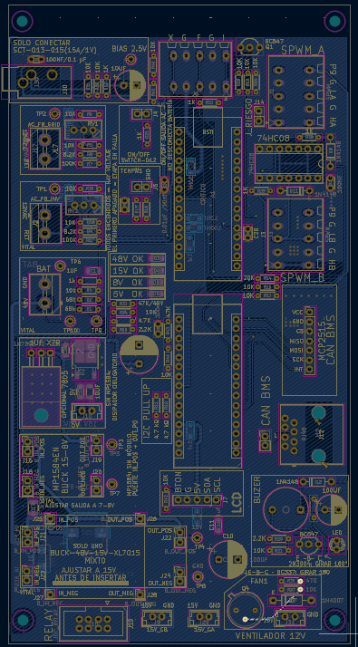
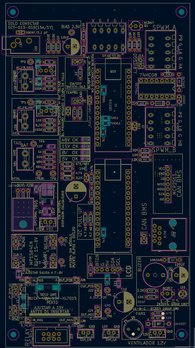

# Tarjeta de control V0.1: el cerebro de la Isla del Sol

La tarjeta de control lleva **dos microcontroladores** (módulos Arduino Nano con ATmega328P) y todo lo que necesitan alrededor:
- la alimentación de 48 V a 15, 8 y 5 V;
- los sensores de voltaje, corriente y temperatura;
- el corte del PWM por hardware;
- las órdenes a la tarjeta de transferencia;
- el CAN con el BMS, la pantalla, el ventilador y el buzzer.

> **Para quien arma y repara en la trinchera:** este documento es un **glosario de módulos**. Cada bloque de la tarjeta dice **qué hace**, **por qué existe**, **por qué cada pieza tiene ese valor** y **qué pasa si esa pieza falla**. Cuando algo no funcione, busca el bloque, mide en su test point y compara con la tabla.

*Vista superior en 3D (KiCad 9), serigrafía "TARJETA DE CONTROL SPWM · ISLA DEL SOL · VER 0.1.J.G NOV 2026". Los dos microcontroladores van en zócalo (aquí se ven los zócalos vacíos), igual que el 74HC08. La serigrafía indica el uso de cada conector, los valores de referencia y los sustitutos de trinchera.*

*Esquemático por bloques (KiCad 9, hoja A2). Cada marco azul es uno de los módulos de este glosario.*

---

## 0. Mapa de la tarjeta

| # | Módulo | Microcontrolador | Decisión | En una frase |
| --- | --- | --- | --- | --- |
| 1 | [Microcontroladores CRÍTICO y AUX](#1-microcontroladores-crítico-y-aux) | — | DC-010, DC-012, DC-017 | El CRÍTICO genera la onda y protege; el AUX informa y conversa |
| 2 | [Entrada de 48 V y su protección](#2-entrada-de-48-v-y-su-protección) | — | DC-003 | Que un pico de la batería no queme el buck |
| 3 | [Buck 48 → 15 V (XL7015)](#3-buck-48--15-v-xl7015) | — | DC-002 | El riel de drivers, relés y ventilador |
| 4 | [Buck 15 → 8 V (MP1584)](#4-buck-15--8-v-mp1584) | — | DC-004 | Baja el voltaje para que el 7805 vaya frío |
| 5 | [Regulador 5 V (7805)](#5-regulador-5-v-7805) | — | DC-005 | 5 V limpio: es la referencia del ADC |
| 6 | [Tablero de LEDs y test points](#6-tablero-de-leds-y-test-points) | — | DC-008 | Dónde está la falla y qué tan mal está |
| 7 | [Monitor del riel de 15 V](#7-monitor-del-riel-de-15-v) | AUX (A1) | DC-008 | Ve envejecer la fuente antes de que falle |
| 8 | [Sensado AC del inversor](#8-sensado-ac-del-inversor-y-de-la-red) | CRÍTICO (A0) | DC-006 | Lazo de amplitud de la salida |
| 9 | [Sensado AC de la red](#8-sensado-ac-del-inversor-y-de-la-red) | CRÍTICO (A6) | DC-006 | Sincronía antes de transferir |
| 10 | [Corriente AC con pinza SCT-013](#9-corriente-ac-con-pinza-sct-013-015) | CRÍTICO (A2) | DC-013 | Watts, sobrecarga y tiempo muerto |
| 11 | [Voltaje de batería](#10-voltaje-de-batería) | CRÍTICO (A3) | DC-007 | Bajo voltaje y estado de carga |
| 12 | [Temperatura (NTC)](#11-temperatura-ntc-10-k) | CRÍTICO (A1) | — | Derrateo y paro por calor |
| 13 | [Corte del PWM por hardware](#12-corte-del-pwm-por-hardware) | CRÍTICO / AUX | DC-014 | Apaga los MOSFET sin esperar al firmware |
| 14 | [Lectura de P9](#13-lectura-de-p9-tiempo-muerto) | CRÍTICO (A7) | DC-011 | Qué gate driver hay y qué tiempo muerto pide |
| 15 | [Límite de corriente I_LIM](#14-límite-de-corriente-i_lim) | CRÍTICO (D2) | DC-016 | Deja arrancar motores sin disparar el corte |
| 16 | [Órdenes a la tarjeta de transferencia (J15)](#15-órdenes-a-la-tarjeta-de-transferencia-j15) | CRÍTICO (D4–D6) | DC-019 | Red, inversor, cargador y unión N–PE |
| 17 | [Caída automática a la red](#16-caída-automática-a-la-red) | — | DC-019 | Si el inversor se corta, la casa vuelve a la red sola |
| 18 | [CAN con el BMS](#17-can-con-el-bms) | AUX (SPI) | DC-010 | Lo que la batería permite cargar y descargar |
| 19 | [Pantalla LCD y botonera](#18-pantalla-lcd-162-y-botonera) | AUX (D4, D5, A7) | — | Menú del SETUP y estado |
| 20 | [Ventilador](#19-ventilador) | AUX (D6) | — | Enfría el puente H |
| 21 | [Buzzer y LED de alarma](#20-buzzer-y-led-de-alarma) | AUX (D8) | — | Avisa sin que nadie mire la pantalla |
| 22 | [Salidas de 15 V y 5 V](#21-salidas-de-15-v-y-5-v) | — | — | Alimentan los gate drivers y módulos externos |

**Regla general de las resistencias de 1 kΩ en serie:** casi todas las señales que salen de la tarjeta por un cable pasan por **1 kΩ antes del pin del microcontrolador** (R3, R15, R19, R22, R25, R38, R39, R41). Si el cable se pela contra 15 V o recibe un pico, esa resistencia limita la corriente que entra a los diodos internos del ATmega a unos pocos mA, y el pin sobrevive. **No se quitan "porque sobran".**

**Regla general de las resistencias de 10 kΩ a GND (pull-down) o a 5 V (pull-up):** fijan el estado de una línea cuando nadie la maneja: microcontrolador en reset, cable suelto, módulo ausente. **El estado que fijan es siempre el seguro:** apagado, sin orden o casa en la red.

---

## 1. Microcontroladores CRÍTICO y AUX

> **Lo que decide la onda y la protege vive en un solo microcontrolador. Lo que informa y conversa vive en el otro.** (DC-010)

| Ref. | Valor | Qué hace | Por qué |
| --- | --- | --- | --- |
| **A1** | Arduino Nano (ATmega328P), **CRÍTICO** | SPWM (D9, D10, D11, D3), sensado AC y DC, relés, corte, P9, I_LIM | Todo lo que tiene que ocurrir **dentro del periodo de la portadora** de 24 kHz. No puede depender de un enlace |
| **A2** | Arduino Nano (ATmega328P), **AUX** | CAN/BMS, LCD, botonera, ventilador, buzzer, SENSOR_OK, AUX_KILL, monitor de 15 V | Lo que no es tiempo real. Si se cuelga, la onda sigue y el CRÍTICO protege solo |
| **R10, R11** | 4.7 kΩ a 5 V | Pull-ups del enlace I2C entre los dos (A4/A5) | El I2C es de drenaje abierto: sin pull-up nunca sube. 4.7 kΩ da un flanco de ~0.4 µs (máximo permitido 1 µs a 100 kHz). **Un solo par para todo el bus** |
| **C15, C19** | 1 µF | Desacople junto al pin +5V de cada Nano | Los Nano se alimentan por **+5V (pin 27), nunca por VIN** (DC-012): VIN pasa por otro regulador que necesita ≥7 V. El 1 µF da la corriente de los picos de conmutación del chip |

- **Los dos van en zócalo:** se cambian sin soldar, y el mismo zócalo acepta un **Nano Every (ATmega4809)** con otro firmware (DC-017, DC-018).
- **Si el enlace I2C se cae:** el AUX manda un latido cada ~100 ms. Si el CRÍTICO no lo recibe en ~500 ms, **deja de cargar** y sigue protegiendo la batería con su propia lectura.

---

## 2. Entrada de 48 V y su protección

| Ref. | Valor | Qué hace | Por qué ese valor | Si falla |
| --- | --- | --- | --- | --- |
| **J11** | Bornera de 2 polos | Entrada de 48 V de la batería (después del fusible T1A y R14 de 2.2 Ω del puente H) | — | — |
| **D1** | TVS **SMBJ58A** (LiFePO4) o **SMBJ64A** (plomo-ácido) | Recorta los picos rápidos al conectar la batería o cuando conmutan relés cerca | El TVS más bajo que **no conduce con la batería llena** (58.4 V). **Banda (cátodo) a 48 V** | En corto: funde el fusible, y es la falla segura. Al revés: corto a GND al conectar |
| **C17** | 1 µF **≥100 V**, X7R 1210 | Absorbe los picos de alta frecuencia, pegado a la entrada del buck | **Tiene que ser de 100 V:** uno de 50 V se perfora con la batería en ecualización | Abierto: más estrés al TVS |
| **C27** | 47–100 µF / **100 V** (opcional) | Con R14 (2.2 Ω) forma un filtro RC de ~220 µs que aplana el pico de conexión | Es la defensa real contra los picos grandes: el TVS recorta en ~94 V y el XL7015 aguanta 80 V | Sin él funciona, pero depende más del TVS |
| **TP10** | Test point | 48 V | — | — |

---

## 3. Buck 48 → 15 V (XL7015)

| Ref. | Valor | Qué hace | Por qué |
| --- | --- | --- | --- |
| **J21–J24** | Zócalo del módulo **amplio** | Entrada 48 V (B_IN), salida 15 V (B_OUT) | El XL7015 aguanta **80 V** y se consigue en cualquier lugar. El LM2596 (40 V) no sirve ni con la batería nominal |
| **J25–J28** | Zócalo del módulo **reducido** | Lo mismo para la versión chica | **Se pone solo uno de los dos** |
| **C10** | 100 µF | Reserva del riel de 15 V | Los relés y el ventilador piden picos de corriente al arrancar |
| **C11** | 1 µF | Desacople de alta frecuencia del riel de 15 V | — |
| **TP4** | Test point | 15 V | — |

⚠️ **Antes de insertar el módulo, ajústalo a 15 V con el multímetro:** puede venir de fábrica en 20 V o más. **Nunca puentees IN → OUT aquí**: meterías 48 V al riel de 15 V. Revisa que el electrolítico de entrada del módulo sea de **100 V**; muchos traen uno de 63 V.

---

## 4. Buck 15 → 8 V (MP1584)

| Ref. | Valor | Qué hace | Por qué |
| --- | --- | --- | --- |
| **J16–J20** | Zócalo del MP1584 | 15 V → **7–8 V** | Baja el voltaje antes del 7805 para que este caiga solo ~3 V (~0.45 W) y vaya frío |
| **TP3, TP7** | Test points | 8 V y GND | — |

✅ **Sin módulo, se puede puentear IN_POS → OUT_POS:** el 7805 recibe 15 V y funciona igual, solo que necesita disipador. **Esta regla es la contraria a la del XL7015**: por eso las dos advertencias van una junto a la otra en la serigrafía.

---

## 5. Regulador 5 V (7805)

> **El 5 V no es solo alimentación: es la referencia del ADC (AVCC).** Si el 5 V tiene ruido, el inversor "ve" mal la red y la batería. (DC-001)

| Ref. | Valor | Qué hace | Por qué |
| --- | --- | --- | --- |
| **U1** | **LM7805 TO-220 (el que se pone)** | 8 V → 5 V lineal | Rechaza ~60 dB del rizo del MP1584. Un buck directo a 5 V dejaría 20–50 mV de rizo: **4–10 cuentas de ruido** en el ADC |
| **U2** | L7805 SMD (TO-252), **NO POBLAR** | Alternativa si solo hay SMD | Huella doble: se usa el que haya. **Nunca los dos** |
| **C26** | 1 µF | En la entrada del 7805 | La hoja de datos pide ≥0.33 µF si el regulador queda lejos del capacitor de la fuente |
| **C6, C23, C24** | 100 µF + 10 µF + 1 µF | En la salida | Estabilidad del 7805 y reserva para los picos de los microcontroladores y el LCD |

---

## 6. Tablero de LEDs y test points

> **Los datos cuantitativos de diagnóstico son oro.** El LED dice **dónde** está la falla; el test point, con su valor de referencia, dice **qué tan mal**. (DC-008)

| LED | Riel | Resistencia | Corriente | Por qué ese valor |
| --- | --- | --- | --- | --- |
| **D3** | 48 V | **R32 47 kΩ** | ~1 mA | ¼ W basta (80 mW a 64 V). **Es el único LED alimentado directo de la batería**: distingue "no hay batería" de "falló el XL7015" |
| **D4** | 15 V | **R34 10 kΩ** | 1.3 mA | Mismo brillo que los demás |
| **D5** | 8 V | **R35 4.7 kΩ** | 1.3 mA | — |
| **D6** | 5 V | **R36 2.2 kΩ** | 1.4 mA | — |

**Cómo se lee:** los cuatro en fila, en el orden de la cascada. **Todos encendidos = hay voltaje. El primero apagado = esa etapa está en falla.**

| Test point | Valor esperado |
| --- | --- |
| TP10 | 48 V (40–58.4 V según la carga de la batería) |
| TP4 | 15 V ±5 % |
| TP3 | 7–8 V (o 15 V si el MP1584 está puenteado) |
| TP9 | Batería × 0.0685 (48 V → 3.29 V) |
| TP5 | 2.5 V (bias de la pinza AC) |
| TP1, TP2 | 2.5 V de CD con la onda AC encima |
| TP6, TP7, TP8 | GND, para la punta negra del multímetro |

⚠️ **El LED dice "hay voltaje", no "el voltaje es correcto".** Un XL7015 desajustado a 20 V prende el LED de 15 V igual. Por eso existe el monitor de 15 V (módulo 7).

---

## 7. Monitor del riel de 15 V

| Ref. | Valor | Qué hace | Por qué ese valor |
| --- | --- | --- | --- |
| **R43** | 47 kΩ | Parte de arriba del divisor (15 V → A1 del AUX) | 15 V → **2.63 V**. Llega a 5 V hasta con 28.5 V: el pin queda protegido aunque el XL7015 se dispare |
| **R44** | 10 kΩ | Parte de abajo del divisor | — |
| **C29** | 100 nF | Filtro junto al pin A1 | Quita el rizo del buck y la conmutación |

**Por qué sirve si "cuando falla el 15 V se apaga todo":** la cascada mantiene vivos a los microcontroladores hasta que el riel de 15 V baja a ~9–10 V. **En esa ventana, el AUX ve la falla antes que nadie:**
- capacitores secos (el riel cae al cerrar relés o arrancar el ventilador);
- un potenciómetro movido (16–20 V, que calienta las bobinas de 15 V de los relés);
- desgaste lento de la fuente.

**Firmware:** aviso por debajo de 13.5 V o por encima de 16 V; paro por debajo de 12 V o por encima de 17 V. Guarda también el **mínimo** al cerrar relés.

---

## 8. Sensado AC del inversor y de la red

Dos canales iguales:
- el del **inversor** (J2 → A0) cierra el lazo de amplitud;
- el de la **red** (J17 → A6) da la fase para sincronizarse antes de transferir.

| Inversor | Red | Valor | Qué hace | Por qué |
| --- | --- | --- | --- | --- |
| **J2** | **J17** | Bornera | Entrada de **12 VAC** de un transformador chico (120 → 12 V) | Pieza de trinchera. **Sin rectificar**: el ADC ve la onda completa, con su polaridad y su cruce por cero. Serigrafía "12VAC / RET", nunca "L / N" |
| **R27** | **R7** | 100 kΩ | Parte de arriba del divisor | Con 16 VAC en vacío (22.6 V de pico) deja como máximo ±2.1 V sobre el bias: **el ADC nunca satura** |
| **R9** | **R8** | 8.2 kΩ | Parte de abajo, fija | — |
| **RV2** | **RV1** | Trimmer 2 kΩ (Bourns 3296W) | Calibración de ±10 % | **Conectado como reóstato** (cursor unido a un extremo): si el cursor pierde contacto, queda en 2 kΩ y el canal no flota |
| **R29 + R30** | **R5 + R6** | 10 kΩ + 10 kΩ | Bias de 2.5 V (la "tierra" de la señal AC) | El ADC solo lee de 0 a 5 V: la onda se monta sobre 2.5 V |
| **C2 + C3** | **C5 + C4** | 10 µF + 100 nF | Mantienen quieto el bias | **Un bias por canal**, para que una señal no se cuele en la otra |
| **C7** | **C16** | 10 nF | Filtro pegado al pin A0 / A6 | Quita la conmutación de 24 kHz. Desfasa ~2°, **igual en los dos canales**, así que se cancela en la sincronía |
| **TP1** | **TP2** | Test point | Señal en el pin | — |

**Calibración en trinchera:** mide la salida con el multímetro y gira el trimmer hasta que el microcontrolador reporte el mismo valor. El ajuste fino va por software (EEPROM).

---

## 9. Corriente AC con pinza SCT-013-015

| Ref. | Valor | Qué hace | Por qué |
| --- | --- | --- | --- |
| **J30** | Jack de 3.5 mm | Entrada de la pinza | **Núcleo abierto:** se abraza el cable sin cortarlo, y **los 127 V nunca entran a la tarjeta** |
| **R15** | 1 kΩ | Serie hacia A2 del CRÍTICO | Protege el pin, sobre todo si alguien conecta un **SCT-013-000** (sale en corriente, no en voltaje) |
| **C20** | 10 nF | Filtro en A2 | Quita la conmutación de 24 kHz |
| **R28 + R31** | 10 kΩ + 10 kΩ | Bias de 2.5 V para la pinza | La pinza entrega ±1.41 V a 15 A; montada en 2.5 V queda entre 1.09 y 3.91 V |
| **C21 + C22** | 100 nF + 10 µF | Mantienen quieto el bias | — |
| **TP5** | Test point | Bias de 2.5 V | — |

- **Solo SCT-013-015 (15 A / 1 V).** Abraza **un solo conductor** (la fase) del devanado de 127 V, con la flecha K→L **del transformador hacia la carga**. Si el signo queda invertido, la compensación del tiempo muerto **empeora** la onda.
- Satura el ADC hacia los ~18.7 A RMS. La resolución es de ~52 mA por cuenta.

---

## 10. Voltaje de batería

| Ref. | Valor | Qué hace | Por qué |
| --- | --- | --- | --- |
| **R1 + R2** | 68 kΩ + 68 kΩ | Parte de arriba del divisor desde 48 V | **Dos en serie:** si una se pone en corto, la otra sigue limitando, y cada una solo ve ~27 V |
| **R4** | 10 kΩ | Parte de abajo | Ganancia 0.0685: 48 V → 3.29 V; 58.4 V → 4.0 V; el ADC llega a 5 V con ~73 V. Sirve para cualquier química de 48 V |
| **R3** | 1 kΩ | Serie hacia A3 | Protege el pin |
| **C1** | 1 µF | Filtro en A3 | Fuente de baja impedancia para el ADC. τ ≈ 10 ms: sigue la caída lenta de la batería, no el rizo de 120 Hz |
| **TP9** | Test point | Lectura en A3 | — |

**Falla segura:** si R4 se abre, la lectura **sube**, el firmware ve "sobrevoltaje" y apaga.

---

## 11. Temperatura (NTC 10 k)

| Ref. | Valor | Qué hace | Por qué |
| --- | --- | --- | --- |
| **J5** | Conector de 2 pines | Termistor NTC de 10 kΩ (en el disipador del puente H) a GND | — |
| **R18** | 10 kΩ a 5 V | Parte de arriba del divisor | Igual al NTC a 25 °C: **2.5 V a 25 °C**, la mejor resolución en la zona de trabajo |
| **R19** | 1 kΩ | Serie hacia A1 del CRÍTICO | Protege el pin (el cable va junto a la potencia) |
| **C9** | 1 nF | Filtro en A1 | Quita el ruido que el cable recoge cerca de los MOSFET |

**Falla segura:** con el NTC desconectado, A1 lee ~5 V. El firmware debe tratar esa lectura como **"sensor ausente" y no arrancar**, en lugar de leerla como "frío".

---

## 12. Corte del PWM por hardware

> **Apaga los cuatro MOSFET en microsegundos, sin esperar al firmware.** El detalle completo está en [corte por hardware](../../docs/corte_por_hardware.md) (DC-014).

| Ref. | Valor | Qué hace | Por qué | Si falla |
| --- | --- | --- | --- | --- |
| **U4** | **74HC08** (4 AND) en zócalo | Cada salida PWM = PWM **AND** EN_HW | Familia HC a 5 V: salida fuerte en alto y en bajo, ~10 ns | **Con un 74HC00 (NAND) se encienden los 4 MOSFET.** Revisa la marca |
| **C12** | 100 nF | Desacople del 74HC08, pegado al pin 14 | Los flancos del PWM piden corriente en nanosegundos | Sin él: flancos falsos en los drivers |
| **J4** | Interruptor ON/OFF del panel | El operador autoriza. **En serie** con D12 del CRÍTICO | Si el cable se suelta, EN_HW cae: "si se suelta, ya no prende" | — |
| **R25** | 1 kΩ | Serie entre D12 y EN_HW | Cuando Q1 o D9 jalan EN_HW a 0, sin ella el pin D12 en alto quedaría en corto | **Obligatoria** |
| **R24** | 10 kΩ a GND | **Pull-down de EN_HW** | Con el microcontrolador en reset o el switch abierto, EN_HW = 0 = **apagado** | **Obligatoria.** Sin ella, EN_HW flota en el reset |
| **R26** | 10 kΩ a 5 V | Pull-up de SENSOR_OK. **Siempre empuja a Q1 a cortar**; solo el sensor sano lo impide | Sensor ausente o cable roto → la línea sube → corte | **La pieza más crítica del bloque** |
| **R16** | 10 kΩ | Base de Q1 | ~0.21 mA de base: satura a Q1 con margen de 4× | Abierta: no corta por sensor |
| **Q1** | BC547 | **Ejecuta el corte:** cuando SENSOR_OK sube, jala EN_HW a ~0.1 V | Cualquier NPN de señal sirve | Abierto: no corta por sensor (prueba 4 del banco) |
| **D9** | 1N4148, **cátodo hacia AUX_KILL** | Candado del AUX: si D7 del AUX = 0, jala EN_HW a ~0.8 V | Diodo: el AUX puede **apagar**, pero nunca **encender** | Al revés: el AUX nunca podría apagar |
| **R38** | 1 kΩ | Lleva EN_HW a D8 del CRÍTICO (EN_SENSE) | El CRÍTICO sabe si alguien le quitó el permiso. Protege D8 si el firmware lo deja como salida por error | — |
| **J14** | Jumper **rojo** J_RIESGO | Pone SENSOR_OK a GND a la fuerza: **opera sin protección de sobrecorriente** | Físico y visible; solo para pruebas autorizadas | Puesto por error: **sin protección** |
| **J6** | Phoenix de 5 pines | Desde el sensor DC: 1 I_OUT · 2 GND · 3 SENSOR_OK · 4 GND · 5 I_LIM | GND junto a cada señal: cada una viaja con su retorno | Suelto: R26 sube la línea → **corte** |
| **R22** | 1 kΩ | Serie de I_OUT hacia A0 del AUX | Protege el pin | — |

---

## 13. Lectura de P9 (tiempo muerto)

> Cada gate driver **declara** qué tiempo muerto necesita con su pin P9 (J1-5 y J3-5). Las dos ramas se leen en **un solo pin analógico** (DC-011).

| Ref. | Valor | Qué hace |
| --- | --- | --- |
| **R12** | 10 kΩ a 5 V | Pull-up de A7 |
| **R13** | 10 kΩ | Rama A (P9_A, J1-5) a A7 |
| **R14** | **20 kΩ** | Rama B (P9_B, J3-5) a A7. **Distinta de R13 a propósito** |
| **C18** | 100 nF | Filtro de A7, pegado al pin |

| P9_A | P9_B | Voltaje en A7 | Tiempo muerto |
| --- | --- | --- | --- |
| Abierto | Abierto | 5.00 V | 1 µs |
| Abierto | GND | 3.33 V | 1 µs + "DT mixto (A)" |
| GND | Abierto | 2.50 V | 1 µs + "DT mixto (B)" |
| GND | GND | 2.00 V | 500 ns |

- **Por qué R13 ≠ R14:** si fueran iguales, los dos casos mixtos darían el mismo voltaje y no se sabría cuál rama es distinta.
- **Falla segura:** un cable suelto o un módulo viejo se leen como "abierto" = **1 µs**, el tiempo muerto más largo.
- Serigrafía: **"P9: GND=500ns · ABIERTO=1µs · R13≠R14"**.

---

## 14. Límite de corriente I_LIM

| Ref. | Valor | Qué hace | Por qué |
| --- | --- | --- | --- |
| **R40** | 10 kΩ a 5 V | Pull-up de I_LIM (J6-5) | La salida del sensor es de **colector abierto**: solo jala a 0 V. Sin pull-up la línea flota y D2 lee disparos falsos |
| **R41** | 1 kΩ | Serie hacia D2 del CRÍTICO | Protege el pin si el cable se pela |
| **C28** | 1 nF | De D2 a GND, pegado al pin | Con R41: filtro de ~1 µs contra las espigas del cable, y sigue siendo rápido para el arranque de un motor |

**Qué hace el CRÍTICO:** I_LIM = 0 V significa "en el límite" (nivel 1, ±75 A). El CRÍTICO **baja el índice de modulación** en lugar de cortar, y así **arrancan los motores** sin disparar SENSOR_OK. **No es fail-safe a propósito:** sin sensor queda en alto ("sin límite"), pero en ese caso SENSOR_OK ya está cortando. El pull-up va en esta tarjeta, al voltaje de su microcontrolador: así el sensor sirve igual con 5 V o con 3.3 V.

---

## 15. Órdenes a la tarjeta de transferencia (J15)

| J15 | Señal | Desde | Tarjeta de transferencia |
| --- | --- | --- | --- |
| 1 | 15 V | Riel de 15 V | Bobinas de los relés y LEDs |
| 2, 4, 6, 8 | GND | — | Cada señal viaja entre dos tierras |
| 3 | **INV_CMD** | **D4 del CRÍTICO** → R39 (1 kΩ) | K4 + K2: la casa pasa al inversor |
| 5 | **CARG_CMD** | **D5 del CRÍTICO** | K1 + K3: el transformador se conecta a la red para cargar |
| 7 | **TN_CMD** | **D6 del CRÍTICO** | K5: unión N–PE, solo en modo INVERSOR CASA y solo si INV está activo (Q2 de la tarjeta de transferencia) |

- Los pull-downs, el candado Q1 (el inversor bloquea al cargador) y Q2 (la unión N–PE solo con inversor) están **en la tarjeta de transferencia**. Sin 15 V, con el cable suelto o con el CRÍTICO en reset, **la casa queda en la red**.
- La transferencia sale del CRÍTICO porque es el que **decide el instante** de la sincronía con la red.

---

## 16. Caída automática a la red

| Ref. | Valor | Qué hace | Por qué |
| --- | --- | --- | --- |
| **R39** | 1 kΩ | Serie entre D4 del CRÍTICO (INV_D4) y J15-3 (INV_CMD) | Permite que D11 baje la línea **sin poner en corto el pin D4** |
| **D11** | 1N4148, **cátodo hacia EN_HW** | Si EN_HW = 0, jala INV_CMD a ~0.8 V | **Si el inversor se corta por cualquier causa** (sensor, switch, AUX_KILL), **la casa vuelve a la red** aunque el CRÍTICO siga mandando INV, sin esperar al firmware |

- **Al revés no sirve:** con el cátodo en INV_CMD, EN_HW en alto encendería el modo inversor sin orden.
- ⚠️ **Prueba de banco:** cuando el corte viene de AUX_KILL (por D9), EN_HW queda en ~0.8 V e INV_CMD en ~1.5 V, cerca del umbral de la Darlington del ULN2003. **Verifica que los relés suelten.** Si no, se cambia D11 por un Schottky (BAT85) o se ajusta el divisor.

---

## 17. CAN con el BMS

| Ref. | Valor | Qué hace | Por qué |
| --- | --- | --- | --- |
| **J8** | Zócalo de 7 pines | Módulo **MCP2515 + TJA1050 (HW-184)**: VCC, GND, CS (D9), SO (D12), SI (D11), SCK (D13), INT (D2) del AUX | En el mismo orden que el módulo: entra sin cables |
| **J12** | RJ45 | Puerto tipo Pylontech: **pin 4 CAN_H, pin 5 CAN_L, pin 6 GND** | Los pines 4 y 5 son un par trenzado en un cable de red |
| **J13** | Header de 2 pines | CAN_H / CAN_L en paralelo al RJ45 | Para conectar con cable suelto |

- **El cristal del módulo es de 8 MHz:** en el firmware se declara `MCP_8MHZ` a **500 kbps**. Muchas bibliotecas asumen 16 MHz y el bus queda mudo.
- **D10 del AUX queda como salida:** si es entrada y recibe un bajo, el SPI pasa a modo esclavo y el CAN se cae.
- **Terminación de 120 Ω:** jumper J1 del módulo puesto, porque el inversor es un extremo del bus.
- Antes de conectar una batería de otra marca, revisa el manual de su puerto CAN.

---

## 18. Pantalla LCD 16×2 y botonera

**Decisión (2026-11-11):** la interfaz será una **pantalla LCD de 16×2 caracteres** con módulo I2C (PCF8574) y **4 botones**. Desde ahí se maneja el **menú del SETUP**, entre otras cosas el modo **INVERSOR CASA / INVERSOR CARGA (UPS)**, que decide la unión N–PE (DC-019). La implementación queda para una etapa posterior; el hardware ya está listo.

| J7 | Señal | Va a |
| --- | --- | --- |
| 1 | SCL_LCD | D5 del AUX (I2C por software, **en un bus aparte** del enlace CRÍTICO–AUX: si el LCD se cuelga, no tumba el enlace) |
| 2 | SDA_LCD | D4 del AUX |
| 3 | 5V | Alimentación del LCD |
| 4 | GND | Retorno del LCD y de la botonera |
| 5 | BOTON_LCD | **A7 del AUX** |

| Ref. | Valor | Qué hace | Por qué |
| --- | --- | --- | --- |
| **R42** | **10 kΩ a 5 V** | Pull-up de A7 y **parte de arriba del divisor de la botonera** | A6 y A7 del Nano son **solo analógicos y no tienen pull-up interno**: `INPUT_PULLUP` no funciona ahí. **No se cambia el valor**: los voltajes de los botones dependen de él |
| **C14** | 1 µF | Desacople del 5 V del LCD | La luz de fondo pide corriente en picos |

**Botonera: 4 botones en un solo pin.** Cada botón conecta BOTON_LCD a GND **con su propia resistencia, en paralelo** (no en cadena: si una falla, solo falla ese botón). Las resistencias van **en la tarjeta de la botonera**.

| Botón | Voltaje en A7 | Resistencia a GND (E24) | Voltaje real | Cuentas ADC |
| --- | --- | --- | --- | --- |
| Ninguno | 5 V | — | 5.00 V | 1023 |
| B4 | 4 V | 39 kΩ | 3.98 V | ~815 |
| B3 | 3 V | 15 kΩ | 3.00 V | ~614 |
| B2 | 2 V | 6.8 kΩ | 2.02 V | ~414 |
| B1 | 1 V | 2.4 kΩ | 0.97 V | ~198 |

- V = 5 V × Rb / (10 kΩ + Rb). Corriente máxima: 0.4 mA.
- **Firmware:** umbrales en 0.5 / 1.5 / 2.5 / 3.5 / 4.5 V (~102 / 307 / 512 / 716 / 921 cuentas); antirrebote con 3 o 4 lecturas iguales (~30 ms). Con dos botones oprimidos a la vez se lee el de menor número.
- **Opcional:** 100 nF de A7 a GND si el cable de la botonera es largo.

---

## 19. Ventilador

| Ref. | Valor | Qué hace | Por qué |
| --- | --- | --- | --- |
| **Q4** | 2N2219 (NPN, 800 mA) | Enciende el ventilador de 12–15 V desde D6 del AUX (con PWM para regular la velocidad) | El AUX no puede dar 100–200 mA de un pin. Cualquier NPN de ≥500 mA sirve (2N2222, BD139) |
| **R33** | 470 Ω | Base de Q4 | (5 − 0.7) V / 470 Ω ≈ **9 mA de base**: satura hasta ~300 mA |
| **R37** | 10 kΩ a GND | Pull-down de la base | Con el AUX en reset, el ventilador queda apagado y no medio encendido |
| **D7** | 1N4007, **cátodo a 15 V** | Rueda libre del motor del ventilador | Al apagar, el motor devuelve un pico que quemaría a Q4 |
| **J31** | Conector JST de 2 pines, valor "VENTILADOR"; **"VENTILADOR 12V"** en la serigrafía | Pin 1 = **15 V**; pin 2 = **negativo conmutado** (colector de Q4), **no es GND** | La serigrafía marca el pin 2 como **"FAN−"**. Si se mide entre ese pin y GND con el ventilador apagado, aparecen 15 V: es normal |

- **Ventilador de 12 V en un riel de 15 V:** a 15 V trabaja 25 % arriba de su voltaje nominal (más ruido y menos vida). **Firmware:** limitar el PWM de D6 a **~80 % como máximo** (12/15), o usar un ventilador de 15 V o de rango amplio ("7–16 V").
- **Sustitutos de Q4 en la trinchera:** la serigrafía indica cómo girar un **2N3904** o un **BC337** si no hay 2N2219. Revisa la corriente del ventilador: el 2N3904 aguanta 200 mA y el BC337, 800 mA.

---

## 20. Buzzer y LED de alarma

| Ref. | Valor | Qué hace | Por qué |
| --- | --- | --- | --- |
| **Q2** | BC547 | Enciende el buzzer desde D8 del AUX | — |
| **R20** | 2.2 kΩ | Base de Q2 | ~2 mA de base: satura de sobra para los ~30 mA del buzzer |
| **R21** | 10 kΩ a GND | Pull-down de la base | En reset, el buzzer calla |
| **BZ1** | Buzzer de 5 V | Alarma audible | Avisa aunque nadie mire la pantalla |
| **D2** | 1N4148 | Rueda libre del buzzer (bobina) | Protege a Q2 del pico al apagar |
| **D10 + R23** | LED + 2.2 kΩ | Prende junto con el buzzer (~1.3 mA) | La alarma también se **ve**, en lugares con ruido o para personas que no oyen |
| **C25** | 100 µF | Reserva local de 5 V junto al buzzer | El pulso de corriente del buzzer no debe hundir el 5 V, que es la referencia del ADC |

---

## 21. Salidas de 15 V y 5 V

| Ref. | Valor | Para qué |
| --- | --- | --- |
| **J29, J9** | 15V_GA / 15V_GB (JST de 2 pines: 15 V y GND) | Alimentación directa de los gate drivers de la rama A y de la rama B. **Salen de la tarjeta de control para no partir el cobre del puente H**: así GND, VS1 y VS2 corren sin cortes en la tarjeta de potencia |
| **J1, J3** | Phoenix de 5 pines | PWM hacia los gate drivers: 1 HA/HB · 2 GND · 3 LA/LB · 4 GND · 5 P9 |
| **J10** | 5 V (JST de 2 pines) | 5 V para un módulo externo |
| **H1–H4** | Barrenos M2.5 | Montaje |

---

## 22. Layout

- **Placa:** 91 × 170 mm, 2 capas, 4 barrenos M2.5. **Versión V0.1** (serigrafía: "VER 0.1.J.G NOV 2026").
- **Conectores en las orillas:** sensores a la izquierda, SPWM A/B a la derecha, y relés, ventilador y gate drivers abajo.
- **Zonas de GND en las dos caras**, unidas por los pines THT.
- **Verificado con script:** el esquemático y el PCB coinciden pin por pin, todas las redes están completas y no hay pistas ni pads a menos de 0.2 mm de otra red. **DRC: 0 errores** (solo el aviso de serigrafía en los barrenos de J12, que viene de la huella de la biblioteca).

*Cara inferior: piezas SMD por debajo, como los capacitores 1206 de filtro junto a los pines del ADC, **C27** (47–100 µF / 100 V, opcional) y el **TVS D1** de la entrada de 48 V. Lleva la serigrafía de cada bloque (12VAC, 12VACG, BAT, 15V A 5V, 15–8V) para ubicarse al reparar por abajo.*

**Orden de ensamble:** primero las piezas SMD de la cara inferior, mientras la placa todavía se apoya plana; después las THT de arriba. **D1 tiene polaridad:** la banda (cátodo) va a 48 V. Al revés, es un corto a GND al conectar la batería.

| Cobre de componentes (F.Cu) | Cobre de soldadura (B.Cu) | Serigrafía y contornos |
| --- | --- | --- |
|  |  |  |

---

## Pendientes de esta tarjeta

- [x] J31: valor "VENTILADOR" en el esquemático y serigrafía del pin 2 "FAN−".
- [ ] Firmware: limitar el PWM del ventilador de 12 V a ~80 %.
- [ ] Prueba de banco de la caída automática con AUX_KILL (módulo 16).
- [ ] Firmware: tratar el NTC desconectado como "sensor ausente" (módulo 11).
- [ ] Render 3D en perspectiva e inferior (opcional).
- [x] DC-019 actualizado: asignación real de J15 (D4 / D5 / D6 del CRÍTICO) y caída automática con R39 + D11.

## Referencias

- [Decisiones críticas](../../docs/decisiones_criticas.md): DC-001 a DC-019.
- [Corte por hardware](../../docs/corte_por_hardware.md).
- [Sensor DC con comparador V0.2](../sensores/sensor-dc-ina-comparador/README.md).
- [Tarjeta de transferencia de carga V0.1](../transferencia_reles/README.md).
