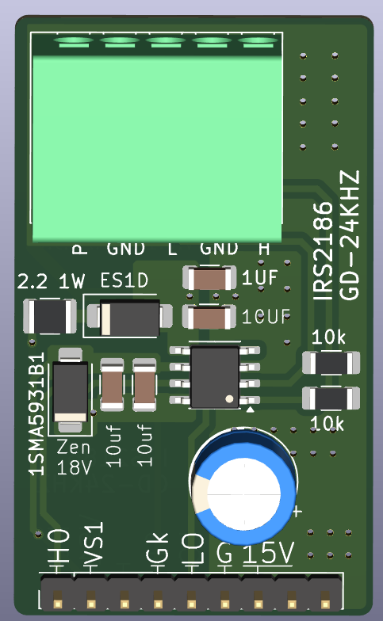
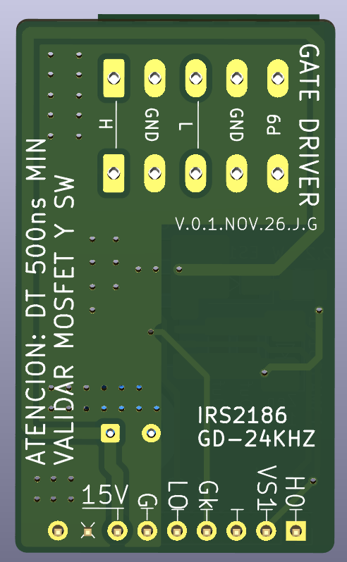

# Módulo gate driver de medio puente H con IRS2186

**Proyecto:** Puente H — prototipo SPWM "Isla del Sol" (inversor 48 V → 127 V / 60 Hz, 1000 W; modo cargador 1 kVA)
**Módulo:** gate driver de **medio puente H** (una rama: MOSFET alto + MOSFET bajo) con bootstrap. Es el **módulo principal de producción**: bajo costo y 500 ns de tiempo muerto
**Intercambiable con:** UCC21520ADWR y TLP250 de trinchera (misma interfaz J1/J5, mismo firmware)
**Estado:** diseño terminado con P9 en J1. Pendiente: DRC final, fabricación y validación en banco
**Fecha:** 2026-11-03
**Documentos relacionados:** [`docs/identificacion_dt_pin9.md`](../../../docs/identificacion_dt_pin9.md), [`docs/compensacion_adaptativa_tiempo_muerto.md`](../../../docs/compensacion_adaptativa_tiempo_muerto.md), [módulo TLP250](../tlp250-trinchera/README.md)

> Verificar los valores marcados con *(verificar)* contra el esquemático de KiCad antes de fabricar.

| Cara de componentes | Cara de soldadura |
| --- | --- |
|  |  |

*Izquierda: arriba, la bornera J1 de entrada (**P**9 · GND · L · GND · H); en medio, el IRS2186 (SOIC-8) con su desacoplo de 15 V (1 µF + 10 µF), la red de bootstrap (2.2 Ω 1 W + ES1D), el zener de 18 V (1SMA5931B1) los capacitores de bootstrap (2 × 10 µF) y el electrolítico de respaldo de 15 V; abajo, el header J5 hacia el puente H (HO · VS1 · · · Gk · LO · G · 15V · llave). Derecha: la leyenda de seguridad **"ATENCIÓN: DT 500 ns MIN — VALIDAR MOSFET Y SW"**, la versión V.0.1.NOV.26.J.G y la **X** de la llave en la posición 8 de J5.*

---

## 1. Qué maneja este módulo

Cada módulo maneja **una rama** del puente H: el **MOSFET del lado alto** (HO, referido a VS, alimentado por bootstrap) y el **MOSFET del lado bajo** (LO, referido a COM).

```
            +48 V
              │
     HA ──► [MOSFET alto]          [MOSFET alto] ◄── HB
              │                         │
              ├── VS1 ──► transformador ◄── VS2 ──┤
              │                         │
     LA ──► [MOSFET bajo]          [MOSFET bajo] ◄── LB
              │                         │
             GND ───────────────────── GND
         └── módulo rama A ──┘    └── módulo rama B ──┘
```

- **El puente completo usa dos módulos iguales:** rama A (VS1) y rama B (VS2). En la rama B, "H" y "L" de J1 manejan HB y LB, y el pin "VS1" de J5 va a VS2.
- **Inversor (modulación híbrida):** rama A a **24 kHz**, rama B a **60 Hz**.
- **Cargador (unipolar):** las dos ramas a **24 kHz**.
- **Alcance:** **1 IRF100P219 por posición** (o hasta 2 IRF540N) con 500 ns. Para más carga de compuerta hace falta tótem rápido o el módulo UCC21520 (ver sección 6).

### Por qué el IRS2186

| Criterio | IRS2186 (este) | UCC21520ADWR | TLP250 + tótem |
| --- | --- | --- | --- |
| Costo y número de componentes | **El menor** ✓ | Medio | El mayor |
| Tiempo muerto | **500 ns** ✓ | 500 ns | 1 µs |
| Corriente de salida | 4 A / 4 A | 4 A / 6 A | ~2 A (más con tótem) |
| Aislamiento entrada / potencia | **No** (lógica referida a COM) | Sí | Sí |
| Reparación a mano | SOIC-8 | SOIC-16 ancho | DIP y TO-220 |

---

## 2. Interfaz

### 2.1 J1 — entrada, hacia la tarjeta de control (bornera de 5 terminales)

| Terminal | Señal | En este módulo |
| --- | --- | --- |
| 1 | H | HIN del IRS2186 (con 10 kΩ a GND) |
| 2 | GND | Tierra lógica = COM (trenzar con H) |
| 3 | L | LIN del IRS2186 (con 10 kΩ a GND) |
| 4 | GND | Tierra lógica = COM (trenzar con L) |
| **5** | **P9 — ID DT** | **Unido a GND** → el MCU usa **500 ns** |

- Serigrafía: "TRENZAR H Y L CON GND", etiquetas H / GND / L / GND / P9. Recomendado agregar **"OPERACION DT IRS2186=500NS"**.
- Las resistencias de 10 kΩ de HIN y LIN a GND mantienen los MOSFET apagados si la tarjeta de control no está conectada o el MCU está en reset.
- Si P9 queda con soldadura fría o cable suelto, el MCU lee 1 → **1 µs** (falla segura: funciona con más armónicos).

### 2.2 J5 — salida, hacia la tarjeta del puente H (header de 9 posiciones, 2.54 mm)

| Pin | Señal | Nota |
| --- | --- | --- |
| 1 | HO | Compuerta lado alto |
| 2 | VS1 | Fuente lado alto (nodo de conmutación) |
| 3 | — | Libre (separación del nodo conmutado) |
| 4 | GND_K | Retorno Kelvin del lado bajo |
| 5 | LO | Compuerta lado bajo |
| 6 | GND | Tierra de potencia |
| 7 | 15 V | Alimentación |
| 8 | — | **Llave mecánica:** sin pad; **quitar el pin 8 del header**; "X" en serigrafía |
| 9 | GND | Reservado (no se lee) |

### 2.3 Tierras: la entrada comparte la tierra de potencia

En el IRS2186 la lógica (HIN, LIN) va referida a **COM**, que también es el retorno del lado bajo. Por eso **el GND de J1 es la misma tierra de potencia**: el módulo no aísla la tarjeta de control.

Consecuencias y cuidados:

1. **Lazo de tierra:** el GND del cable J1 es un camino más entre la tarjeta de control y la potencia; con dos módulos (rama A y B) ya hay dos. Parte de la corriente de conmutación puede circular por esos cables.
2. **Rebote de tierra:** el di/dt del MOSFET bajo puede mover COM unos cientos de mV respecto al GND del MCU. El IRS2186 tiene umbrales de entrada de ~0.8 V / ~2.5 V *(verificar en la hoja de datos)*; con MCU a 5 V el margen es mayor.
3. **Medidas:**
   - **Par trenzado H/GND y L/GND, lo más corto posible.**
   - **Un solo punto de unión** entre tierra de control y tierra de potencia en la tarjeta del puente H (estrella), cerca de la fuente del MOSFET bajo o del shunt.
   - **Retorno de LO hacia GND_K** (Kelvin) y lógica hacia GND, unidos en un solo punto: la corriente de compuerta no debe pasar por la tierra de las entradas.
4. Si en banco aparecen disparos falsos o ruido en las entradas, los módulos **UCC21520** o **TLP250** lo eliminan por diseño (entrada aislada).

---

## 3. Circuito

### 3.1 IRS2186 (SOIC-8)

| Pin | Señal | Conexión |
| --- | --- | --- |
| 1 | HIN | J1-H, 10 kΩ a GND |
| 2 | LIN | J1-L, 10 kΩ a GND |
| 3 | COM | GND (tierra lógica y retorno del lado bajo) |
| 4 | LO | J5-5 |
| 5 | VCC | 15 V, con desacoplo a COM |
| 6 | VS | J5-2 (VS1) |
| 7 | HO | J5-1 |
| 8 | VB | Nodo del bootstrap |

Verificar contra la hoja de datos de la variante comprada (IRS2186S, SOIC-8).

**Datos de la hoja de datos (Infineon IRS2186):** salida 4 A / 4 A; retardo de propagación ~170 ns típ., 250 ns máx.; diferencia entre canales ≤ 35 ns; VCC 10–20 V; offset VS hasta 600 V *(verificar)*.

### 3.2 Alimentación de 15 V (lado bajo)

- 15 V desde J5-7 a VCC, con desacoplo **10 µF + 1 µF X7R** pegados a los pines 5 y 3, más capacitor electrolítico de respaldo en la línea de 15 V *(verificar valores)*.
- **¿Por qué 15 V y no 12 V?** Más voltaje de compuerta (menor R_DS(on) y más margen de UVLO en el bootstrap de la rama de 60 Hz) dentro del rango de VCC del IRS2186 y del ±20 V de V_GS del MOSFET.

### 3.3 Bootstrap (lado alto)

```
15 V ── R9 2.2 Ω 1 W ── D5 (ES1D / ES1J) ──┬── VB (pin 8)
                                           ├── 2 × 10 µF X7R 50 V 1206 ── VS1
                                           └── Zener 18 V (1SMA5931BT3G), cátodo a VB ── VS1
```

| Componente | Valor | Por qué |
| --- | --- | --- |
| R9 | 2.2 Ω, 1 W, **antes del diodo** | Limita el pico de recarga del bootstrap cuando VS cae a 0 V (circuito de referencia de TI; IR Design Tip DT98-2; patente US5969964, ya expirada) |
| D5 | ES1D (200 V) o **ES1J (600 V)** | Diodo rápido. ES1D limita el bus del módulo a ~120 V; con ES1J el límite lo ponen las separaciones del PCB (≤ 150 V) |
| C_boot | 2 × 10 µF X7R 50 V 1206 | Sostiene VB durante los **8.3 ms** de encendido continuo de la rama de 60 Hz. El X7R pierde capacidad con el voltaje DC: por eso dos |
| Zener | 18 V (1SMA5931BT3G) | Protege VB–VS contra picos por encima del máximo del IRS2186 |

**Reglas de firmware para el bootstrap:**
- **Precarga** de 0.5–2 ms con los lados bajos encendidos antes de arrancar el PWM.
- **Ciclo de trabajo máximo ≤ 95 %** en la rama de 24 kHz, para dejar tiempo de recarga en cada periodo.

### 3.4 Red de compuerta

Las resistencias de compuerta de cada MOSFET (arreglo R1/R2/R3) y las **10 kΩ de compuerta a fuente** están en la **tarjeta del puente H**, junto a cada MOSFET. El módulo solo entrega HO y LO.

---

## 4. Tiempo muerto: 500 ns

| Concepto | Valor |
| --- | --- |
| Diferencia de retardo entre canales del IRS2186 | ≤ 35 ns |
| Apagado del IRF100P219 en el peor caso (con la red de compuerta) | ~390 ns |
| **Piso de tiempo muerto** | **~390–425 ns → se usa 500 ns** |

- **Por qué no 1 µs siempre:** con 500 ns el 3er armónico es ~0.58 % y el THD ~0.81 %; con 1 µs, ~1.17 % y ~1.62 % (híbrida, 24 kHz, 1000 W, sin compensación).
- El tiempo muerto se aplica en **ambos flancos**, por firmware. El IRS2186 **no tiene tiempo muerto interno ni interbloqueo**: si el firmware enciende HIN y LIN a la vez, enciende los dos MOSFET.
- El MCU elige 500 ns **solo si P9 de los dos módulos está a GND** (ver `identificacion_dt_pin9.md`).

---

## 5. Layout

- **Dominio HV** (VB, VS1, HO, bootstrap, zener): **0.6 mm** al resto (regla `HV_a_LV`, IPC-2221 B2 para ≤ 150 V):
  ```
  (rule "HV_a_LV" (constraint clearance (min 0.6mm)) (condition "A.NetClass == 'HV' && B.NetClass != 'HV'"))
  ```
- Capacitores de bootstrap y zener **pegados a los pines 8 y 6** del IRS2186; desacoplo de VCC pegado a los pines 5 y 3.
- J1: P9 y las dos GND unidos a la zona de GND. Recomendado: *Thermal reliefs* en esos pads para soldar la bornera a mano sin soldaduras frías.
- J5: sin pad 8 (llave) con "X" en serigrafía.

---

## 6. Alcance: cantidad de MOSFET por posición

### 6.1 Criterio

Con 500 ns de tiempo muerto y ≤ 35 ns de diferencia entre canales del IRS2186, el **apagado del MOSFET (o de los MOSFET en paralelo) debe quedar en ~400 ns como máximo**. El tiempo de apagado crece con la **carga de compuerta total** que el IRS2186 (4 A, ~3.75 Ω equivalentes a 15 V) tiene que sacar.

Referencia: **1 × IRF100P219 (~240 nC a 15 V) → ~390 ns**. Eso fija el presupuesto en **~250 nC por posición** sin ayuda externa.

| Carga de compuerta a 15 V | IRF100P219 | IRF540N | Sin ayuda (IRS2186 solo) | Con tótem rápido (D44H11/D45H11 o ZXTC2062E6) |
| --- | --- | --- | --- | --- |
| ~100 nC | — | 1 | ✓ amplio | ✓ |
| ~200 nC | — | 2 | ✓ | ✓ |
| ~240 nC | 1 | — | ✓ **(diseño actual)** | ✓ |
| ~300 nC | — | 3 | ⚠ ~490 ns: solo con Qg típica, validar en banco | ✓ |
| ~400 nC | — | 4 | ✗ | ✓ validar en banco |
| ~480 nC | 2 | — | ✗ ~590 ns | ✓ ~280–320 ns |

*Qg a 15 V estimada: IRF100P219 ~240 nC (180 nC típ. a 10 V); IRF540N ~100 nC máx. (71 nC máx. a 10 V). Los tiempos son estimaciones con modelo RC; confirmarlos en banco.*

### 6.2 Potencia aproximada por configuración (48 V)

| MOSFET por posición | Potencia | Módulo recomendado |
| --- | --- | --- |
| **1 × IRF100P219** | **1000 W** | **IRS2186 (este)** ✓ |
| 2 × IRF100P219 | 1000 W más frío (pérdida por conducción ÷ 2 en total) | UCC21520, o IRS2186 + tótem rápido |
| 1 × IRF540N | ~300 W (cargas pequeñas: módem, celular, laptop) | IRS2186 ✓ |
| 2 × IRF540N | ~500 W | IRS2186 ✓ |
| 4 × IRF540N | ~800–1000 W | IRS2186 + tótem rápido, o UCC21520 |

Los MOSFET en paralelo deben ser **del mismo número de parte** (idealmente del mismo lote), cada uno con **su propia resistencia de compuerta** y layout simétrico. **No mezclar** IRF540N con IRF100P219 en la misma posición: con 1.7 mΩ contra 44 mΩ, el IRF100P219 lleva casi toda la corriente.

### 6.3 Si se necesitan más MOSFET que los que el IRS2186 maneja solo

1. **Usar el módulo UCC21520** (6 A de apagado, R_OL ~0.55 Ω): maneja 2 × IRF100P219 con 500 ns.
2. **Agregar al IRS2186 un tótem rápido** por canal: **D44H11/D45H11** (TO-220, 20 A pico, f_T 40–50 MHz) o **ZXTC2062E6** (SOT23-6, 20 V, 10 A pico). **No usar TIP41/42** (f_T 3 MHz: no mejora a un driver de 4 A) ni el ZXTC2061 (V_CEO 12 V < 15–18 V).
3. **PNP de descarga local por MOSFET** (solo acelera el apagado, que es el flanco crítico): emisor a la compuerta, colector a la fuente.
4. **Marcar el módulo** en la serigrafía con su alcance: "IRS2186 · 1 MOSFET/POSICION". Un IRS2186 sin tótem en un equipo de 2 MOSFET por posición declararía 500 ns (P9 a GND) **sin margen**.

### 6.4 Consumo y bootstrap con más MOSFET

- **Potencia de compuerta por canal:** Qg × V × f. Con 1 × IRF100P219 a 24 kHz: 240 nC × 15 V × 24 kHz ≈ **0.09 W**; con 2, ≈ 0.17 W. Se reparte entre el IRS2186, la red de compuerta y la R_G interna; dentro de lo que disipa el SOIC-8.
- **Bootstrap:** por pulso, ΔV = Qg / C_boot. Con 2 × 10 µF (~10–14 µF efectivos): 1 MOSFET → ~20 mV; 2 MOSFET → ~40 mV ✓.
- **Rama de 60 Hz (8.3 ms encendido):** las 10 kΩ de compuerta a fuente de la tarjeta del puente H consumen ~1.4 mA por MOSFET; con 2 MOSFET (5 kΩ) ≈ 2.8 mA → ~1.7–2.3 V de caída en los 8.3 ms, más la corriente propia del IRS2186. Verificar en banco que VB–VS1 quede con margen sobre el UVLO.

---

## 7. Validación en banco

1. **Sin MOSFET:** alimentar 15 V, verificar HO y LO con HIN/LIN en alto y bajo. Confirmar que con J1 desconectado las salidas quedan en bajo (10 kΩ).
2. **P9:** confirmar que el MCU reporta **500 ns**. Desconectar el cable P9 → debe reportar **1 µs**.
3. **Bootstrap:** medir VB–VS1 al final de los 8.3 ms de la rama de 60 Hz; debe quedar con margen sobre el UVLO del IRS2186.
4. **Tiempo muerto real:** medir en la compuerta de cada MOSFET el intervalo entre la bajada de LO y la subida de HO (y viceversa) → ≥ 500 ns.
5. **Ruido de tierra:** con carga, medir con el osciloscopio la diferencia entre GND del MCU y COM del módulo durante la conmutación; buscar disparos falsos en HIN/LIN.
6. **Armónicos:** 3er armónico ≈ 0.58 % a 1000 W sin compensación.

---

## 8. Bitácora

| Fecha | Qué se hizo | Resultado | Siguiente paso |
| --- | --- | --- | --- |
| 2026-11-03 | P9 en J1-5 unido a GND; J5 sin pad 8 con "X"; J5-9 a GND (reservado) | Módulo declara 500 ns ✓ | Serigrafía "OPERACION DT IRS2186=500NS", thermal reliefs en J1, DRC, fabricar |
| | | | |

---

## 9. Referencias

- Infineon, IRS2186(4)(S)PbF datasheet.
- International Rectifier, Design Tip DT98-2, "Bootstrap component selection for control ICs".
- International Rectifier, patente US5969964 (1999, expirada): resistencia en serie con el diodo de bootstrap.
- Texas Instruments, SLUA887A, "Bootstrap circuitry selection for half-bridge configurations".
- Infineon, IRF100P219 datasheet.
- IPC-2221 (separaciones eléctricas).
