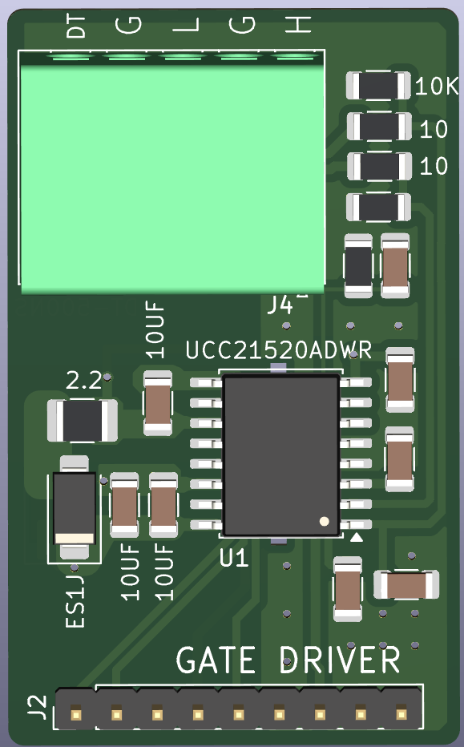
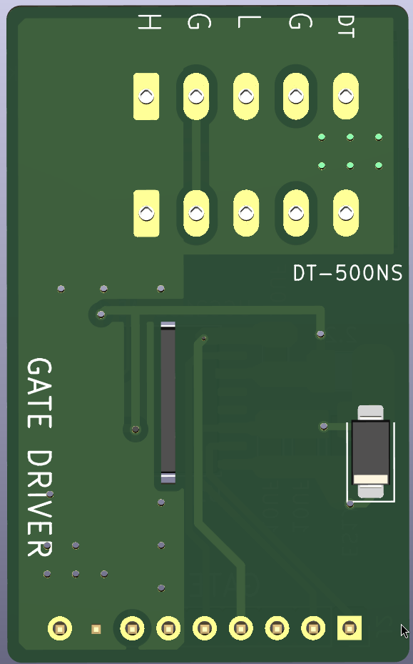
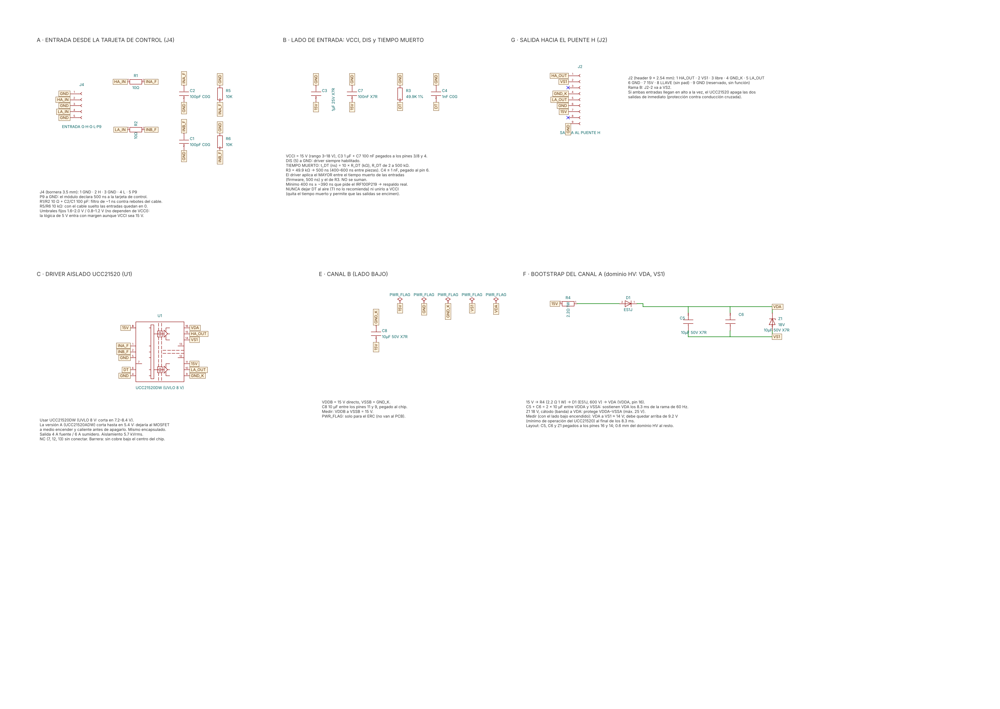
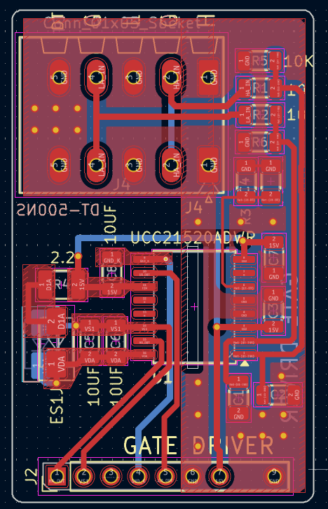

# Módulo gate driver de medio puente H con UCC21520ADWR

**Proyecto:** Puente H — prototipo SPWM "Isla del Sol" (inversor 48 V → 127 V / 60 Hz, 1000 W; modo cargador 1 kVA)
**Módulo:** gate driver de **medio puente H** (una rama: MOSFET alto + MOSFET bajo) con el driver aislado de dos canales **TI UCC21520ADWR** y bootstrap para el lado alto
**Intercambiable con:** IRS2186, TLP250 e IR2110 de trinchera (misma interfaz J4/J2, mismo firmware)
**Tiempo muerto declarado por P9:** **500 ns** (P9 a GND)
**Estado:** esquemático y layout dibujados. **Borrador del README**, escrito a partir de las capturas del esquemático y del PCB: falta verificarlo contra los archivos de KiCad y subirlos.
**Fecha:** 2026-11-05
**Documentos relacionados:** [`docs/identificacion_dt_pin9.md`](../../../docs/identificacion_dt_pin9.md), [módulo IRS2186](../irs2186/README.md)

| Cara de componentes | Cara de soldadura |
| --- | --- |
|  |  |

*Izquierda: arriba, la bornera J4 de entrada (DT · G · L · G · H) con las resistencias y los filtros de entrada; en medio, el **UCC21520ADWR** (SOIC-16 ancho, aislado); a la izquierda, el bootstrap (2.2 Ω + ES1J) con sus 2 × 10 µF; abajo, el header J2 hacia el puente H. Derecha: la leyenda **"DT-500NS"**, el zener de 18 V del bootstrap y la llave de la posición 8 de J2 (sin pad).*

---

## 1. Por qué este módulo

El UCC21520 es un driver de dos canales **con aislamiento galvánico** entre la entrada y cada salida. Cada canal tiene su propio UVLO y su propia tierra. Comparado con el IRS2186:
- Corriente de pico más alta (4 A de fuente / 6 A de sumidero), útil para muchos MOSFET en paralelo.
- **Tiempo muerto programable por hardware** con una resistencia (sección 4): si el firmware se equivoca, el driver no deja que los dos MOSFET se enciendan juntos.
- Si las dos entradas llegan en alto al mismo tiempo, **apaga las dos salidas** de inmediato.

No es una pieza de trinchera: se consigue con distribuidor. Es la opción "de producción" de mayor margen.

## 2. Interfaz

### 2.1 J4: entrada, hacia la tarjeta de control (bornera de 5 terminales)

| Pin | Señal | Conexión |
| --- | --- | --- |
| 1 | GND | Tierra |
| 2 | HA_IN (H) | INA, a través de R1 10 Ω; C2 100 pF y R5 10 kΩ a GND |
| 3 | GND | Tierra |
| 4 | LA_IN (L) | INB, a través de R2 10 Ω; C1 100 pF y R6 10 kΩ a GND |
| 5 | P9 ("DT") | **A GND**: declara 500 ns a la tarjeta de control |

Los umbrales de entrada del UCC21520 son de 1.6–2.0 V para el "1" y de 0.8–1.2 V para el "0", así que la lógica de 5 V del proyecto entra con margen amplio.

### 2.2 J2: salida, hacia la tarjeta del puente H (header de 9 posiciones)

| Pin | Señal |
| --- | --- |
| 1 | HA_OUT (gate del MOSFET alto) |
| 2 | VS1 |
| 3 | NC |
| 4 | GND_K |
| 5 | LA_OUT (gate del MOSFET bajo) |
| 6 | GND |
| 7 | 15 V |
| 8 | **Llave** (sin pad) |
| 9 | NC |

## 3. Circuito

| Bloque | Componentes | Notas |
| --- | --- | --- |
| Lado de entrada | VCCI (pin 3) a **15 V**, con C3 1 µF + C7 100 nF; GND (pin 4) a tierra; DIS (pin 5) a GND (driver habilitado) | El rango de VCCI es de 3 a 18 V |
| Filtro de entrada | R1/R2 10 Ω + C2/C1 100 pF (τ ≈ 1 ns), pull-down R5/R6 10 kΩ | Las entradas quedan en bajo si no hay control conectado |
| Tiempo muerto | **R3 = 5 kΩ** + C4 1 nF del pin DT a GND | ⚠️ Ver la sección 4 |
| Canal B (lado bajo) | VDDB (pin 11) desde 15 V (net `15V-P11`), C8 10 µF a GND_K; VSSB (pin 9) a GND_K; OUTB a LA_OUT | — |
| Canal A (lado alto) | Bootstrap: 15 V → R4 2.2 Ω → D1 **ES1J** → VDDA (pin 16); C5 + C6 2 × 10 µF de VDDA a VS1; zener 1SMA5931B1 18 V; VSSA (pin 14) a VS1; OUTA a HA_OUT | El mismo bootstrap que los otros módulos |

## 4. Tiempo muerto: corregir R3 ⚠️

Según la hoja de datos del UCC21520: **t_DT (ns) = 10 × R_DT (kΩ)**, con R_DT entre 0.5 y 500 kΩ.

| R3 | Tiempo muerto programado |
| --- | --- |
| 5 kΩ (actual) | **50 ns** |
| **50 kΩ (recomendado)** | **500 ns** |

El driver aplica el **mayor** de dos tiempos muertos: el que llega en las señales de entrada (el del firmware) o el programado con R3. Con 5 kΩ el firmware sí pone sus 500 ns, pero el respaldo del hardware es de solo 50 ns. Si un error del firmware o un rebote deja las señales casi encimadas, los MOSFET podrían conducir juntos.

**Recomendación:** **R3 = 50 kΩ** (49.9 kΩ al 1 %), para que el módulo **garantice en hardware** los 500 ns que declara por P9. Es el mismo principio de poka-yoke del resto del proyecto. Con R_DT mayor a 5 kΩ, TI recomienda un capacitor de **1 nF o menos** en paralelo y cerca del chip: el **C4 de 1 nF** ya cumple.

## 5. Layout

*Vista del editor con las dos capas. Arriba, la bornera J4 con las resistencias de entrada y la serigrafía "DT-500NS"; en el centro, el UCC21520 con su barrera de aislamiento; a la izquierda, el bootstrap (ES1J, 2.2 Ω, 2 × 10 µF); abajo, el header J2.*

## 6. Pendientes

| Pendiente | Prioridad |
| --- | --- |
| Cambiar **R3 de 5 kΩ a 50 kΩ** (500 ns en hardware) | **Alta** |
| Confirmar en la hoja de datos el comportamiento de las entradas con **VCCI = 15 V**: los umbrales vienen especificados con VCCI de 3.3 V o 5 V | Media |
| Subir los archivos de KiCad (`.kicad_pro`, `.kicad_sch`, `.kicad_pcb`) y verificar este README contra ellos | Media |
| Lista de materiales, ensamble y validación en banco, como en los otros módulos | Media |

## 7. Referencias

- Texas Instruments, *UCC21520, UCC21520A 4-A, 6-A, 5.7-kVRMS Isolated Dual-Channel Gate Driver*, hoja de datos SLUSCJ9: ecuación del tiempo muerto, capacitor del pin DT, protección contra entradas encimadas, rango de VCCI y umbrales de entrada. <https://www.ti.com/document-viewer/lit/html/SLUSCJ9F/GUID-7AE416D5-4533-4C64-BDAA-2976FB545BFA>

---

*Hardware bajo licencia CERN-OHL-S v2; documentación CC BY-SA 4.0 (ver `LICENSE.md` en la raíz).*
