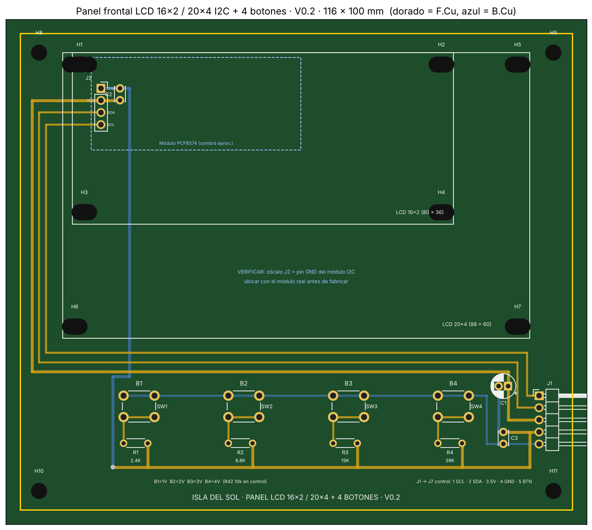
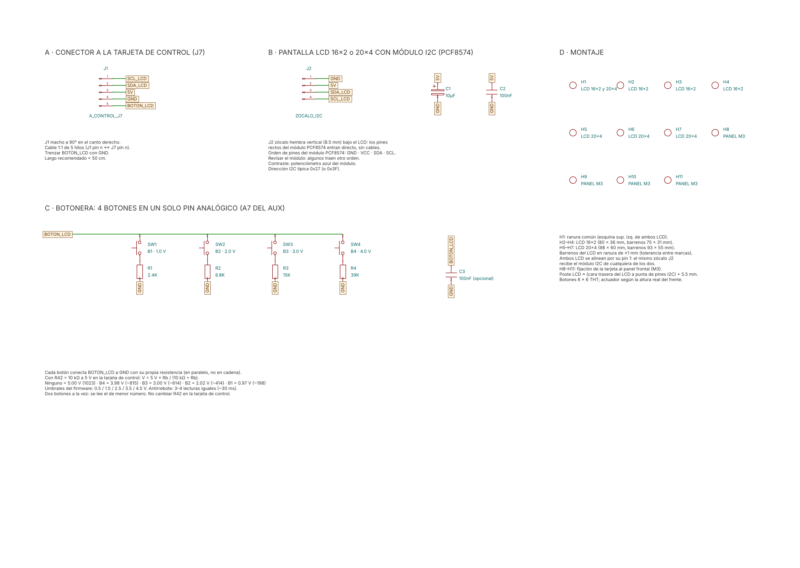

# Panel frontal V0.2: pantalla LCD I2C y 4 botones

El panel frontal es **la cara del inversor**. Sirve para dos cosas:
- **ver todos los datos** que miden las tarjetas: red, salida, batería, potencia, temperatura, protecciones y estado de los relés;
- **configurar el inversor** desde el menú del **SETUP**, entre otras cosas el modo **INVERSOR CASA / INVERSOR CARGA (UPS)**, que decide la unión N–PE (DC-019).

Se conecta con un solo cable de 5 hilos a **J7 de la [tarjeta de control](../control/README.md)**. Lo maneja el microcontrolador **AUX**. El CRÍTICO mide y protege, y el AUX solo muestra y pide cambios. **Si el panel se desconecta o se cuelga, el inversor sigue funcionando y protegiendo igual.**

> **Para quien arma y repara en la trinchera:** igual que en las otras tarjetas, cada bloque dice **qué hace**, **por qué tiene ese valor** y **qué pasa si falla**. Antes de fabricar, revisa la sección [6. Verificar antes de fabricar](#6-verificar-antes-de-fabricar): la posición del zócalo del módulo I2C se mide con el módulo real.



*PCB V0.2 de 116 × 100 mm, 2 capas. Dorado = cobre de arriba (F.Cu), azul = cobre de abajo (B.Cu). Se ven las dos siluetas (LCD 20×4 por fuera y 16×2 por dentro), el zócalo J2 del módulo I2C, la botonera B1–B4 y J1 hacia la tarjeta de control.*



*Esquemático por bloques (KiCad 9, hoja A4): A conector a la tarjeta de control, B pantalla y módulo I2C, C botonera, D montaje.*

---

## 0. Mapa del panel

| # | Bloque | Componentes | En una frase |
| --- | --- | --- | --- |
| 1 | [Conector a la tarjeta de control](#1-conector-a-la-tarjeta-de-control-j1--j7) | J1, C1 | Un cable 1:1 de 5 hilos: I2C, 5 V, GND y botonera |
| 2 | [Pantalla y módulo I2C](#2-pantalla-lcd-y-módulo-i2c-j2) | J2, C2 | El módulo PCF8574 entra **directo** al zócalo, sin cables |
| 3 | [Botonera](#3-botonera-4-botones-en-un-solo-pin) | SW1–SW4, R1–R4, C3 | 4 botones en un solo pin analógico (A7 del AUX) |
| 4 | [Montaje mecánico](#4-montaje-mecánico-162-o-204) | H1–H11 | La misma placa sirve para LCD 16×2 o 20×4 |
| 5 | [Qué muestra y qué configura](#5-qué-muestra-y-qué-configura-propuesta-de-firmware) | Firmware del AUX | Pantallas de datos y menú SETUP |

---

## 1. Conector a la tarjeta de control (J1 ↔ J7)

| J1 | Señal | Va a (tarjeta de control) | Notas |
| --- | --- | --- | --- |
| 1 | SCL_LCD | D5 del AUX | I2C por software, **en un bus aparte** del enlace CRÍTICO–AUX: si la pantalla se cuelga, no tumba el enlace |
| 2 | SDA_LCD | D4 del AUX | — |
| 3 | 5V | Riel de 5 V (7805) | Pantalla, luz de fondo y botonera |
| 4 | GND | GND | Retorno común |
| 5 | BOTON_LCD | A7 del AUX, con **R42 = 10 kΩ a 5 V** | El pull-up está **en la tarjeta de control**, no aquí |

| Ref. | Valor | Qué hace | Por qué |
| --- | --- | --- | --- |
| **J1** | Tira macho 1×5, 2.54 mm, **a 90°** | Sale por el canto derecho | Vertical, con el conector del cable puesto, mediría ~22 mm y chocaría con el frente |
| **C1** | 10 µF electrolítico (5 mm) | Reserva a la entrada del cable | La luz de fondo pide corriente en picos; el cable tiene resistencia e inductancia |

- **Cable:** 5 hilos, **pin n con pin n** (1:1). Trenza BOTON_LCD con GND. Largo recomendado: menos de 50 cm.
- **Si el cable se suelta:** A7 queda en 5 V por R42 = "ningún botón". La pantalla se apaga y **el inversor no cambia de estado**.

---

## 2. Pantalla LCD y módulo I2C (J2)

La pantalla usa el módulo adaptador **PCF8574** (FC-113 o equivalente) soldado atrás del LCD. Sus 4 pines salen **rectos, perpendiculares al módulo**, apuntando hacia esta placa. Por eso entran **directo en el zócalo J2**: el LCD se monta en sus postes y queda conectado, sin cables.

| J2 | Señal | Pin del módulo PCF8574 |
| --- | --- | --- |
| 1 (cuadrado) | GND | GND |
| 2 | 5V | VCC |
| 3 | SDA_LCD | SDA |
| 4 | SCL_LCD | SCL |

| Ref. | Valor | Qué hace | Por qué |
| --- | --- | --- | --- |
| **J2** | Tira **hembra** 1×4, 2.54 mm, vertical (8.5 mm) | Recibe los pines del módulo I2C | Desmontable: la pantalla se cambia sin soldar |
| **C2** | 100 nF cerámico | Desacople pegado al zócalo | Filtra el ruido de alta frecuencia del PCF8574. **Bajo (≤ 5 mm):** queda debajo del módulo |

- **Orden de pines:** casi todos los módulos traen GND · VCC · SDA · SCL. **Revisa la serigrafía del tuyo** antes de montarlo: si viene en otro orden, el 5 V queda al revés.
- **Dirección I2C:** típica **0x27** (PCF8574T) o **0x3F** (PCF8574AT). El firmware la busca sola al arrancar (ver la sección 5).
- **Contraste:** potenciómetro azul del módulo. Si la pantalla prende pero no muestra nada, casi siempre es el contraste.
- **Luz de fondo:** el puente (jumper) del módulo la habilita. El firmware la puede apagar después de un rato sin tocar botones.
- **Pull-ups del I2C:** la mayoría de los módulos traen sus resistencias de pull-up en SDA y SCL. Si el tuyo no las trae, agrega 4.7 kΩ a 5 V en cada línea.

---

## 3. Botonera: 4 botones en un solo pin

Cada botón conecta BOTON_LCD a GND **con su propia resistencia, en paralelo** (no en cadena: si una falla, solo falla ese botón). Con R42 = 10 kΩ en la tarjeta de control se forma un divisor: **V = 5 V × Rb / (10 kΩ + Rb)**.

| Botón | Resistencia (E24) | Voltaje en A7 | Cuentas ADC | Función propuesta |
| --- | --- | --- | --- | --- |
| Ninguno | — | 5.00 V | 1023 | — |
| **B1** | R1 = **2.4 kΩ** | 0.97 V | ~198 | **ATRÁS / ESC** |
| **B2** | R2 = **6.8 kΩ** | 2.02 V | ~414 | **ARRIBA / −** |
| **B3** | R3 = **15 kΩ** | 3.00 V | ~614 | **ABAJO / +** |
| **B4** | R4 = **39 kΩ** | 3.98 V | ~815 | **OK / ENTRAR** (sostenido 3 s: SETUP) |

| Ref. | Valor | Qué hace | Por qué |
| --- | --- | --- | --- |
| **SW1–SW4** | Botón táctil THT 6 × 6 mm | Cierra BOTON_LCD a GND por su resistencia | La huella es la misma para cualquier altura de actuador: se elige según el frente (sección 4) |
| **R1–R4** | 2.4 k / 6.8 k / 15 k / 39 k, ¼ W, 1 % de preferencia | Fijan el voltaje de cada botón | Separación de ~1 V entre botones: tolera resistencias de 5 % y ruido sin confundir un botón con otro. Corriente máxima: 0.4 mA |
| **C3** | 100 nF, **opcional (DNP)** | Filtro de la línea | Solo si el cable es largo o hay ruido. De entrada no se coloca |

- **Firmware:** umbrales en 0.5 / 1.5 / 2.5 / 3.5 / 4.5 V (~102 / 307 / 512 / 716 / 921 cuentas). Antirrebote: 3 o 4 lecturas iguales (~30 ms). Con dos botones oprimidos a la vez se lee el de menor número.
- **No cambies R42** en la tarjeta de control: todos los voltajes dependen de ella.
- **Prueba con multímetro** (panel conectado, sin pantalla): mide BOTON_LCD contra GND y oprime cada botón; debe dar la columna "Voltaje en A7" con ±0.1 V.

---

## 4. Montaje mecánico: 16×2 o 20×4

La misma placa acepta **las dos pantallas**. Ambas se alinean por el **pin 1 de su conector de 16 pines**. Como el módulo I2C va soldado en ese conector, sus pines caen **en el mismo lugar** con cualquiera de las dos, y J2 sirve para ambas.

| Ref. | Para | Medida | Notas |
| --- | --- | --- | --- |
| **H1** | LCD 16×2 **y** 20×4 | Ranura M3 de 7.2 × 3.2 mm | Esquina superior izquierda: los barrenos de las dos pantallas se enciman y comparten la ranura |
| **H2–H4** | LCD 16×2 (80 × 36 mm) | Ranuras M3 de 5.2 × 3.2 mm, a 75 × 31 mm entre centros | — |
| **H5–H7** | LCD 20×4 (98 × 60 mm) | Ranuras M3 de 5.2 × 3.2 mm, a 93 × 55 mm entre centros | — |
| **H8–H11** | Fijación al gabinete | Barrenos M3 en las esquinas | — |

- **Ranuras de ±1 mm:** absorben la diferencia entre marcas de pantalla. Las ranuras son huellas propias, en la librería `Isla_del_Sol.pretty` que viene con el proyecto (`fp-lib-table`).
- **Pila de alturas:** los postes del LCD fijan a qué altura quedan los pines I2C. Para que entren unos 3 mm en el zócalo de 8.5 mm:

  **Altura del poste ≈ (cara trasera del LCD a la punta de los pines I2C) + 5.5 mm**

  Con los módulos comunes salen postes de **15 a 18 mm**.
- **Botones:** con esa pila, el frente del LCD queda a **~25 mm** de la placa. Elige el actuador de los botones según la altura que midas, o usa capuchones extensores.
- **Nada alto bajo el módulo I2C:** la sombra del módulo está dibujada en la capa Dwgs.User. Ahí solo va C2 (bajo). C1 (alto) va junto a J1.
- **Ventana del panel:** se corta a la medida del vidrio del LCD (16×2: ~71 × 24 mm; 20×4: ~77 × 26 mm).

---

## 5. Qué muestra y qué configura (propuesta de firmware)

> **Estado:** el hardware ya está listo. Las pantallas y el menú de esta sección son la **propuesta para el firmware del AUX**. Se ajustarán cuando se programe y se valide en banco.

### Datos disponibles

Todos los mide la tarjeta de control (el CRÍTICO por sus pines, el AUX por CAN y por su monitor) y el AUX los recibe por el enlace I2C entre los dos.

| Dato | De dónde sale | Pantalla |
| --- | --- | --- |
| Voltaje de salida del inversor (V AC) | A0 del CRÍTICO (sensado AC del inversor) | `SAL 127V` |
| Voltaje de la red (V AC) y si hay red | A6 del CRÍTICO (sensado AC de la red) | `RED 125V` / `RED --` |
| Frecuencia (Hz) | Cruces por cero de A0 / A6 | `60.0Hz` |
| Corriente AC (A) y potencia (W / VA) | A2 del CRÍTICO, pinza SCT-013-015 | `5.2A 640W` |
| Voltaje de batería (V DC) | A3 del CRÍTICO | `BAT 51.2V` |
| Estado de carga y límites de la batería | CAN con el BMS (AUX) | `SOC 78%` |
| Temperatura del puente H (°C) | A1 del CRÍTICO, NTC 10 k | `T 42C` |
| Riel de 15 V | A1 del AUX (monitor del riel) | `15V OK` |
| Modo de trabajo | SETUP | `CASA` / `UPS` |
| Fuente de la casa | Órdenes a la tarjeta de transferencia (J15) | `RED` / `INV` / `CARGANDO` |
| Unión N–PE | TN_CMD (solo en modo CASA con inversor) | `TN` |
| Permiso del inversor | EN_SENSE (EN_HW leído en D8) | `ON` / `OFF` |
| Protecciones | SENSOR_OK, I_LIM, sobretemperatura, batería baja | Pantalla de alarma |

### Pantallas de datos (B2 / B3 cambian de pantalla)

**LCD 16×2:**

```
+----------------+     +----------------+     +----------------+
|INV 127V  60.0Hz|     |BAT 51.2V SOC78%|     |T 42C  15V OK   |
|5.2A  640W  CASA|     |CARGA  +8.0A    |     |RED 125V  TN    |
+----------------+     +----------------+     +----------------+
  1. Salida              2. Batería             3. Estado
```

**LCD 20×4:** cabe todo en una sola pantalla.

```
+--------------------+
|INV 127V 60.0Hz CASA|
|5.2A  640W   T 42C  |
|BAT 51.2V  SOC 78%  |
|RED 125V  TN  15V OK|
+--------------------+
```

**Alarma:** tiene prioridad sobre cualquier pantalla, parpadea la luz de fondo y suena el buzzer de la tarjeta de control.

```
+----------------+
|! SOBRECORRIENTE|
|B1: ver  B4: ok |
+----------------+
```

### Menú SETUP (B4 sostenido 3 s)

| Opción | Valores | Qué hace | Candado propuesto |
| --- | --- | --- | --- |
| **Modo de trabajo** | INVERSOR CASA / INVERSOR CARGA (UPS) | CASA: el inversor alimenta la casa y **se une N–PE** (TN). UPS: alimenta una carga y **no se une** (DC-019) | **Solo con el inversor apagado** (EN_HW = 0) y confirmando con B4 |
| **Pantalla** | 16×2 / 20×4 | Acomoda los datos al tamaño | — |
| **Luz de fondo** | Siempre / 1 min / 5 min | Ahorra energía de la batería | — |
| **Diagnóstico** | Solo lectura | Lecturas crudas del ADC, dirección I2C detectada, versión de firmware | — |
| **Salir** | — | Guarda en EEPROM y regresa a los datos | — |

- **Navegación:** B2/B3 suben y bajan; B4 entra o confirma; B1 regresa sin guardar.
- **La seguridad no depende del menú.** El panel solo **pide** cambios. Los candados de verdad están por hardware: Q1/Q2 de la tarjeta de transferencia, el corte del PWM y la caída automática a la red.
- **Arranque:** el firmware busca la pantalla en 0x27 y en 0x3F. Si no la encuentra, el inversor trabaja igual y lo reporta por el buzzer.

---

## 6. Verificar antes de fabricar

1. **Posición del zócalo J2.** No hay un plano estándar del módulo FC-113. La V0.2 supone el pin GND del módulo a **2.0 mm a la izquierda y 5.0 mm abajo del pin 1 del LCD** (vista de frente). **Mídelo en tu módulo.** Si es distinto, en KiCad mueve J2 y vuelve a rutear sus 4 pistas cortas.
2. **Pin 1 de cada pantalla.** Se supuso el pin 1 a 8.0 mm (16×2) y 10.0 mm (20×4) del borde izquierdo, y a 2.5 mm del borde de arriba. Las ranuras de ±1 mm absorben la diferencia, pero compruébalo con tu pantalla.
3. **Orden de pines del módulo I2C** (GND · VCC · SDA · SCL).
4. **Altura de los postes y de los botones** (sección 4).
5. **En KiCad:** presiona **B** para rellenar la zona de GND (B.Cu) y corre el DRC.

## 7. Ensamble

1. Suelda R1–R4, C2 y C3 (si lo usas), luego J2, C1, los botones y al final J1.
2. Sin pantalla, conecta el cable a J7 y mide: 5 V entre J2-2 y J2-1; BOTON_LCD con cada botón (tabla de la sección 3).
3. Monta los postes en el LCD, presenta el módulo en J2 y atornilla.
4. Ajusta el contraste.

## 8. Lista de materiales

| Ref. | Cant. | Descripción |
| --- | --- | --- |
| J1 | 1 | Tira macho 1×5, 2.54 mm, a 90° |
| J2 | 1 | Tira hembra 1×4, 2.54 mm, vertical 8.5 mm |
| C1 | 1 | Electrolítico 10 µF, ≥ 16 V, 5 mm, paso 2 mm |
| C2 | 1 | Cerámico 100 nF, paso 2.5 mm, bajo |
| C3 | 0–1 | Cerámico 100 nF (opcional) |
| R1–R4 | 4 | 2.4 k, 6.8 k, 15 k, 39 k, ¼ W (DIN0204) |
| SW1–SW4 | 4 | Botón táctil 6 × 6 mm THT, actuador según la altura del frente |
| — | 1 | LCD 16×2 o 20×4 con módulo PCF8574 (pines rectos) |
| — | 4 | Postes M3 hembra-hembra (15–18 mm según la medición) + tornillos |
| — | 4 | Postes M3 para fijar al gabinete + tornillos |
| — | 1 | Cable de 5 hilos 1:1 con conectores Dupont hembra (< 50 cm) |

## 9. Archivos

| Archivo | Contenido |
| --- | --- |
| `PANEL_LCD_BOTONES.kicad_pro` / `.kicad_sch` / `.kicad_pcb` | Proyecto KiCad 9 |
| `fp-lib-table` + `Isla_del_Sol.pretty/` | Huellas propias: ranuras M3 de 5.2 y 7.2 mm |
| `img/` | Vista del PCB y del esquemático |

## 10. Historial

| Versión | Fecha | Cambios |
| --- | --- | --- |
| V0.1 | 2026-11-11 | LCD 16×2 con cable Dupont al módulo I2C, J1/J2 a 90°, 100 × 80 mm |
| **V0.2** | 2026-11-11 | **LCD 16×2 o 20×4** en la misma placa; **módulo I2C directo a zócalo** (J2 hembra vertical); ranuras de ±1 mm; C1 a la entrada del cable; 116 × 100 mm |

## 11. Pendientes

- [ ] Medir el módulo I2C real y ajustar la posición de J2 (sección 6).
- [ ] Definir la altura de los postes y de los botones con el gabinete.
- [ ] Firmware del AUX: pantallas, menú SETUP, detección de dirección I2C y candado del modo con el inversor apagado.
- [ ] Fabricar y validar en banco con la tarjeta de control.

## Ver también

- [Tarjeta de control V0.1](../control/README.md), módulo 18 (J7, R42 y la botonera).
- [Tarjeta de transferencia de carga V0.1](../transferencia_reles/README.md) (modos CASA / UPS y unión N–PE).
- [Decisiones críticas](../../docs/decisiones_criticas.md), DC-019.
