# Auditoría del layout: corriente y calentamiento del cobre

Tarjeta auditada: `PUENTE_H_INV48V_REV_C_2026-10_GATE_CENTRO.kicad_pcb` (versión del 2026-11-05) · Cobre: **1 oz (35 µm)**.

Esta etapa responde, **antes de fabricar**, dos preguntas prácticas. La primera es para quien arma el puente H en una zona de trinchera:

> **¿El cobre de 1 oz aguanta la corriente, o hay que reforzarlo con alambre?**

La segunda (sección 8):

> **Con el calor de los MOSFET y el rizo de los capacitores, ¿todo queda dentro de sus límites?**

La herramienta `auditoria_cobre.py` lee el `.kicad_pcb`, calcula cómo se reparte la corriente en las zonas de cobre reales (las dos capas, unidas por los pines THT y las vías) y estima cuánto se calienta el cobre. Se corre en los dos escenarios, **cobre solo** y **con alambre 12 AWG soldado en las ventanas**, para que **cada usuario decida** si agrega el refuerzo.

---

## 1. Resultado y decisión

| Escenario | Pérdida total en el cobre | Calentamiento máximo del cobre | Dónde |
| --- | --- | --- | --- |
| **Cobre solo (1 oz)** | 2.8 W | **+12.9 °C** | Entre Q1 y su borne J27 (cara de soldadura) |
| **Con alambre 12 AWG en las 4 ventanas** | 2.0 W | **+8.7 °C** | Repartido; ya no hay un punto dominante |

Estos dos renglones son el calentamiento **solo por la corriente en el cobre**. Al sumar el calor de los **MOSFET** y de los **Rubycon** (sección 8), el cobre junto a los MOSFET de la pierna A llega a **~+21 °C (≈ 61 °C con 40 °C de ambiente)**, y el alambre apenas lo baja a ~+20.7 °C: **el calor dominante viene de los MOSFET, no del cobre.**

**Criterio usado:** que el cobre no suba más de **+20 °C** sobre el ambiente **por su propia corriente** a plena carga. Para la temperatura total, el criterio es que los componentes queden dentro de sus límites (sección 8).

| Si tu equipo… | Decisión |
| --- | --- |
| Opera a 1000 W o menos, con ventilación o ventilador | ✅ **El refuerzo es opcional.** El cobre solo queda en +13 °C, con margen. |
| Va encerrado, en clima caliente o con muchas horas a plena carga | 👍 **Recomendado.** Baja el punto más caliente unos 4 °C y la caída en la salida de ~21 a ~4 mV. |
| Se va a llevar a más de 1000 W | ⚠️ **Necesario.** La pérdida sube con el cuadrado de la corriente: a 1500 W serían ~2.3 veces más calor. |

**El bus DC (POS / NEG) no necesita refuerzo con 1 oz:** se mantiene en ~6–7 °C. Sus tiras sin máscara quedan como opción para quien suba la potencia.

---

## 2. Cómo leer las gráficas

**Mapas de corriente (semáforo).** Cada color indica cuánta corriente pasa por cada milímetro de ancho de cobre, como valor RMS en operación:

| Color | A/mm | Qué significa |
| --- | --- | --- |
| 🟩 Verde oscuro | < 0.5 | Holgado |
| 🟩 Verde | 0.5 – 1.35 | Bien |
| 🟨 Amarillo | 1.35 – 2.7 | Atención: aquí se concentra el calentamiento |
| 🟧 Naranja | 2.7 – 4 | Zona caliente |
| 🟥 Rojo | > 4 | Concentración junto a un pin. Es normal en un área de pocos mm² alrededor de las patas. |

**Referencia:** 1.35 A/mm es lo que, según la fórmula de IPC-2221, calienta ~20 °C una pista ancha de 1 oz (33 A en ~24.5 mm).

**Mapas de temperatura.** Muestran el calentamiento del cobre sobre el ambiente, con curvas cada 5 °C y una ⭐ en el punto más caliente.

**La cara de soldadura (B.Cu) se dibuja vista desde arriba**, en la misma posición que la cara de componentes, para comparar las dos capas fácilmente.

---

## 3. Mapas de la tarjeta completa

### Corriente: cobre solo
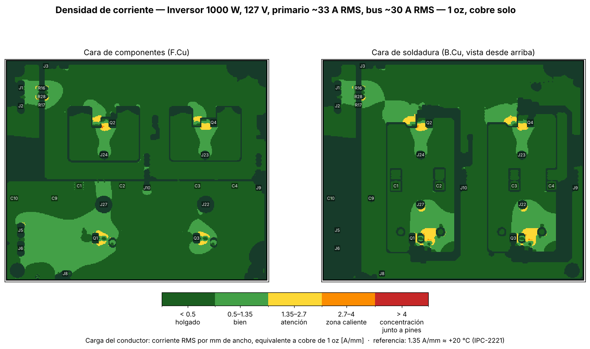

Las zonas amarillas importantes están en la **salida del MOSFET alto hacia su borne** (Q1 → J27, Q3 → J22). Ahí la corriente pasa **solo por la cara de soldadura**, porque en la cara de componentes está el plano de 48 V. Los planos de 48 V y GND se mantienen en verde porque son muy anchos.

### Corriente: con alambre 12 AWG
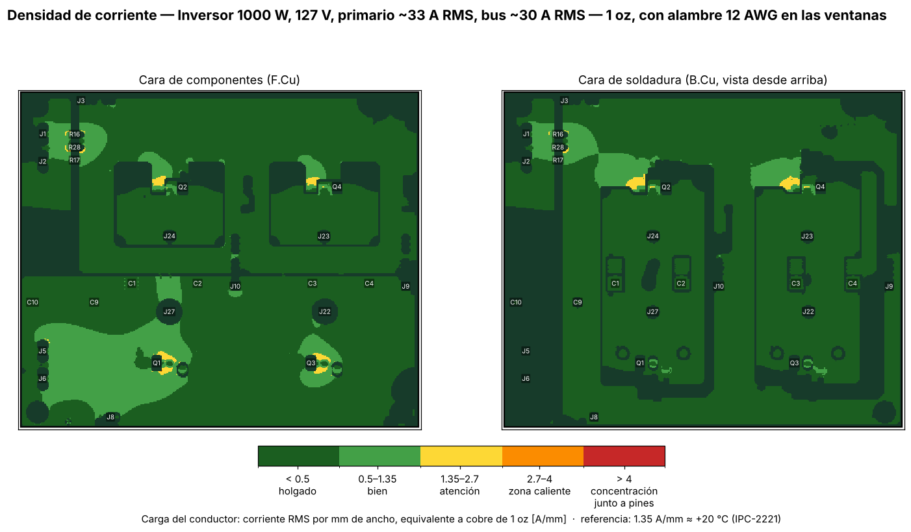

En los mapas con alambre, el color indica la **carga equivalente de cobre de 1 oz**. Donde hay alambre la carga baja, porque el alambre tiene decenas de veces más sección que la lámina de 1 oz que lo rodea.

### Temperatura: cobre solo y con alambre
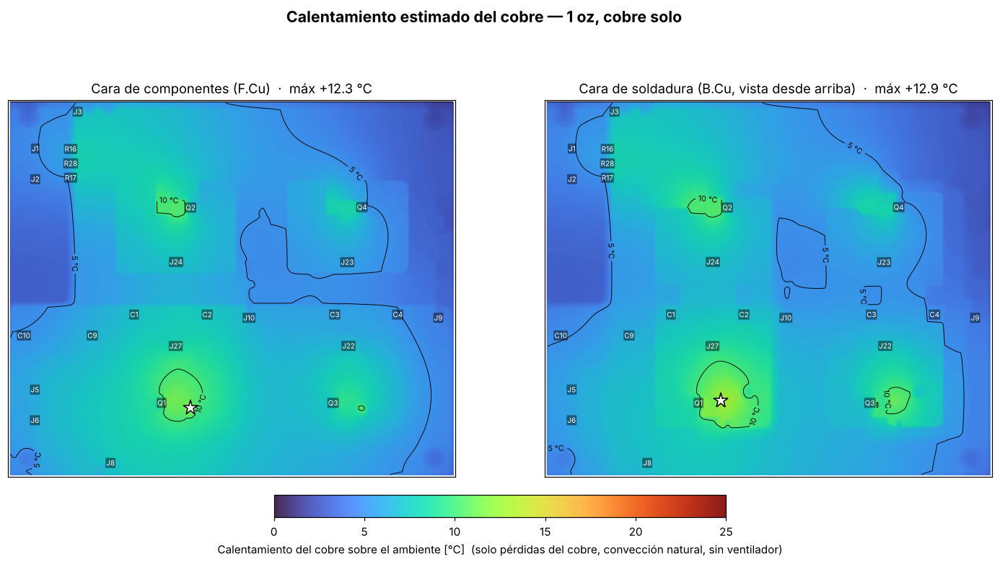
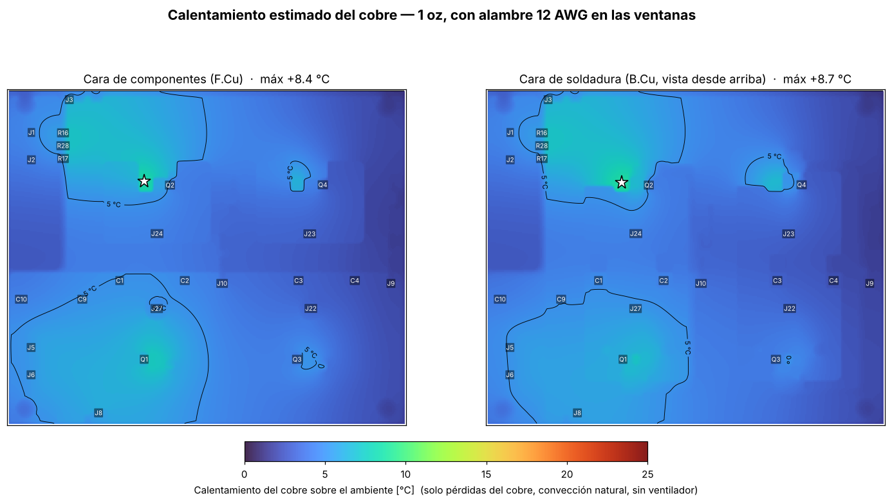

---

## 4. Acercamiento a cada pierna

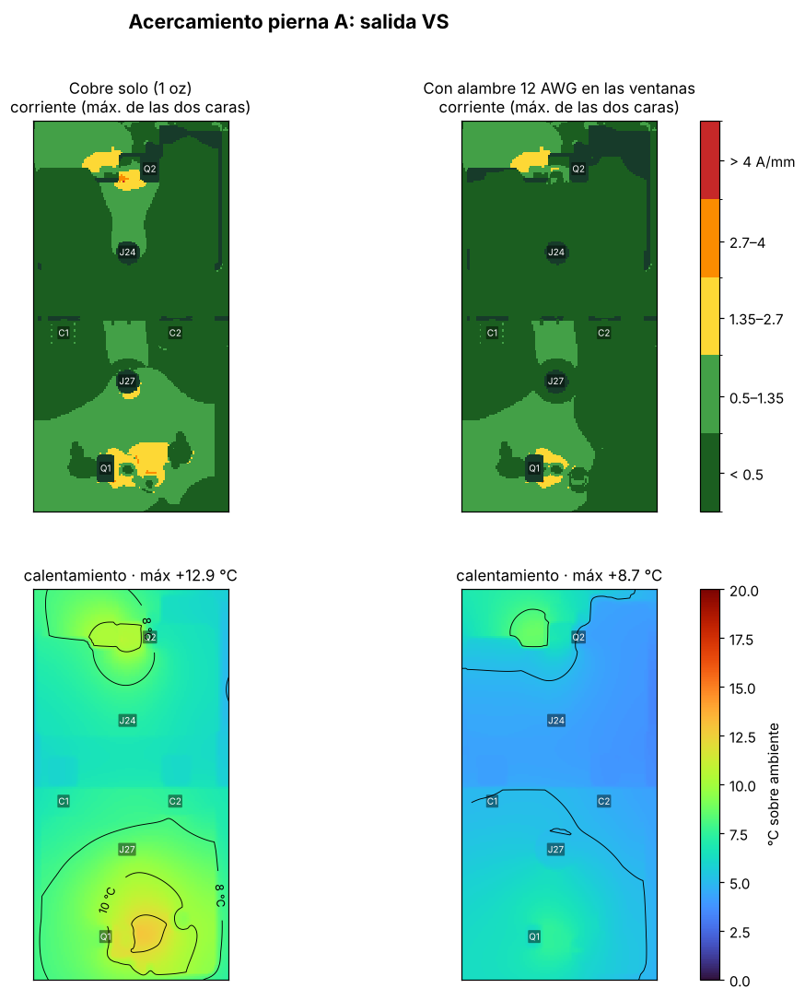
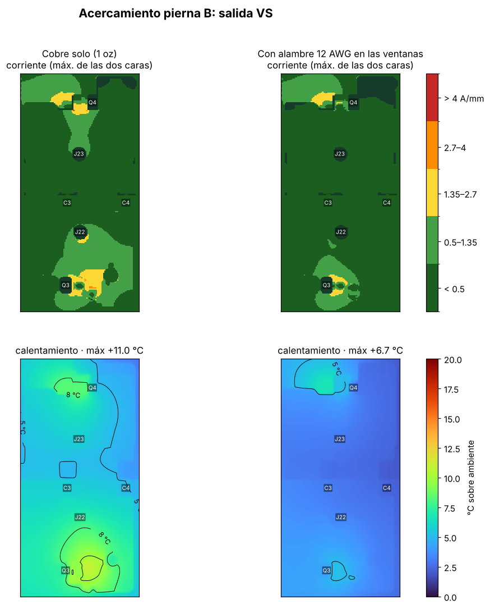

## 5. Resumen por camino

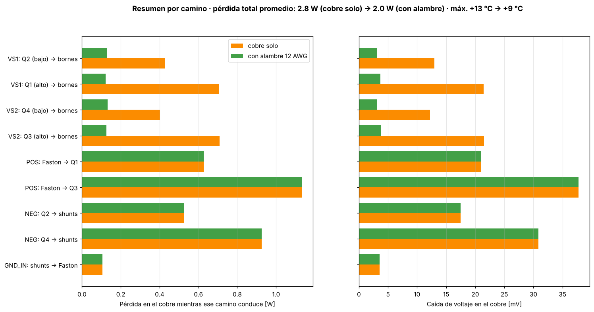

Pérdida y caída de voltaje **mientras ese camino conduce**:

| Camino | Corriente · fracción del tiempo | Cobre solo | Con alambre |
| --- | --- | --- | --- |
| VS1: Q2 (bajo) → bornes | 33 A · 50 % | 0.43 W / 13 mV | 0.13 W / 3 mV |
| VS1: Q1 (alto) → bornes | 33 A · 50 % | 0.71 W / 21 mV | 0.12 W / 4 mV |
| VS2: Q4 (bajo) → bornes | 33 A · 50 % | 0.40 W / 12 mV | 0.13 W / 3 mV |
| VS2: Q3 (alto) → bornes | 33 A · 50 % | 0.71 W / 22 mV | 0.13 W / 4 mV |
| POS: Faston → Q1 | 30 A · 50 % | 0.63 W / 21 mV | igual |
| POS: Faston → Q3 | 30 A · 50 % | 1.13 W / 38 mV | igual |
| NEG: Q2 → shunts | 30 A · 50 % | 0.52 W / 17 mV | igual |
| NEG: Q4 → shunts | 30 A · 50 % | 0.93 W / 31 mV | igual |
| GND_IN: shunts → Faston | 30 A · 100 % | 0.11 W / 4 mV | igual |

---

## 6. Lección del diseño: la ventana tiene que llegar al pin

En una versión anterior del layout, la ventana para el alambre de Q2 **empezaba ~3.7 mm antes de la pata del MOSFET**. La auditoría mostró algo que no es intuitivo:

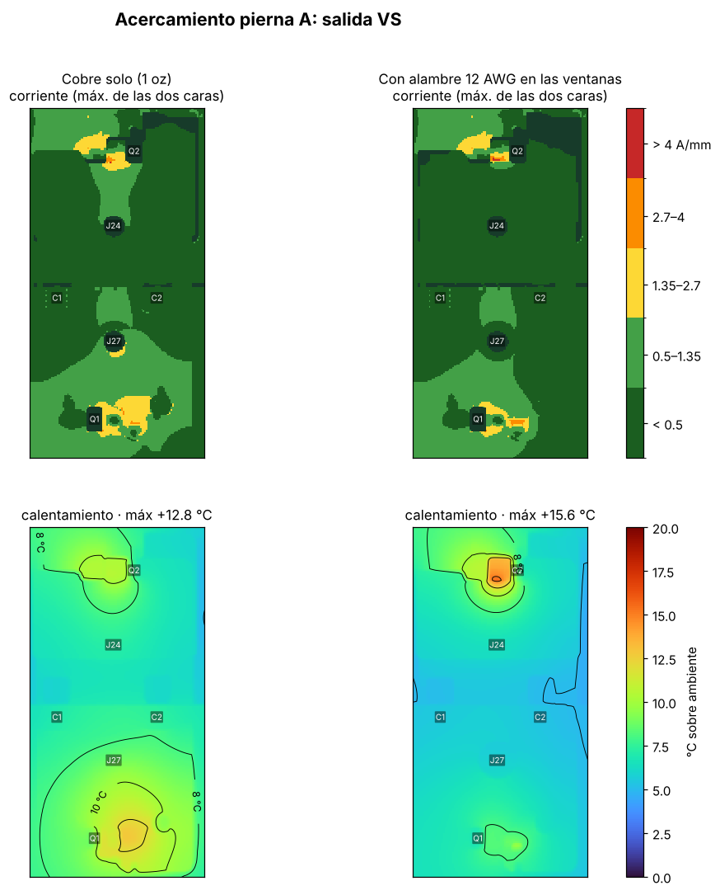

- **Con el alambre, Q2 se calentaba más (+16 °C) que sin alambre (+13 °C).**
- **La razón:** el alambre "jala" la corriente porque su resistencia es muy baja. Toda esa corriente tiene que pasar primero por el **cuello de cobre** entre la pata y el inicio del alambre, y ese tramo se vuelve el punto más caliente.
- **La corrección:** llevar la ventana **hasta envolver la pata** y soldar el alambre **directo al pin**. Con el layout actual, Q2 baja a ~+8 °C.

**Regla para cualquier refuerzo:** un refuerzo que no empieza en el pin solo cambia de lugar el cuello de botella.

---

## 7. Separación de las ventanas contra los pines vecinos

Medido con la geometría exacta: borde de la ventana de máscara contra el cobre del pad vecino.

| Ventana | Pin vecino más cercano | Separación | Estado |
| --- | --- | --- | --- |
| Q2 → J24 (VS1, bajo) | Q2-1 (gate) | 2.50 mm | ✅ |
| | Q2-3 (GND) | 2.85 mm | ✅ |
| Q4 → J23 (VS2, bajo) | Q4-1 (gate) | 2.84 mm | ✅ |
| | Q4-3 (GND) | 3.12 mm | ✅ |
| Q1 → J27 (VS1, alto) | Q1-2 (48 V) | 1.98 mm | ✅ (2 mm nominal) |
| Q3 → J22 (VS2, alto) | Q3-2 (48 V) | 1.99 mm | ✅ (2 mm nominal) |

En una versión anterior, las ventanas del MOSFET bajo quedaban a 1.49–1.58 mm del gate. Se corrigieron con un **cuello angosto** que envuelve solo la pata central, y la parte ancha empieza después de la fila de pines.

**Por qué importa:** si la soldadura del alambre puentea la ventana con un pin vecino, el MOSFET queda en corto (VS con 48 V o con GND) o su gate queda pegado a VS. **Antes de energizar, mide con el multímetro que no haya continuidad** entre VS y 48 V, entre VS y GND, y entre VS y cada gate.

---

## 8. Capacitores y MOSFET: el calor completo

La parte anterior solo considera el calor que genera la corriente al pasar por el cobre. Pero la tarjeta también recibe calor de otros dos lados:
- **Los MOSFET** conducen calor a la tarjeta por sus patas y por los pines soldados de su disipador.
- **Los Rubycon** se calientan por su resistencia interna (ESR) con el rizo, y comparten calor con la tarjeta por sus patas.

Esta etapa (`termica_componentes.py`) resuelve todo junto: la tarjeta de dos capas, las uniones de los 4 MOSFET, sus 4 disipadores y los 4 Rubycon.

### 8.1 ¿Qué corriente ven los capacitores?

La corriente que el puente toma del bus tiene tres partes. Con modulación híbrida y m = 0.90 (primario de ~30.5 V RMS, 32.8 A RMS):

| Parte | Valor RMS | ¿Quién la entrega? |
| --- | --- | --- |
| Directa (promedio) | 20.8 A | La batería |
| 120 Hz (el doble de la red, por ser monofásico) | 14.7 A | Casi toda la batería: a 120 Hz los 3.3 mF del banco tienen ~0.4 Ω y no alcanzan a sostenerla |
| **Alta frecuencia (24 kHz y armónicos)** | **13.0 A** | **Los capacitores.** Los cables de batería son demasiado inductivos para entregarla. |
| Total del bus | 28.6 A | — |

Fórmulas (puente monofásico, factor de potencia 1):
- I_bus,RMS² = 8·m·I_o² / (3π)
- I_DC = m·√2·I_o / 2
- I_120 = I_DC / √2
- I_HF² = I_bus,RMS² − I_DC² − I_120²

### 8.2 Reparto del rizo entre los Rubycon

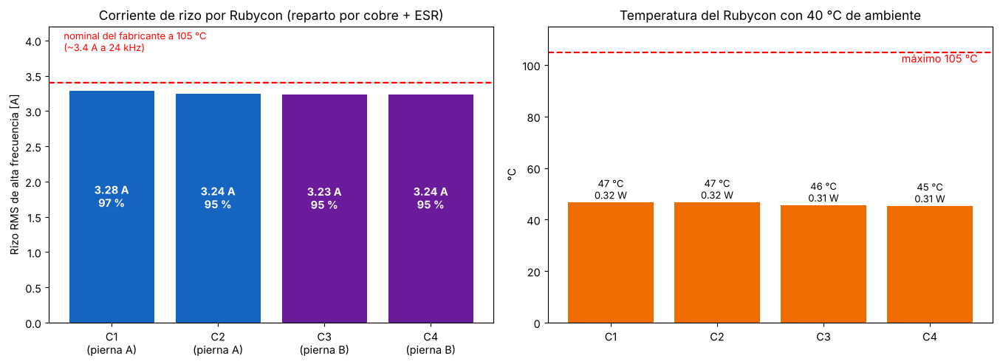

El reparto se calculó con el cobre real: el lazo va del Rubycon al MOSFET alto por el plano de 48 V y regresa del MOSFET bajo por el plano de GND, con la ESR de cada capacitor en serie.

| | C1 | C2 | C3 | C4 |
| --- | --- | --- | --- | --- |
| Rizo de alta frecuencia | 3.28 A | 3.24 A | 3.23 A | 3.24 A |
| % del nominal a 105 °C (~3.4 A a 24 kHz) | 97 % | 95 % | 95 % | 95 % |
| Pérdida en la ESR | 0.32 W | 0.32 W | 0.31 W | 0.31 W |
| Temperatura del bote (40 °C de ambiente) | 47 °C | 47 °C | 46 °C | 45 °C |

**Cómo leerlo:**
- **El reparto es parejo**, aunque los capacitores estén a distancias distintas del MOSFET. La ESR (~30 mΩ) es mucho mayor que la resistencia de los planos (~1 mΩ), así que manda la ESR. Es el resultado de tener planos anchos.
- **Cada Rubycon trabaja cerca de su corriente nominal**, pero ese nominal es **a 105 °C**. A ~47 °C el capacitor está muy por debajo de su límite, y el aumento de temperatura de su núcleo se estima en solo ~6–7 °C.
- **Vida esperada** (método de Cornell Dubilier: L = M_v · L_b · 2^((T_m − T_c)/10), con T_c = T_amb + 1.5·ΔT y M_v = 4.3 − 3.3·V_aplicado/V_nominal): con 40 °C de ambiente, 54 V de bus y ΔT de 6.6 a 16 °C, la fórmula da del orden de **0.5 a 1 millón de horas**. Ese número no se toma literal: en la práctica la vida la limita el envejecimiento del sello, del orden de 15 años, no el rizo.
- **Margen:** el rizo está al 95–97 % del nominal. **No conviene quitar Rubycon** (con 3 piezas, cada uno pasaría al ~127 %), y conviene que el aire del ventilador pase primero por ellos.

Los cerámicos (10 µF y 4.7 µF) manejan los flancos de MHz. A 24 kHz su impedancia (~1 Ω) es mucho mayor que la de un Rubycon, así que casi no toman rizo de la fundamental.

### 8.3 Rizo en los planos

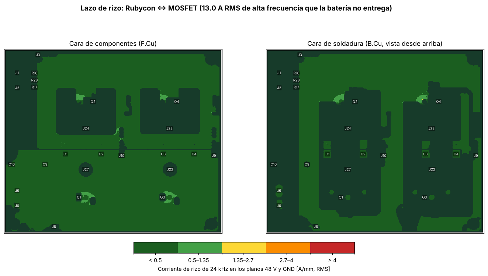

Los 13 A de rizo circulan entre los Rubycon y los MOSFET por los planos de 48 V y GND. Como esos planos son anchos, el rizo queda en verde (< 1.35 A/mm) en toda la tarjeta, y solo se nota alrededor de las patas.

### 8.4 Pérdidas de los MOSFET y balance de calor

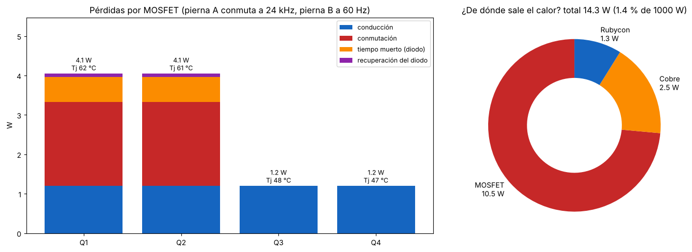

| MOSFET | Conducción | Conmutación | Tiempo muerto (diodo) | Recuperación | **Total** | Unión (40 °C amb.) |
| --- | --- | --- | --- | --- | --- | --- |
| Q1 (alto A) | 1.20 W | 2.13 W | 0.64 W | 0.09 W | **4.1 W** | **62 °C** |
| Q2 (bajo A) | 1.20 W | 2.13 W | 0.64 W | 0.09 W | **4.1 W** | **61 °C** |
| Q3 (alto B) | 1.20 W | — | — | — | **1.2 W** | 48 °C |
| Q4 (bajo B) | 1.20 W | — | — | — | **1.2 W** | 47 °C |

**Total de pérdidas estimadas: ~14 W** (1.4 % de 1000 W): MOSFET 10.5 W, cobre 2.5 W y Rubycon 1.3 W.

**Lo que enseña:**
1. **La modulación híbrida se nota en el calor:** la pierna B (60 Hz) solo tiene pérdidas de conducción, y la pierna A carga con toda la conmutación. Por eso **el disipador y el aire importan más en la pierna A** (ver `docs/modulacion_spwm.md`).
2. **El tiempo muerto de trinchera cuesta calor:** con 1 µs (TLP250, IR2110), el diodo del MOSFET conduce más tiempo y agrega **0.64 W por MOSFET** en la pierna A. Con un módulo de 500 ns (IRS2186, UCC21520) esa parte baja a la mitad.
3. **El MOSFET domina:** al sumar su calor, el cobre junto a Q1 y Q2 llega a ~+21 °C. El alambre de refuerzo baja ese punto menos de 1 °C. **El refuerzo de cobre sirve para la caída de voltaje y para el calor propio del cobre, no para enfriar los MOSFET.**

### 8.5 Temperatura total de la tarjeta

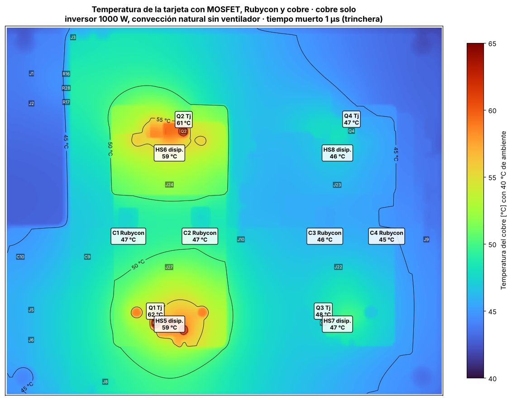
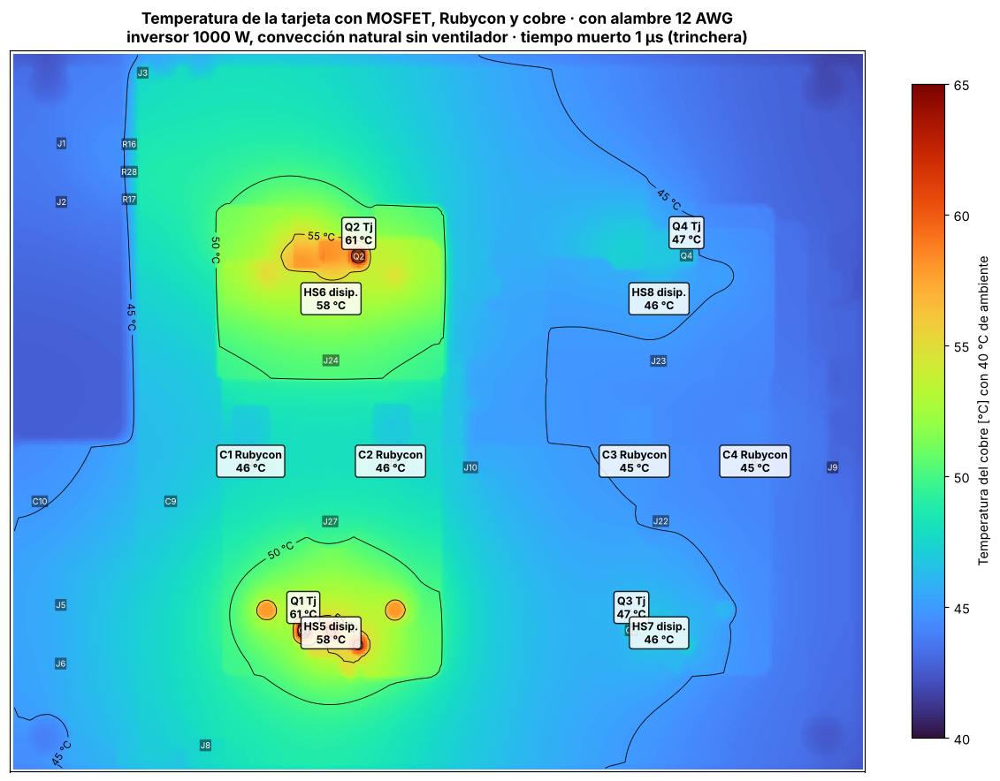

| Componente | Cobre solo | Con alambre | Límite |
| --- | --- | --- | --- |
| Unión de Q1 / Q2 | 62 / 61 °C | 61 / 61 °C | 175 °C (máximo absoluto del MOSFET) |
| Disipadores HS5 / HS6 | 59 / 59 °C | 58 / 58 °C | — |
| Rubycon C1 – C4 | 45 – 47 °C | 45 – 46 °C | 105 °C |
| Cobre más caliente | ~61 °C | ~61 °C | FR-4 común: Tg ~130 °C |

Todo queda con margen amplio **a 40 °C de ambiente y sin ventilador**. El ventilador queda como margen para climas calientes, gabinetes cerrados y la operación como cargador.

**Datos usados en esta etapa (y su fuente):**

| Dato | Valor | Fuente |
| --- | --- | --- |
| R_DS(on) del IRF100P219 | 1.4 mΩ típico a 25 °C (× 1.6 en caliente) | Hoja de datos de Infineon; el factor en caliente es estimado de la curva normalizada |
| R_thJC / R_thCS | 0.44 / 0.24 °C/W | Hoja de datos de Infineon |
| Q_rr del diodo | 224–280 nC a 100 A; se usó 150 nC a ~30 A | Hoja de datos (estimación a menor corriente) |
| t_r + t_f con nuestro driver | 250 ns | **Estimado** (la hoja de datos da 90 + 80 ns con R_G = 2.7 Ω). Es el dato más incierto. |
| Disipador SK 129 50.8 STS | 5.3 °C/W | Fischer Elektronik, vía distribuidor |
| Patas del MOSFET y pines del disipador hacia la tarjeta | 9 y 10 °C/W | Estimado por geometría |
| ZLH 820 µF / 100 V, 18 × 40 | Z = 0.026 Ω a 100 kHz; 3510 mA a 105 °C y 100 kHz; coeficiente 0.96 a 10 kHz | Hoja de datos de Rubycon ZLH |
| Enfriamiento del bote del Rubycon | β = 2.3 × 10⁻³ W/(cm²·°C), 25.1 cm² (base); 1.0 × 10⁻³ (pesimista) | Método usual de los fabricantes japoneses; Cornell Dubilier usa ~10 W/m²K (1.0 × 10⁻³), más conservador |

**Las pérdidas de conmutación son la parte más incierta.** Con t_r + t_f de 150 ns bajarían a ~1.3 W; con 400 ns subirían a ~3.4 W por MOSFET. La medición en banco (sección 11) es la que fija el número real.

### 8.6 ¿Qué tan exactos son estos números? (sensibilidad)

Los resultados no son mediciones. Para saber cuánto se pueden mover, la auditoría se corrió en tres casos con valores razonables de cada dato incierto (`sensibilidad.py`):

| Dato | Optimista | Base | Pesimista |
| --- | --- | --- | --- |
| R_DS(on) a 25 °C × factor en caliente | 1.4 mΩ × 1.5 | 1.4 mΩ × 1.6 | 1.7 mΩ (máx.) × 1.75 |
| t_r + t_f (conmutación) | 160 ns | 250 ns | 400 ns |
| Q_rr / V_f del diodo | 100 nC / 0.8 V | 150 nC / 0.9 V | 250 nC / 1.0 V |
| Disipador | 4.5 °C/W | 5.3 °C/W | 6.5 °C/W |
| Convección de la tarjeta | 14 W/m²K | 10 W/m²K | 7 W/m²K |
| Cobre real (tolerancia del fabricante) | 38 µm | 35 µm | 31 µm |
| ESR del Rubycon | 24 mΩ | 30 mΩ | 36 mΩ |
| Enfriamiento del bote del Rubycon | 2.3 × 10⁻³ W/(cm²·°C) | 2.3 × 10⁻³ | 1.0 × 10⁻³ (CDE: ~10 W/m²K) |

| Resultado | Optimista | **Base** | Pesimista | Rango respecto a la base |
| --- | --- | --- | --- | --- |
| Pérdidas totales | 11.8 W | **14.3 W** | 19.3 W | −17 % / +35 % |
| Pérdida de Q1 o Q2 | 3.1 W | **4.1 W** | 5.9 W | −23 % / +44 % |
| Pérdida en el cobre | 2.3 W | **2.5 W** | 2.8 W | −8 % / +13 % (+~8 % más si el cobre está caliente) |
| Unión de Q1 (40 °C de ambiente) | 55 °C | **62 °C** | 77 °C | aumento: −33 % / +72 % |
| Cobre más caliente | 54 °C | **61 °C** | 76 °C | aumento: −33 % / +70 % |
| Bote del Rubycon más caliente | 45 °C | **47 °C** | 56 °C | aumento: −27 % / +142 % (el pesimista usa el coeficiente de CDE, más conservador) |
| Rizo por Rubycon | 3.29 A | **3.28 A** | 3.28 A | ±2 % por el modelo; ±10 % por la diferencia de ESR entre piezas reales |

**Cómo leerlo:**
- **Lo más confiable es el cobre:** la geometría sale exacta del archivo de KiCad, y su error es de ±10–15 %, sobre todo por el grosor real del cobre que entregue el fabricante.
- **Lo menos confiable son los MOSFET:** las pérdidas de conmutación dependen de qué tan rápido conmuta el driver real, y por eso **las temperaturas tienen un rango de −33 % a +70 %** en su aumento sobre el ambiente.
- **Aun en el caso pesimista**, todo queda dentro de los límites: unión a 77 °C (máx. 175 °C), Rubycon a 56 °C (máx. 105 °C), cobre a 76 °C (FR-4 Tg ~130 °C).
- **Fuera de esta tabla queda la carga real.** Las cuentas suponen carga resistiva (factor de potencia 1). Cargas con motor, o rectificadores con capacitor (cargadores, fuentes de computadora), pueden subir la corriente RMS un 20–40 % con la misma potencia, y las pérdidas suben con el cuadrado.
- **La medición en banco** (sección 11) es la que convierte estos rangos en un número: con una temperatura medida se recalibra el modelo, y el resto de los resultados se vuelve más confiable.

**Pendiente:** repetir esta etapa para el **modo cargador (unipolar)**, donde las dos piernas conmutan a 24 kHz y la pierna B también tendrá pérdidas de conmutación.

---

## 9. Validación del método

Antes de confiar en los resultados, cada parte de la herramienta se comprobó contra un caso con respuesta conocida:

| Prueba | Resultado de la herramienta | Valor esperado | Diferencia |
| --- | --- | --- | --- |
| **Resistencia de una tira recta** de 10 × 100 mm en 1 oz (solución analítica: R = ρ·L/(t·W)) | 4.725 mΩ | 4.706 mΩ (misma geometría de celdas) / 4.914 mΩ (ideal) | 0.4 % (4 % contra la ideal, por la cuadrícula de 0.4 mm) |
| **Calentamiento uniforme** de la tarjeta: 10 W repartidos (solución analítica: ΔT = P / (2·h·A)) | 21.45 K | 21.45 K | < 0.1 % |
| **Corrientes del bus** (fórmulas de la sección 8.1) contra una **simulación de la modulación híbrida** de 400 portadoras por ciclo, con FFT | RMS 28.64 A · DC 20.83 A · 120 Hz 14.73 A · HF 13.00 A | 28.63 · 20.83 · 14.73 · 13.00 A | < 0.1 % |
| **Voltaje de salida** de esa simulación (fundamental de V_AB) | 30.50 V RMS | 30.5 V RMS (objetivo) | 0 % |

Las pruebas están en `pruebas/` (`prueba_tira_recta.py`, `prueba_corrientes_bus.py`) para que cualquiera las repita.

**Qué significa:** las ecuaciones y los métodos numéricos están bien implementados. **El error que queda viene de los datos de entrada** (sección 8.6), no del cálculo. Por eso lo siguiente es medir en el banco.

### 9.1 ¿Qué le falta para considerarse completa?

| Pendiente | Por qué importa | Cómo se cierra |
| --- | --- | --- |
| **Medición en banco** | Es la única forma de fijar las pérdidas de conmutación y el enfriamiento real | Sección 11: termopar o infrarrojo a 1000 W, 30 min; ajustar t_r + t_f y la convección hasta que el modelo coincida |
| **Modo cargador (unipolar)** | Las dos piernas conmutan a 24 kHz: la pierna B suma pérdidas y su rizo es distinto | Agregar el escenario unipolar al script |
| **Carga no resistiva** | Motores y rectificadores con capacitor suben la corriente RMS 20–40 % | Correr con I_o y factor de cresta medidos de una carga real |
| **Corto circuito** | En una falla, ¿qué se funde primero, la pista o el fusible? ¿Alcanza la protección de 2–3 µs del sensor? | Cálculo de fusión de pistas (por ejemplo, ecuación de Onderdonk) contra la energía que deja pasar el fusible |
| **Inductancia y EMI** | El modelo es de DC; no calcula sobretiros ni ruido | Medir con osciloscopio el sobretiro en VS1/VS2 (ver `docs/modulacion_spwm.md`) |
| **Revisión independiente** | Que otra persona revise supuestos y código | Comparar con una herramienta conocida, por ejemplo la calculadora IPC-2152 de Saturn PCB Toolkit, o la calculadora de pistas de KiCad (IPC-2221) |

---

## 10. Escenario y supuestos

| Parámetro | Valor | Nota |
| --- | --- | --- |
| Operación | Inversor 1000 W, 127 V | Modulación híbrida, ver `docs/modulacion_spwm.md` |
| Corriente en la salida VS | 33 A RMS | Primario del transformador; cada MOSFET conduce ~50 % del tiempo (~23 A RMS por MOSFET) |
| Corriente del bus DC | 30 A RMS | Se reparte entre las dos piernas (~50 % cada una) |
| Shunts montados | 2 (R16 y R28) | Configuración de operación |
| Bornes de salida | J24 + J27 y J23 + J22, en paralelo | Cables de igual largo al transformador |
| Cobre | 1 oz = 35 µm, 0.49 mΩ por cuadro a 25 °C | El cobre sube ~0.4 % de resistencia por cada °C |
| Alambre | 12 AWG, 3.31 mm² | Solo en las ventanas sobre VS1 y VS2 |
| Térmico | Dos capas de cobre acopladas por FR-4 de 1.6 mm; convección natural de 10 W/m²K por cara | Sin ventilador |

**Límites (léelos antes de confiar en un número):**
- Es un modelo de **corriente continua**. A 24 kHz la profundidad de piel del cobre (~0.42 mm) es mucho mayor que 35 µm, así que en la lámina el efecto pelicular no cambia el resultado.
- La parte 1 (secciones 1–7) **no incluye el calor de los MOSFET ni de los Rubycon**: solo el del cobre. La sección 8 los suma.
- La parte 1 toma los 30 A del bus como si salieran de la batería (conservador). La sección 8 los separa: ~25 A de batería (DC + 120 Hz) y 13 A de rizo local entre los Rubycon y los MOSFET.
- El modelo térmico es aproximado. Las temperaturas son **tendencias para comparar escenarios**, no una medición.
- Las zonas rojas junto a las patas son en parte efecto de la cuadrícula (0.4 mm). Lo que importa es el **área amarilla y naranja**, no el valor de un solo punto.

---

## 11. Validación en banco

1. A 1000 W y después de **30 minutos**, mide con termopar o termómetro infrarrojo (con cinta negra mate para leer bien el cobre) en:
   - el cobre entre **Q1 y J27**, y entre **Q3 y J22** (el punto más caliente según la auditoría);
   - el cobre entre **J5/J6 y Q3** (POS, el camino más largo);
   - el cobre entre **Q4 y los shunts** (NEG).
2. **Criterio:** ≤ +20 °C sobre el ambiente, sin contar el área de 2–3 mm alrededor de las patas.
3. Si se pasa, suelda el alambre en las ventanas de VS y repite la medición.
4. Mide también el **bote de los Rubycon** (C1 y C2, a media altura) y la **aleta de los disipadores** de la pierna A. Compáralos con la sección 8.5.
5. Anota los resultados en la bitácora de la tarjeta, para comparar la simulación contra la realidad.

---

## 12. Cómo correr la auditoría en tu propia tarjeta

```bash
pip install numpy scipy matplotlib
python3 auditoria_cobre.py MI_TARJETA.kicad_pcb --oz 1 --salida resultados
```

- Antes de correrla, **rellena las zonas en KiCad (tecla B) y guarda**. La herramienta usa los polígonos rellenos que guarda el archivo.
- Las corrientes y los caminos se definen en el diccionario `ESCENARIO`, al inicio del script, con el formato *net, pin de entrada, pines de salida, amperes, fracción del tiempo*. Para otra tarjeta, cambia las referencias (Q1, J24…) por las tuyas.
- Las ventanas de refuerzo se detectan solas: cualquier ventana en F.Mask o B.Mask que quede sobre las nets indicadas en `refuerzo(nets=…)`, dibujada como línea, polígono o zona.
- Resultados: mapas de corriente y de temperatura (cobre solo y con alambre), acercamientos y `resumen.json`.

Para el calor completo (MOSFET + Rubycon + cobre):

```bash
python3 termica_componentes.py MI_TARJETA.kicad_pcb --salida resultados --tamb 40
python3 termica_componentes.py MI_TARJETA.kicad_pcb --salida resultados --tamb 40 --alambre
```

Los datos de operación, de los MOSFET y de los capacitores están en los diccionarios `OP`, `MOS`, `CAP` y `PIERNA`, al inicio del script. Cámbialos por los de tus piezas.

---

## 13. Referencias

- IPC-2221B, *Generic Standard on Printed Board Design*: relación entre corriente, sección de cobre y aumento de temperatura (I = k·ΔT^0.44·A^0.725).
- IPC-2152, *Standard for Determining Current Carrying Capacity in Printed Board Design*: versión moderna, basada en mediciones, de la capacidad de corriente de pistas y planos.
- Infineon, hoja de datos IRF100P219 (R_DS(on), R_thJC, R_thCS, Q_rr, tiempos de conmutación). <https://www.farnell.com/datasheets/2849758.pdf>
- Rubycon, hoja de datos de la serie ZLH (impedancia, corriente de rizo, coeficientes de frecuencia). <https://sy-dep-epc-lpc.web.cern.ch/components/datasheets/epc-lpc%20(converters)/ZLH-Aluminium-Capacitor_Rubycon.pdf>
- Fischer Elektronik SK 129 50.8 STS: 5.3 °C/W (ficha del distribuidor). <https://nz.element14.com/fischer-elektronik/sk-129-50-8-sts/heat-sink-extruded-pcb-mounting/dp/1319813>
- Infineon, D. Graovac, M. Pürschel, A. Kiep, *MOSFET Power Losses Calculation Using the Data-Sheet Parameters*, nota de aplicación V1.1, julio 2006 (método de pérdidas de conducción, conmutación y recuperación). Copia: <https://forums.futura-sciences.com/attachments/electronique/134703d1297466225-calcul-courant-de-grille-maximal-un-mosfet-mosfet_powerlossescalculationusingdata-sheetparameters.pdf>
- Cornell Dubilier, *Aluminum Electrolytic Capacitor Application Guide* (vida por temperatura, coeficiente de transferencia de calor, ESR). <https://www.cma4ch.org/chemo/ftp/CDE_Aluminum-Electrolytic-Capacitor-Application-Guide-r2.pdf>
- Saturn PCB Design, *PCB Toolkit* (calculadora gratuita IPC-2152, útil para verificar en forma independiente). <https://pcdandf.com/pcdesign/index.php/editorial/menu-new-indust-prod/14858-saturn-pcb-delivers-pcb-design-toolkit-v-7-12>
- Resistividad del cobre a 20 °C: 1.72 × 10⁻⁸ Ω·m (cobre recocido, IACS).

---

*Herramientas `auditoria_cobre.py`, `termica_componentes.py` y `sensibilidad.py`: licencia MIT. Documento: CC BY-SA 4.0.*
