# SENSOR_DC_INA_COMPARADOR — módulo de medición, límite y protección de corriente DC

- **Proyecto:** Puente H — prototipo SPWM "Isla del Sol" (inversor 48 V → 127 V / 60 Hz, 1000 W; modo cargador 1 kVA)
- **Módulo:** sensor de corriente del **bus DC**, **bidireccional** (descarga e inyección/carga), con **dos ventanas por hardware**: disparo duro y límite de corriente, más **detección de presencia fail-safe** (SENSOR_OK)
- **Versión:** **V0.2** (serigrafía: `V.0.2/8-NOV-26.J.G`) · **Fecha:** 2026-11-08
- **Estado:** esquemático y layout V0.2 terminados, ERC/DRC sin errores. Pendiente: fabricación y validación en banco
- **Compatible con:** ATmega328P, ATmega4809, STM32, ESP32 y otros MCU de 3.3 V o 5 V, sin cambiar piezas
- **Decisiones que implementa:** [DC-014](../../../docs/decisiones_criticas.md#dc-014-corte-del-pwm-por-hardware-con-lógica-fail-safe-sensor_ok-y-doble-candado) (SENSOR_OK fail-safe) · [DC-016](../../../docs/decisiones_criticas.md#dc-016-corto-circuito-en-ac-niveles-de-protección-arranque-de-motores-arco-transferencia-y-reintentos) (niveles 0 y 1: disparo y límite)
- **Archivos de KiCad (V0.2):** `SENSOR_DC_INA_COMPARADOR_V2.kicad_pro` / `.kicad_sch` / `.kicad_pcb`, con la huella `SSA2512_Littelfuse_Kelvin.kicad_mod` y el modelo `SSA2512_Littelfuse.step`. La V0.1 queda en el historial de Git.
- **Documentos relacionados:** [Corte del PWM por hardware](../../../docs/corte_por_hardware.md) · [Sensado de corriente](../../../docs/sensado_corriente.md)

> **En una línea:** el módulo tiene que decir **"estoy aquí y estoy bien"** todo el tiempo (SENSOR_OK en 0 V). Si se calla por cualquier razón (falla, cable roto, sin alimentación, sobrecorriente), el inversor se apaga por hardware.

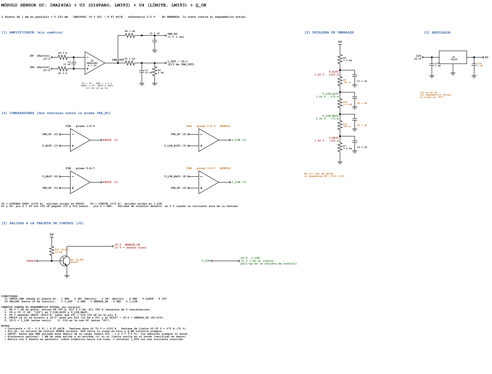

*Esquemático explicado del módulo V0.2. En naranja, lo nuevo contra la V0.1: la escalera de 5 resistencias, U4 (límite), Q1 + R6 (SENSOR_OK) y J2-5 = I_LIM. Script: [`img/esquematico_modulo_sensor_dc_u4.py`](img/esquematico_modulo_sensor_dc_u4.py).*

---

## Índice

1. [Qué hace](#1-qué-hace)
2. [Qué cambió en la V0.2](#2-qué-cambió-en-la-v02)
3. [Cómo llegamos aquí](#3-cómo-llegamos-aquí)
4. [Seguridad: qué protege y qué no](#4-seguridad-qué-protege-y-qué-no)
5. [Interfaz](#5-interfaz)
6. [Shunts, umbrales y calibración](#6-shunts-umbrales-y-calibración)
7. [Circuito](#7-circuito)
8. [Layout y serigrafía](#8-layout-y-serigrafía)
9. [Lista de materiales](#9-lista-de-materiales)
10. [Validación en banco](#10-validación-en-banco)
11. [Bitácora](#11-bitácora)
12. [Referencias](#12-referencias)

---

## 1. Qué hace

El módulo se conecta **pegado a los shunts** del bus DC de la tarjeta de potencia y cumple cuatro funciones:

| Función | Salida (J2) | Qué hace con ella la tarjeta de control |
| --- | --- | --- |
| **Medir** la corriente de la batería, en los dos sentidos | **I_OUT** (pin 1): 0–3.3 V, centro 1.67 V | ADC: potencia, eficiencia, control del cargador, pantalla |
| **Proteger** (disparo duro, nivel 0) | **SENSOR_OK** (pin 3): **0 V = todo bien** | R26 + Q_EN cortan EN_HW → 74HC08 apaga los 4 MOSFET en ~2–4 µs, con candado |
| **Detectar presencia** (fail-safe) | La misma **SENSOR_OK** | Sin módulo, sin 15 V o con el cable roto, la línea sube y el inversor no arranca |
| **Limitar** (nivel 1) | **I_LIM** (pin 5): **0 V = en el límite** | D2 del CRÍTICO (interrupción): baja el índice de modulación, sin candado; corren las huellas de corto, arco y motor |

```
              TARJETA DE CONTROL (ATmega328P / 4809 / STM32 / ESP32)
         ▲ I_OUT (ADC)    ▲ SENSOR_OK (R26 → Q_EN → EN_HW)    ▲ I_LIM (D2, INT)
         │                │                                    │
   ┌─────┴────────────────┴────────────────────────────────────┴─────┐
   │ J2 (arriba): 1 I_OUT · 2 GND · 3 SENSOR_OK · 4 GND · 5 I_LIM     │
   │                                                                   │
   │   78L05 · INA240A1 · U3 LM393 (disparo ±105 A) · Q1 BC547         │
   │                      U4 LM393 (límite ±75 A)                      │
   │                                                                   │
   │ J1 (abajo, header): G · K+ · K− · G · X (llave) · 15V             │
   └─────┬──────────────────┬──────────────────────────────────────────┘
         │ IN+ / IN− Kelvin │ 15 V
         ▼                  ▼
   TARJETA DE POTENCIA: 3 shunts de 1 mΩ en paralelo en el bus DC (lado bajo)
```

- **Los shunts se quedan en la tarjeta de potencia** (por ellos pasan hasta 100 A). Al módulo solo llega su voltaje (milivoltios) por dos líneas Kelvin.
- **El módulo es intercambiable**, como los gate drivers: si se daña, se cambia sin tocar la tarjeta de potencia.

---

## 2. Qué cambió en la V0.2

| # | Cambio | Por qué | Decisión |
| --- | --- | --- | --- |
| 1 | **J2-3: FAULT → SENSOR_OK** con **Q1 (BC547) + R6 (10 kΩ)**. FAULT queda interno | Lógica invertida (fail-safe): sin módulo, sin alimentación o con el cable roto, la línea sube y se corta. Con FAULT directo, un sensor ausente "no reportaba falla" | [DC-014](../../../docs/decisiones_criticas.md#dc-014-corte-del-pwm-por-hardware-con-lógica-fail-safe-sensor_ok-y-doble-candado) |
| 2 | **U4 = segundo LM393**: ventana de **límite** (±75 A) | Separar "limitar" de "cortar": un arranque de motor se limita y se clasifica; solo lo peligroso corta | [DC-016](../../../docs/decisiones_criticas.md#dc-016-corto-circuito-en-ac-niveles-de-protección-arranque-de-motores-arco-transferencia-y-reintentos) |
| 3 | **J2-5: NC → I_LIM** (salidas de U4 unidas, colector abierto) | La terminal 5 estaba libre desde la V0.1 | DC-016 |
| 4 | **Escalera de 5 resistencias:** R5 3.6k – **R9 390** – **R10 2.0k** – **R11 390** – R7 3.6k (sale la R6 de 2.7k de la V0.1) | Cuatro umbrales con un solo divisor: las dos ventanas se mueven juntas si el 5 V varía | — |
| 5 | **C8, C9, C10** de 1 nF en los nodos nuevos (C7 sigue en V_ALTO) | Umbrales estables frente al ruido de conmutación | — |
| 6 | **C6** pasa a ser el 0.1 µF de U4; **C5** sigue en U3 | Desacople pegado a cada pin 8 | — |
| 7 | **C14** corregido a la red **5V** (estaba en una red "6V" sin fuente) | Sin esto, la salida del 78L05 quedaba sin capacitor | — |
| 8 | **Resistencias y capacitores THT** (salvo INA240, 78L05, R3, R4 y C3) | Se sueldan y se cambian en la trinchera con cautín común | — |
| 9 | **Serigrafía:** J2 = I_OUT · GND · SEN OK · GND · I_LIM; "C B E" en Q1; "TRENZAR I_OUT, SENSOR_OK E I_LIM CON GND"; versión V.0.2 | Lo primero que lee quien conecta el cable | — |

---

## 3. Cómo llegamos aquí

La V0.1 medía bien y cortaba rápido. Lo que cambió fueron **preguntas de trinchera** que la V0.1 no sabía contestar.

**1. "¿Y si en la trinchera no llega el INA, marcaría FAULT?"** No. FAULT era una señal de **falla activa en 0**: el silencio significaba "todo bien", y un módulo que no está siempre guarda silencio. El inversor habría operado **sin protección y sin que nadie lo supiera**. De ahí salió la lógica invertida: el módulo tiene que estar diciendo "estoy bien" (**SENSOR_OK en 0 V**) para que el inversor opere. Se pidió expresamente que fuera **físico, no firmware**: por eso es un transistor (Q1) en el módulo y otro (Q_EN) en la tarjeta de control, y un jumper rojo (J_RIESGO) para el riesgo autorizado. → DC-014.

**2. "¿El corto en AC se evaluó?"** Al revisar el corto en la salida de 127 V salió que **un arranque de motor y un corto se parecen** en los primeros milisegundos: los dos jalan corriente y hunden el voltaje. Con un solo umbral que corta y enclava, el refrigerador de vacunas habría disparado la protección en cada arranque. La respuesta fueron **niveles**: un límite que recorta sin candado mientras el firmware reconoce la huella (motor, corto o arco), y un disparo duro solo para lo que el firmware no alcanza a seguir. → DC-016.

**3. "¿La detección por firmware evita la chispa del arco?"** No: la chispa inicial no la evita nada electrónico. Lo que sí se controla es **cuánta energía recibe el arco**: con el límite en ±75 A y el corte a ~50 ms, un arco paralelo recibe ~48 J, debajo del criterio de ~100 J con que IEC 62606 fijó los tiempos de los detectores de arco. Eso exige que el límite exista **en hardware**, no solo en el ADC. → DC-016.

**4. La inconsistencia de umbrales.** El disparo duro estaba pensado en 60–80 A, **por debajo** del pico de un arranque de motor (90–140 A en el primario): habría disparado antes de que el firmware pudiera clasificar. Con los **3 shunts de diseño** (0.333 mΩ), la escalera nueva deja el **límite en ±75 A** (1.6 × el pico nominal de 46 A) y el **disparo en ±105 A** (2.3 ×). El límite atrapa el arranque antes de que llegue al disparo.

**5. "El segundo comparador" y una confusión útil.** Se propuso usar "el canal B libre" del LM393 para el límite. Al revisar el esquemático real resultó que **el canal B no estaba libre**: ya cuidaba la sobrecorriente en sentido de carga (la ventana es bidireccional). Por eso el límite lleva **su propio LM393 (U4)** y U3 se quedó intacto.

**6. La revisión antes de fabricar** encontró tres errores que el ERC y el DRC no ven, porque son de función, no de conexión:

| Error | Qué habría pasado |
| --- | --- |
| **U4A con las entradas al revés** (+ en INA_RC) | I_LIM en 0 V todo el tiempo: el CRÍTICO nunca habría dejado subir la modulación |
| **Q1 sin agregar** (FAULT directo a J2-3) | La tarjeta de control nunca habría arrancado: R26 vería la línea en alto |
| **C14 en una red "6V"** | El 78L05 sin capacitor de salida |

> **Lección para la trinchera:** "0 errores" en el DRC significa que las conexiones son coherentes, **no que el circuito haga lo que tiene que hacer**. Antes de fabricar, revisar la función con la tabla de estados (sección 4) y la prueba rápida (sección 10).

---

## 4. Seguridad: qué protege y qué no

### 4.1 Tabla de estados

| Situación | U3 (FAULT) | Q1 | **SENSOR_OK** (J2-3) | U4 | **I_LIM** (J2-5) | Resultado en el inversor |
| --- | --- | --- | --- | --- | --- | --- |
| Corriente normal (entre −75 y +75 A) | suelto | conduce | **0 V** | suelto | alto | Opera |
| Entre 75 y 105 A, en cualquier sentido (arranque, corto naciendo) | suelto | conduce | **0 V** | a 0 V | **0 V** | Límite: el CRÍTICO baja el índice y clasifica (DC-016) |
| Más de 105 A, en cualquier sentido | **a 0 V** | **apagado** | **alto** | a 0 V | 0 V | **Corte en ~2–4 µs + candado** (DC-014) |
| Módulo ausente o cable de J2 roto | — | — | **alto** (R26) | — | alto (R_PU) | **No arranca** |
| Módulo sin 15 V (78L05 apagado) | — | apagado (R6 sin voltaje) | **alto** | — | alto | **No arranca** |
| LM393 U3 quemado abierto o sin chip | — | conduce | 0 V | — | — | ⚠️ Opera **sin disparo duro** (ver 4.2) |
| **Q1 en corto C-E** | — | — | **0 V siempre** | — | — | ⚠️ **Opera sin disparo duro y no se nota** (ver 4.2) |
| U4 dañado o sin chip | — | — | — | — | alto | Sin límite; el disparo duro sigue |

### 4.2 Fallas de una sola pieza que anulan la protección (se dejan escritas a propósito)

- **Q1 en corto colector–emisor:** SENSOR_OK queda en 0 V ("estoy bien") aunque haya sobrecorriente. Es la única falla de una pieza que **anula el disparo duro sin que se note**.
- **U3 sin chip o con la salida abierta:** FAULT nunca baja y Q1 siempre conduce.

Las dos se detectan con la **prueba de disparo** (sección 10, prueba 6). **Debe repetirse en cada mantenimiento** y después de cambiar U3 o Q1. Mientras tanto, el nivel 2 de DC-016 (firmware, con I_OUT y la pinza AC) sigue vigilando, más lento.

### 4.3 Lo que este módulo no hace

- **No es una protección de personas**: no mide fuga a tierra (ver [DC-015](../../../docs/decisiones_criticas.md)).
- **No ve los estados cero** de la modulación híbrida: en ellos la corriente circula dentro del puente sin pasar por el shunt. Como en esos estados la corriente no crece, el disparo llega en el siguiente pulso activo. El sensor AC del primario lo cubre en una versión posterior.
- **I_LIM no es fail-safe a propósito:** sin módulo queda en alto ("sin límite"), pero en ese caso SENSOR_OK ya está cortando. El límite es comodidad para los arranques; la seguridad la dan SENSOR_OK y el disparo duro.
- **No protege el lado DC de la batería**: un corto en los cables de 48 V solo lo interrumpe el **fusible DC clase T junto a la batería**.

---

## 5. Interfaz

### 5.1 J1 — abajo, hacia la tarjeta de potencia (header de 2.54 mm, pegado a los shunts)

| Pin | Señal | Nota |
| --- | --- | --- |
| 1 | GND | Blindaje |
| 2 | **IN+ (Kelvin)** | Desde el pad Kelvin del shunt |
| 3 | **IN− (Kelvin)** | Desde el otro pad; vecino del 2 |
| 4 | GND | Blindaje |
| 5 | **Llave (X)** | **Sin pin ni pad** |
| 6 | 15 V | Alimentación; el módulo genera sus 5 V |

Las señales de milivoltios (2 y 3) quedan entre dos GND y separadas de los 15 V por la llave. En la tarjeta de potencia, la posición 5 del zócalo hembra se **tapa**. El módulo va pegado al shunt con header corto; **nunca cables para IN+ e IN−**.

### 5.2 J2 — arriba, hacia J6 de la tarjeta de control (Phoenix SPT 1,5/5-H-3,5)

| Terminal | Señal | Tipo | Nivel | En la tarjeta de control |
| --- | --- | --- | --- | --- |
| 1 | **I_OUT** | Analógica | 0–3.33 V, centro 1.67 V | ADC (AUX A0, con R 1 kΩ en serie) |
| 2 | GND | | | Trenzar con I_OUT |
| 3 | **SENSOR_OK** | Colector abierto (Q1) | **0 V = sensor bien** | **R26 10 kΩ a 5V → R16 → Q_EN → EN_HW**; también a D3 del AUX (INT1) |
| 4 | GND | | | Trenzar con SENSOR_OK |
| 5 | **I_LIM** | Colector abierto (U4) | **0 V = en el límite** | **R_PU 10 kΩ a 5V → R_S 1 kΩ → D2 del CRÍTICO**, con **C_F 1 nF** a GND |

- **El módulo no pone pull-ups en SENSOR_OK ni en I_LIM:** las pone la tarjeta de control, al voltaje de su MCU. Por eso funciona igual con 5 V (ATmega) que con 3.3 V (STM32, ESP32).
- **Cable:** trenzar I_OUT, SENSOR_OK e I_LIM con GND, corto (< 50 cm) y lejos de la potencia.
- **Tierra:** la tierra del módulo es el lado bajo del shunt. Unión con la tierra de control **en un solo punto**, en el negativo de la batería (ver [corte por hardware](../../../docs/corte_por_hardware.md), sección 10).

### 5.3 Compatibilidad con cualquier MCU

| MCU | I_OUT | SENSOR_OK | I_LIM |
| --- | --- | --- | --- |
| ATmega328P / ATmega4809 (5 V) | ADC: ~680 de 1024 cuentas útiles | R26 + Q_EN + 74HC08 (y D3 del AUX) | D2 del CRÍTICO (INT0 / cualquier pin en el 4809) |
| STM32 (3.3 V) | ADC de 3.3 V, rango completo | BKIN del timer avanzado, **activo en alto** | Entrada de interrupción |
| ESP32 (3.3 V) | ADC con atenuación de 11 dB | Entrada de falla del MCPWM, **activa en alto** | Entrada de interrupción |

---

## 6. Shunts, umbrales y calibración

### 6.1 La pieza

**Littelfuse SSA2512LR001FWR**: 1 mΩ ±1 %, 6 W a 70 °C, lámina metálica, 2512. Huella del proyecto `SSA2512_Littelfuse_Kelvin`. Van en la **tarjeta de potencia**, en el negativo del bus DC. Hoja de datos: [Littelfuse SSA Series](https://www.mouser.com/datasheet/2/240/media-3323775.pdf).

### 6.2 La escalera de umbrales (V0.2)

5 V → R5 3.6 kΩ → **V_ALTO** → R9 390 Ω → **V_LIM_ALTO** → R10 2.0 kΩ → **V_LIM_BAJO** → R11 390 Ω → **V_BAJO** → R7 3.6 kΩ → GND (total 9.98 kΩ)

| Nodo | Voltaje | Distancia a 2.5 V | Comparador |
| --- | --- | --- | --- |
| V_ALTO | 3.196 V | +0.696 V | U3A (+): disparo, descarga |
| V_LIM_ALTO | 3.001 V | +0.501 V | U4A (+): límite, descarga |
| V_LIM_BAJO | 1.999 V | −0.501 V | U4B (−): límite, carga |
| V_BAJO | 1.804 V | −0.696 V | U3B (−): disparo, carga |

El límite queda al **72 %** del disparo. La referencia del INA240 (VS/2) y la escalera salen de los mismos 5 V: si el 78L05 varía ±5 %, todo se mueve junto y los límites casi no cambian.

### 6.3 ¿Cuántas piezas? (1, 2 o 3)

| | 1 pieza | 2 piezas | **3 piezas (diseño, 1000 W)** |
| --- | --- | --- | --- |
| Resistencia efectiva | 1 mΩ | 0.5 mΩ | **0.333 mΩ** |
| Sensibilidad en INA_OUT | 20 mV/A | 10 mV/A | **6.67 mV/A** |
| **Límite (U4, I_LIM)** | ±25 A | ±50 A | **±75 A** |
| **Disparo duro (U3, SENSOR_OK)** | ±35 A | ±70 A | **±105 A** |
| Uso | Primeras pruebas en banco | Pruebas a media potencia | **Operación a 1000 W y arranques de motor** |
| Potencia por pieza a 1000 W (~30 A<sub>rms</sub> en el bus) | ~0.9 W | ~0.23 W | **~0.10 W** |
| Resolución en I_OUT con ATmega (10 bits, 5 V) | ~0.37 A/cuenta | ~0.73 A/cuenta | ~1.1 A/cuenta |
| `R_SHUNT_OHM` en firmware | `0.001` | `0.0005` | `0.000333` |
| Etiqueta CAL del módulo | "CAL: 1 mΩ / ±25 / ±35 A" | "CAL: 0.5 mΩ / ±50 / ±70 A" | **"CAL: 0.33 mΩ / ±75 / ±105 A"** |

**Contra la operación a 1000 W (3 piezas):** el pico nominal en el primario es ~46 A. El límite (75 A) queda a 1.6 × y el disparo (105 A) a 2.3 ×. Un arranque de motor recibe hasta ~12.8 A<sub>rms</sub> en la salida (1.6 × nominal) mientras el límite lo sostiene.

**A medir en la V1** ([DC-016](../../../docs/decisiones_criticas.md)): la inductancia de dispersión del transformador, para conocer el sobretiro sobre los 105 A en los ~4 µs del corte y compararlo con la corriente pulsada (I<sub>DM</sub>) de los IRF100P219.

### 6.4 Reglas de montaje de los shunts

1. **La posición con las pistas Kelvin se monta siempre** (serigrafía "KELVIN · MONTAR SIEMPRE").
2. Las posiciones vacías van como **DNP** en el esquemático.
3. **Cobre simétrico hacia las tres piezas:** si la Kelvin se toma en una sola, la lectura depende de que las tres repartan igual. Calibrar con una corriente conocida.
4. Planos anchos, vías térmicas, lejos de los barrenos de montaje.
5. Serigrafía del valor: **"1mΩ 6W"**, nunca "1M".
6. **Al cambiar el número de piezas:** actualizar `R_SHUNT_OHM`, la etiqueta CAL y los umbrales que espera el firmware.

### 6.5 Fórmulas

| Magnitud | Fórmula |
| --- | --- |
| Salida del INA240 (INA_OUT) | V = 2.5 V + I × R_shunt × 20 |
| Salida al MCU (I_OUT) | V = 1.667 V + I × R_shunt × 13.33 |
| Corriente desde la lectura | **I = (V_I_OUT − 1.667 V) / (R_shunt × 13.33)** |
| Umbral de un nodo de la escalera | V = 5 V × (resistencia de ese nodo a GND) / 9.98 kΩ |
| Corriente de disparo o de límite | **I = (V_nodo − 2.5 V) / (R_shunt × 20)** |

### 6.6 Rango de entrada del LM393

A 5 V, las entradas del LM393 trabajan hasta ~3.5 V (VCC − 1.5 V). Según la hoja de datos, **basta con que una de las dos entradas esté dentro de ese rango** para que la salida sea correcta. Los cuatro umbrales (1.80 a 3.20 V) siempre lo están, así que las ventanas funcionan aunque INA_RC suba hasta ~4.9 V en un corto.

---

## 7. Circuito

### 7.1 Alimentación

| Ref. | Valor | Función |
| --- | --- | --- |
| U1 | L78L05 (SOT-89, cara de abajo) | 15 V → 5 V |
| C15 | 1 µF | Entrada del 78L05 (red 15V) |
| C14 | 1 µF | **Salida del 78L05 (red 5V)** — corregido en la V0.2 |
| C2 | 0.1 µF | Pegado al pin 5 (VS) del INA240 |
| C5 | 0.1 µF | Pin 8 de U3 |
| C6 | 0.1 µF | Pin 8 de U4 |

> **El 78L05 va en la cara de abajo**, que mira hacia la tarjeta de potencia. Verificar que entre las dos tarjetas haya espacio (SOT-89 ≈ 1.6 mm; plástico del header ≈ 2.5 mm) y que no haya un tornillo o un pad de 48 V justo debajo.

### 7.2 Medición (INA240A1, ganancia 20, bidireccional) — sin cambios

```
IN+ (Kelvin) ──[R3 0 Ω]──┬──── IN+ del INA240
                         C3 10 nF (filtro diferencial)
IN− (Kelvin) ──[R4 0 Ω]──┴──── IN− del INA240

VS = 5 V · GND · REF2 = 5 V · REF1 = GND   → referencia = 2.5 V

INA_OUT ──[R1 1 kΩ]──┬──────────── I_OUT (J2-1)
                     ├──[R2 2 kΩ]── GND      (divisor × 0.667)
                     └──[C1 10 nF]─ GND      (filtro)

INA_OUT ──[R8 1 kΩ]──┬── INA_RC              (blanking, τ = 1 µs)
                    [C4 1 nF]
                     │
                    GND
```

Filtro de entrada opcional si en banco hay ruido: R3 = R4 = 10 Ω con C3 = 10 nF C0G. No subir R3/R4 arriba de ~10 Ω (error de ganancia, SBOS662).

### 7.3 Dos ventanas sobre la misma INA_RC

```
U3A (disparo, descarga):  + (3) = V_ALTO      − (2) = INA_RC      → OUT (1) ─┐
U3B (disparo, carga):     + (5) = INA_RC      − (6) = V_BAJO      → OUT (7) ─┴── FAULT (interno)

U4A (límite, descarga):   + (3) = V_LIM_ALTO  − (2) = INA_RC      → OUT (1) ─┐
U4B (límite, carga):      + (5) = INA_RC      − (6) = V_LIM_BAJO  → OUT (7) ─┴── I_LIM (J2-5)
```

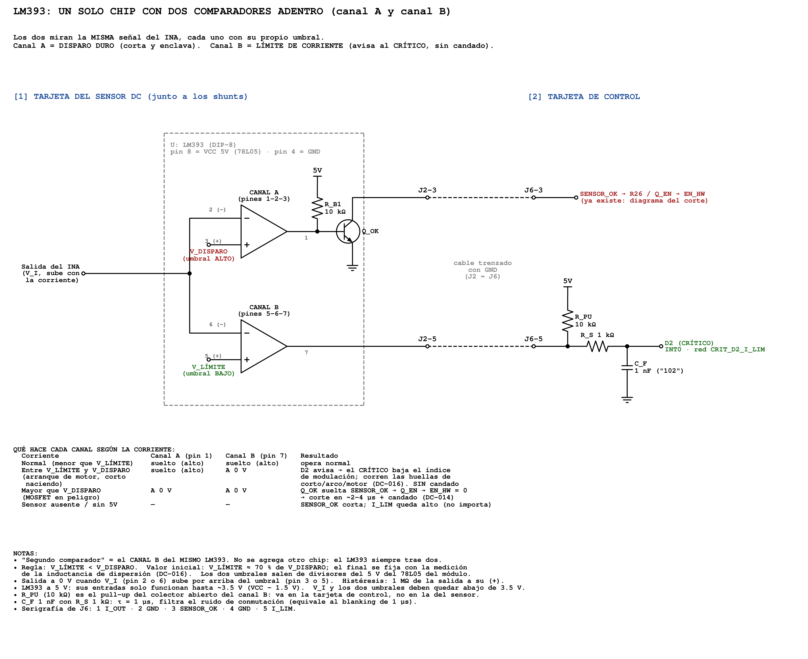

*Cómo trabaja un LM393 por dentro: un solo chip con dos comparadores que miran la misma señal del INA, cada uno con su umbral. En la V0.2 hay dos chips así: U3 (disparo) y U4 (límite).*

**Regla para no equivocarse:** en el canal de **descarga** (A), **el umbral va en el +**; en el canal de **carga** (B), **INA_RC va en el +**. Una salida baja cuando su + queda por debajo de su −.

### 7.4 SENSOR_OK (fail-safe)

```
5V ──[R6 10 kΩ]──┬── FAULT (salidas 1 y 7 de U3)
                 │
                 └── base de Q1 (BC547, pin 2)
                     emisor (pin 3) ── GND
                     colector (pin 1) ── SENSOR_OK (J2-3)
```

- **Sin falla:** U3 suelta FAULT, R6 da ~0.43 mA de base, Q1 satura y **SENSOR_OK ≈ 0.1 V**.
- **Con falla:** U3 jala FAULT a 0 V, Q1 se apaga y **la pull-up de la tarjeta de control sube SENSOR_OK** → corte.
- **Sin 15 V:** R6 se queda sin voltaje, Q1 apagado → corte.

### 7.5 Tiempos

| Etapa | Tiempo aprox. |
| --- | --- |
| *Blanking* (R8/C4) | ~1 µs |
| LM393 | ~0.3–1.3 µs |
| Q1 saliendo de saturación | ~0.2–1 µs |
| Q_EN + 74HC08 (tarjeta de control) | ~0.2–0.5 µs |
| Gate driver + descarga de compuerta | ~0.1–0.5 µs |
| **Total del disparo duro** | **~2–4 µs** (estimado, por medir) |
| Límite: hasta la interrupción de D2 (con R_S/C_F de 1 µs) | ~2–3 µs; el CRÍTICO actúa en el siguiente periodo de la portadora (~42 µs) |

---

## 8. Layout y serigrafía

| Cara de componentes (V0.2, zona de J2 y Q1) | Cara de soldadura (V0.2) |
| --- | --- |
| 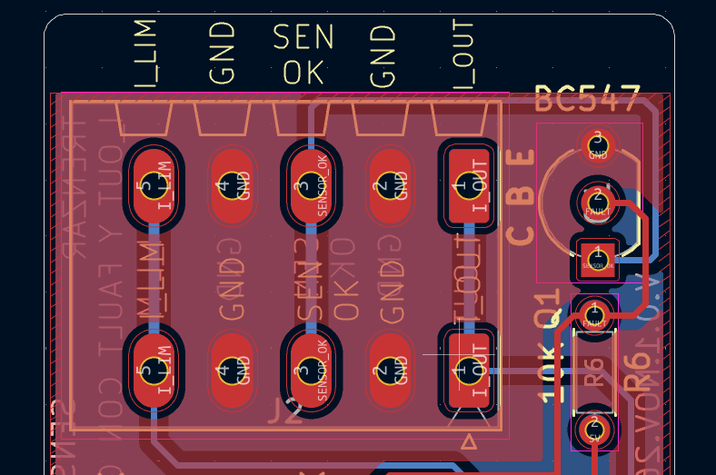 | 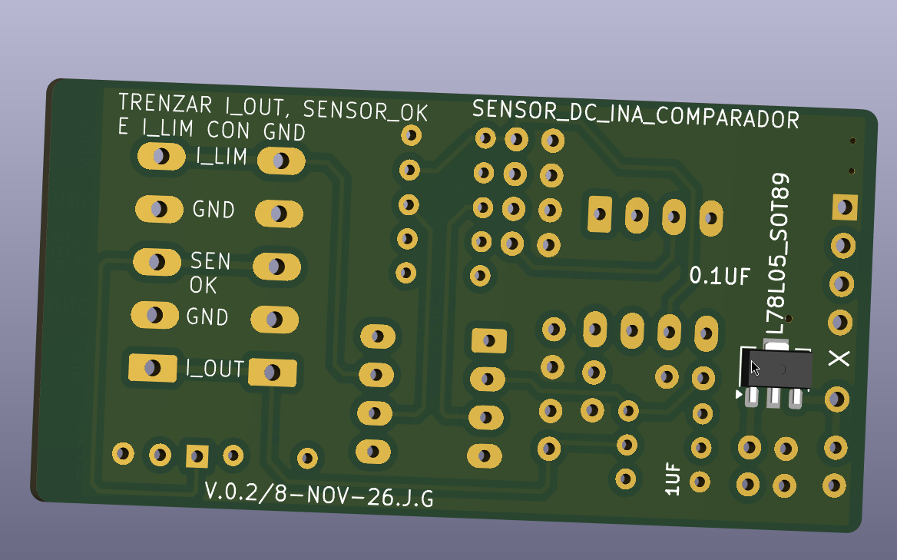 |

| Capa F.Cu | Capa B.Cu |
| --- | --- |
| 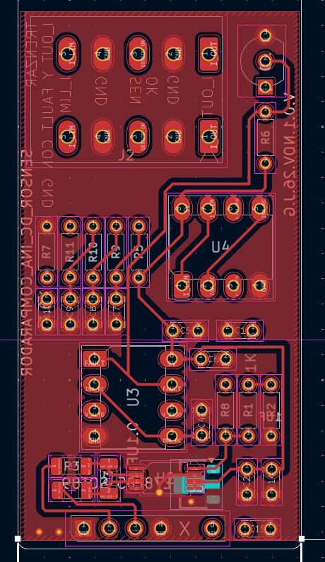 | 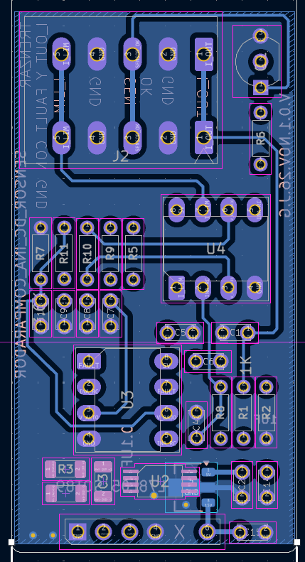 |

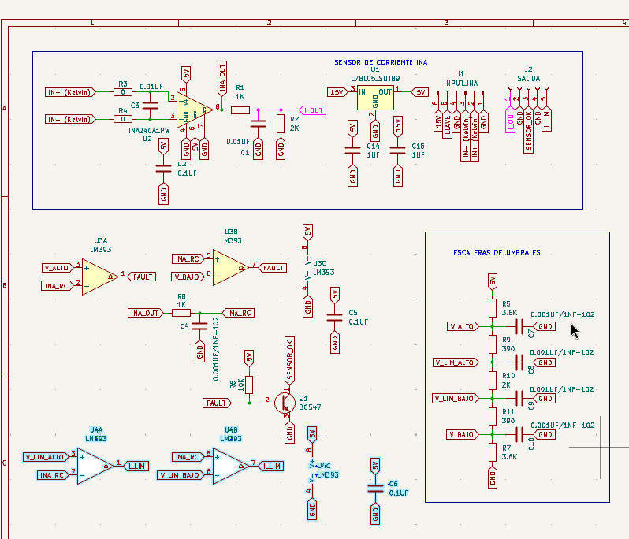

*Esquemático de KiCad V0.2: arriba el INA240A1, el 78L05 y los conectores J1/J2; en medio U3 (disparo), R8/C4 y Q1 con R6; abajo U4 (límite); a la derecha la escalera de umbrales con C7–C10.*

**Lo que se cuidó:**
- **J1 abajo, pegado al shunt; J2 arriba**, hacia la tarjeta de control.
- **IN+ e IN− como par**, encimados en capas opuestas desde J1 hasta R3/R4; C3 pegado al INA240.
- **Q1 y R6 junto a J2-3:** pistas cortas de FAULT a la base y del colector a J2.
- **U4 ruteado sin cruzar la zona del INA**; escalera y capacitores de 1 nF juntos.
- **Planos de GND en las dos caras**, unidos con vías de cosido.
- **J1 sin pad 5 (llave):** el aviso de "huella no coincide con la librería" es esperado. **No usar "Actualizar huellas desde la librería"**: se restaura el pad 5 y se pierde la llave.

**Serigrafía V0.2:**

| Texto | Estado |
| --- | --- |
| J2: I_OUT · GND · SEN OK · GND · I_LIM (las dos caras) | ✅ |
| "TRENZAR I_OUT, SENSOR_OK E I_LIM CON GND" | ✅ |
| "C B E" junto a Q1, "BC547", "10K" | ✅ |
| J1: G · K+ · K− · G · X · 15V | ✅ |
| "SENSOR_DC_INA_COMPARADOR" y "V.0.2/8-NOV-26.J.G" | ✅ |
| "LÍMITE ±75 A" junto a U4 y "DISPARO ±105 A" junto a U3 | ⏳ Sugerido |
| **"CAL: 0.33 mΩ / ±75 / ±105 A"** | ⏳ Sugerido |

### 8.1 Evidencia del proceso: de la V0.1 a la V0.2

Las capturas de KiCad tomadas durante la revisión del 2026-11-08, en orden. Se conservan como evidencia de qué se encontró y cómo se corrigió.

**Paso 1. Esquemático de partida (V0.1).** Una sola ventana (U3) con FAULT directo a J2-3, J2-5 libre y C14 en una red "6V".

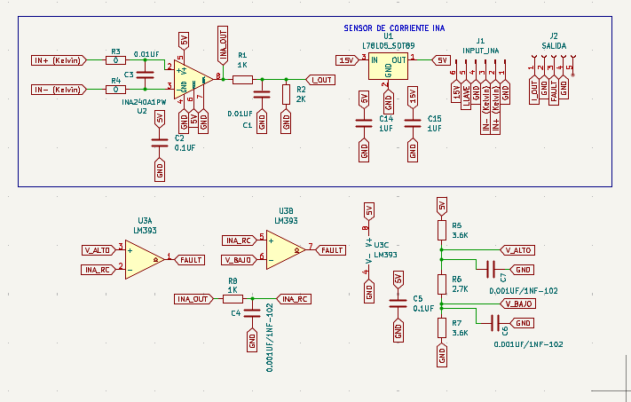

**Paso 2. Primer esquemático con U4, escalera de 5 resistencias y THT.** La revisión encontró **U4A con las entradas invertidas** (+ en INA_RC): I_LIM habría quedado en 0 V todo el tiempo. Todavía sin Q1.

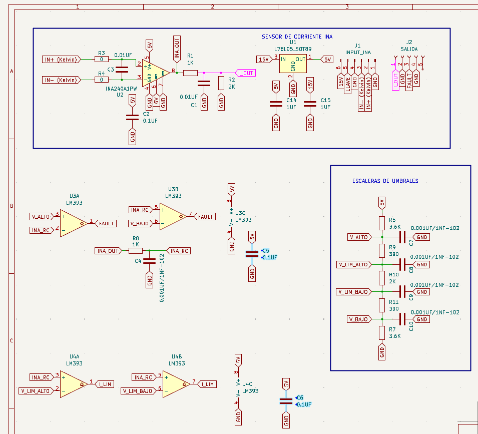

| PCB con THT, todavía sin Q1 | 3D con THT, todavía sin Q1 (J2 con "FAULT" y "NC") |
| --- | --- |
| 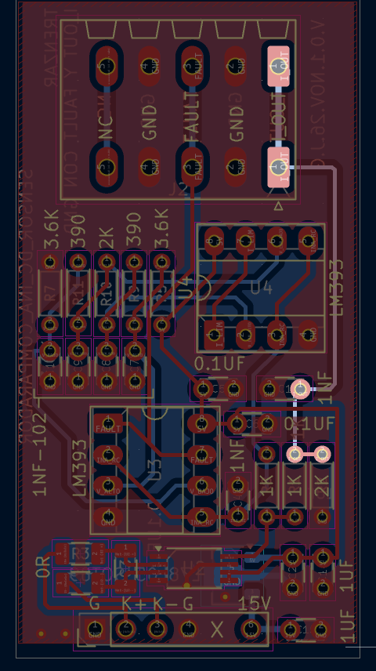 | 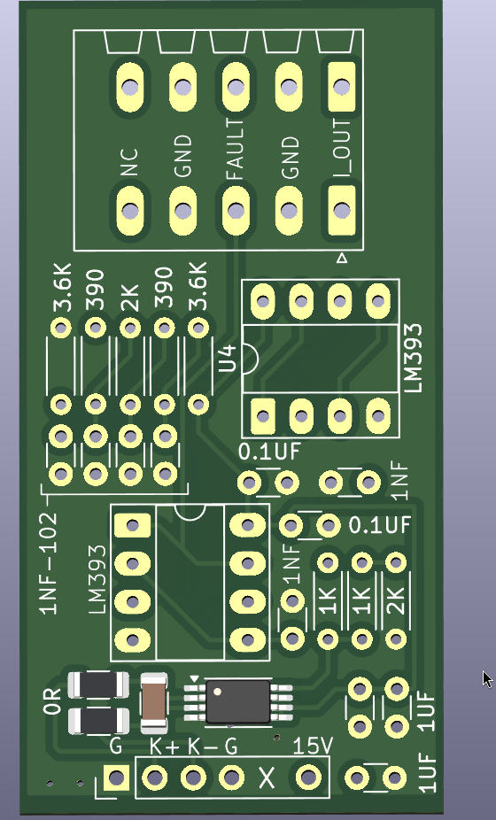 |

**Paso 3. U4A corregido:** + = V_LIM_ALTO, − = INA_RC.

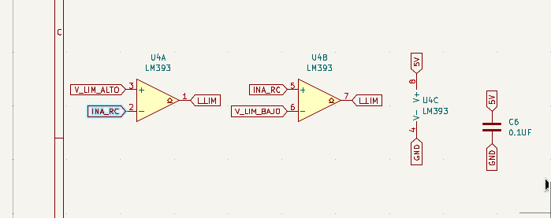

**Paso 4. Q1 (BC547) y R6 agregados.** J2-3 = SENSOR_OK y J2-5 = I_LIM en el esquemático. La serigrafía de J2 todavía tenía los nombres viejos y se corrigió después (sección 8).

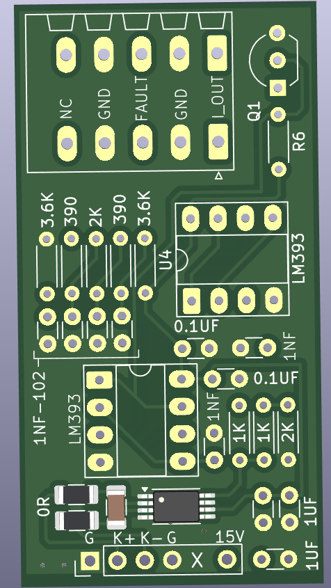

**Paso 5. V0.2 terminada:** las capturas de la sección 8 (J2 y Q1, capas F.Cu y B.Cu, cara inferior con "V.0.2/8-NOV-26.J.G" y esquemático de KiCad).

**Referencia: la V0.1 como estaba en el repositorio**

| Cara de componentes V0.1 | Cara de soldadura V0.1 |
| --- | --- |
| 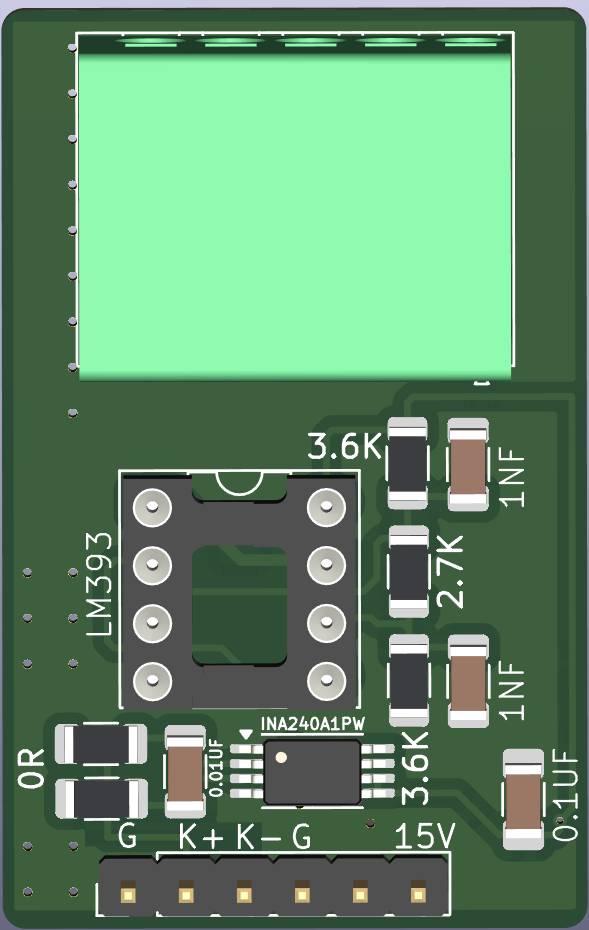 | 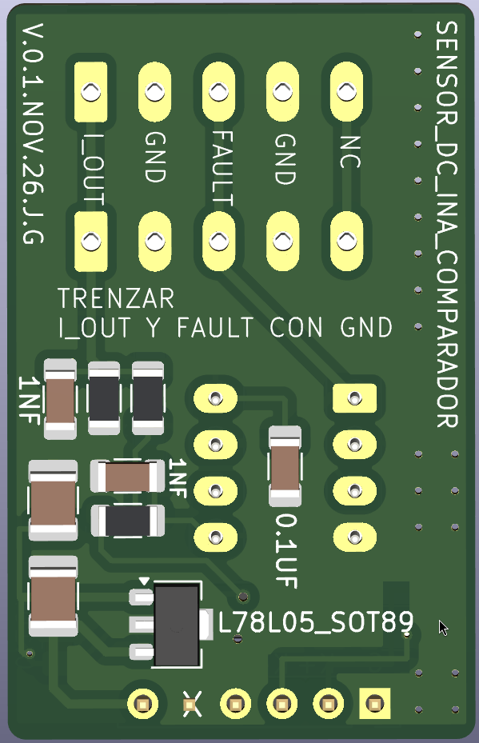 |

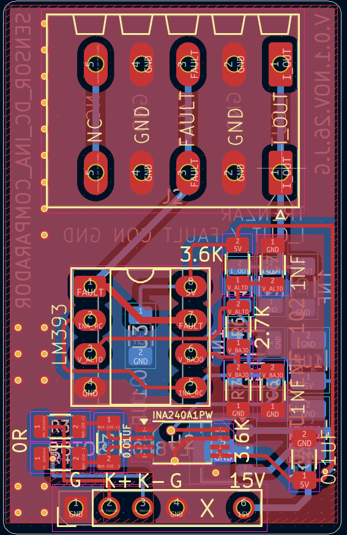

> **Para que las imágenes se vean**, la carpeta `img/` debe estar junto a este README (en GitHub: `hardware/sensores/sensor-dc-ina-comparador/img/`). Para leerlo sin GitHub o imprimirlo: `sensor_dc_v02.pdf`, con todas las imágenes incluidas.

---

## 9. Lista de materiales

| Ref. | Valor / parte | Encapsulado | Función |
| --- | --- | --- | --- |
| U1 | L78L05 | SOT-89 | Regulador de 5 V |
| U2 | **INA240A1PW** (ganancia 20) | TSSOP-8 | Amplificador de corriente bidireccional |
| U3 | **LM393** | DIP-8 | Ventana de **disparo duro** |
| **U4** | **LM393** | DIP-8 | Ventana de **límite** (nuevo) |
| **Q1** | **BC547** | TO-92 | SENSOR_OK (nuevo) |
| R1, R8 | 1 kΩ | THT | Divisor de I_OUT / *blanking* |
| R2 | 2 kΩ | THT | Divisor de I_OUT |
| R3, R4 | 0 Ω (10 Ω con filtro) | SMD | Entrada del INA240 |
| R5, R7 | 3.6 kΩ | THT | Escalera (extremos) |
| **R6** | **10 kΩ** | THT | **Base de Q1** (en la V0.1, R6 era el 2.7 kΩ de la escalera) |
| **R9, R11** | **390 Ω** | THT | Escalera (nuevo) |
| **R10** | **2.0 kΩ** | THT | Escalera (nuevo) |
| C1 | 10 nF | THT | Filtro de I_OUT |
| C2, C5, **C6** | 0.1 µF | THT / SMD | Desacople INA240, U3, **U4** |
| C3 | 10 nF C0G | SMD | Filtro diferencial |
| C4 | 1 nF ("102") | THT | *Blanking* |
| C7, **C8, C9, C10** | 1 nF ("102") | THT | Umbrales V_ALTO, **V_LIM_ALTO, V_LIM_BAJO, V_BAJO** |
| C14, C15 | 1 µF | THT | Salida (5V) y entrada (15V) del 78L05 |
| J1 | Header macho 1 × 6, 2.54 mm, **sin pin 5** | THT | A la tarjeta de potencia |
| J2 | Phoenix SPT 1,5/5-H-3,5 | THT | A J6 de la tarjeta de control |
| *(tarjeta de potencia)* | Littelfuse SSA2512LR001FWR × 3 | 2512 | Shunts del bus DC |

**En la tarjeta de control** (no en este módulo): R26 10 kΩ, R16 10 kΩ, Q_EN BC547 y J_RIESGO para SENSOR_OK; **R_PU 10 kΩ, R_S 1 kΩ y C_F 1 nF** para I_LIM en D2.

---

## 10. Validación en banco

**Prueba rápida al armar** (solo el módulo, 15 V en J1-6, sin corriente en el shunt; pull-ups de prueba de 10 kΩ a 5 V en J2-3 y J2-5):

| # | Medir | Esperado |
| --- | --- | --- |
| 1 | 5V (salida del 78L05) | 4.8–5.2 V |
| 2 | INA_OUT / I_OUT | ~2.5 V / ~1.67 V |
| 3 | V_ALTO · V_LIM_ALTO · V_LIM_BAJO · V_BAJO | 3.20 · 3.00 · 2.00 · 1.80 V (±2 %) |
| 4 | FAULT (base de Q1) | ~0.7 V |
| 5 | **J2-3 SENSOR_OK** | **< 0.2 V** |
| 6 | **J2-5 I_LIM** | **~5 V** (si da 0 V: revisar las entradas de U4A) |
| 7 | Quitar los 15 V | J2-3 sube a ~5 V (corte) |

**Pruebas de función:**

| # | Prueba | Esperado |
| --- | --- | --- |
| 1 | **Ganancia y signo:** 5, 10 y 20 A por el shunt, en los dos sentidos, contra una pinza de referencia | I_OUT según la fórmula; positivo = descarga |
| 2 | **Límite sin potencia:** inyectar voltaje en INA_RC (a través de R8, con el INA240 sin alimentar o desconectado) | I_LIM cae en ~3.00 V y en ~2.00 V |
| 3 | **Disparo sin potencia:** igual, subiendo más | SENSOR_OK sube en ~3.20 V y en ~1.80 V |
| 4 | **Presencia:** desconectar J2 con la tarjeta de control encendida | El inversor no arranca (EN_HW < 0.3 V) |
| 5 | **Disparo real a bajo voltaje:** bus de 12–24 V, fuente con límite, sobrecorriente controlada | Del cruce del umbral al apagado de las compuertas: **< 3–4 µs** (osciloscopio) |
| 6 | **Prueba de mantenimiento (Q1 y U3):** puentear FAULT a GND con el equipo encendido a bajo voltaje | **SENSOR_OK debe subir y el inversor cortar.** Si no corta: Q1 en corto o U3 dañado. **No operar hasta corregir** |
| 7 | **Ruido de conmutación:** inversor operando, ver INA_RC e I_LIM en el osciloscopio | Sin flancos falsos en I_LIM. Si los hay: filtro de entrada (R3 = R4 = 10 Ω, C3 = 10 nF) o histéresis de 1 MΩ de cada salida de U4 a su + |

---

## 11. Bitácora

| Fecha | Qué se hizo | Resultado | Siguiente paso |
| --- | --- | --- | --- |
| 2026-11-04 | Definición del módulo (INA240 + LM393 en ventana), interfaz J1/J2, esquemático y layout | Medición y protección validadas en esquemático | Serigrafía, DRC final |
| 2026-11-04 | Shunts definidos: Littelfuse SSA2512LR001FWR (1 mΩ, 6 W), configuraciones de 1, 2 y 3 piezas | — | Validar en banco |
| 2026-11-08 | **SENSOR_OK fail-safe:** Q1 BC547 + R6 10 kΩ; J2-3 deja de ser FAULT (DC-014) | Sin módulo, sin 15 V o con el cable roto, el inversor no arranca | — |
| 2026-11-08 | **U4 (segundo LM393) para el límite ±75 A**, escalera de 5 resistencias, J2-5 = I_LIM (DC-016) | Disparo ±105 A y límite ±75 A con los 3 shunts de diseño | — |
| 2026-11-08 | Revisión antes de fabricar: U4A con entradas invertidas, Q1 faltante, C14 en "6V" | Corregidos. ERC/DRC sin errores | Fabricar V0.2 |
| 2026-11-08 | Resistencias y capacitores a THT; serigrafía V.0.2/8-NOV-26.J.G | Listo para Gerbers | Validación en banco (sección 10) |
| 2026-11-08 | Archivos de KiCad V0.2 en el repositorio; verificación de redes en la PCB: U3 (1/7 FAULT, 3 V_ALTO, 6 V_BAJO), U4 (1/7 I_LIM, 3 V_LIM_ALTO, 6 V_LIM_BAJO), Q1 (1 SENSOR_OK, 2 FAULT, 3 GND), J2 (1 I_OUT · 3 SENSOR_OK · 5 I_LIM), C14 en 5V | Coinciden con el diseño | Fabricar |

---

## 12. Referencias

1. Texas Instruments, *INA240* (SBOS662): amplificador de corriente bidireccional, −4 V a 80 V, rechazo mejorado al PWM.
2. Texas Instruments, *LM393 Dual Differential Comparator*: salida de colector abierto, rango de modo común hasta VCC − 1.5 V, salida correcta mientras una entrada esté dentro del rango; respuesta ~1.3 µs. <https://www.ti.com/lit/ds/symlink/lm393.pdf>
3. onsemi, *BC546B, BC547A/B/C, BC548B/C* (BC546-D): hFE mínimo 110, V<sub>CE(sat)</sub>, orden de patas TO-92 (1 = C, 2 = B, 3 = E). <https://www.onsemi.com/pdf/datasheet/bc546-d.pdf>
4. STMicroelectronics, *L78L05*.
5. Littelfuse, *SSA Series* (shunts de lámina metálica). <https://www.mouser.com/datasheet/2/240/media-3323775.pdf>
6. BEAMA, *AFDD FAQ fact sheet*: tiempos de IEC 62606 y criterio de ~100 J. <https://www.beama.org.uk/static/84330bcd-90bc-4fe3-87df9d092ec14b89/BEAMA-ARC-FAULT-DETECTION-AFDD-FAQ-Fact-Sheet.pdf>
7. Documentos del proyecto: [decisiones críticas](../../../docs/decisiones_criticas.md) (DC-014, DC-016) · [corte por hardware](../../../docs/corte_por_hardware.md) · [sensado de corriente](../../../docs/sensado_corriente.md).
