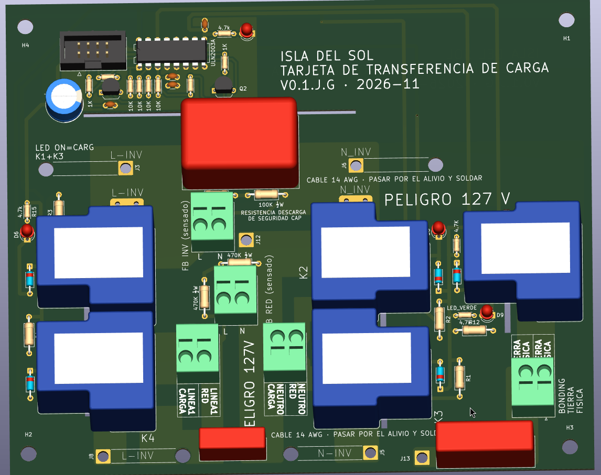
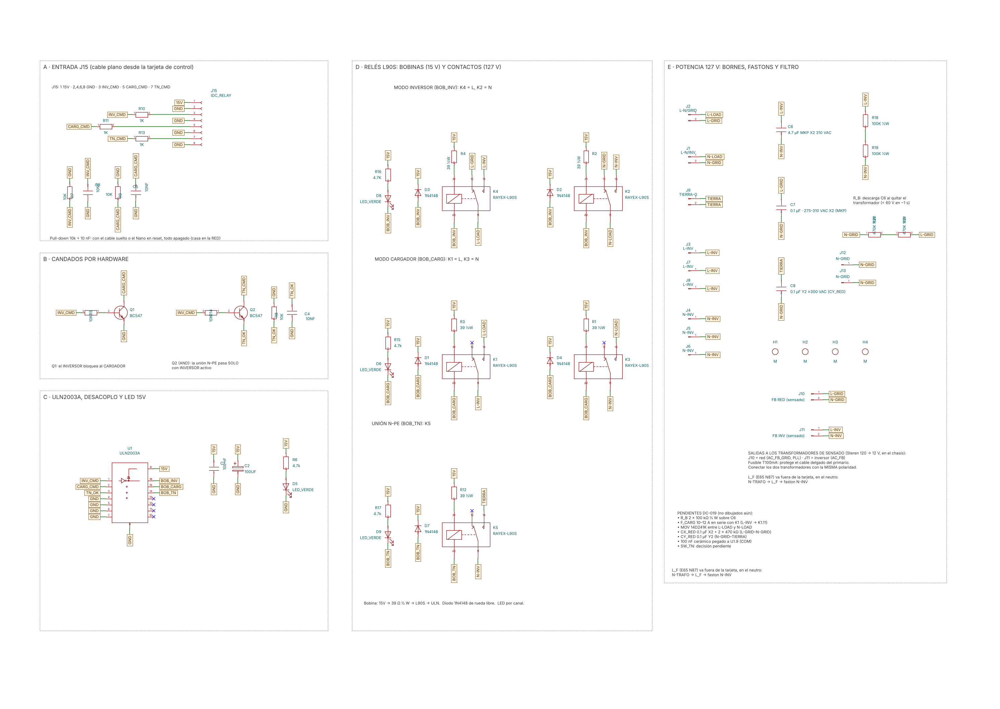
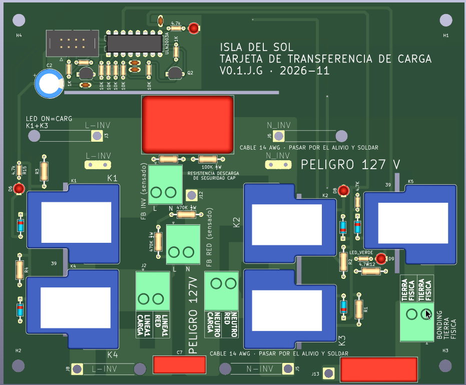
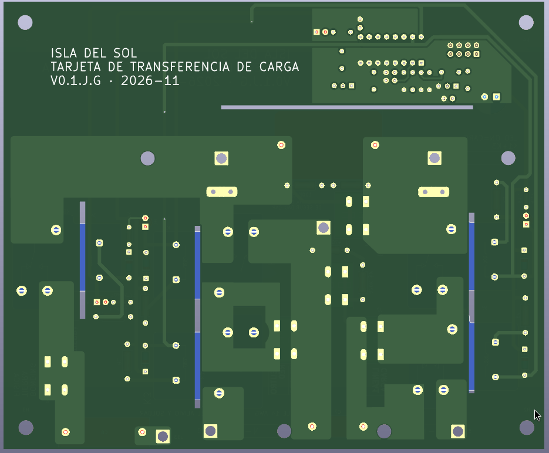
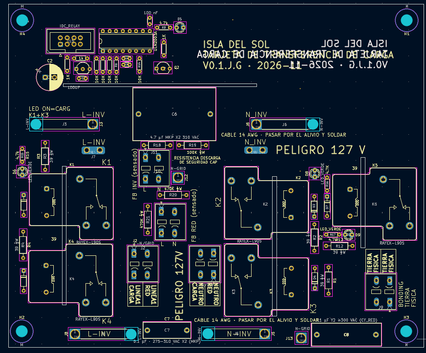
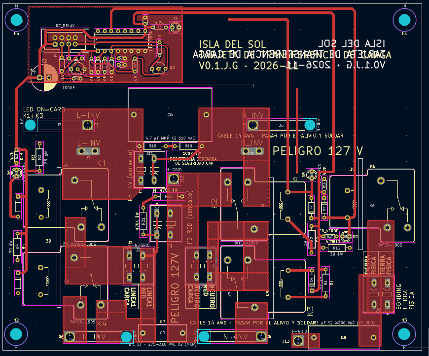
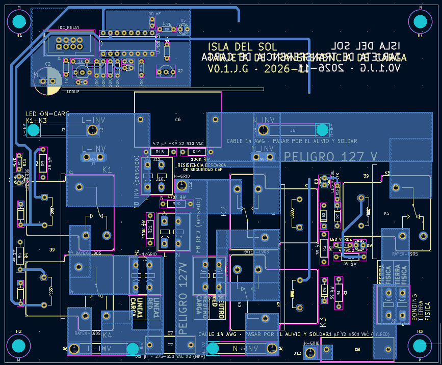

# Tarjeta de transferencia de carga V0.1: 5 relés (red · inversor · cargador)

Tarjeta de potencia de 127 V que decide **de dónde se alimenta la casa**: de la **red** o del **inversor**. También conecta el **transformador a la red para cargar la batería** y hace la **unión neutro–tierra (N–PE)** cuando el inversor es la fuente principal.

Recibe tres órdenes de la tarjeta de control por un cable plano IDC de 8 hilos (J15) y no tiene microcontrolador propio. **Si se va la energía de 15 V, se suelta el cable o el microcontrolador de la tarjeta de control está en reset, todos los relés se sueltan y la casa queda en la red** (falla segura).

> ⚠️ **127 V AC en bornes, pistas y contactos de relé: pueden ser mortales.** Prototipo en desarrollo, no certificado. La decisión de diseño completa está en [DC-019](../../docs/decisiones_criticas.md) y el estudio de referencia industrial en [OutBack FX](../../docs/referencia_outback_fx.md).

*Render 3D de KiCad 9, V0.1. Arriba, la lógica de 15 V (J15, ULN2003A, Q1/Q2) y el título; abajo, los 5 relés, los bornes de 127 V y los capacitores X2/Y2. El modelo de los relés es aproximado (`3d/`).*

---

## 0. Por qué la Isla del Sol necesita esta tarjeta

La Isla del Sol es **inversor y cargador a la vez**: el mismo puente H y el **mismo transformador** sacan 127 V de la batería cuando no hay red, y la cargan desde la **red eléctrica pública** (o un generador) cuando sí hay. Ese doble papel deja tres preguntas que el puente H no puede contestar por sí solo y que esta tarjeta resuelve **con hardware**:

**1. ¿De dónde se alimenta la casa, y cómo se garantiza que nunca sea de las dos fuentes a la vez?**
Si la salida del inversor queda en paralelo con la red, aunque sea un instante:
- la red eléctrica alimenta de reversa al transformador y al puente H y lo destruye (son dos fuentes de 127 V que no están sincronizadas);
- con la red caída, el inversor **energiza la acometida**: 127 V en las líneas de la red eléctrica, donde puede haber un liniero trabajando.

Por eso la transferencia la hace un **conmutador de 2 polos y 2 tiros** (K4 + K2): el mismo contacto que conecta la casa a una fuente la desconecta de la otra. **Ni siquiera un relé soldado forma el paralelo** (análisis de falla en [DC-019](../../docs/decisiones_criticas.md)). Es el principio del equipo de transferencia de los sistemas de respaldo (NOM-001-SEDE-2012 de México, art. 702; equivalente al artículo 702 del NEC de EE. UU.).

**2. ¿Cómo se conecta el transformador a la red para cargar la batería, sin que la casa se quede sin luz?**
En modo cargador, K1 + K3 conectan el transformador al **nodo de la casa**, que sigue en la red por los contactos NC. La casa nunca se queda sin luz mientras se carga, y el candado Q1 impide que "cargar" e "invertir" se pidan al mismo tiempo.

**3. ¿Quién hace la unión neutro–tierra cuando el inversor alimenta la casa?**
Al conmutar también el neutro, el inversor se vuelve un **sistema derivado separadamente**. Necesita su propia unión N–PE (NOM-001-SEDE-2012, 250-30; NEC 250.30), pero **solo** cuando es la fuente: con la red, la unión es la de la acometida, y una segunda unión haría circular corriente por la tierra. K5 la hace de forma automática según el modo del SETUP (sección 4.1). El OutBack FX, la referencia industrial, deja esa decisión al instalador ([estudio](../../docs/referencia_outback_fx.md)).

**Y además, por diseño de la Isla del Sol:**
- **Los 127 V fuera de la tarjeta de control** ([DC-015](../../docs/decisiones_criticas.md)). El microcontrolador, el LCD y los botones solo ven 15 V y un cable plano. Toda la parte de 127 V vive aquí, con 5 mm de separación y ranuras de aislamiento.
- **Falla segura:** sin 15 V, con el cable suelto o con el microcontrolador en reset, la casa queda **en la red**. Si el inversor se apaga por cualquier causa, la casa no se queda a oscuras si hay red.
- **Reparable en la trinchera:** relés de 30 A tipo T90, ULN2003, BC547, 1N4148 y resistencias de agujero pasado. Todo se consigue en una tienda de electrónica local, se cambia con un cautín y está documentado pieza por pieza.

**Dónde se usa:**

| Instalación | Modo normal | Qué hace la tarjeta |
| --- | --- | --- |
| Casa con red inestable (respaldo) | Red | Al fallar la red pasa a inversor (modo CARGA/UPS o CASA); al volver, regresa a la red y carga la batería |
| Sitio aislado con generador | Inversor (CASA) | El generador entra como "red" para cargar la batería y alimentar la casa mientras tanto |
| Solar como fuente principal, red de respaldo | Inversor (CASA) | Usa primero el sol y la batería; la red solo para cargar o cuando la batería se agota |

## 1. Características

| Parámetro | Valor |
| --- | --- |
| Voltaje | 127 V AC / 60 Hz (fase, neutro y tierra física) |
| Corriente de diseño | **10 A RMS continuos** (1270 VA) |
| Relés | 5 × SPDT de 30 A NO / 20 A NC, familia T90. **Bobina de 15 V** (p. ej. Picker PTRH-1C-15S) o Rayex L90S de 12 V con 39 Ω (sección 12) |
| Conmuta | **Fase y neutro** (los dos polos), en transferencia y en cargador |
| Mando | ULN2003A desde 15 V; 3 canales: INV, CARG, TN |
| Candados por hardware | Q1: el inversor bloquea al cargador · Q2: la unión N–PE solo con inversor activo |
| Filtro | C_F 4.7 µF X2 del lado del transformador · CX_RED 0.1 µF X2 + CY_RED 0.1 µF Y2 del lado de la red |
| Versión | **V0.1** (2026-11). En la serigrafía: "ISLA DEL SOL · TARJETA DE TRANSFERENCIA DE CARGA · V0.1.J.G · 2026-11" |
| Placa | 158.4 × 131.1 mm, 2 capas, **1 oz**, 4 barrenos de montaje Ø4.3 mm, **4 ranuras de aislamiento** |
| Separaciones | **≥ 5 mm** de 127 V a lógica · **≥ 3 mm** entre redes de 127 V (verificado con script, secciones 9 y 10) |

## 2. Archivos

| Archivo | Qué es |
| --- | --- |
| `RELAY_TRANSFER_INV_RED.kicad_pro` | Proyecto de KiCad 9 (incluye las exclusiones del DRC: serigrafía sobre las ranuras y las 3 islas unidas por cable) |
| `RELAY_TRANSFER_INV_RED.kicad_sch` | Esquemático, en 5 bloques sobre A3 |
| `RELAY_TRANSFER_INV_RED.kicad_pcb` | Layout |
| `RELAY_TRANSFER_INV_RED.kicad_dru` | **Reglas de separación** de 5 mm y 3 mm para el DRC de KiCad (sección 10). Va en la misma carpeta que el proyecto |
| `auditoria/` | Auditoría térmica a 10 A: script, mapas e informe ([README](auditoria/README.md)) |
| `3d/` | **Modelo 3D aproximado del relé** (`Relay_SPDT_RAYEX-L90S_aprox.step`) y el script que lo genera (CadQuery). KiCad no trae el modelo oficial de esta huella; los relés lo usan con la ruta `${KIPRJMOD}/3d/...` |
| `img/` | Imágenes de este documento |

---

## 3. Cómo funciona

### 3.1 Los relés

Hay dos pares de relés iguales, uno para la **fase (L)** y otro para el **neutro (N)**, más el relé de la unión N–PE.

| Relé | Polo | Función | COM (11) | NC (12), en reposo | NO (14), energizado |
| --- | --- | --- | --- | --- | --- |
| **K4** (K_L2) | L | Transferencia | L-LOAD (casa) | **L-GRID** (red) | L-INV (transformador) |
| **K2** | N | Transferencia | N-LOAD | **N-GRID** | N-INV |
| **K1** (K_L3) | L | Cargador | L-INV | sin conectar | L-LOAD |
| **K3** | N | Cargador | N-INV | sin conectar | N-LOAD |
| **K5** (RL_TN) | N–PE | Unión neutro–tierra | N-INV | sin conectar | TIERRA |

K4 y K2 forman un **conmutador de 2 polos y 2 tiros**: la casa nunca puede tener la red y el inversor al mismo tiempo, porque es el mismo contacto el que cambia de lado.

### 3.2 Los tres canales y los modos

| Canal (salida del ULN2003) | Orden en J15 | Bobinas | LED |
| --- | --- | --- | --- |
| **INV** (AISLAR RED), salida 16 | J15-3 | K4 + K2 | D8 |
| **CARG** (TRAFO), salida 15 | J15-5 | K1 + K3 | D6 |
| **TN**, salida 14 | J15-7, **pasando por Q2** | K5 | D9 |

| Modo | INV | CARG | TN | La casa queda en | El transformador |
| --- | --- | --- | --- | --- | --- |
| **Red** (también: sin 15 V, cable suelto, microcontrolador en reset) | 0 | 0 | 0 | Red | Aislado |
| **Inversor CASA** (fuente principal) | 1 | 0 | 1 | Inversor, **con unión N–PE** (K5) | Alimenta la casa |
| **Inversor CARGA** (UPS de cargas críticas) | 1 | 0 | 0 | Inversor, **sin unión N–PE** | Alimenta las cargas |
| **Cargador** | 0 | 1 | 0 | Red | Conectado a la red por el nodo de la casa |

INV y CARG al mismo tiempo **no existe**: Q1 lo impide (sección 4).

---

## 4. Candados por hardware

*Vista previa aproximada del esquemático, dibujada desde el `.kicad_sch`. Bloques: A · entrada J15, B · candados, C · ULN2003 y LED de 15 V, D · relés, E · potencia de 127 V.*

| Candado | Cómo | Qué evita |
| --- | --- | --- |
| **Pulldowns de 10 kΩ + 10 nF** en INV_CMD, CARG_CMD y TN_OK (R7, R9, R8 y C3, C5, C4) | Con la entrada al aire, el ULN2003 queda apagado | Cable suelto, microcontrolador en reset o pin flotante → la casa queda en la red |
| **Q1** (BC547): base desde INV_CMD por R5 (10 kΩ); colector en CARG_CMD; emisor a GND | Si llega INV, Q1 jala CARG_CMD a 0 V. R11 (1 kΩ) limita la corriente si el microcontrolador manda CARG al mismo tiempo | Inversor y cargador a la vez: el transformador en paralelo con la red mientras alimenta la casa |
| **Q2** (BC547) en seguidor de emisor: colector ← TN_CMD por R13 (1 kΩ); base ← INV_CMD por R14 (10 kΩ); emisor → TN_OK | TN solo llega al ULN si INV también está activo (compuerta AND) | Una **doble unión N–PE** con la de la acometida de la red eléctrica: en modo red o cargador, K2 todavía une N-LOAD con N-GRID |
| **Entradas 4–7 del ULN2003 a GND** | Canales sin uso apagados | Ruido que encienda una salida libre |

Todas las órdenes entran por **1 kΩ en serie** (R10, R11, R13) para proteger los pines del microcontrolador si el cable se pela contra 15 V.

### 4.1 Unión N–PE: automática según el modo que elige el instalador

**La unión N–PE se hace sola.** El instalador (trinchero) solo elige **una vez**, en el menú del SETUP, cómo trabaja el inversor. Desde ahí, el microcontrolador de la tarjeta de control manda o no la orden TN cada vez que pasa a inversor:

| Modo en el SETUP | Uso | Al pasar a inversor | K5 |
| --- | --- | --- | --- |
| **INVERSOR CASA** (fuente principal de la vivienda) | El inversor alimenta el tablero de la casa o del sitio aislado | El microcontrolador manda **TN = 1** junto con INV | **Cierra:** une N-INV con TIERRA (sistema derivado separadamente, NOM 250-30) |
| **INVERSOR CARGA** (UPS) | El inversor respalda cargas críticas derivadas de un circuito de la red | El microcontrolador manda **TN = 0** | Abierto: salida flotante; la unión es la de la acometida de la red eléctrica |
| Red o cargador (cualquier modo) | — | — | **Abierto siempre:** Q2 bloquea TN sin INV |

**El criterio del trinchero está en elegir bien el modo**, según cómo se va a instalar. Por eso tiene que saber de puesta a tierra: CASA solo si el equipo es la fuente principal y **no hay otra unión aguas abajo**; CARGA para un UPS que alimenta contactos o circuitos dedicados.

**Variante para un sitio aislado sin red:** se puede dejar **K5 sin poblar** y hacer una sola unión N–PE fija en el tablero. El menú se deja en CARGA, para que el microcontrolador nunca mande TN.

**Reglas:**
- **Una sola unión N–PE por sistema.** Modo CASA nunca con otra unión en el tablero; unión manual nunca con K5 poblado en modo CASA.
- **Con red conectada nunca hay doble unión:** en modo red o cargador, K2 deja el neutro de la casa en la red y Q2 bloquea a K5.
- **El modo CARGA depende del firmware.** Protecciones: de fábrica en CARGA (TN = 0); si falla el CRC de la EEPROM, regresa a CARGA; cambiar de modo solo con el inversor en espera y confirmando dos veces. **El LED D9** muestra si K5 tiene la orden.
- **Verifícalo con el multímetro** al instalar. Con el inversor alimentando y la red desconectada, mide **voltaje AC** entre N-LOAD (J1-1) y TIERRA (J9):
  - **CASA o unión manual:** ~0 V.
  - **CARGA (flotante):** un voltaje que varía. Puede marcar decenas de volts por acoplamiento capacitivo del transformador; eso es normal en una salida flotante.
  - Además, entre la fase (J2-1) y TIERRA debe haber ~127 V en CASA.

## 5. LEDs de diagnóstico (lado de 15 V)

| LED | Indica | Resistencia | Corriente |
| --- | --- | --- | --- |
| D5 | La tarjeta recibe 15 V por J15-1 | R6 4.7 kΩ | ~2.7 mA |
| D8 | Canal **INV**: bobinas de K4 + K2 con orden | R16 4.7 kΩ | ~2.6 mA |
| D6 | Canal **CARG**: K1 + K3 ("LED ON = CARG") | R15 4.7 kΩ | ~2.6 mA |
| D9 | Canal **TN**: K5 (unión N–PE) | R17 4.7 kΩ | ~2.6 mA |

**El LED dice que la bobina recibe la orden, no que el contacto cerró.** Con una bobina abierta enciende igual. Para confirmar el contacto, usa la prueba con multímetro (sección 14) o la corriente del inversor en el LCD.

**Diagnóstico del cable J15:**
- **15V apagado:** no llega energía (cable o fuente de 15 V), y todo queda en la red.
- **LED de canal apagado** aunque el LCD diga que hay orden: J15-3, -5 o -7 abierto.
- **LED encendido sin orden:** una línea pelada contra 15 V. **Revisa el cable de inmediato.**
- **Parpadeo:** GND flojo o IDC mal prensado.

---

## 6. Conectores

### 6.1 J15: cable plano desde la tarjeta de control (IDC 2×4, paso 2.54 mm)

| Pin | Señal | Pin | Señal |
| --- | --- | --- | --- |
| 1 | **15 V** | 2 | GND |
| 3 | INV (AISLAR RED) → R10 1 kΩ | 4 | GND |
| 5 | CARG (TRAFO) → R11 1 kΩ | 6 | GND |
| 7 | TN (orden de unión N–PE) → R13 1 kΩ | 8 | GND |

Cada señal va **entre dos tierras**, así el cable plano queda blindado entre hilos.

### 6.2 Potencia de 127 V

| Ref. | Tipo | Pines | Va a |
| --- | --- | --- | --- |
| **J2** | Phoenix SPT 2.5, 2 polos | 1 = L-LOAD · 2 = L-GRID | Fase: casa / red |
| **J1** | Phoenix SPT 2.5, 2 polos | 1 = N-LOAD · 2 = N-GRID | Neutro: casa / red |
| **J7** | Faston 6.3 mm (63823) | L-INV | Fase del transformador |
| **J4** | Faston 6.3 mm (63823) | N-INV | Neutro del transformador (después de L_F) |
| **J9** | Phoenix SPT 2.5, 2 polos | TIERRA / TIERRA | Tierra física: entra y sale (PE pasante) |

### 6.3 Puentes de cable (soldados, 14 AWG de 600 V)

La zona de 127 V no cabe en dos capas sin cruzar redes, así que tres redes se dividen en dos islas de cobre **unidas por cable**. Las tres son **a propósito**: el DRC y el script de revisión las marcan como islas.

| Red | Puente | Une |
| --- | --- | --- |
| L-INV | **J3 ↔ J8** | Faston J7 con el NO de K4 |
| N-INV | **J6 ↔ J5** | Faston J4 con el COM de K3 |
| N-GRID | **J12 ↔ J13** | La red con C8 (CY_RED) |

Las huellas J3, J5, J6 y J8 tienen **alivio de esfuerzo** (el cable pasa por un barreno y luego se suelda). En la serigrafía dice: *"CABLE 14 AWG · PASAR POR EL ALIVIO Y SOLDAR"*.
- El cable pasa **por encima de la zona de 127 V**, nunca sobre la lógica.
- Si cruza sobre la bobina de un relé, ponle **termocontráctil** encima del aislamiento (doble aislamiento).

### 6.4 Salidas a los transformadores de sensado

| Ref. | Pines | Para |
| --- | --- | --- |
| **J10** "FB RED" | 1 = L-GRID · 2 = N-GRID | Transformador 120 → 12 V de la red: AC_FB_GRID y PLL |
| **J11** "FB INV" | 1 = L-INV · 2 = N-INV | Transformador del inversor: AC_FB |

- Transformadores chicos de 500 mA (tipo Steren), **montados en el chasis**.
- **Fusible en línea 5×20 mm T100 mA 250 V en el cable del VIVO, pegado a J10/J11.** Usa portafusibles de 250 V, no de auto.
- Sin fusible el sensado funciona, pero el cable delgado queda sin protección.
- Conecta los dos transformadores con la **misma polaridad**: el PLL compara fases.

---

## 7. Filtro, descarga y unión N–PE

| Ref. | Valor | Entre | Para qué |
| --- | --- | --- | --- |
| **C6** (C_F) | 4.7 µF MKP **X2** 310 VAC | L-INV – N-INV | Con los ~2 mH del transformador + L_F forma el filtro LC de salida (f₀ ≈ 1.64 kHz, quita los 24 kHz). Siempre del lado del transformador, antes de los relés |
| **R18 + R19** (R_B) | 2 × 100 kΩ ½ W en serie | En paralelo con C6 | **Descarga de seguridad:** C6 baja a < 60 V en ~1 s si se desconecta el transformador. ~40 mW cada una |
| **C7** (CX_RED) | 0.1 µF MKP **X2** 275–310 VAC | L-GRID – N-GRID | EMI diferencial de la red (como el CX del OutBack FX) |
| **R20 + R21** | 2 × 470 kΩ ½ W en serie | En paralelo con C7 | Que los bornes de la red no queden cargados al desconectar. ~9 mW cada una |
| **C8** (CY_RED) | 0.1 µF **Y2** ≥ 300 VAC | N-GRID – TIERRA | EMI de alta frecuencia a tierra. Clase **Y2** porque falla abierto. Nunca X2 |
| **K5** (RL_TN) | Relé | N-INV – TIERRA | **Unión N–PE** en modo Inversor CASA (sistema derivado separadamente, NOM-001-SEDE-2012 250-30) |

**Prohibido:**
- un capacitor Y en un vivo (0.1 µF a 127 V son ~4.8 mA de fuga permanente);
- cualquier capacitor entre N-INV y PE, porque en modo Inversor CARGA "amarraría" a tierra la salida flotante.

**L_F** (inductor E65 N87) **va fuera de la tarjeta**, en el chasis, en serie con el neutro: N-TRAFO → L_F → Faston J4.

---

## 8. Layout

- **Zona de 127 V** (abajo y al centro) y **lógica de 15 V** (arriba a la izquierda), separadas por una **ranura horizontal** y con más de 5 mm de cobre a cobre.
- **4 ranuras** de 1.1–1.6 mm (en X 58, X 138 y X 172, y en Y 50.7) bajo los relés y entre zonas: alargan la distancia de fuga. El cuerpo de los relés queda encima de ellas, y el DRC lo marca como **solapamiento de courtyard**, que se excluye a propósito.
- **Zonas de 127 V con separación de 3 mm** en su configuración. La zona GND de la lógica va a 0.5 mm, y la regla de 5 mm hacia la parte de potencia la aplica `RELAY_TRANSFER_INV_RED.kicad_dru`.
- **Pistas de lógica:** **1.0 mm** para 15 V, GND, bobinas (BOB_*) y K*-A1; **0.5 mm** para las señales. Esquinas a 45°.
- **Serigrafía de advertencia:** "PELIGRO 127 V", nombres de cada borne, "BONDING TIERRA FÍSICA" en K5 y la nota de la resistencia de descarga.

### 8.1 Vistas

*Vista superior en 3D de la V0.1: título y versión en la serigrafía, arriba a la derecha (zona de 15 V). K1/K4 (fase), K2/K3 (neutro), K5 (unión N–PE); bornes Phoenix y puntos para soldar cable. El modelo de los relés es aproximado (`3d/`).*

*Cara de soldadura: título también en la serigrafía inferior, zonas de cobre de 127 V separadas, las **4 ranuras de aislamiento** (en azul) y los puntos para soldar los puentes de cable 14 AWG.*

### 8.2 Capas en el editor

*Serigrafía, contornos y pads de todas las capas.*

*F.Cu: zonas de 127 V con 3 mm entre redes; pistas de lógica de 1.0 mm (15 V, GND, bobinas) y 0.5 mm (señales).*

*B.Cu: las mismas zonas de potencia en la segunda cara (unidas por los pines THT) y el retorno de las bobinas BOB_INV / BOB_CARG por el borde izquierdo.*

## 9. Separaciones verificadas

Medidas con `pcbcheck.py`, que mide cobre contra cobre en cada capa (pads, pistas y zonas rellenas), sobre la versión final del 2026-11-11:

| Regla | Mínimo pedido | Lo más justo en la placa |
| --- | --- | --- |
| 127 V ↔ lógica de 15 V | 5 mm | **5.11 mm** (D8 contra la zona N-INV) |
| Entre redes de 127 V | 3 mm | **3.00 mm** (zona N-LOAD contra el pin NC de K3) · 3.13 mm (J10 contra N-GRID) |
| Puntos medios de los divisores (R18/R19, R20/R21) contra otra red de 127 V | 3 mm | 3.45 mm |
| Lógica contra lógica | 0.2 mm (KiCad) | 0.3 mm (CARG_CMD contra el pad R8.2) |
| Cobre contra ranura | 0.3 mm (fabricación) | 0.5 mm |

Los **contactos NC sin conectar** de K1, K3 y K5 se tratan como 127 V: en reposo tocan su COM.

## 10. Reglas de DRC

`RELAY_TRANSFER_INV_RED.kicad_dru` (cópialo junto al proyecto o pégalo en *Configuración de la placa → Reglas personalizadas*):
- **"Potencia a lógica 5 mm":** cualquier red `L-*`, `N-*`, `TIERRA`, `unconnected-(K*` o punto medio de los divisores, contra cualquier otra que no lo sea.
- **"Potencia entre redes 3 mm":** entre dos redes de potencia distintas.

El DRC final solo marca: **courtyard de los relés sobre las ranuras** (intencional) y **serigrafía encimada en conectores** (cosmético).

---

## 11. Temperatura a 10 A

Resumen de la [auditoría térmica](auditoria/README.md):

| Modo | Solo cobre | Cobre + relés |
| --- | --- | --- |
| Red → casa | +8.3 °C | +21.6 °C |
| Inversor → casa | +4.1 °C | +26.8 °C |
| Cargador (10 A de la red al transformador) | +8.3 °C | **+28.1 °C** |

- **El cobre de 1 oz no necesita refuerzo.** El calor lo ponen los relés: contactos y bobinas.
- Con 40 °C de ambiente, el pin más caliente queda en ~68 °C. El relé aguanta hasta 85 °C de ambiente.
- **El contacto es lo que decide:** un relé desgastado (15 mΩ) lleva el pin a ~110 °C. Mide la caída de cada contacto en banco.

## 12. Relés de 15 V y las huellas R1–R4, R12

| Opción | R1–R4, R12 | Bobina | Calor en la resistencia |
| --- | --- | --- | --- |
| **Elegida: relé de 15 V** (Picker PTRH-1C-15S, 375 Ω) | **Puente de alambre** | ~37 mA, 0.52 W | Ninguno |
| Respaldo: Rayex L90S de 12 V (155 Ω) | **39 Ω**, ½ W como mínimo (huella DIN0207 actual) | 77 mA, 0.93 W | 0.23 W: ~80 °C con ½ W; ~60 °C con 1 W |

- El relé de 15 V cierra con 10.25 V como máximo. Con ~14 V en la bobina (15 V menos el ULN) tiene **casi 4 V de margen**, aunque esté caliente.
- **Nunca pongas una resistencia de ¼ W:** trabajaría al 93 %, con el cuerpo a ~120 °C.
- **⚠️ Antes de fabricar, compara los pines del PTRH** contra la huella `Relay_SPDT_RAYEX-L90S`: bobina A1–A2, posición de COM, NO y NC, y diámetro de los barrenos. Los dos son de la familia T90, pero la hoja que se consultó no trae las medidas.
- **En el pedido debe decir "1C"** (SPDT): K4 y K2 usan el contacto NC.

## 13. Consumo de 15 V y del ULN2003

| Modo | Bobinas encendidas | Corriente de 15 V (relés de 15 V) | Con L90S + 39 Ω |
| --- | --- | --- | --- |
| Red | 0 | ~3 mA (LED de 15 V) | ~3 mA |
| Inversor CASA | K4, K2, K5 | **~120 mA** | ~240 mA |
| Cargador | K1, K3 | ~80 mA | ~160 mA |

- **Fuente de 15 V: 0.3 A como mínimo, 0.5 A recomendada.** Si la fuente se cae de voltaje, los relés pueden vibrar justo en la transferencia.
- **ULN2003:** como máximo 2 bobinas por canal; disipa < 0.2 W. Su COM (pin 9) va a 15 V, así que sus diodos internos también sirven de rueda libre. Además hay **1N4148** externos (D1–D4, D7).

---

## 14. Ensamble y validación

**Orden de ensamble:**
1. Lógica: resistencias, LEDs, Q1/Q2, ULN2003 (en zócalo), C1/C2, J15.
2. **Prueba sin relés:** 15 V por J15, y verifica con un multímetro:
   - D5 enciende con 15 V;
   - INV → D8; CARG → D6; TN solo junto con INV → D9;
   - INV + CARG juntos → solo D8 (Q1);
   - TN sin INV → nada (Q2).
3. Puentes R1–R4 y R12 (relé de 15 V) o resistencias de 39 Ω (L90S de 12 V).
4. Relés, capacitores de 127 V, bornes y fastons.
5. **Puentes de cable 14 AWG** J3↔J8, J6↔J5, J12↔J13, pasados por el alivio y soldados.

**Antes de conectar 127 V, con el multímetro:**
- No hay continuidad entre L-GRID y N-GRID, L-INV y N-INV, ni entre cualquier borne de 127 V y J15.
- Sin 15 V: L-GRID ↔ L-LOAD y N-GRID ↔ N-LOAD tienen continuidad (contactos NC); L-INV ↔ L-LOAD está abierto.
- Con INV activo: L-INV ↔ L-LOAD tiene continuidad; L-GRID ↔ L-LOAD está abierto.
- Con INV + TN: N-INV ↔ TIERRA tiene continuidad (K5).

**Con carga (10 A resistivos):**
- Caída en cada contacto cerrado: **< 50 mV** ✅ · 50–150 mV 👍 · > 150 mV ⚠️ cambia el relé.
- Después de 1 hora en modo cargador, ningún pin a más de **+35 °C** sobre el ambiente.
- Prueba periódica de "relé soldado": con orden INV, **0 V entre L-GRID y L-LOAD**.

---

## 15. Lista de materiales

| Cant. | Ref. | Valor | Huella / nota |
| --- | --- | --- | --- |
| 4 + 1 | K1–K4 + K5 | Relé SPDT 30 A, **bobina 15 V** (Picker PTRH-1C-15S) · respaldo: Rayex L90S 12 V. K5 puede quedar sin poblar en un sitio aislado con unión fija (sección 4.1) | `Relay_SPDT_RAYEX-L90S` |
| 5 | R1–R4, R12 | **Puente** (relé de 15 V) · 39 Ω ½ W (L90S de 12 V; así está en los archivos) | DIN0207, 10.16 mm |
| 1 | U1 | ULN2003A | DIP-16, con zócalo |
| 2 | Q1, Q2 | BC547 | TO-92 |
| 5 | D1–D4, D7 | 1N4148 | DO-35 |
| 4 | D5, D6, D8, D9 | LED verde 3 mm | |
| 4 | R6, R15, R16, R17 | 4.7 kΩ ¼ W | DIN0204 |
| 3 | R10, R11, R13 | 1 kΩ ¼ W | DIN0204 |
| 5 | R5, R7, R8, R9, R14 | 10 kΩ ¼ W | DIN0204 |
| 2 | R18, R19 | 100 kΩ ½ W | DIN0207 |
| 2 | R20, R21 | 470 kΩ ½ W | DIN0207 |
| 1 | C6 | 4.7 µF MKP **X2** 310 VAC | MKS4, paso 27.5 mm |
| 1 | C7 | 0.1 µF MKP **X2** 275–310 VAC | FKS3, paso 15 mm |
| 1 | C8 | 0.1 µF **Y2** ≥ 300 VAC | MKS4, paso 22.5 mm |
| 3 | C3, C4, C5 | 10 nF cerámico | |
| 1 | C1 | 100 nF cerámico | |
| 1 | C2 | 100 µF electrolítico, ≥ 25 V | Radial, 10 mm |
| 1 | J15 | IDC 2×4 macho, paso 2.54 mm | |
| 5 | J1, J2, J9, J10, J11 | Phoenix SPT 2.5 de 2 polos, paso 5.0 mm | |
| 2 | J4, J7 | Faston macho 6.3 mm para PCB (63823) | |
| 6 | J3, J5, J6, J8, J12, J13 | Puntos para soldar cable 14 AWG de 600 V | Con alivio: J3, J5, J6, J8 |
| 2 | — | Portafusibles en línea de 250 V + fusible 5×20 mm T100 mA | En el vivo de J10 y de J11 |

**Fuera de la tarjeta** (DC-019, punto 8): fusible lento de 10–12 A en el camino del cargador, breaker de 20 A hacia la casa, MOV 14D241K en la salida a la casa, y L_F en el neutro del transformador.

---

## 16. Diferencias con DC-019 y pendientes

La tarjeta construida **no coincide** en estos puntos con lo escrito en [DC-019](../../docs/decisiones_criticas.md). Hay que decidir cada uno y actualizar el que corresponda: la tarjeta o el documento.

| # | DC-019 dice | La tarjeta tiene | Impacto |
| --- | --- | --- | --- |
| 1 | **SW_TN**: selector DPDT en la tarjeta de relés. Polo A en serie con la bobina de RL_TN; polo B lleva **MODO_TN** a J15-8 | **No hay SW_TN**, y J15-8 es GND | ✅ **Decidido (2026-11-11): sin selector físico.** La unión es **automática según el modo del SETUP** (CASA → TN = 1; CARGA/UPS → TN = 0), la manda el microcontrolador por J15-7 y Q2 la condiciona a INV (sección 4.1). DC-019 actualizado (puntos 9 y 10) |
| 2 | Un LED **por relé**, 2.2 kΩ (~6 mA), azules para INV y ámbar para CARG | Un LED **por canal**, todos verdes y **todos con 4.7 kΩ** (~2.6 mA) | ✅ **Resuelto en la tarjeta (2026-11-11):** los cuatro LED brillan igual. DC-019 actualizado (punto 11) |
| 3 | Relés L90S de 12 V + **39 Ω ½ W** (punto 7) | Decisión del 2026-11-11: **relé de 15 V + puente** | ✅ DC-019 actualizado (punto 7) |
| 4 | El transformador va hacia K_L3/K3 por **puentes faston con seguro** (seccionador de servicio del cargador) | Fastons J7/J4 directos; los puentes J3↔J8 y J6↔J5 son **cable soldado** y solo sirven al layout | Decidir si el seccionador de servicio va fuera de la tarjeta |
| 5 | Rueda libre con los diodos internos del ULN2003 | Diodos internos **y** 1N4148 externos | Ninguno: redundancia |

**Otros pendientes:**
- Comparar los pines del PTRH-1C-15S contra la huella (sección 12).
- ✅ Serigrafía: "TIERRA GND" cambiado a **"TIERRA FÍSICA"**. Las cotas de medición están en la capa Dwgs.User, que no sale en los Gerber.
- F_CARG y MOV 14D241K: confirmar que van fuera de la tarjeta.
- La nota **"PENDIENTES DC-019 (no dibujados aún)"** del bloque E del esquemático está desactualizada: R_B, CX_RED, CY_RED y el capacitor de 100 nF en U1.9 (C1) ya están dibujados. Solo quedan F_CARG y el MOV (SW_TN se eliminó).

---

## 17. Bitácora (tres días de revisión, hasta el 2026-11-11)

| Etapa | Cambio |
| --- | --- |
| Día 1 | Esquemático reorganizado en 5 bloques sobre A3. Revisión de candados: Q1 estaba volteado; Q2 tenía colector y emisor con la misma etiqueta (en corto); TIERRA en el NC de K5 (doble unión); J11.2 sin conectar |
| Día 2 | Se agregan R18/R19 (descarga de C6), C7 + R20/R21 (CX_RED), C8 Y2 (CY_RED) y J10/J11 (sensado). C8 corregido de X2 a **Y2**, y de disco cerámico a MKP |
| Día 2 | Ranuras de aislamiento; puentes de cable soldados con alivio en lugar de fastons |
| Día 3 | Pista L-RD entre los pads de L-GRID de J10 (1.5 mm) → R20/R21 reacomodadas (≥ 3.45 mm). Zonas de 127 V a 3 mm. Choque de N-LOAD con el NC de K3 corregido |
| Día 3 | Zona GND puesta por error a 5 mm (se vació la lógica) → regresa a 0.5 mm, y los 5 mm se aplican con reglas personalizadas (`.kicad_dru`) |
| Día 3 | Pulido de la lógica: anchos en dos clases, 11 esquinas a 45°. BOB_INV y BOB_CARG paralelas a 0.2 mm → 0.7 mm |
| Día 3 | R16 de 2.2 kΩ → 4.7 kΩ (LEDs iguales). Serigrafía "TIERRA GND" → "TIERRA FÍSICA" |
| Día 3 | SW_TN eliminado: unión N–PE automática según el modo del SETUP (CASA / UPS), por el microcontrolador y Q2 |
| Día 3 | Auditoría térmica a 10 A. Las 39 Ω de ¼ W trabajaban al 93 % → ½ W → **relés de 15 V sin resistencia** |

## 18. Referencias

1. [DC-019: transferencia red / inversor / cargador](../../docs/decisiones_criticas.md)
2. [Estudio de referencia: OutBack FX](../../docs/referencia_outback_fx.md)
3. Rayex/Recoy, *L90 series power relay*. https://www.rcscomponents.kiev.ua/datasheets/L90RECOY.pdf
4. Picker Components, *PTRH 30 Amp Power PCB Relay*. https://dtsheet.com/doc/1306933/30-amp-power-pcb-relay-ptrh-ot
5. NOM-001-SEDE-2012, artículos 250-24 y 250-30 (unión N–PE, sistemas derivados separadamente).
6. IEC 60384-14 (capacitores clase X e Y).
7. IPC-2221 (corriente y calentamiento de pistas).
