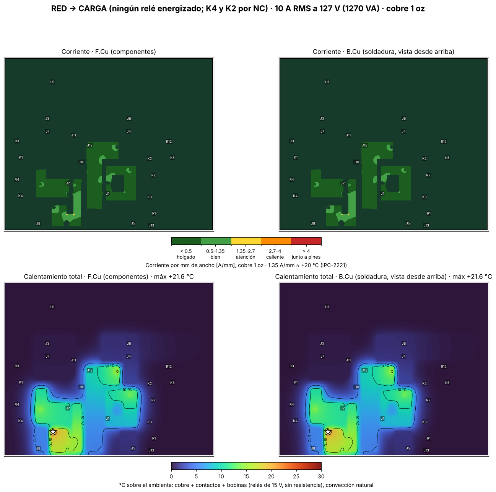
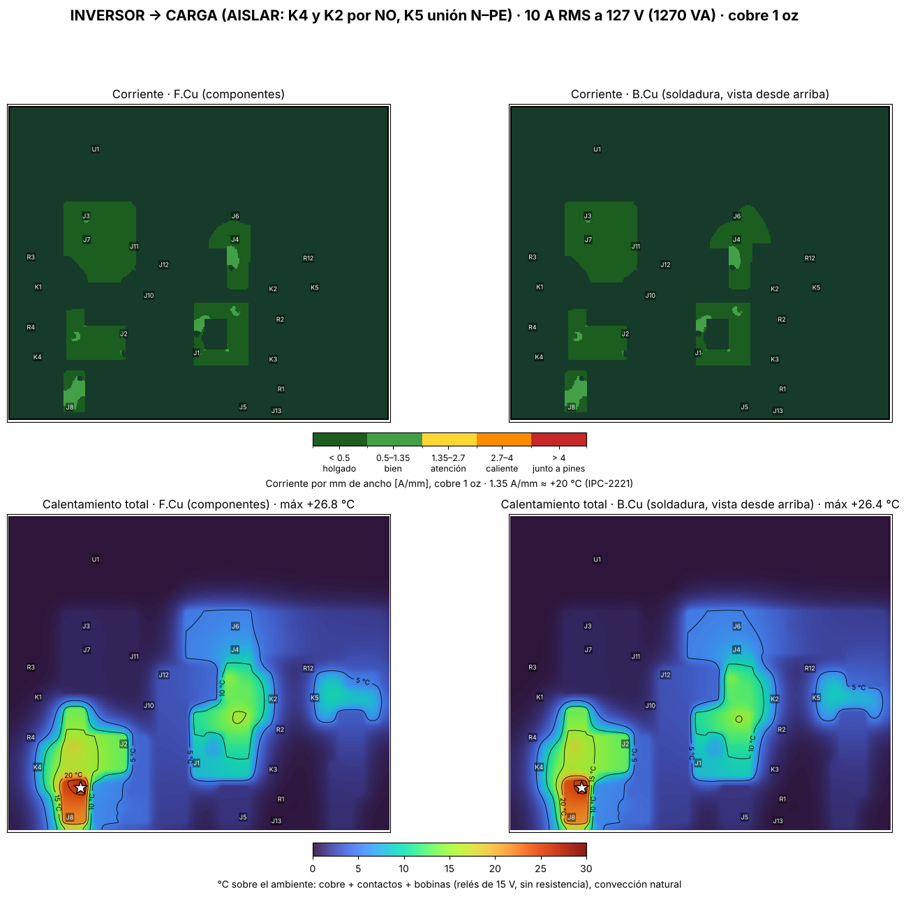
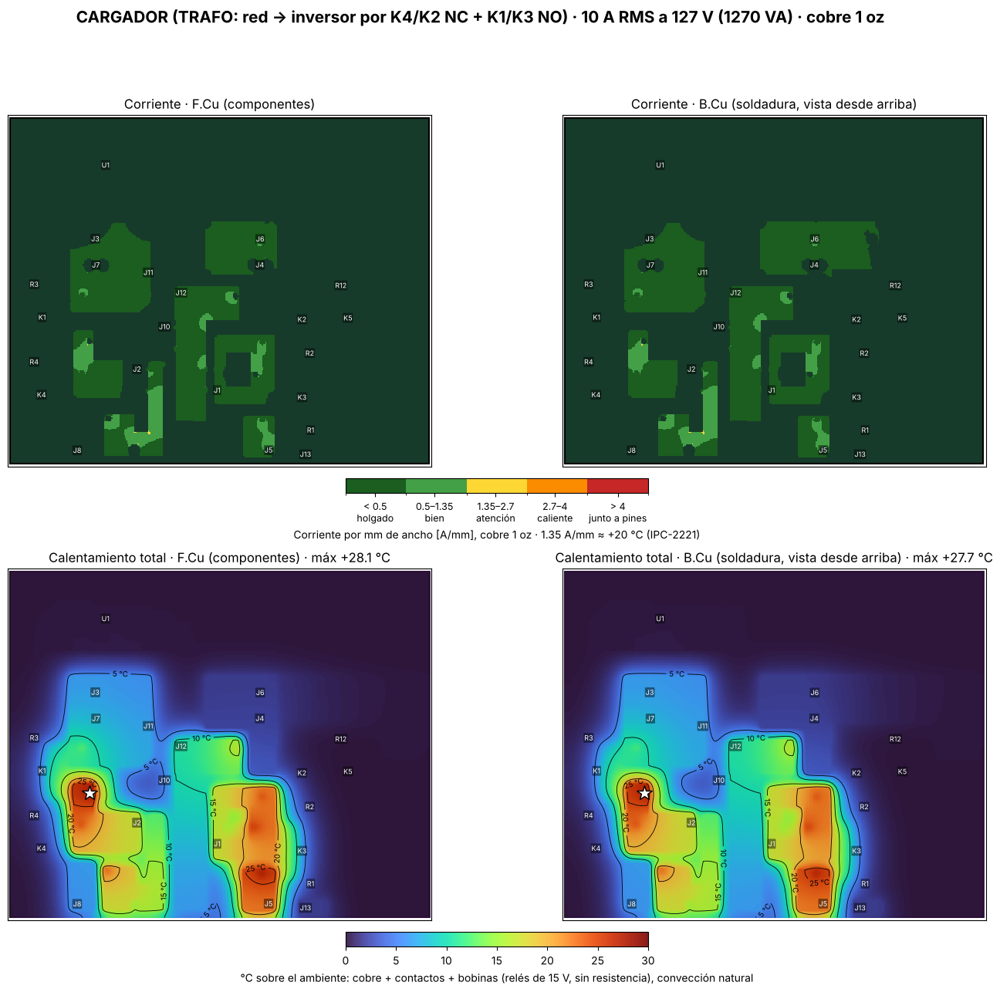

# Auditoría térmica: tarjeta de transferencia de 5 relés

**Tarjeta:** `RELAY_TRANSFER_INV_RED.kicad_pcb` (2026-11-11). **Cobre:** 1 oz (35 µm). **Relés:** bobina de 15 V, sin resistencia en serie (sección 6).
**Condición:** **10 A RMS a 127 V (1270 VA)** continuos, el máximo de diseño.

Usa el mismo método que la auditoría del puente H (`hardware/puente_h/auditoria/`):
1. Reparte la corriente en las zonas de cobre reales: las dos caras, unidas por los pines THT.
2. Calcula el calentamiento con convección natural, sin ventilador.
3. Suma el calor de los **contactos** y de las **bobinas** de los relés.

> **¿El cobre de 1 oz aguanta 10 A continuos, o hay que reforzarlo?**

---

## 1. Resultado

| Modo (DC-019) | Relés energizados | Pérdida en el cobre | Solo cobre | Cobre + relés | Punto más caliente |
| --- | --- | --- | --- | --- | --- |
| **RED → CARGA** | ninguno (K4 y K2 por NC) | 0.33 W | **+8.3 °C** | **+21.6 °C** | Pin NC de K4 (L-GRID) |
| **INVERSOR → CARGA** (AISLAR + TN) | K4, K2, K5 | 0.17 W | +4.1 °C | **+26.8 °C** | Pin NO de K4 (L-INV) |
| **CARGADOR** (TRAFO), 10 A de la red al inversor | K1, K3 | 0.36 W | +8.3 °C | **+28.1 °C** | Pin NO de K1 (L-LOAD) |

**Conclusión: el cobre de 1 oz no necesita refuerzo.** Por sí solo sube como máximo **+8.3 °C** a 10 A. Las zonas son anchas y los caminos cortos; en el puente H, con 33 A, subía +13 °C.

**El calor dominante viene de los relés:** la resistencia de contacto de cada contacto y la bobina de cada relé energizado (0.52 W). El cobre es secundario. Con **40 °C de ambiente**, el pin más caliente queda en **~68 °C**. El relé está especificado para trabajar con hasta **85 °C de ambiente** [1].

**El modo cargador es el peor caso** porque la corriente pasa por **cuatro contactos**: K4 y K2 (NC) y luego K1 y K3 (NO). El cálculo usa los 10 A completos como corriente del cargador, sin carga en la casa. Si en el mismo momento hay carga, L-GRID y N-GRID llevan la suma; **el límite de 10 A es para la corriente total que entra de la red**.

---

## 2. Supuestos

| Dato | Valor usado | De dónde sale |
| --- | --- | --- |
| Corriente | 10 A RMS continua por cada camino | Máximo de diseño (1270 VA) |
| Cobre | 1 oz en las dos caras | Fabricación estándar |
| Resistencia de contacto | **5 mΩ por contacto** (0.5 W a 10 A) | Típica de relés de 30 A. Las hojas de datos solo dan el máximo inicial: **50 mΩ**, medido a 1 A / 6 VDC [1][2] |
| Calor del contacto hacia la tarjeta | 60 %, por los dos pines del contacto cerrado | La lámina del contacto es de aleación de cobre y lleva el calor al pin |
| Bobina | Relé de 15 V, 375 Ω, con ~14 V: **0.52 W**. El 30 % llega a la tarjeta, repartido bajo el cuerpo | [2]. El resto sale al aire por el cuerpo del relé |
| Convección | 10 W/m²·K por cara | Aire quieto, sin ventilador |

---

## 3. Mapas

### RED → CARGA

La corriente de la red entra por J2 (fase) y J1 (neutro) y pasa por los **contactos NC** de K4 y K2. La zona más cargada (**2.6 A/mm**, amarillo) es el **cuello de L-GRID junto a C7**, entre J2 y el pin NC de K4. Es una franja corta, y por eso el cobre solo sube +8 °C.

### INVERSOR → CARGA

La fase del inversor entra por el Faston J7, cruza el **puente de cable J3 → J8** y llega al NO de K4. El neutro va directo: Faston J4 → NO de K2. La carga máxima en el cobre es de 1.2 A/mm.

### CARGADOR

Camino de la fase: red → NC de K4 → nodo de carga → NO de K1 → J7 (transformador). Camino del neutro: red → NC de K2 → nodo de carga → NO de K3 → puente J5 → J6 → J4.

---

## 4. Pérdida y caída por camino (1 oz, 10 A)

| Modo | Camino | Pérdida | Caída | Carga máx. |
| --- | --- | --- | --- | --- |
| Red / cargador | L-GRID: J2 → K4 NC | 149 mW | 14.9 mV | 2.6 A/mm (cuello junto a C7) |
| Red / inversor | L-LOAD: K4 COM → J2 | 39 mW | 3.9 mV | 0.8 A/mm |
| Red / cargador | N-GRID: J1 → K2 NC | 86 mW | 8.6 mV | 1.1 A/mm |
| Red / inversor | N-LOAD: K2 COM → J1 | 51 mW | 5.1 mV | 1.1 A/mm |
| Inversor | L-INV: Faston J7 → puente J3 | 13 mW | 1.3 mV | 0.7 A/mm |
| Inversor | L-INV: puente J8 → K4 NO | 36 mW | 3.6 mV | 1.2 A/mm |
| Inversor | N-INV: Faston J4 → K2 NO | 30 mW | 3.0 mV | 1.1 A/mm |
| Cargador | L-LOAD: K4 COM → K1 NO | 37 mW | 3.7 mV | 1.4 A/mm |
| Cargador | L-INV: K1 COM → Faston J7 | 17 mW | 1.7 mV | 0.7 A/mm |
| Cargador | N-LOAD: K2 COM → K3 NO | 31 mW | 3.1 mV | 1.1 A/mm |
| Cargador | N-INV: K3 COM → puente J5 | 28 mW | 2.8 mV | 1.3 A/mm |
| Cargador | N-INV: puente J6 → Faston J4 | 13 mW | 1.3 mV | 0.6 A/mm |

En cualquier modo, el cobre cae **menos de 30 mV** contra 127 V. **Un solo contacto de 5 mΩ cae 50 mV**, más que todo el cobre junto.

---

## 5. Sensibilidad

| Cambio | Peor caso: solo cobre | Peor caso: cobre + relés |
| --- | --- | --- |
| Base (1 oz, contacto 5 mΩ) | +8.3 °C | +28.1 °C |
| **Cobre 2 oz** | +3.9 °C | +24.2 °C |
| **Contacto desgastado, 15 mΩ** (1.5 W por contacto) | +8.3 °C | **+71.5 °C** ⚠️ |

- **Pasar a 2 oz casi no cambia el total** (−4 °C): no vale la pena.
- **El contacto es lo que decide.** Con contactos de 15 mΩ, en modo cargador el pin llega a **~110 °C con 40 °C de ambiente**. Eso pasa el límite del relé y acelera el desgaste. Por eso la sección 7 pide medir la caída de cada contacto.

---

## 6. Historia: las resistencias de 39 Ω de las bobinas

La primera versión usaba relés de **12 V** (155 Ω) alimentados desde 15 V con **39 Ω** en serie: 77 mA y **0.233 W por resistencia**. En huella **DIN0204 (¼ W)** trabajaban al **93 %**, con el cuerpo a ~120 °C (40 °C de ambiente). Primero se pasaron a ½ W, que quedaba al 47 % y ~80 °C.

**Decisión final (2026-11-11): relés con bobina de 15 V** (familia T90, p. ej. Picker PTRH-1C-15S, 375 Ω [2]), con un **puente de alambre** en el lugar de cada resistencia:
- Ya no hay calor que disipar en serie.
- La bobina baja de 0.93 W a ~0.52 W.
- El voltaje máximo para cerrar es 10.25 V; con ~14 V queda **casi 4 V de margen**.
- Las huellas se conservan, para poner **39 Ω de 1 W** si solo se consigue el L90 de 12 V.

---

## 7. Prueba de banco

1. **Caída en cada contacto:** con 10 A de carga resistiva, mide el voltaje AC entre COM y el contacto cerrado:
   - **< 50 mV:** ✅
   - **50–150 mV:** 👍 vigílalo
   - **> 150 mV:** ⚠️ cambia el relé
2. **Termómetro o cámara térmica** después de **1 hora a 10 A** en modo cargador: ningún pin debe pasar de **+35 °C sobre el ambiente**.
3. **Fastons y bornes:** que no estén más calientes que los pines de los relés. Si lo están, el crimpado está flojo.

---

## Referencias

[1] Rayex/Recoy, *L90 series power relay*: 30 A NO / 20 A NC a 240 VAC, contacto ≤ 50 mΩ inicial, −55 a +85 °C. https://www.rcscomponents.kiev.ua/datasheets/L90RECOY.pdf
[2] Picker Components, *PTRH 30 Amp Power PCB Relay*: bobina de 15 VDC con 375 Ω, cierra con 10.25 V como máximo; 30 A NO / 20 A NC. https://dtsheet.com/doc/1306933/30-amp-power-pcb-relay-ptrh-ot
[3] IPC-2221, relación corriente–ancho–calentamiento (1.35 A/mm ≈ +20 °C en 1 oz).
[4] Solucionador: `hardware/puente_h/auditoria/auditoria_cobre.py`.

**Script:** desde esta carpeta, `python3 auditoria_reles.py ../RELAY_TRANSFER_INV_RED.kicad_pcb ../../puente_h/auditoria/auditoria_cobre.py --oz 1 --amp 10 --rc 0.005`
